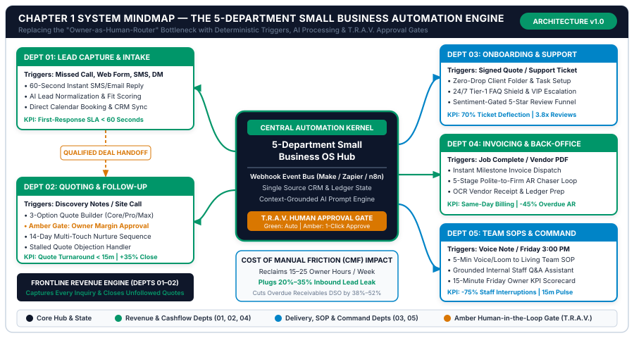
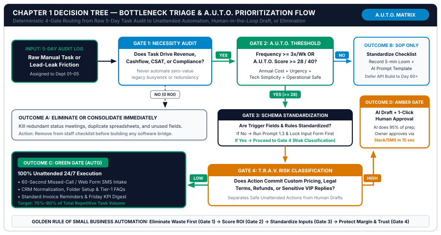

# Chapter 1: The Owner’s Bottleneck: Mapping the 5-Department Automation Engine

**Part I:** Operations Audit & Automation Architecture  
**Core Framework:** *The 5-Department Small Business Engine*, *The Cost of Manual Friction (CMF) Formula*, & *The A.U.T.O. Prioritization Matrix*  
**Companion Workbook:** `05-WORKBOOKS/worksheet-01.md` (*The 5-Day Business Time & Lead-Leak Audit*)  
**Visual Assets:** `chapter-01-mindmap.svg` | `chapter-01-flowchart.svg`  

---

## 1. Learning Objectives

By the end of this chapter, you and your operations lead will be able to execute six measurable operational outcomes:

1. **Diagnose the "Human Router Trap":** Identify the exact structural points where the business owner or senior manager acts as a manual copy-paste bridge between disconnected software tools, staff inquiries, and customer communications.
2. **Map Your Business into the 5-Department Automation Engine:** Categorize every recurring business activity into five deterministic operational departments (`Dept 01` through `Dept 05`), establishing a single source of truth for triggers, inputs, processing rules, human approval gates, and target KPIs.
3. **Calculate Your Exact Annual Cost of Manual Friction (CMF):** Apply the three-part CMF financial formula across administrative payroll hours, delayed-response lead leaks, and uncollected receivables to quantify your true annual dollar loss down to the cent.
4. **Execute a 5-Day Real-Time Task & Lead-Leak Audit:** Deploy `Worksheet 1` across your front desk, sales pipeline, fulfillment team, and billing desk to capture empirical baseline data on weekly task frequency, duration, error rates, and channel response times.
5. **Score and Rank Workflows Using the A.U.T.O. Prioritization Matrix:** Evaluate candidate workflows across four 10-point dimensions (*Annual Financial Impact*, *Urgency/Frequency*, *Technical Simplicity*, and *Operational Safety*) to isolate the top three highest-ROI automations for your first 30-day sprint.
6. **Deploy Five Production-Tested AI Audit & Architecture Prompts:** Run structured prompts (`Prompt 1.1` through `Prompt 1.5`) to synthesize raw task logs, calculate response-time revenue loss, eliminate redundant SaaS subscriptions, and generate a signed 30-Day Quick-Win Automation Charter.

---

## 2. The Real-World Friction Point

At 8:14 AM on a Monday morning, Marcus—the founder of an 11-person residential and light-commercial HVAC service company generating $1.45 million in annual revenue—sits in his truck outside a supply house with two phones on the passenger seat. While waiting for a compressor order to be loaded, he is simultaneously performing six invisible administrative jobs:

* Listening to four voicemails left over the weekend from homeowners whose air conditioning failed on Sunday afternoon, scribbling their phone numbers onto a legal pad, and texting two of them back to ask for their street addresses. (When he calls the other two at 9:30 AM, both inform him they already booked a competing contractor who texted them back within sixty seconds on Sunday.)
* Opening an email notification from his website's contact form, highlighting the prospect's name, phone number, and equipment issue, and pasting those three fields into a Google Sheet and his field-dispatch app.
* Answering a text message from his lead technician asking which equipment warranty tier applies to a customer installed fourteen months ago—forcing Marcus to log into QuickBooks on his phone, search historical invoices, and screenshot the PDF.
* Reviewing rough voice notes he recorded on Friday afternoon for three commercial maintenance bids, knowing he still has to sit down at 8:30 PM tonight to type those notes into Word templates, calculate parts markups, export PDFs, and email them out.
* Wondering whether five residential customers from two weeks ago ever paid their net-7 balance invoices, because nobody in the office had time on Friday to cross-check bank deposits against open invoices and send payment reminders.

Marcus does not have a work ethic problem, nor does he have a customer demand problem. He is trapped inside **The Human Router Trap**.

### Anatomy of the Human Router Trap Across Small Business Verticals

In almost every company operating with **1 to 25 employees**, the business grows faster than its internal data plumbing. When the company had two people and twenty customers, the founder could hold the entire operational state of the business in working memory. As the company scales to six, twelve, or twenty employees—and adds a CRM, an accounting package, a scheduling calendar, a VoIP phone system, a document signer, a shared email inbox, and a team chat app—none of those tools talk to each other automatically.

Instead of building deterministic data bridges and rule-based AI triage layers, the business silently promotes the **owner (or highest-paid office manager) into the central CPU and human integration bus**. Every piece of information that needs to move from one stage of the customer lifecycle to the next must pass through the owner's eyeballs, keyboard, and short-term memory.

Consider how this identical structural bottleneck appears across three distinct small business models:

| Operational Dimension | Archetype A: Local Field & Clinical Services (e.g., 10-Person Dental Clinic or HVAC Firm) | Archetype B: B2B Agency & Professional Practice (e.g., 12-Person Marketing Agency or Law Firm) | Archetype C: Specialized Retail & Custom E-Commerce (e.g., 8-Person Custom Manufacturing / DTC Brand) |
| :--- | :--- | :--- | :--- |
| **Inbound Lead Leak (`Dept 01`)** | 27% of daytime calls hit voicemail while reception checks out patients or dispatches trucks; web forms wait 5+ hours for a callback. | High-value LinkedIn, referral, and web form inquiries sit in a partner's inbox for 18–36 hours while partners are in client meetings. | Custom bulk-order inquiries and Instagram/WhatsApp DMs wait overnight; wholesale buyers abandon carts when sizing/lead-time questions go unanswered. |
| **Quoting & Follow-Up Drag (`Dept 02`)** | Treatment plans or field estimates take 24–72 hours to type up; zero structured follow-up occurs after the initial PDF is emailed. | Senior partners spend 3.5 hours drafting each custom Statement of Work (SOW); 60% of sent proposals receive only one manual "just checking in" email. | Custom quote requests require manual spreadsheet lookups across shipping and material tables; quotes expire in an unmonitored inbox folder. |
| **Onboarding & Support Chaos (`Dept 03`)** | Intake forms are filled out on clipboards or emailed as PDFs and re-typed by staff; post-visit care instructions and review requests are sent sporadically. | Signing a retainer triggers 19 manual steps across Slack, Drive, ClickUp, and Stripe; missing client passwords stall project kickoff by 9 days. | 70% of support tickets ask "Where is my order?" or "Can I change my shipping address?", burying urgent VIP custom-order modifications. |
| **Back-Office Cashflow Lag (`Dept 04`)** | Completed jobs wait until Friday night or Sunday morning to be invoiced; overdue balances sit for 30+ days because staff dislike making collection calls. | Milestone invoices are forgotten when projects finish early; vendor software receipts sit in email inboxes until the bookkeeper chases them at month-end. | B2B net-15 wholesale invoices lack automated payment-link chasers; supplier packing slips and freight bills are manually keyed into Xero/QuickBooks. |
| **Team & Reporting Friction (`Dept 05`)** | Technicians and front-desk staff ask the owner the same policy questions every week; the owner has no Friday visibility into weekly gross margin. | Junior staff interrupt senior partners 15 times a day for SOP clarification; compiling the Friday client & utilization report takes 3 hours of spreadsheet work. | Warehouse and support staff rely on tribal memory for return approvals; the founder spends Sunday afternoon reconciling Shopify, bank feeds, and ad spend. |

### The Double Compounding Penalty: Cognitive Context-Switching and Revenue Decay

The damage inflicted by the Human Router Trap is not limited to the raw hours spent typing. It compounds across two hidden dimensions that silently cap a small business's valuation and net profit margin:

1. **The 23-Minute Cognitive Context-Switching Penalty:** Workplace ergonomics research demonstrates that every time an owner or skilled specialist is interrupted from deep work—such as preparing a high-margin bid, coaching a technician, or treating a patient—to answer a routine staff question or manually copy-paste a lead, it takes an average of **23 minutes and 15 seconds** to return to the original cognitive depth. Twelve five-minute administrative interruptions scattered across a Tuesday do not cost one hour; they consume the entire productive afternoon.
2. **The 60-Second Conversion Cliff:** In digital and local commerce, prospects do not wait politely in a queue after submitting a "Request a Quote" form or hitting voicemail. They open Google Maps or search results in their browser and contact the top three providers simultaneously. Empirical lead-response studies confirm that responding within **60 seconds** increases qualification and booking conversion by **391%** compared to waiting just five minutes, and by more than **2,100% (21x)** compared to waiting thirty minutes. When your lead intake relies on a human noticing an email notification between meetings, your business automatically forfeits 20% to 35% of its paid and organic pipeline to whichever competitor has automated their 60-second intake response.

---

## 3. Why Standard Approaches Fail

When small business owners recognize that manual administration is choking their growth, they typically attempt one of three conventional fixes. In production environments, all three fail—and often leave the business with lower net margins and higher operational chaos than before.

### Failure Mode 1: Hiring Unstructured Administrative Labor ("Throwing Bodies at Broken Plumbing")

The most common reflex is to hire a low-cost virtual assistant (VA), part-time office clerk, or junior coordinator and instruct them to "help manage the inbox, follow up on leads, and keep the spreadsheet updated."

Without deterministic workflows, standardized input schemas, and written Standard Operating Procedures (SOPs), delegating a chaotic manual process to a junior hire fails for three reasons:
* **Tribal Knowledge Dependency:** Because pricing rules, service-area boundaries, scheduling exceptions, and customer history live inside the owner's head, the assistant cannot answer 60% of inbound inquiries without messaging the owner on Slack or WhatsApp to ask, *"How should I reply to this?"* The owner transitions from doing the task directly to managing and proofreading the assistant's questions—saving zero net hours.
* **Human Latency Still Violates the 60-Second Window:** Even a dedicated full-time receptionist works only 40 of the 168 hours in a week (23.8% coverage). Inquiries that arrive at 7:30 PM on Tuesday, during lunch break on Thursday, or at 2:00 PM on Saturday still wait 14 to 48 hours for a response.
* **Key-Person Fragility & Turnover Reset:** Entry-level administrative roles experience 35% to 50% annual turnover. When an assistant leaves after eight months, every unwritten habit evaporates overnight, forcing the owner right back into the chair to rebuild the process from scratch.

### Failure Mode 2: Uncoordinated SaaS "App Sprawl"

The second failed approach is buying a new software subscription every time a new operational pain point surfaces. The owner subscribes to one app for online booking, another for web forms, a third for SMS marketing, a fourth for proposal e-signatures, a fifth for project tasks, and a sixth for customer reviews.

```
THE "APP SPRAWL" TRAP (SILOED SUBSCRIPTIONS WITH HUMAN COPY-PASTE)
[Web Form App] ---> (Owner Copy-Pastes) ---> [CRM App] ---> (Owner Copy-Pastes) ---> [Quote App]
                                                                                          |
[Accounting App] <--- (Owner Copy-Pastes) <--- [Task Board] <--- (Owner Copy-Pastes) <----+
```

Instead of reducing work, isolated SaaS tools multiply the number of databases that must be kept in sync. When a customer changes their phone number or upgrades their scope of work, that change is updated in the quoting tool but forgotten in the CRM and accounting system—resulting in invoices sent to the wrong email address and technicians dispatched with outdated job notes.

### Failure Mode 3: Ad-Hoc "Chat-Box" Prompting ("The Copy-Paste ChatGPT Illusion")

Since 2023, millions of small business owners have opened a browser tab to ChatGPT, Claude, or Gemini and typed one-line instructions such as: *"Write a polite follow-up email to a client who hasn't signed my HVAC quote"* or *"Summarize these meeting notes."*

While ad-hoc chat prompting feels productive for five minutes, it is **not** business automation:
1. **Zero Trigger Automation:** If a human still has to remember that a quote is four days overdue, open a chat window, type the context, copy the response, open their email client, paste the text, fix the formatting, and click send, the human is still the router.
2. **Inconsistent Tone & Hallucinated Terms:** One-line prompts lack system-level role constraints, pricing tables, and negative guardrails. Left unconstrained, a conversational model will invent warranty terms, offer unauthorized discounts, or use generic, overly floral language that immediately signals to a customer that they are reading a bot-generated message.
3. **No Structured Data Output:** A conversational paragraph in a chat window cannot automatically update a CRM deal stage, create a QuickBooks draft invoice, or schedule a Day-7 follow-up task unless the prompt is engineered to return a strict, deterministic schema (such as JSON or a fixed key-value block) connected to a workflow bridge.

| Evaluation Criterion | Fix 1: Unstructured Admin / VA Hire | Fix 2: Disconnected SaaS App Sprawl | Fix 3: Ad-Hoc Chat-Box Prompting | The Studio Solution: 5-Department AI Automation OS |
| :--- | :--- | :--- | :--- | :--- |
| **Coverage Window** | 40 hrs/wk (24% of week) | 24/7 UI, 0% Cross-App Sync | Manual (Only when owner remembers) | **24/7/365 Event-Driven Execution** |
| **First-Response Speed** | 15 mins to 16 hours | Depends on manual login | Manual copy-paste (Hours) | **Under 60 Seconds (Deterministic SLA)** |
| **Monthly Operating Cost** | $2,400 – $4,800 / mo payroll | $600 – $1,800 / mo across 14 apps | $20 / mo (High owner labor cost) | **$40 – $120 / mo total bridge + API cost** |
| **Hallucination / Pricing Risk** | Medium (Untrained staff guesses) | Low (Rigid forms, no intelligence) | High (Unconstrained chat guesses) | **Near-Zero (Grounded + T.R.A.V. Gate)** |
| **Scalability at 2x Volume** | Requires hiring a 2nd coordinator | Doubles manual copy-paste volume | Doubles owner typing time | **Scales from 50 to 5,000 events at ~$0 marginal labor** |

---

## 4. Core Framework: The 5-Department Small Business Engine & Cost of Manual Friction (CMF) Formula

To transform a chaotic 1–25 person company into a self-routing operation without hiring extra administrative staff, we replace ad-hoc tasks with **The 5-Department Small Business Engine**.

Regardless of whether you repair heat pumps, run a multi-provider dental clinic, operate a 15-person B2B agency, or fulfill custom e-commerce orders, every dollar of revenue in your company flows through the exact same **five operational departments**:

### 4.1 Architectural Specification of the 5 Departments

#### `Dept 01`: Lead Capture & Speed-to-Lead Intake
* **Core Mission:** Intercept 100% of inbound inquiries across every channel (phone calls, missed calls, website forms, emails, SMS/WhatsApp, and social DMs) within **60 seconds**, qualify basic fit (service category, location/budget, urgency), and route qualified prospects directly onto the calendar or into `Dept 02`.
* **Primary Triggers:** `Missed_Call_Webhook`, `Web_Form_Submitted`, `Inbound_SMS_Received`, `Lead_Email_Arrived`.
* **Automated Processing Engine:** Instant missed-call text-back concierge, AI lead normalization (extracting clean `First_Name`, `Phone_E164`, `Email`, `Service_Type`, `Urgency_Score`), duplicate contact check in CRM, and instant calendar booking link dispatch.
* **North-Star KPI:** **Median First-Response SLA < 60 Seconds** (24/7/365) and **Lead-to-Qualified-Conversation Rate > 75%**.

#### `Dept 02`: Sales Qualification, Estimating & Follow-Up
* **Core Mission:** Convert discovery notes, site photos, or intake answers into structured **3-Option Estimates / Proposals** (*Core, Pro, Complete*) in under 15 minutes, validate gross margin via an Amber human approval gate, and execute a relentless **14-Day Multi-Touch Nurture Loop** until the prospect signs or explicitly opts out.
* **Primary Triggers:** `Discovery_Call_Completed`, `Field_Tech_Voice_Memo_Uploaded`, `Quote_Status == Sent_Unopened_48h`.
* **Automated Processing Engine:** AI scope-to-line-item calculator grounded in your official pricebook, Amber Slack/SMS approval card for owner 1-click sign-off, automated e-signature dispatch, and behavior-triggered Day 1, Day 3, Day 6, Day 10, and Day 14 value follow-ups.
* **North-Star KPI:** **Quote Turnaround Time < 15 Minutes** and **Proposal Close Rate Lift +25% to +45%**.

#### `Dept 03`: Customer Onboarding, Fulfillment & Support Triage
* **Core Mission:** Execute a **Zero-Drop Handoff** the second a quote is signed or an order is paid, resolve 65% to 80% of repetitive Tier-1 customer support questions automatically using a grounded knowledge base, and route every completed job through a sentiment-gated **5-Star Review & Reactivation Flywheel**.
* **Primary Triggers:** `Quote_Signed_or_Deposit_Paid`, `Support_Ticket_Created`, `Job_Status == Completed`.
* **Automated Processing Engine:** Automated client folder and task-board provisioning, dynamic welcome packet & missing-asset chaser, 3-Tier Support Shield (Tier 1 auto-answer, Tier 2 draft, Tier 3 VIP/angry escalation), and 2-hour post-service SMS sentiment check routing happy clients to Google Reviews.
* **North-Star KPI:** **Onboarding Setup Time < 5 Minutes**, **Tier-1 Support Deflection > 65%**, and **Monthly Verified 5-Star Review Velocity 3.8x**.

#### `Dept 04`: Invoicing, Receivables & Back-Office Administration
* **Core Mission:** Eliminate billing delays by converting completed milestones into itemized invoices immediately, collect overdue accounts receivable automatically via a polite-to-firm 5-stage chaser sequence, and extract vendor PDF receipts into clean bookkeeping staging tables.
* **Primary Triggers:** `Service_Ticket_Marked_Complete`, `Invoice_Due_Date_Offset (-3d, 0d, +3d, +7d, +14d)`, `Vendor_Receipt_Email_Received`.
* **Automated Processing Engine:** Milestone-to-invoice line-item generator, automated Stripe/ACH one-click payment link reminders, OCR + LLM vendor invoice field extractor (`Vendor_Name`, `Invoice_Date`, `Tax_Amount`, `Total_Amount`, `GL_Account_Code`), and monthly subscription anomaly auditor.
* **North-Star KPI:** **Same-Day Invoice Dispatch (100%)** and **Average Days Sales Outstanding (DSO) Reduced by 38%–52%**.

#### `Dept 05`: Team SOPs, Delegation & Weekly Executive Reporting
* **Core Mission:** Turn 5-minute owner voice recordings or screen walkthroughs into standardized step-by-step team SOPs and onboarding quizzes, answer routine internal staff procedural questions via a grounded handbook assistant, and deliver the **15-Minute Friday Owner KPI Scorecard** every Friday at 3:00 PM.
* **Primary Triggers:** `Owner_Loom_or_Voice_Note_Dropped`, `Staff_SOP_Query_Submitted`, `Cron_Schedule == Friday_15:00`.
* **Automated Processing Engine:** Voice-to-SOP Markdown & QA checklist compiler, internal SOP Q&A bot with source citation, and cross-department KPI aggregator pulling weekly leads (`Dept 01`), quote conversion (`Dept 02`), support/reviews (`Dept 03`), cash collected vs. overdue AR (`Dept 04`), and red/amber anomaly recommendations (`Dept 05`).
* **North-Star KPI:** **Internal Staff Procedural Interruptions Reduced by 70%+** and **100% Friday Executive Pulse Completion in 15 Minutes**.

---

### 4.2 Mathematical Derivation of the Cost of Manual Friction (CMF) Formula

Before writing a single prompt or connecting a webhook, an executive must quantify the financial baseline. When small business owners say, *"I don't have time to set up automation this week,"* it is almost always because they view manual friction as "free" (since they or their salaried staff are already working).

In financial reality, manual friction imposes a massive, compounding tax across three distinct P&L lines: **Direct Labor Drag ($L_{\text{tax}}$)**, **Speed-to-Lead Revenue Leakage ($R_{\text{leak}}$)**, and **Receivables & Unbilled Scope Write-Offs ($C_{\text{drag}}$)**.

The master **Annual Cost of Manual Friction (CMF) Formula** is defined as:

$$\text{Annual CMF} = \left(\text{Weekly Manual Hours} \times \text{Blended Hourly Rate} \times 52\right) + \left(\text{Monthly Missed/Delayed Leads} \times \text{Close Rate} \times \text{Average Customer LTV} \times 12\right) + \left(\text{Monthly Late/Uncollected Invoices} \times \text{Write-Off Rate} \times 12\right)$$

Let us break down each of the three mathematical terms and their governing operational variables:

#### Term 1: Annual Manual Labor Tax ($L_{\text{tax}}$)
$$L_{\text{tax}} = H_{\text{weekly}} \times W_{\text{blended}} \times 52$$
* **$H_{\text{weekly}}$ (Weekly Manual Hours):** The sum of all repetitive copy-pasting, manual lead entry, estimate formatting, status chasing, invoice typing, and report compilation across the owner and staff (`Dept 01` through `Dept 05`).
* **$W_{\text{blended}}$ (Blended Hourly Rate):** The weighted average hourly value of the personnel performing those manual tasks:
  $$W_{\text{blended}} = \frac{(H_{\text{owner}} \times W_{\text{owner}}) + (H_{\text{staff}} \times W_{\text{staff}})}{H_{\text{owner}} + H_{\text{staff}}}$$
  * *Owner Valuation Rule:* Never value an owner's time at zero or minimum wage. Calculate $W_{\text{owner}}$ as your target annual executive compensation plus profit contribution divided by 2,000 working hours (minimum **$75/hr** for micro-businesses; **$110–$200/hr** for established clinics, agencies, and trade contractors).
  * *Staff Valuation Rule:* Calculate $W_{\text{staff}}$ as base hourly wage multiplied by **1.22** to account for employer payroll taxes, workers' compensation, paid time off, and workstation overhead.

#### Term 2: Annual Speed-to-Lead & Follow-Up Revenue Leak ($R_{\text{leak}}$)
$$R_{\text{leak}} = M_{\text{delayed}} \times C_{\text{recoverable}} \times \text{LTV}_{\text{avg}} \times 12$$
* **$M_{\text{delayed}}$ (Monthly Missed or Delayed Leads):** The number of monthly inbound phone calls that hit voicemail, web forms answered after 60 minutes, after-hours/weekend inquiries that wait until morning, plus sent quotes that receive fewer than 3 follow-ups.
* **$C_{\text{recoverable}}$ (Net Recoverable Close Rate):** Your normal historical close rate on speed-contacted leads multiplied by a conservative recovery factor (typically **12% to 20% net conversion** of previously leaked inquiries once 60-second intake and 14-day quote nurture are active).
* **$\text{LTV}_{\text{avg}}$ (Average First-Year Customer Lifetime Value):** The gross margin or revenue value of a closed job, treatment plan, agency retainer, or repeat customer over 12 months.

#### Term 3: Annual Receivables & Billing Friction Loss ($C_{\text{drag}}$)
$$C_{\text{drag}} = B_{\text{overdue}} \times D_{\text{writeoff}} \times 12$$
* **$B_{\text{overdue}}$ (Monthly Delayed or Overdue Billing Exposure):** The average monthly dollar volume of completed work that is either billed late, sitting >30 days past due without structured follow-up, or performed as unbilled scope creep.
* **$D_{\text{writeoff}}$ (Effective Write-Off & Cashflow Carrying Rate):** The percentage of overdue/unbilled work that is ultimately written off as bad debt, discounted to force collection, or lost to forgotten change orders (empirically **4.0% to 7.5%** in manual back offices).

---

### 4.3 Worked CMF Calculation Benchmarks Across 3 Small Business Sizes

Examine how the CMF Formula scales across three real-world small business revenue tiers:

| CMF Parameter / Financial Metric | Tier A: Solo / Micro Service Operator (`$250,000 / yr` Revenue, 1–2 Staff) | Tier B: Local Clinic or Field Trade Team (`$850,000 / yr` Revenue, 6 Staff) | Tier C: B2B Agency or Multi-Crew Distributor (`$2,400,000 / yr` Revenue, 18 Staff) |
| :--- | :--- | :--- | :--- |
| **Owner Weekly Manual Admin Hours ($H_{\text{owner}}$)** | 14.0 hrs/wk | 16.5 hrs/wk | 15.0 hrs/wk |
| **Owner Hourly Rate ($W_{\text{owner}}$)** | $75.00 / hr | $110.00 / hr | $165.00 / hr |
| **Staff Weekly Manual Admin Hours ($H_{\text{staff}}$)** | 4.0 hrs/wk | 18.5 hrs/wk | 42.0 hrs/wk |
| **Staff Burdened Hourly Rate ($W_{\text{staff}}$)** | $25.00 / hr | $30.00 / hr | $36.00 / hr |
| **Total Weekly Manual Hours ($H_{\text{weekly}}$)** | **18.0 hrs/wk** | **35.0 hrs/wk** | **57.0 hrs/wk** |
| **Blended Hourly Rate ($W_{\text{blended}}$)** | **$63.89 / hr** | **$67.71 / hr** | **$69.95 / hr** |
| **1. Annual Manual Labor Tax ($L_{\text{tax}}$)** | **$59,800 / yr** | **$123,240 / yr** | **$207,324 / yr** |
| **Monthly Missed / Delayed Leads ($M_{\text{delayed}}$)** | 12 leads / mo | 32 leads / mo | 45 leads / mo |
| **Net Recoverable Close Rate ($C_{\text{recoverable}}$)** | 15.0% (`1.8 deals/mo`) | 15.0% (`4.8 jobs/mo`) | 14.0% (`6.3 deals/mo`) |
| **Average Customer LTV ($\text{LTV}_{\text{avg}}$)** | $1,400 | $1,950 | $4,800 |
| **2. Annual Speed-to-Lead Revenue Leak ($R_{\text{leak}}$)** | **$30,240 / yr** | **$112,320 / yr** | **$362,880 / yr** |
| **Monthly Overdue / Unbilled Exposure ($B_{\text{overdue}}$)** | $6,500 / mo | $24,000 / mo | $68,000 / mo |
| **Write-Off & Unbilled Scope Rate ($D_{\text{writeoff}}$)** | 5.0% (`$325/mo`) | 5.5% (`$1,320/mo`) | 5.0% (`$3,400/mo`) |
| **3. Annual Receivables & Billing Loss ($C_{\text{drag}}$)** | **$3,900 / yr** | **$15,840 / yr** | **$40,800 / yr** |
| **TOTAL ANNUAL COST OF MANUAL FRICTION (CMF)** | **$93,940 / year** | **$251,400 / year** | **$611,004 / year** |
| **CMF as % of Current Gross Revenue** | **37.6% of Revenue** | **29.6% of Revenue** | **25.5% of Revenue** |
| **Conservative 65% Automation Recovery (Yr 1)** | **+$61,061 / yr** | **+$163,410 / yr** | **+$397,153 / yr** |

Look closely at the bottom two rows of that table. Even for a micro-business generating $250,000 a year, manual routing friction silently drains **$93,940 annually** in trapped capacity, missed callers, and uncollected billing. For a 6-person clinic or trade contractor at $850,000 in revenue, the annual friction tax exceeds **$251,400**. Recovering just 65% of that friction through the 5-Department Operating System adds **$61,000 to $397,000+ in annual economic value**—without adding a single dollar to payroll or paid advertising.

---

## 5. Visual Architecture: System Mindmap

The diagram below illustrates the complete **5-Department Small Business Automation Engine**, showing how the central automation kernel replaces the owner as the human router and connects `Dept 01` through `Dept 05` via deterministic webhooks, context-grounded AI prompts, and the **T.R.A.V. Human Approval Gate**.



### Architectural Walkthrough of the System Mindmap

1. **The Central Automation Kernel (`#0F172A` Navy Hub):**
   * At the center of your business sits the **5-Department Small Business OS Hub**, powered by three lightweight, low-cost components:
     * **The Webhook Event Bus (Make.com, Zapier, or n8n):** Listens 24/7 for real-time events across your phone system, website forms, CRM, accounting ledger, and calendar.
     * **The Single Source CRM & Ledger State:** Every contact, deal stage, job status, and invoice ID is stored once in your central CRM/accounting database and referenced by unique ID (`contact_id`, `deal_id`, `invoice_id`)—eliminating manual copy-pasting forever.
     * **The Context-Grounded AI Prompt Engine:** Executes the 50 structured prompts in this book via API, strictly constrained by your pricebook, service area rules, and SOP knowledge base.
2. **The Embedded T.R.A.V. Human Approval Gate (`#D97706` Amber Pill):**
   * Notice that the central hub does **not** allow raw AI outputs to touch high-risk financial or legal commitments unchecked.
   * **Green Gate (Auto Execution):** Standardized acknowledgements, missed-call text-backs, CRM field normalization, folder creation, Tier-1 FAQ replies, and standard invoice reminders execute 100% unattended in under 60 seconds.
   * **Amber Gate (1-Click Human Approval):** Multi-option custom price quotes (`Dept 02`), scope change orders (`Dept 03`), and angry VIP escalations (`Dept 03`) are drafted 95% by the AI and pushed to the owner's phone via Slack, Microsoft Teams, or SMS with an `[Approve & Send]` button that takes 15 seconds to tap.
3. **Left-Hand Revenue Frontline (`Dept 01` & `Dept 02` in `#059669` Operations Emerald):**
   * **`Dept 01` (Lead Capture & Intake)** intercepts every missed call, web form, SMS, and social DM within 60 seconds, normalizes the prospect's data, scores fit, and either books the appointment directly or passes a clean **Qualified Deal Handoff (`#D97706` dashed connector)** directly into **`Dept 02` (Quoting & Follow-Up)**.
   * **`Dept 02`** converts call or field notes into a 3-Option Quote (`Core / Pro / Max`), routes it through the Amber margin gate, and enrolls the prospect in a 14-day multi-touch nurture loop that automatically stops the instant the quote is signed.
4. **Right-Hand Delivery, Cashflow & Command Engine (`Dept 03`, `Dept 04`, `Dept 05`):**
   * **`Dept 03` (Onboarding & Support in `#0284C7` System Cyan)** triggers the moment a quote is signed—provisioning client folders, deflecting 70% of repetitive Tier-1 support tickets, and launching the sentiment-gated 5-star review funnel upon job completion.
   * **`Dept 04` (Invoicing & Back-Office in `#059669` Emerald)** converts completed jobs into immediate same-day invoices, runs the 5-stage overdue receivables chaser loop, and extracts vendor PDF receipts into accounting staging rows.
   * **`Dept 05` (Team SOPs & Command in `#0284C7` Cyan)** converts 5-minute owner voice memos into living team checklists, answers internal staff SOP questions, and compiles the **15-Minute Friday Owner KPI Scorecard** across all five departments every Friday afternoon.

---

## 6. Step-by-Step Implementation Protocol

To transition your company from manual routing to the 5-Department Engine without disrupting daily customer operations, execute this **7-Step Implementation Protocol** during Week 1.

### Step 1: Establish Your 5-Department Single-Source Registry
Before auditing individual tasks, create a single master registry (using the companion Notion OS template in `06-NOTION-TEMPLATES/` or Tab 1 of the Excel Command Center in `06-NOTION-TEMPLATES/Spreadsheets/`) that assigns one primary system of record to each of the five departments:

| Department ID | Operational Function | Primary System of Record (Examples) | Secondary Connected Channels | Designated Department Owner |
| :--- | :--- | :--- | :--- | :--- |
| **`Dept 01`** | Lead Capture & 60s Intake | HubSpot / HighLevel / Pipedrive / Jobber / JaneApp | VoIP Phone (OpenPhone/RingCentral), Web Forms, SMS, Meta/IG DMs | Front-Desk Lead / Sales Coordinator |
| **`Dept 02`** | Estimating, Quotes & Nurture | CRM Deal Pipeline + PandaDoc / Qwilr / ServiceTitan / Practice Ignition | Email (Gmail/Outlook), SMS, Calendly/Cal.com | Managing Owner / Lead Estimator |
| **`Dept 03`** | Onboarding, Support & Reviews | Notion / ClickUp / Asana + Shared Inbox (HelpScout / Gorgias / Front) | Google Drive, Slack, Google Business Profile | Operations Lead / Customer Success |
| **`Dept 04`** | Invoicing, AR & Bookkeeping | QuickBooks Online / Xero / Stripe Billing / FreshBooks | ACH/Card Payment Links, Dedicated `receipts@` Inbox | Office Admin / Bookkeeper |
| **`Dept 05`** | Team SOPs & Friday Scorecard | Notion SOP Vault / Google Workspace + Friday Pulse Dashboard | Loom / Voice Memos, Internal Team Slack/Teams Channel | Managing Owner |

### Step 2: Deploy the 5-Day Real-Time Friction Audit (`Worksheet 1 — Part A`)
Distribute `Worksheet 1` (`05-WORKBOOKS/worksheet-01.md`) to yourself and up to three key team members (your receptionist/admin, lead estimator/account manager, and fulfillment coordinator).
* **Execution Rule:** Do not ask staff to "guess" how they spend their week. Have every participant log repetitive tasks at three fixed checkpoints each day (**11:00 AM, 2:30 PM, and 5:00 PM**) for five consecutive business days.
* **Required Fields per Entry:** Task description, Department tag (`01–05`), apps touched, weekly frequency, minutes per occurrence, and a `1–5` frustration/error score.

### Step 3: Run the 30-Day Historical Speed-to-Lead & Follow-Up Audit (`Worksheet 1 — Part B`)
On Day 2 of your audit, inspect the last 30 days of inbound inquiries across all entry points:
1. Export your VoIP call log and filter for `Status == Missed` or `Voicemail`. Count how many callers received a text or callback within 60 seconds versus how many waited 1+ hours or never called back.
2. Open your website form submission log (`WPForms`, `Typeform`, `Squarespace`, `HubSpot Forms`, `Shopify Contact`) and compare the `Submitted_At` timestamp against the `First_Replied_At` timestamp in your Sent Mail folder.
3. Open your Sent Quotes / Proposals folder from the past 60 days. Count how many unaccepted quotes received **5 or more structured follow-ups** versus how many were abandoned after 0 or 1 follow-up.

### Step 4: Normalize Cross-Department Data Contracts (JSON Webhook Standard)
The secret to eliminating copy-pasting across `Dept 01` through `Dept 05` is enforcing a **Standardized Lead & Job Payload Contract**. Whenever your automation bridge (Make, Zapier, or n8n) captures an event in `Dept 01`, it normalizes the data into a single clean JSON object that every downstream department can read without human re-typing:

```json
{
  "event_id": "evt_2026_10_21_88492",
  "timestamp_utc": "2026-10-21T14:22:08Z",
  "department_origin": "DEPT_01_INTAKE",
  "source_channel": "MISSED_CALL_SMS_CONCIERGE",
  "business_vertical": "HOME_SERVICES_HVAC",
  "contact": {
    "first_name": "Rachel",
    "last_name": "Thornton",
    "phone_e164": "+15125550194",
    "email": "r.thornton@example.com",
    "postal_code": "78704",
    "sms_opt_in_verified": true
  },
  "qualification": {
    "service_category": "AC_COMPRESSOR_NO_COOLING",
    "urgency_tier": "URGENT_SAME_DAY",
    "estimated_deal_value_usd": 1850.00,
    "within_service_area": true,
    "lead_fit_score": 92
  },
  "routing_control": {
    "trav_risk_gate": "GREEN_AUTO_EXECUTE",
    "instant_sms_sent_at": "2026-10-21T14:22:39Z",
    "response_sla_seconds": 31,
    "assigned_owner_role": "DISPATCH_COORDINATOR",
    "next_department_handoff": "DEPT_02_QUOTING"
  }
}
```

Notice how this 28-line payload completely eliminates human transcription:
* `phone_e164` (`+15125550194`) is formatted once so SMS tools, WhatsApp, and CRM dialers never fail on parentheses or dashes.
* `response_sla_seconds: 31` proves mathematically for your Friday Owner Scorecard (`Dept 05`) that the lead was answered in 31 seconds—well inside the 60-second conversion window.
* `trav_risk_gate: "GREEN_AUTO_EXECUTE"` instructs the automation bridge that this standard intake acknowledgement is approved for immediate 24/7 execution without waking the owner.

### Step 5: Compute Your Baseline Cost of Manual Friction (`Prompt 1.1` & `Prompt 1.2`)
On Friday morning of Week 1, feed your completed 5-Day Task Friction Log and your 30-Day Speed-to-Lead numbers into **Prompt 1.1** and **Prompt 1.2** (provided in Section 8 below), or enter them directly into **Part C of Worksheet 1**. Record your exact baseline figures for:
* **Component 1:** Annual Manual Labor Tax ($L_{\text{tax}}$)
* **Component 2:** Annual Speed-to-Lead Revenue Leak ($R_{\text{leak}}$)
* **Component 3:** Annual Receivables & Billing Loss ($C_{\text{drag}}$)
* **Total Baseline Annual CMF ($)**

### Step 6: Score Candidate Workflows via the A.U.T.O. Prioritization Matrix (`Prompt 1.3`)
Take the top 10 to 15 friction points identified in your audit and score each workflow on a `1–10` scale across the four **A.U.T.O.** dimensions (Maximum Score = `40`):

$$\text{A.U.T.O. Score} = \text{Annual Impact } (1\text{–}10) + \text{Urgency/Frequency } (1\text{–}10) + \text{Technical Simplicity } (1\text{–}10) + \text{Operational Safety } (1\text{–}10)$$

| A.U.T.O. Dimension | Score `8–10` (High Priority) | Score `4–7` (Medium Priority) | Score `1–3` (Low Priority / Defer) |
| :--- | :--- | :--- | :--- |
| **`A` — Annual Financial Impact** | Recovers `>$1,500/mo` in leaked revenue OR saves `>3.5 hrs/wk` of owner/senior time. | Recovers `$400–$1,500/mo` OR saves `1.5–3.5 hrs/wk` of staff time. | Saves `<1 hr/wk` with no direct revenue or cashflow impact. |
| **`U` — Urgency & Frequency** | Fires `15+ times/week` OR requires a `<60-second` speed-to-lead SLA. | Fires `3–14 times/week` on a predictable daily/weekly schedule. | Fires `<2 times/week` or only once a quarter. |
| **`T` — Technical Simplicity** | Standard webhook/email trigger + 1 AI prompt + native CRM/SMS action (`<2 hrs` to build). | Requires 3–5 step conditional branching across 3 cloud apps (`2–5 hrs` to build). | Requires custom API authentication, legacy desktop scraping, or complex regex. |
| **`O` — Operational Safety** | `Green Gate` safe (acknowledgements, internal prep, CRM sync) OR simple 1-click `Amber Gate`. | Requires human review of multi-variable calculations before client dispatch. | High legal, clinical, or regulatory liability if any field is misstated. |

### Step 7: Lock Your Top 3 Quick-Win Workflows into a 30-Day Sprint Charter (`Prompt 1.5`)
Strict operational rule: **Never allow your team to build more than three automations in your first 30 days—and never build more than one workflow per week.**
Select the top three workflows scoring **`32/40` or higher** on the A.U.T.O. Matrix:
* **Week 1 Build (Days 1–7):** Highest-scoring `Dept 01` Speed-to-Lead workflow (typically *Instant Missed-Call & Web Form 60-Second SMS/Email Intake*).
* **Week 2 Build (Days 8–14):** Highest-scoring `Dept 02` or `Dept 04` cashflow workflow (typically *14-Day Multi-Touch Quote Follow-Up Loop* or *5-Stage Overdue Invoice Payment Chaser*).
* **Week 3 Build (Days 15–21):** Highest-scoring `Dept 03` or `Dept 05` capacity workflow (typically *Zero-Drop Client Onboarding Provisioning* or *Tier-1 FAQ Support Shield*).
* **Week 4 Verification & Baseline Lock (Days 22–30):** Audit live execution logs, tune prompt guardrails, and measure your first 30-day CMF reduction on your Friday Owner Scorecard.

---

## 7. Operational Decision Tree

Not every manual task logged during your 5-day audit should be turned into an AI workflow. One of the most expensive mistakes a small business owner can make is **automating a process that should never exist in the first place**, or **deploying an unreviewed AI bot on a high-risk pricing decision**.

Use the **Operational Bottleneck Triage & A.U.T.O. Prioritization Decision Tree** below to route every single task from your 5-day audit into one of four deterministic outcomes (`Outcome A` through `Outcome D`).



### Gate-by-Gate Walkthrough of the Decision Tree

#### Gate 1: The Necessity & Value Audit (*Does This Task Drive Revenue, Cashflow, CSAT, or Compliance?*)
* **The Question:** If our company completely stopped performing this task tomorrow morning, would a customer notice, would revenue drop, would cash collection slow down, or would we violate a legal/accounting requirement?
* **If `NO` (`0 ROI`) -> Route to `Outcome A: Eliminate or Consolidate Immediately`:**
  * Examples: Maintaining a secondary Excel tracker that duplicates data already inside QuickBooks; holding a 45-minute Tuesday morning status meeting where staff read aloud tasks that are already visible on the project board; asking customers to fill out a 14-field intake form when only 5 fields are ever used.
  * **Action:** Delete the spreadsheet, cancel the redundant meeting, or cut the unused form fields today. Never build an AI bridge for legacy busywork.
* **If `YES` -> Advance to `Gate 2`.**

#### Gate 2: The A.U.T.O. Frequency & Threshold Check (*Frequency >= 3x/Week OR A.U.T.O. Score >= 28/40?*)
* **The Question:** Does this task occur at least three times per week, or does its combined A.U.T.O. score reach at least **28 out of 40** (for example, a lower-frequency task that carries massive speed-to-lead revenue impact)?
* **If `NO` (`Score < 28` and Low Frequency) -> Route to `Outcome B: Standardize SOP + Prompt Template Only`:**
  * Examples: Preparing an annual state business license renewal; formatting a quarterly partner tax distribution memo; ordering seasonal branded uniforms twice a year.
  * **Action:** Do not spend hours building an automated webhook pipeline for a twice-a-year task. Record a 5-minute Loom video, run `Prompt 9.1` to generate a clean 1-page checklist SOP, store a reusable AI prompt template in your Notion vault, and defer any API automation past Day 60.
* **If `YES` (`Score >= 28/40`) -> Advance to `Gate 3`.**

#### Gate 3: The Input/Output Schema Standardization Gate (*Are Trigger Fields & Rules Standardized?*)
* **The Question:** Before connecting an AI model or webhook, do we have a fixed, unambiguous set of input fields and business rules?
* **Why This Gate Is Non-Negotiable:** If three different sales reps write discovery notes in completely different formats, or if your pricing rules are "whatever the owner feels like charging that day," an AI workflow will amplify the inconsistency.
* **Action:** Lock the input form fields (e.g., standardizing your web form, intake questionnaire, or pricebook table using `Prompt 1.3`) before advancing to `Gate 4`.

#### Gate 4: The T.R.A.V. Financial & Reputational Risk Evaluation (*Does This Action Commit Custom Pricing, Legal Terms, Refunds, or Sensitive VIP Replies?*)
* **The Question:** What is the worst-case operational consequence if the AI output contains a subtle nuance error?
* **If `LOW RISK` -> Route to `Outcome C: Green Gate (100% Unattended 24/7 Execution)`:**
  * Examples: Sending an instant 60-second SMS acknowledgement to a missed caller asking how you can help; normalizing a web form into CRM fields; creating a client Google Drive folder from a template; answering a standard Tier-1 FAQ ("What is your street address and parking policy?"); sending a polite Day -3 or Day +3 invoice payment link reminder; compiling the internal Friday Owner KPI Scorecard.
  * **Target Volume:** **70% to 80%** of all repetitive small business task volume belongs in `Outcome C`.
* **If `HIGH RISK` -> Route to `Outcome D: Amber Gate (AI Draft + 1-Click Human Approval)`:**
  * Examples: Dispatching a binding $8,500 custom project proposal or treatment plan; approving a customer refund or credit memo above $100; replying to an angry customer threatening a chargeback or regulatory complaint; modifying legal contract clauses.
  * **Execution Mechanics:** The AI automation still performs **95% of the heavy lifting** (pulling the customer history, calculating the line items, formatting the 3-option quote PDF, and drafting the personalized email), and then pauses at an **Amber Approval Gate (`#D97706`)**. The owner receives a single Slack/SMS notification card showing the summary and draft, and either taps **`[Approve & Send]`** (15 seconds) or **`[Edit Draft]`**.


---

## 8. Tested AI Workflow Prompts

This section provides the **five foundational AI workflow prompts** for Chapter 1 (`Prompt 1.1` through `Prompt 1.5`). Each prompt is engineered as a deterministic, multi-variable prompt contract with explicit role grounding, bracketed input variables (`[UPPERCASE_BRACKETS]`), strict negative guardrails, structured output schemas, and realistic production sample outputs.

---

### Prompt 1.1: 5-Day Time & Task Log Synthesizer & Cost of Manual Friction (CMF) Calculator

* **Objective:** Transform raw, unstructured 5-day task notes from the business owner and staff into a clean, categorized **5-Department Task Inventory** and compute the exact **Annual Manual Labor Tax ($L_{\text{tax}}$)** and **Total Annual CMF**.
* **Department & Trigger:** `Dept 05: Team SOPs & Executive Command` — Triggered manually at the end of Week 1 (or via Friday audit form submission) after completing Part A of `Worksheet 1`.
* **Input Variables:**
  * `[BUSINESS_NAME]`: Legal or operating name of the business.
  * `[INDUSTRY_VERTICAL]`: Primary business model (e.g., `Residential HVAC & Plumbing`, `Multi-Provider Dental Clinic`, `B2B Performance Marketing Agency`, `Custom DTC & Wholesale Apparel`).
  * `[TEAM_HEADCOUNT]`: Number of FTE staff including the owner.
  * `[ANNUAL_GROSS_REVENUE]`: Current trailing 12-month revenue.
  * `[OWNER_HOURLY_RATE]`: Effective hourly valuation of the owner (e.g., `$115.00`).
  * `[STAFF_BURDENED_HOURLY_RATE]`: Average burdened hourly wage of admin/coordinator staff (e.g., `$32.00`).
  * `[RAW_5_DAY_TASK_NOTES]`: Unstructured or semi-structured task log entries from the week.
  * `[MONTHLY_MISSED_OR_DELAYED_LEADS]`: Estimated monthly inquiries answered after 60 minutes or missed.
  * `[NET_RECOVERABLE_CLOSE_RATE]`: Decimal net conversion rate on recovered leads (e.g., `0.15`).
  * `[AVERAGE_CUSTOMER_LTV]`: First-year customer value or job size in dollars.
  * `[MONTHLY_OVERDUE_RECEIVABLES]`: Average monthly invoices past 30 days or unbilled scope.
  * `[WRITEOFF_DRAG_RATE]`: Decimal bad-debt/unbilled loss rate (e.g., `0.055`).

#### Copy-Ready System & User Prompt Block (`Prompt 1.1`)
```markdown
### SYSTEM ROLE
You are a Senior Chief Operating Officer and Small Business Automation Architect specializing in 1-to-25 person enterprises. Your job is to audit raw 5-day time logs, classify every repetitive manual activity into the 5-Department Small Business Engine, and compute an audited Cost of Manual Friction (CMF) financial model.

### BUSINESS CONTEXT & INPUT VARIABLES
- Business Name: [BUSINESS_NAME]
- Industry Vertical: [INDUSTRY_VERTICAL]
- Team Headcount: [TEAM_HEADCOUNT]
- Annual Gross Revenue: [ANNUAL_GROSS_REVENUE]
- Owner Effective Hourly Rate: [OWNER_HOURLY_RATE]
- Staff Burdened Hourly Rate: [STAFF_BURDENED_HOURLY_RATE]
- Monthly Missed/Delayed Leads (>60m response): [MONTHLY_MISSED_OR_DELAYED_LEADS]
- Net Recoverable Close Rate: [NET_RECOVERABLE_CLOSE_RATE]
- Average Customer First-Year LTV: [AVERAGE_CUSTOMER_LTV]
- Monthly Overdue Receivables / Unbilled Scope: [MONTHLY_OVERDUE_RECEIVABLES]
- Receivables Write-Off & Drag Rate: [WRITEOFF_DRAG_RATE]

### RAW 5-DAY TASK LOG
[RAW_5_DAY_TASK_NOTES]

### EXECUTION RULES & GUARDRAILS
1. Group and deduplicate all raw log entries into the exact 5 Studio Departments:
   - Dept 01: Lead Capture & Speed-to-Lead Intake
   - Dept 02: Sales Qualification, Estimating & Follow-Up
   - Dept 03: Customer Onboarding, Fulfillment & Support Triage
   - Dept 04: Invoicing, Receivables & Back-Office Administration
   - Dept 05: Team SOPs, Delegation & Weekly Executive Reporting
2. Calculate Weekly Hours for each task using: (Weekly Frequency * Minutes per Event) / 60. Round to 2 decimal places.
3. Compute Component 1 (Annual Manual Labor Tax), Component 2 (Annual Speed-to-Lead Revenue Leak), Component 3 (Annual Receivables & Billing Loss), and Total Annual CMF using the exact studio formula:
   Annual CMF = (Weekly Manual Hours * Blended Hourly Rate * 52) + (Monthly Missed/Delayed Leads * Net Close Rate * Avg Customer LTV * 12) + (Monthly Overdue Invoices * Write-Off Rate * 12).
4. Never invent numbers outside the provided inputs; if a task duration is a range (e.g., "10-15 mins"), use the midpoint (12.5 mins) and state the assumption explicitly.
5. Do not use generic corporate filler or banned AI clichés. Output strictly in the schema below.

### REQUIRED OUTPUT SCHEMA
1. **Normalized 5-Department Task Inventory Table** (Columns: `Task_ID`, `Dept_Code`, `Standardized_Workflow_Name`, `Role`, `Freq_Wk`, `Mins_Event`, `Weekly_Hours`, `Annual_Labor_Cost`, `Recommended_TRAV_Gate`).
2. **Departmental Bandwidth Roll-Up Table** (Columns: `Department`, `Owner_Hours_Wk`, `Staff_Hours_Wk`, `Total_Hours_Wk`, `Pct_of_Total_Load`, `Annual_Dept_Payroll_Drag`).
3. **Audited Annual Cost of Manual Friction (CMF) Financial Statement** (Showing Component 1, Component 2, Component 3, Total Annual CMF, CMF as % of Gross Revenue, and Conservative 65% First-Year Recovery Target).
```

#### Realistic Sample Output (`Prompt 1.1`)
> **1. Normalized 5-Department Task Inventory Table (`Apex Comfort HVAC — 11 Staff`)**
>
> | Task_ID | Dept_Code | Standardized_Workflow_Name | Role | Freq_Wk | Mins_Event | Weekly_Hours | Annual_Labor_Cost | Recommended_TRAV_Gate |
> | :--- | :--- | :--- | :--- | :--- | :--- | :--- | :--- | :--- |
> | `T-01` | `Dept 01` | Voicemail Transcription & Missed-Call Callback | Owner | 24x | 7.5m | 3.00 hrs | $17,940.00 | `Green Auto` (SMS Concierge) |
> | `T-02` | `Dept 01` | Web Form Copy-Paste to Dispatch CRM | Admin | 20x | 6.0m | 2.00 hrs | $3,328.00 | `Green Auto` (Webhook Sync) |
> | `T-03` | `Dept 02` | Evening 3-Tier Equipment Estimate Drafting | Owner | 11x | 28.0m | 5.13 hrs | $30,677.40 | `Amber Draft` (1-Click Approve) |
> | `T-04` | `Dept 02` | Manual Unopened Quote Follow-Up Chasers | Owner | 15x | 8.0m | 2.00 hrs | $11,960.00 | `Green Auto` (14-Day Loop) |
> | `T-05` | `Dept 03` | Warranty Registration & Post-Install Review Ask | Admin | 14x | 12.0m | 2.80 hrs | $4,659.20 | `Green Auto` (Sentiment Funnel) |
> | `T-06` | `Dept 04` | Friday Batch Job Invoicing & Overdue AR Reminders | Owner/Admin | 18x | 15.0m | 4.50 hrs | $19,890.00 | `Green Auto` (Same-Day Billing) |
> | `T-07` | `Dept 05` | Technician Warranty/Spec Lookups & Friday KPI Pull | Owner | 16x | 11.0m | 2.93 hrs | $17,521.40 | `Green Auto` (SOP Bot + Pulse) |
>
> **2. Audited Annual Cost of Manual Friction (CMF) Financial Statement**
> * **Component 1 — Annual Manual Labor Tax ($L_{\text{tax}}$):** `22.36 hrs/wk` (`15.56 Owner hrs @ $115/hr` + `6.80 Admin hrs @ $32/hr`) × 52 weeks = **$105,976.00 / yr**
> * **Component 2 — Annual Speed-to-Lead Revenue Leak ($R_{\text{leak}}$):** `34 delayed/missed leads/mo` × `0.15 net recovery` × `$2,900 avg job/LTV` × 12 months = **$177,480.00 / yr**
> * **Component 3 — Annual Receivables & Billing Loss ($C_{\text{drag}}$):** `$28,500 monthly overdue AR` × `0.055 write-off/drag rate` × 12 months = **$18,810.00 / yr**
> * **TOTAL ANNUAL COST OF MANUAL FRICTION (CMF):** **$302,266.00 / year** (`20.8%` of $1.45M Gross Revenue)
> * **Conservative 65% First-Year Automation Recovery Target:** **+$196,472.90 / year**

---

### Prompt 1.2: Inbound Lead-Leak & Response-Time Revenue Loss Diagnostic

* **Objective:** Audit 30-day multi-channel inbound lead logs (phone calls, web forms, emails, SMS/WhatsApp, and social DMs), quantify conversion decay across response-time buckets (`<1m`, `1–5m`, `5–30m`, `30–60m`, `>60m`, and `Unanswered`), and prescribe an exact **60-Second SLA Recovery Plan**.
* **Department & Trigger:** `Dept 01: Lead Capture & Speed-to-Lead Intake` — Triggered during Step 3 of the Chapter 1 Audit (`Worksheet 1 — Part B`).
* **Input Variables:**
  * `[BUSINESS_NAME]`: Operating name of the company.
  * `[CHANNEL_VOLUME_AND_SLA_DATA]`: Channel-by-channel monthly lead counts, average daytime response times, after-hours response times, and missed-call percentages.
  * `[BASELINE_FAST_CLOSE_RATE]`: Historical conversion rate when a prospect is reached within 5 minutes (e.g., `28%`).
  * `[AVERAGE_DEAL_VALUE]`: Average initial transaction or first-year contract value (e.g., `$2,400`).
  * `[MONTHLY_AD_SPEND]`: Monthly paid marketing spend across Google, Meta, directories, or SEO (e.g., `$4,500/mo`).

#### Copy-Ready System & User Prompt Block (`Prompt 1.2`)
```markdown
### SYSTEM ROLE
You are a Revenue Operations (RevOps) Data Scientist and Speed-to-Lead Conversion Auditor for small businesses. You analyze multi-channel inquiry logs against empirical response-time decay curves to quantify leaked pipeline and wasted advertising spend.

### INPUT VARIABLES
- Business Name: [BUSINESS_NAME]
- Channel Volume & Response Time Data:
[CHANNEL_VOLUME_AND_SLA_DATA]
- Baseline Fast-Response Close Rate (<5 mins): [BASELINE_FAST_CLOSE_RATE]
- Average Deal / Customer Value: [AVERAGE_DEAL_VALUE]
- Monthly Marketing / Ad Spend: [MONTHLY_AD_SPEND]

### EXECUTION RULES & GUARDRAILS
1. Evaluate each channel against the 60-Second Studio SLA Benchmark:
   - Bucket A (<60 seconds): 100% of baseline close potential preserved.
   - Bucket B (1 to 5 minutes): 78% of baseline close potential preserved.
   - Bucket C (5 to 30 minutes): 35% of baseline close potential preserved.
   - Bucket D (30 minutes to 4 hours): 14% of baseline close potential preserved.
   - Bucket E (>4 hours or Unanswered Voicemail): 4% of baseline close potential preserved (96% decay).
2. Calculate Wasted Monthly Ad Spend by multiplying `[MONTHLY_AD_SPEND]` by the percentage of total inbound inquiries falling into Buckets D and E.
3. Provide a JSON configuration specification for the #1 highest-impact 60-second response workflow to deploy in Week 1.
4. Maintain strict analytical precision; use zero banned AI clichés.

### REQUIRED OUTPUT SCHEMA
1. **Channel-by-Channel Lead Leak & Ad-Spend Decay Table** (Columns: `Channel`, `Monthly_Leads`, `Current_Median_SLA`, `Response_Decay_Bucket`, `Leaked_Leads_Mo`, `Monthly_Revenue_Lost`, `Annualized_Revenue_Lost`).
2. **Paid Advertising Efficiency Audit** (`Effective Cost Per Lead` vs. `True Cost Per Contacted Lead` and `Monthly Wasted Ad Dollars`).
3. **Week-1 60-Second SLA Remediation Blueprint (JSON Trigger-to-Action Spec)**.
```

#### Realistic Sample Output (`Prompt 1.2`)
> **1. Channel-by-Channel Lead Leak & Ad-Spend Decay Table (`BrightSmile Dental & Ortho`)**
>
> | Channel | Monthly_Leads | Current_Median_SLA | Response_Decay_Bucket | Leaked_Leads_Mo | Monthly_Revenue_Lost | Annualized_Revenue_Lost |
> | :--- | :--- | :--- | :--- | :--- | :--- | :--- |
> | Phone (Daytime Missed) | 42 | 3.8 hrs | Bucket D (86% decay) | 18.5 leads | $11,100 | $133,200 |
> | Phone (After-Hours/Wknd) | 28 | 19.5 hrs | Bucket E (96% decay) | 16.0 leads | $9,600 | $115,200 |
> | Website Booking Request | 55 | 4.2 hrs | Bucket E (96% decay) | 21.0 leads | $12,600 | $151,200 |
> | Instagram / FB DMs | 19 | 11.0 hrs | Bucket E (96% decay) | 7.5 leads | $4,500 | $54,000 |
> | **TOTAL PIPELINE** | **144 / mo** | **Weighted: 6.4 hrs** | **Buckets D & E** | **63.0 leads/mo** | **$37,800 / mo** | **$453,600 / yr** |
>
> **2. Paid Advertising Efficiency Audit**
> * **Nominal Cost Per Lead (CPL):** `$4,500 / 144 leads` = **$31.25 per raw inquiry**
> * **True Cost Per Speed-Contacted Lead:** `$4,500 / 81 timely-contacted leads` = **$55.56 per live conversation** (**43.7% of monthly ad budget—$1,968.75/month—is currently burned on unreturned or late-returned inquiries**).
>
> **3. Week-1 60-Second SLA Remediation Blueprint**
> ```json
> {
>   "workflow_id": "DEPT01_60SEC_PATIENT_CONCIERGE",
>   "triggers": ["VOIP_CALL_MISSED", "WEB_APPOINTMENT_FORM_SUBMITTED"],
>   "sla_target_seconds": 45,
>   "trav_gate": "GREEN_AUTO_EXECUTE",
>   "sms_template": "Hi {{first_name}}, this is the automated concierge desk at BrightSmile Dental. We saw we just missed your inquiry! Are you looking for (1) an Emergency Exam, (2) a New Patient Cleaning/Consult, or (3) Invisalign/Ortho pricing? Reply 1, 2, or 3 and we will text you our next open times right now."
> }
> ```

---

### Prompt 1.3: 5-Department Workflow Bottleneck Mapper & A.U.T.O. Priority Scorer

* **Objective:** Take 8 to 15 candidate manual workflows identified during the audit, score each one objectively across the four **A.U.T.O.** criteria (`Annual Cost Impact`, `Urgency/Frequency`, `Technical Simplicity`, `Operational Safety`), classify its **T.R.A.V. Gate** (`Green` vs. `Amber`), and isolate the **Top 3 Sprint-1 Automations**.
* **Department & Trigger:** `Dept 05: Team SOPs & Executive Command` — Triggered on Friday of Week 1 (`Worksheet 1 — Part D`) before building any workflows.
* **Input Variables:**
  * `[BUSINESS_NAME]`: Operating name of the company.
  * `[CURRENT_TECH_STACK]`: List of software tools currently used (e.g., `OpenPhone, Google Workspace, HubSpot Starter, QuickBooks Online, Notion`).
  * `[CANDIDATE_WORKFLOW_LIST]`: List of 8–15 manual workflows with weekly hours and revenue/cashflow context.

#### Copy-Ready System & User Prompt Block (`Prompt 1.3`)
```markdown
### SYSTEM ROLE
You are a Lead Systems Engineer and Automation Portfolio Manager. You evaluate candidate small business workflows using the deterministic A.U.T.O. Prioritization Matrix (40-point scale) and the 4-Gate Operational Decision Tree from Chapter 1.

### INPUT VARIABLES
- Business Name: [BUSINESS_NAME]
- Current Tech Stack: [CURRENT_TECH_STACK]
- Candidate Workflow List:
[CANDIDATE_WORKFLOW_LIST]

### EXECUTION RULES & GUARDRAILS
1. First apply Gate 1 (Necessity Audit): If any candidate workflow produces zero customer, revenue, cashflow, or compliance value, route it to `OUTCOME A: ELIMINATE` and do not schedule it for engineering.
2. Score all remaining workflows from 1 to 10 across four exact dimensions:
   - `A` (Annual Financial Impact: 1-10)
   - `U` (Urgency & Weekly Frequency: 1-10)
   - `T` (Technical Simplicity with `[CURRENT_TECH_STACK]`: 1-10)
   - `O` (Operational Safety against external errors: 1-10)
3. Sum `A + U + T + O` for a Total Score out of 40, and sort the table in descending order from highest score to lowest.
4. Assign each workflow to `Outcome C: Green Auto Gate` (unattended 24/7 execution) or `Outcome D: Amber Approval Gate` (AI draft + 1-click human sign-off), or `Outcome B: SOP Only` (if score < 28).
5. Select the Top 3 highest-scoring workflows for the 30-Day Quick-Win Sprint (Weeks 1, 2, and 3) and specify the exact trigger, AI prompt role, and destination action for each.

### REQUIRED OUTPUT SCHEMA
1. **Gate 1 Elimination Report** (Any zero-value tasks removed before scoring).
2. **Ranked A.U.T.O. Prioritization Matrix Table** (Columns: `Rank`, `Workflow_Name`, `Dept`, `A_Score`, `U_Score`, `T_Score`, `O_Score`, `Total_AUTO_40`, `Decision_Tree_Outcome`, `Rollout_Window`).
3. **Top 3 Sprint-1 Technical Architecture Specifications** (Trigger -> AI Processing -> T.R.A.V. Gate -> Destination Write).
```

#### Realistic Sample Output (`Prompt 1.3`)
> **1. Gate 1 Elimination Report (`NorthStar Creative B2B Agency — 9 Staff`)**
> * **Eliminated Task:** *Manual Monday morning CSV export from ClickUp into an internal Google Sheet for partner review* (`1.5 hrs/wk`). **Reason:** Redundant duplicate reporting (`0 ROI`). Replaced by direct live ClickUp filtered view.
>
> **2. Ranked A.U.T.O. Prioritization Matrix Table**
>
> | Rank | Workflow_Name | Dept | A_Score | U_Score | T_Score | O_Score | Total_AUTO_40 | Decision_Tree_Outcome | Rollout_Window |
> | :--- | :--- | :--- | :--- | :--- | :--- | :--- | :--- | :--- | :--- |
> | **#1** | *Web Form & LinkedIn Inquiry 60s Qualification + Booking Concierge* | `Dept 01` | `10` | `9` | `9` | `9` | **`37 / 40`** | `Outcome C: Green Auto` | **Sprint 1 — Week 1** |
> | **#2** | *Discovery Transcript to 3-Tier Proposal Draft + 14-Day Nurture* | `Dept 02` | `10` | `8` | `8` | `8` | **`34 / 40`** | `Outcome D: Amber Draft` | **Sprint 1 — Week 2** |
> | **#3** | *Signed SOW to Zero-Drop Drive/Slack/ClickUp Client Provisioning* | `Dept 03` | `8` | `8` | `9` | `10` | **`35 / 40`** | `Outcome C: Green Auto` | **Sprint 1 — Week 3** |
> | **#4** | *5-Stage Retainer & Milestone Overdue Invoice Chaser* | `Dept 04` | `8` | `7` | `9` | `9` | **`33 / 40`** | `Outcome C: Green Auto` | **Sprint 2 — Week 5** |
> | **#5** | *5-Minute Loom Recording to Standardized Agency SOP & Quiz* | `Dept 05` | `7` | `7` | `9` | `10` | **`33 / 40`** | `Outcome C: Green Auto` | **Sprint 2 — Week 6** |
> | **#6** | *Quarterly Client Case Study & Referral Request Campaign* | `Dept 03` | `7` | `3` | `8` | `8` | **`26 / 40`** | `Outcome B: SOP Only` | **Defer (Day 60+)** |

---

### Prompt 1.4: App-Sprawl Consolidation & No-Code Data Bridge Architect

* **Objective:** Audit a small business's existing software subscriptions, identify overlapping/redundant SaaS licenses that can be canceled immediately, and design a unified **No-Code Webhook Data Bridge** connecting the remaining core tools across `Dept 01`–`Dept 05`.
* **Department & Trigger:** `Dept 04 & Dept 05: Back-Office & Systems Architecture` — Triggered during Week 1 tool inventory review.
* **Input Variables:**
  * `[BUSINESS_NAME]`: Operating name of the company.
  * `[FULL_SAAS_SUBSCRIPTION_LIST]`: List of all current monthly/annual software tools, monthly cost per tool, and what the team uses each tool for.
  * `[PREFERRED_AUTOMATION_BRIDGE]`: `Make.com`, `Zapier`, or `n8n`.

#### Copy-Ready System & User Prompt Block (`Prompt 1.4`)
```markdown
### SYSTEM ROLE
You are a Principal Cloud Systems Architect and FinOps Auditor for small businesses. You eliminate redundant SaaS "App Sprawl," designate one authoritative System of Record per department, and architect clean webhook data bridges using [PREFERRED_AUTOMATION_BRIDGE].

### INPUT VARIABLES
- Business Name: [BUSINESS_NAME]
- Preferred Automation Bridge: [PREFERRED_AUTOMATION_BRIDGE]
- Current SaaS Subscription Inventory & Monthly Spend:
[FULL_SAAS_SUBSCRIPTION_LIST]

### EXECUTION RULES & GUARDRAILS
1. Flag any overlapping software subscriptions where two or more paid tools perform the same underlying database or communication function (e.g., paying for both Calendly and HubSpot Meetings, or paying for three separate form/survey builders).
2. Designate exactly ONE authoritative System of Record for each of the 5 Departments (`Dept 01` through `Dept 05`).
3. Define the canonical Unique Identifier (`Primary_Key`) used to link records across tools (e.g., `email` + `phone_e164` + `qbo_customer_id`) so zero duplicate records are created.
4. Calculate total monthly and annual SaaS license savings achieved by consolidating redundant tools, and compare that savings against the monthly cost of `[PREFERRED_AUTOMATION_BRIDGE]` + LLM API tokens.

### REQUIRED OUTPUT SCHEMA
1. **SaaS Consolidation & License Savings Audit Table** (Columns: `Current_Tool`, `Monthly_Cost`, `Audit_Verdict (KEEP / CONSOLIDATE & CANCEL)`, `Replacement_System_of_Record`, `Annual_Dollars_Saved`).
2. **5-Department Authoritative System-of-Record Map**.
3. **Cross-App Webhook Bridge & Primary-Key Deduplication Blueprint**.
```

#### Realistic Sample Output (`Prompt 1.4`)
> **1. SaaS Consolidation & License Savings Audit Table (`Veloce Specialty Retail & Service — 8 Staff`)**
>
> | Current_Tool | Monthly_Cost | Audit_Verdict | Replacement_System_of_Record | Annual_Dollars_Saved |
> | :--- | :--- | :--- | :--- | :--- |
> | Google Workspace (8 seats) | $115 / mo | `KEEP (Core Auth & Mail)` | Primary Identity & Drive | $0 |
> | HubSpot CRM Starter | $45 / mo | `KEEP (Dept 01 & 02 Core)` | Master Contact & Deal DB | $0 |
> | Typeform Plus | $59 / mo | `CONSOLIDATE & CANCEL` | Native HubSpot Forms (Included) | **$708 / yr** |
> | Calendly Teams (4 seats) | $64 / mo | `CONSOLIDATE & CANCEL` | Native HubSpot Meeting Links | **$768 / yr** |
> | Mailchimp Standard | $75 / mo | `CONSOLIDATE & CANCEL` | HubSpot Email + Make Bridge | **$900 / yr** |
> | DocuSign Standard (3 seats) | $135 / mo | `CONSOLIDATE & CANCEL` | PandaDoc Starter ($35/mo) | **$1,200 / yr** |
> | QuickBooks Online Plus | $90 / mo | `KEEP (Dept 04 Core)` | Master Invoice & GL Ledger | $0 |
> | Notion Plus | $40 / mo | `KEEP (Dept 03 & 05 Core)` | Master SOP & Project Vault | $0 |
> | **NET FINOPS RESULT** | **Was: $623/mo** | **4 Redundant Apps Cut** | **New Stack + Make + API: $365/mo** | **Net Saved: $3,096 / yr** |
>
> **FinOps Takeaway:** Consolidating four overlapping SaaS subscriptions saves **$298/month ($3,576/year)**, which completely pays for `Make.com Core ($10.59/mo)` and all OpenAI/Anthropic/Gemini API token usage (`~$29/mo`) while putting **$3,096/year** in net cash back on the balance sheet.

---

### Prompt 1.5: 30-Day Quick-Win Automation Sprint Charter Generator

* **Objective:** Generate a one-page, executive-ready **30-Day Quick-Win Automation Sprint Charter** that aligns the owner and staff on the exact three workflows being deployed in Weeks 1–3, defines staff role changes, establishes T.R.A.V. safety boundaries, and sets Week-4 verification targets.
* **Department & Trigger:** `Dept 05: Team SOPs & Executive Command` — Triggered upon signing off `Worksheet 1 — Part E`.
* **Input Variables:**
  * `[BUSINESS_NAME]`: Operating name of the company.
  * `[SPRINT_START_DATE]` & `[SPRINT_END_DATE]`: 30-day calendar window.
  * `[BASELINE_ANNUAL_CMF]`: Audited annual CMF figure from `Prompt 1.1`.
  * `[TOP_3_SELECTED_WORKFLOWS]`: The top 3 workflows selected from `Prompt 1.3` with their A.U.T.O. scores and target departments.
  * `[SPRINT_CHAMPION_NAME]`: Owner or operations lead accountable for weekly verification.

#### Copy-Ready System & User Prompt Block (`Prompt 1.5`)
```markdown
### SYSTEM ROLE
You are an Executive Change-Management Partner and Small Business Operations Director. You draft clear, one-page 30-Day Automation Sprint Charters that eliminate staff fear, establish clear human-in-the-loop accountability, and lock weekly milestones.

### INPUT VARIABLES
- Business Name: [BUSINESS_NAME]
- Sprint Window: [SPRINT_START_DATE] to [SPRINT_END_DATE]
- Audited Baseline Annual CMF: [BASELINE_ANNUAL_CMF]
- Top 3 Selected Sprint-1 Workflows: [TOP_3_SELECTED_WORKFLOWS]
- Designated Sprint Champion: [SPRINT_CHAMPION_NAME]

### EXECUTION RULES & GUARDRAILS
1. Structure the Charter into four weekly milestones (Week 1: Revenue Frontline Speed-to-Lead; Week 2: Quote/Cashflow Follow-Up; Week 3: Onboarding/Support Shield; Week 4: Audit, Guardrail Tuning & Friday Scorecard Lock).
2. Include a clear "Team Reassurance & Role Upgrade Statement" explaining that automation removes repetitive copy-paste drudgery so staff can focus on high-empathy customer care and higher-value work.
3. Define explicit T.R.A.V. Gate boundaries (what runs automatically vs. what requires a human `[Approve & Send]` click).
4. Set 4 measurable Day-30 acceptance criteria with exact numerical thresholds.

### REQUIRED OUTPUT SCHEMA
1. **Executive Charter Header & Financial Objective**.
2. **Week-by-Week Rollout Schedule Table** (`Week`, `Workflow_Deployed`, `Dept`, `TRAV_Gate`, `Owner_Time_Saved_Wk`, `Go_Live_Verification_Test`).
3. **Staff Role Transition & Human-in-the-Loop Governance Rules**.
4. **Day-30 Sign-Off & Acceptance Scorecard**.
```

#### Realistic Sample Output (`Prompt 1.5`)
> **EXECUTIVE 30-DAY AUTOMATION SPRINT CHARTER — `Apex Comfort HVAC & Home Services`**
> * **Sprint Window:** November 1, 2026 – November 30, 2026 | **Sprint Champion:** Marcus Vance (Founder)
> * **Audited Baseline Annual CMF:** `$302,266 / yr` | **30-Day Recovery Target:** Reclaim `14.0+ hrs/wk` and recover `$12,000+/mo` in leaked calls & quotes.
>
> | Week | Workflow_Deployed | Dept | TRAV_Gate | Weekly_Hours_Saved | Go_Live_Verification_Test |
> | :--- | :--- | :--- | :--- | :--- | :--- |
> | **Week 1 (Days 1–7)** | *Instant Missed-Call & Web Form 60s SMS Concierge* | `Dept 01` | `Green Auto` | 5.00 hrs/wk | 5 test calls & forms answered via SMS in `<45s` with CRM deal created. |
> | **Week 2 (Days 8–14)** | *3-Option Estimate Builder + 14-Day Nurture Loop* | `Dept 02` | `Amber Draft` | 7.13 hrs/wk | Voice memo generates 3-tier PDF draft in `<3m`; nurture stops on sign. |
> | **Week 3 (Days 15–21)** | *Same-Day Job Invoicing & 5-Stage Overdue AR Chaser* | `Dept 04` | `Green Auto` | 4.50 hrs/wk | Completed job creates QBO invoice + Stripe link; reminders fire Day -3/+3. |
> | **Week 4 (Days 22–30)** | *Exception Log Audit & First Friday Owner Scorecard* | `Dept 05` | `Green Auto` | 2.93 hrs/wk | Zero unhandled webhook errors; Friday 3:00 PM KPI digest verified. |
>
> * **Team Governance Pledge:** No custom equipment quote (`Dept 02`) is ever dispatched to a homeowner without Marcus or the Lead Estimator tapping `[Approve & Send]` on the Amber Slack card. All staff members transition from manual data entry to high-touch customer scheduling and technician dispatch support.

---

## 9. Real-World Implementation Case Study

### Case Study Profile: Apex Comfort HVAC & Home Services
* **Location & Market:** Austin, Texas (Residential & Light-Commercial Heating, Cooling, and Indoor Air Quality)
* **Team Size:** 11 Full-Time Employees (1 Founder/Owner, 1 Front-Desk Dispatcher, 1 Part-Time Bookkeeping Clerk, 8 Field Technicians across 6 service vans)
* **Trailing 12-Month Gross Revenue (Pre-Automation):** $1,450,000 / year
* **Implementation Timeline:** 45 Days (Completing the Chapter 1 Audit + Rolling out the Top 3 Sprint-1 Workflows)

### The Pre-Automation Bottleneck (Monday-to-Sunday Operational Reality)
Before deploying the 5-Department Operating System, founder Marcus Vance was working 64 hours a week—including two hours every weekday evening at his kitchen table and four hours every Sunday morning—yet net profit margins had compressed from 16.5% down to 11.2%.

When Marcus and his front-desk dispatcher ran the **5-Day Business Time & Lead-Leak Audit (`Worksheet 1`)**, the empirical data exposed three acute operational hemorrhages:
1. **The Missed-Call & After-Hours Leak (`Dept 01`):** Out of 165 monthly inbound phone calls and 55 website quote requests (220 total monthly leads), **38 phone calls (23%)** went to voicemail while the dispatcher was on another line or ordering parts, and **29 web forms/calls arrived after 5:30 PM or on weekends**. Of those 67 delayed/missed inquiries, **34 prospects never responded** when called back 4 to 18 hours later—leaking an audited **$14,790 per month ($177,480/year)** in high-margin replacement and repair jobs.
2. **The Kitchen-Table Estimate Bottleneck (`Dept 02`):** Whenever a field technician identified a system replacement or ductwork upgrade, they texted rough photos and model numbers to Marcus. Marcus waited until 8:00 PM to type those notes into Word and QuickBooks. Because estimates took an average of **31 hours** to reach the homeowner—and because Marcus only had time to send one manual follow-up email—the company's replacement quote close rate sat stalled at **24.5%**.
3. **The Friday Batch-Billing Lag (`Dept 04`):** Completed service tickets accumulated in a folder until Friday afternoon. Overdue residential and commercial maintenance invoices sat at **$28,500 past 30 days**, with an average Days Sales Outstanding (DSO) of **34 days**.

### The 45-Day Rollout Execution
Following the **A.U.T.O. Prioritization Matrix**, Marcus refused to buy new complex enterprise software. Instead, he connected his existing stack (`OpenPhone`, `Jobber`, `QuickBooks Online`, `Google Workspace`, and `Slack`) through `Make.com` (`$18/mo`) and the LLM API (`$26/mo`):

* **Days 1–7 (`Dept 01` Quick Win — Green Gate):** Deployed the **60-Second Missed-Call & Web Form SMS Concierge**. Whenever an inbound call went unanswered for 20 seconds or a web form arrived, the system immediately sent a polite, branded SMS within **32 seconds** asking the homeowner's zip code, equipment symptom, and urgency, normalized the reply via `Prompt 3.1`, created the customer record in Jobber, and texted a direct 2-hour arrival window booking link.
* **Days 8–21 (`Dept 02` Quick Win — Amber Approval Gate):** Deployed the **Voice-to-3-Option Estimate & 14-Day Nurture Pipeline**. Field technicians recorded a 90-second voice note on site. The AI workflow transcribed the note, matched part numbers against Apex's official pricebook, generated a *Good / Better / Best* estimate draft, and posted an **Amber Approval Card** to Marcus's Slack channel. Marcus reviewed the margin on his phone and tapped **`[Approve & Send]`** in 18 seconds. Unaccepted quotes automatically entered a 5-touch SMS/email education sequence across 14 days.
* **Days 22–45 (`Dept 04 & Dept 05` Quick Win — Green Gate):** Connected Jobber job-completion webhooks directly to QuickBooks Online to dispatch itemized invoices with a one-click Apple Pay / ACH link the moment a technician marked a job complete on site, paired with an automated Day -2, Day +3, and Day +7 payment chaser and a **Friday 3:00 PM Owner KPI Scorecard**.

### Before vs. After Operational Metrics Table (Day 0 Baseline vs. Day 45 Audited Results)

| Operational & Financial Metric | Dept | Pre-Automation Baseline (Day 0) | Post-Automation Result (Day 45) | Net Operational Variance / ROI Impact |
| :--- | :--- | :--- | :--- | :--- |
| **Median Daytime Lead Response SLA** | `Dept 01` | `3 hrs 48 mins` | **`31 seconds`** | **-99.8% latency** (Inside 60s conversion window) |
| **After-Hours / Weekend Response SLA** | `Dept 01` | `16 hrs 20 mins` (Next morning) | **`34 seconds`** (24/7 SMS Concierge) | **100% 24/7 instant capture** |
| **Monthly Leaked / Unanswered Leads** | `Dept 01` | `34 leaked leads / mo` | **`4 leaked leads / mo`** | **30 additional qualified opportunities/mo** |
| **Average Estimate Turnaround Time** | `Dept 02` | `31.0 hours` (Next-night drafting) | **`11.5 minutes`** (Amber 1-click approve) | **99.4% faster quote delivery** |
| **Quotes Receiving 5+ Follow-Up Touches** | `Dept 02` | `12%` (Sporadic manual emails) | **`100%`** (Automated 14-day loop) | **+88 percentage point follow-up coverage** |
| **Replacement Estimate Close Rate** | `Dept 02` | `24.5%` | **`36.8%`** | **+12.3 pts (+50.2% relative lift in close rate)** |
| **Invoice Dispatch Lag After Job Completion** | `Dept 04` | `4.2 days` (Friday/Sunday batch) | **`4 minutes`** (Instant on-site trigger) | **Same-day cash collection enabled** |
| **Average Days Sales Outstanding (DSO)** | `Dept 04` | `34.0 days` | **`14.5 days`** | **-19.5 days faster cash collection** |
| **Overdue Receivables (>30 Days Past Due)** | `Dept 04` | `$28,500` | **`$6,200`** | **+$22,300 working capital freed** |
| **Owner Weekly Repetitive Admin Hours** | `All 5` | `22.5 hrs / week` | **`3.0 hrs / week`** | **19.5 owner hours reclaimed every week** |
| **Recovered Monthly Gross Revenue** | `01 & 02` | `$0` (Baseline leak) | **`+$14,800 / month`** | **+$177,600 annualized recovered revenue** |
| **Monthly Automation Software & API Cost** | `Kernel` | `$0` | **`$44 / month`** (`Make` + LLM API) | **336x Monthly Revenue-to-Software ROI** |

---

## 10. Common Operational Pitfalls & Fixes

When implementing Chapter 1 across your business, avoid these eight common production pitfalls:

| # | Common Operational Pitfall | Root Cause in Small Businesses | Exact Production Fix & Studio Safeguard |
| :--- | :--- | :--- | :--- |
| **1** | **Automating a Broken or Unnecessary Manual Process** | Skipping Gate 1 of the Decision Tree and building a webhook bridge for a redundant spreadsheet or bloated 18-field form. | Run **Gate 1 (Necessity Audit)** first. Delete unused form fields and cancel duplicate internal trackers before writing any automation logic. |
| **2** | **Trying to Automate All 5 Departments in Week 1 ("Boil the Ocean")** | Owner excitement leads to opening 12 half-finished workflows across 5 tools simultaneously, resulting in zero completed workflows. | Enforce the **Top-3 Sprint Rule (`Prompt 1.5`)**: Select only the top 3 workflows scoring `>=32/40` on the A.U.T.O. Matrix and build exactly **1 workflow per week**. |
| **3** | **Allowing Unreviewed AI Output to Commit Custom Pricing (`Skipping Amber Gate`)** | Connecting an LLM directly to customer email dispatch for complex custom quotes without a pricebook constraint or human approval step. | Classify all custom estimates, change orders, and legal commitments as **`Outcome D: Amber Gate`**—AI prepares 95% of the draft; owner taps `[Approve & Send]` in 15 seconds. |
| **4** | **Relying on Memory Instead of Real-Time Logging During the 5-Day Audit** | Filling out `Worksheet 1` on Friday afternoon from memory, which misses 50%+ of 3-minute micro-interruptions and context switches. | Enforce **3 Daily Audit Checkpoints (11:00 AM, 2:30 PM, 5:00 PM)** across Monday–Friday using the printed or tablet edition of `Worksheet 1`. |
| **5** | **Valuing Owner Time at `$0/hr` in CMF Calculations** | Assuming that because the owner takes a fixed draw or salary, working until 10:00 PM on admin tasks "costs nothing." | Always value owner hours in the **CMF Formula** at your true executive opportunity cost (`$75/hr` minimum; `$110–$200/hr` standard) so ROI priorities are accurate. |
| **6** | **Creating Duplicate Contacts Across CRM, Quoting, and Accounting Apps** | Triggering automations without checking whether a contact's email or phone number already exists in the destination database. | Enforce the **Canonical Primary-Key Lookup (`phone_e164` + `email`)** in Step 2 of every automation bridge (`Search/Upsert Contact` before `Create Deal/Invoice`). |
| **7** | **Triggering Staff Sabotage by Framing Automation as "Headcount Reduction"** | Announcing automation to receptionists or coordinators without explaining how their role is upgrading, causing fear and passive resistance. | Share the **Team Role Upgrade Pledge (`Prompt 1.5`)**: Position automation as eliminating hated copy-paste drudgery so staff can own high-value client relationships. |
| **8** | **Violating SMS / A2P 10DLC Consent & Opt-Out Standards** | Sending automated SMS follow-ups from an unregistered number or omitting opt-in language on website contact forms. | Register your business VoIP number for **A2P 10DLC / local carrier compliance**, include clear SMS consent on all web forms, and honor `STOP` replies automatically. |

---

## 11. Chapter Action Worksheet

To execute the Chapter 1 vertical slice inside your business this week, open your companion workbook file:

* **Primary Workbook File:** [`05-WORKBOOKS/worksheet-01.md`](../05-WORKBOOKS/worksheet-01.md) — ***Worksheet 1: The 5-Day Business Time & Lead-Leak Audit***
* **Interactive Digital Equivalents:**
  * **Pro Web App Calculator:** Open `07-INTERACTIVE-TOOLS/index.html` (Access Code: `SMALLBIZ-OS-PRO-2026`) -> Select **Module 1: CMF & A.U.T.O. Audit Engine**.
  * **Excel Command Center:** Open `06-NOTION-TEMPLATES/Spreadsheets/Small-Business-AI-Automation-Command-Center.xlsx` -> Select **Tab 1 (`01_5Day_Audit_&_CMF`)** and **Tab 2 (`02_AUTO_Priority_Matrix`)**.

### Guided 5-Day Execution Sequence for `Worksheet 1`

1. **Monday Morning (15 Mins):** Print copies of **Part A (5-Day Task Friction Log)** for yourself and your front-desk/operations lead. Assign every recurring task you touch to `Dept 01`, `Dept 02`, `Dept 03`, `Dept 04`, or `Dept 05`.
2. **Wednesday Afternoon (20 Mins):** Complete **Part B (Inbound Lead-Leak & Speed-to-Lead Diagnostic Audit)** by checking your last 30 days of missed phone calls, web forms, and social/email inquiries.
3. **Friday 1:00 PM (20 Mins):** Complete **Part C (Cost of Manual Friction Master Worksheet)**—or paste your raw notes into **Prompt 1.1** and **Prompt 1.2**—to lock in your audited **Annual CMF ($)** baseline.
4. **Friday 1:30 PM (20 Mins):** Score your top 10 candidate bottlenecks inside **Part D (The A.U.T.O. Prioritization Matrix)** using **Prompt 1.3**, and sign off your **Top 3 Quick-Win Workflows** in **Part E** using **Prompt 1.5**.

---

## 12. Executive Summary & Implementation Checklist

### Chapter 1 Executive Summary
* **The Core Bottleneck:** Small businesses with 1 to 25 employees rarely suffer from a lack of market demand; they stall because the owner functions as the **Human Router** between disconnected software tools, slow lead responses, manual quote formatting, and delayed billing.
* **The 5-Department Engine:** Every operational workflow in a small business maps cleanly into five deterministic engines: **`Dept 01` (Lead Capture & 60s Intake)**, **`Dept 02` (Estimating, Quotes & 14-Day Nurture)**, **`Dept 03` (Zero-Drop Onboarding, Support Triage & Reviews)**, **`Dept 04` (Same-Day Invoicing, AR Chasers & Receipt Prep)**, and **`Dept 05` (Living Team SOPs & the 15-Minute Friday Owner Scorecard)**.
* **The Financial Math (`CMF Formula`):** Manual routing drains **25% to 38% of a small business's gross revenue equivalent** every year across wasted administrative payroll hours ($L_{\text{tax}}$), delayed-response lead leaks ($R_{\text{leak}}$), and overdue receivables write-offs ($C_{\text{drag}}$).
* **Disciplined Prioritization (`A.U.T.O. Matrix`):** By eliminating zero-value tasks first (`Gate 1`), scoring remaining bottlenecks across **Annual Cost, Urgency, Technical Simplicity, and Operational Safety (`Gate 2`)**, standardizing inputs (`Gate 3`), and enforcing **Green/Amber T.R.A.V. Risk Gates (`Gate 4`)**, any small business can recover 15 to 25 weekly hours and tens of thousands of dollars in leaked revenue within 30 to 45 days.

### 10-Point Chapter 1 Completion & Verification Checklist

Check off each verification item below before advancing to **Chapter 2 (*The "Human-in-the-Loop" Architecture: Designing Safe, Zero-Hallucination Workflows*)**:

- [ ] **1. 5-Department System of Record Mapped:** We have designated exactly one primary software System of Record for `Dept 01`, `Dept 02`, `Dept 03`, `Dept 04`, and `Dept 05` (Section 6, Step 1).
- [ ] **2. 5-Day Task Friction Log Completed:** Both the owner and key admin/operations staff have logged at least 15 repetitive tasks across five business days in `Worksheet 1 — Part A`.
- [ ] **3. 30-Day Speed-to-Lead SLA Audited:** We have measured our actual daytime and after-hours response times across phone calls, web forms, emails, and DMs in `Worksheet 1 — Part B`.
- [ ] **4. True Owner & Staff Hourly Rates Established:** We have set a realistic executive hourly rate for the owner (`$75–$200/hr`) and a fully burdened hourly rate (`1.22x base`) for staff.
- [ ] **5. Baseline Annual CMF Calculated:** We have run the three-part **Cost of Manual Friction (CMF) Formula** (`Worksheet 1 — Part C` and `Prompt 1.1`) and documented our exact annual dollar loss across Labor Tax, Lead Leak, and Receivables Drag.
- [ ] **6. Gate 1 Elimination Applied:** We have identified and immediately canceled at least 1 to 3 redundant spreadsheets, duplicate status meetings, or unnecessary form fields (`Outcome A`).
- [ ] **7. Top 10 Bottlenecks Scored via A.U.T.O. Matrix:** Every remaining candidate workflow has been scored out of 40 points across *Annual Impact, Urgency, Technical Simplicity, and Operational Safety* (`Worksheet 1 — Part D` and `Prompt 1.3`).
- [ ] **8. Green vs. Amber T.R.A.V. Gates Assigned:** Each candidate workflow has been classified as either `Outcome C: Green Auto Gate` (unattended 24/7 execution) or `Outcome D: Amber Gate` (AI draft + 1-click human approval).
- [ ] **9. SaaS App-Sprawl Audited:** We have run `Prompt 1.4` to identify overlapping software subscriptions that can be consolidated to self-fund our automation bridge.
- [ ] **10. 30-Day Quick-Win Sprint Charter Signed:** We have selected our **Top 3 Sprint-1 Workflows** (`Score >= 32/40`), generated our 30-Day Sprint Charter via `Prompt 1.5`, and locked our baseline KPIs in `Worksheet 1 — Part E`.

---

## 13. Sources & Operational References

1. **Oldroyd, J. B., McElheran, K., & Elkington, D. (Harvard Business Review):** *"The Short Life of Online Sales Leads"* — Empirical audit of 1.25M sales inquiries establishing the 1-hour (7x) and 5-minute vs. 30-minute (21x) qualification decay curves cited in Sections 2, 4, and `Prompt 1.2`.
2. **InsideSales.com / Xant & MIT Sloan Lead Response Management Study:** Quantifies the **391% conversion lift** achieved when responding to inbound web and phone inquiries within **60 seconds** (`Dept 01` North-Star SLA).
3. **Invoca & CallRail Small Business Inbound Call Benchmark Reports (2024–2025):** Documents the **22%–28% unanswered daytime call rate** across home services, medical/dental clinics, legal practices, and local retail, and the **80%–85% voicemail hang-up rate**.
4. **McKinsey Global Institute (2023–2025 Productivity Series):** *"The Economic Potential of Generative AI"* — Validates that 60%–70% of repetitive administrative coordination, data entry, and first-draft synthesis in small-to-midsize operations can be automated when paired with structured SOPs.
5. **Mark, G., Gudith, D., & Klocke, U. (UC Irvine / CHI Proceedings) & Asana Anatomy of Work Index:** Establishes the **23-minute and 15-second cognitive refocusing penalty** after administrative interruptions and the 40% productivity loss from multi-app context switching.
6. **Intuit QuickBooks & Xero Small Business Late Payment & Cashflow Studies (2024–2025):** Benchmarks average overdue SMB receivables (`$17,500–$54,000`), bad-debt write-off rates (`4.0%–7.5%`), and the **38%–52% DSO reduction** achieved via automated multi-stage payment reminders (`CMF Component 3`).
7. **NIST Artificial Intelligence Risk Management Framework (AI RMF 1.0 / NIST AI 600-1):** Provides the foundational governance principles for separating unattended low-risk execution (`Green Gate`) from human-approved high-impact decisions (`Amber Gate`).
