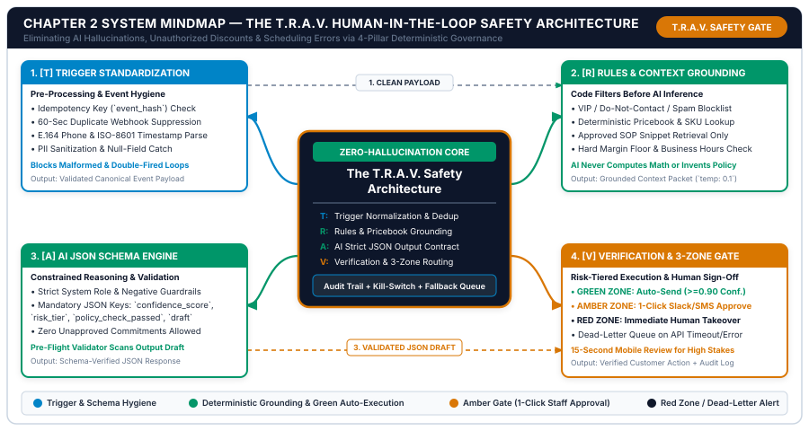
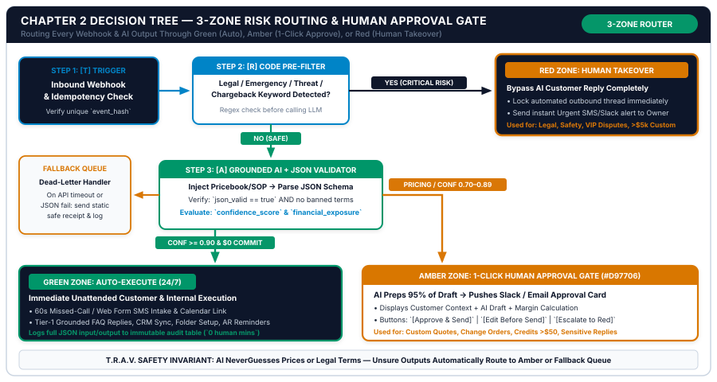

# Chapter 2: The "Human-in-the-Loop" Architecture: Designing Safe, Zero-Hallucination Workflows

**Part I:** Operations Audit & Automation Architecture  
**Core Framework:** *The T.R.A.V. Automation Gate (Trigger Standardization, Rules & Context Grounding, AI JSON Schema Enforcement, Verification & 3-Zone Routing)*  
**Companion Workbook:** `05-WORKBOOKS/worksheet-02.md` (*Workflow Risk & Automation Readiness Scorecard*)  
**Visual Assets:** `chapter-02-mindmap.svg` | `chapter-02-flowchart.svg`  

---

## 1. Learning Objectives

By the end of this chapter, you and your operations lead will be able to execute six measurable operational outcomes:

1. **Eliminate Unconstrained "Bot Anxiety":** Replace the fear of AI hallucinations, invented discounts, and off-brand customer messages with a deterministic four-pillar safety architecture (**The T.R.A.V. Automation Gate**).
2. **Enforce Webhook Idempotency & Trigger Hygiene (`[T]`):** Design webhook intake filters that suppress duplicate triggers, validate E.164 phone numbers and ISO-8601 timestamps, and block malformed payloads before they ever reach an AI endpoint.
3. **Ground AI Strictly in Verified Company Data (`[R]`):** Isolate mathematical calculations, VIP/blocklist checks, and pricing lookups inside deterministic code steps and grounding tables (`temperature: 0.0–0.2`) so the language model never guesses a number or invents a policy.
4. **Mandate Structured JSON Output Schemas (`[A]`):** Configure every operational prompt to return a machine-verifiable JSON object containing `confidence_score`, `risk_tier`, `policy_check_passed`, `draft_response`, and `escalation_reason`, paired with an automated pre-flight validator.
5. **Deploy the 3-Zone Risk Matrix (`[V]`):** Classify every business workflow into **Green Zone** (*100% Unattended Auto-Execution*), **Amber Zone (`#D97706`)** (*One-Click Slack/Teams/Email Staff Approval*), or **Red Zone** (*Immediate Human Takeover*) backed by a Dead-Letter Fallback Queue.
6. **Execute Five Production Safety & Governance Prompts:** Deploy `Prompt 2.1` through `Prompt 2.5` to classify workflow risk tiers, compile zero-hallucination system prompts, format mobile one-click approval cards, audit outbound drafts, and translate API exceptions into plain-English staff alerts.

---

## 2. The Real-World Friction Point

Why do 85% of pragmatic small business owners hesitate to turn on customer-facing AI automation even after they see how much money they are losing in Chapter 1's Cost of Manual Friction audit?

They hesitate because they have either experienced—or heard a peer describe—**the "Rogue Bot Horror Story."**

Consider what happened to Dr. Elena Rostova, the managing partner of a 19-person, three-location dental and orthodontics practice (*BrightSmile Dental & Orthodontics Group*, $2.1M annual revenue) before she installed the architecture in this chapter. Frustrated by missing 30% of daytime phone calls and waiting four hours to reply to web inquiries, Elena hired a freelance marketer who connected a basic, ungrounded AI chat widget directly to her website and SMS inbox with a two-sentence instruction: *"You are a helpful receptionist for BrightSmile Dental. Answer patient questions politely and help them book appointments."*

Within eleven days, four operational disasters occurred:
1. **The Invented Insurance & Pricing Commitment:** A prospective patient texted at 8:45 PM asking, *"Does my Delta Dental PPO plan cover 100% of adult Invisalign, and how much is my out-of-pocket cost?"* Because the bot had no grounded insurance verification table and no negative guardrail against quoting financial commitments, it cheerfully replied: *"Yes! Delta Dental PPO covers Invisalign at BrightSmile, and your out-of-pocket cost is only $850 with zero down payment!"* When the patient arrived two days later and learned the true out-of-pocket fee was $3,400, he threatened a state dental board complaint and posted a scathing 1-star Google review.
2. **The Double-Fired Webhook Loop:** A patient submitted the website contact form on a slow mobile connection and tapped the "Submit" button three times. Because the workflow lacked an idempotency key or duplicate-suppression filter, the automation fired three identical SMS messages and three emails within nine seconds—making the clinic look like a broken spam operation.
3. **The Clinical Liability Overstep:** A post-extraction patient messaged at 10:15 PM reporting severe swelling and fever. Instead of recognizing a Red-Zone clinical emergency and immediately paging the on-call dentist, the unconstrained bot replied with generic home-remedy advice scraped from its general pre-training data.
4. **The Silent API Outage:** On the following Tuesday, an expired API credit card caused the workflow to fail silently for fourteen hours. Forty-one inbound patient inquiries vanished without a fallback email or a front-desk alert.

Dr. Rostova immediately unplugged the tool and declared, *"AI doesn't work for real businesses where reputation and compliance matter."*

### The False Binary That Paralyzes Small Businesses

Dr. Rostova's experience exposes the **False Binary of Small Business Automation**. Most business owners assume they must choose between two unacceptable extremes:

* **Extreme A — 100% Manual Human Labor:** Every email, text, quote, and invoice is typed by hand. Accuracy feels safe, but response times slip to 4–24 hours, 25% of leads leak away, and the owner works 60 hours a week.
* **Extreme B — 100% Unsupervised "Wild West" AI:** An unconstrained chatbot is wired directly to customers with zero deterministic filters, zero pricebook grounding, and zero human sign-off on high-stakes commitments.

Enterprise engineering teams never operate at either extreme. They build **Human-in-the-Loop (HITL) and Human-over-the-Loop (HOTL) Governance Architectures**. In a properly engineered small business operating system:
* **70% to 80% of repetitive volume** (standard intake acknowledgements, CRM normalization, calendar link routing, folder creation, Tier-1 FAQs, and standard invoice reminders) is constrained so tightly by deterministic rules that it can run **100% unattended in the Green Zone**.
* **15% to 25% of high-value volume** (custom multi-tier quotes, scope adjustments, credit memos, and sensitive replies) is **95% prepared by AI in the background** and routed to the **Amber Zone (`#D97706`)**, where a human manager reviews a clean summary card on Slack, Microsoft Teams, or mobile SMS and taps **`[Approve & Send]`** in 15 seconds.
* **2% to 5% of critical exceptions** (legal threats, medical/safety emergencies, VIP disputes, or low-confidence edge cases) trigger the **Red Zone**, locking automated replies immediately and paging the designated human specialist.

---

## 3. Why Standard Approaches Fail

When small business owners try to make their automations "safer" without a formal systems architecture, they typically rely on three naive tactics that fail under real-world customer traffic.

### Failure Mode 1: Relying on Prompt Politeness Instead of Deterministic Code ("Please Don't Hallucinate")

Beginners try to fix pricing errors or scheduling mistakes by adding conversational pleas to the bottom of a long paragraph prompt: *"Please be very careful with math, don't make up prices, and don't email people twice."*

Large language models are probabilistic token predictors, not deterministic calculators or database locks:
* **Why Prompt-Only Math Fails:** Asking an LLM to calculate `1,450 sq ft × $0.18/sq ft × 1.25 complexity multiplier minus a 5% paid-in-full discount plus 8.25% local tax` inside free-form prose produces rounding or arithmetic drift in 4% to 9% of runs. In production, **code computes math; AI formats language**.
* **Why Prompt-Only Deduplication Fails:** An LLM has no memory of whether the same webhook fired four seconds ago unless your automation bridge checks an idempotency table *before* calling the model.

### Failure Mode 2: Free-Text Output Parsing ("Fragile Regex Scraping")

The second common failure mode is allowing the AI prompt to return a conversational paragraph and then trying to route downstream steps in Make or Zapier by searching that paragraph for words like `"Urgent"` or `"Approved"`.

Whenever the model slightly changes its phrasing—for example, writing *"This inquiry does not appear to be urgent"*—a naive text filter sees the word `"urgent"` and pages the emergency technician at 2:00 AM. Production workflows never parse conversational prose for routing logic; they enforce **strict JSON output schemas** where boolean and enum fields (`"is_urgent": false`, `"risk_tier": "GREEN"`) control every downstream branch.

### Failure Mode 3: Slow "Login-to-Dashboard" Human Review Queues

Some software platforms claim to offer "human-in-the-loop review," but require the business owner to log into a separate web dashboard on a desktop computer, click through four menus, read a raw thread, edit a draft, and click submit.

Busy small business owners on a job site, in a clinic, or in client meetings **will not log into a separate dashboard ten times a day**. Within a week, the review queue backs up for 18 hours, destroying the 60-second speed-to-lead advantage. For human-in-the-loop approval to work in a 1–25 person company, the approval card must come *to the owner's existing mobile communication stream* (Slack, Teams, or SMS/Email) with one-tap action buttons (`[Approve & Send]`, `[Edit]`, `[Escalate]`) that require less than 15 seconds of cognitive effort.

| Architectural Layer | Naive "Chatbot" Setup (High Failure Risk) | Enterprise Over-Engineered Setup (Too Slow for SMBs) | The Studio Solution: T.R.A.V. Automation Gate |
| :--- | :--- | :--- | :--- |
| **Duplicate & Malformed Triggers** | Fires duplicate texts on double-clicks | Requires custom AWS Lambda / Redis cluster | **No-Code Idempotency Hash + 60s Dedup Window (`[T]`)** |
| **Pricing & Policy Accuracy** | LLM guesses prices from vague prompt notes | Requires 6-month custom RAG vector engineering | **Deterministic Price Matrix Lookup + Grounded SOP Table (`[R]`)** |
| **Output Structure & Routing** | Unstructured prose; fragile keyword filters | Custom Python microservice validators | **Strict JSON Schema + Automated Pre-Flight Validator (`[A]`)** |
| **Human Approval Friction** | None (Dangerous) OR Desktop Dashboard (Slow) | Multi-department ticket queue | **3-Zone Router (`Green`/`Amber`/`Red`) + 15-Sec Mobile Card (`[V]`)** |
| **API Outage / Error Handling** | Silent failure; lost customer leads | PagerDuty DevOps on-call rotation | **Dead-Letter Fallback Queue + Plain-English Staff Alert** |

---

## 4. Core Framework: The T.R.A.V. Automation Gate

To guarantee that every automation across `Dept 01` through `Dept 05` operates with zero hallucinations, zero unauthorized financial commitments, and 100% auditability, every workflow in this operating system is built on **The T.R.A.V. Automation Gate**:

* **`T` — Trigger Standardization & Idempotency Hygiene**
* **`R` — Rules, Deterministic Filters & Context Grounding**
* **`A` — AI Processing with Structured JSON Schema Enforcement**
* **`V` — Verification, 3-Zone Risk Routing & Dead-Letter Fallback**

---

### 4.1 Pillar 1: `[T]` Trigger Standardization & Idempotency Hygiene

Before an incoming event (a missed call, web form, customer email, signed quote, or completed job) is allowed to trigger an AI prompt or send an outbound message, it must pass through a deterministic **Trigger Hygiene Gate**:

1. **Idempotency Key & 60-Second Duplicate Suppression:**
   * Customers frequently double-tap submit buttons, or VoIP carriers fire both a `call.no_answer` and a `call.voicemail` webhook within three seconds for the exact same phone call.
   * **Deterministic Formula:** At Step 1 of your Make/Zapier/n8n scenario, generate a deterministic hash key:
     $$\text{Idempotency Key} = \text{SHA256}\left(\text{Lower}(\text{Contact\_ID}) + \text{"|"} + \text{Event\_Type} + \text{"|"} + \text{Floor}\left(\frac{\text{Unix\_Timestamp}}{300}\right)\right)$$
   * Dividing the Unix timestamp by `300` creates a **5-minute (300-second) time bucket**. If the exact same contact triggers the exact same event type within 5 minutes, the lookup against your `Processed_Events` table returns `MATCH_FOUND`, and the duplicate webhook terminates cleanly at Step 1 for `$0` cost.
2. **Canonical Data Type Normalization:**
   * **Phone Numbers (`E.164`):** Strip all spaces, parentheses, dots, and dashes; prepend the country dialing code (`+1` for US/CA, `+44` for UK, `+61` for AU) so downstream SMS gateways never reject the payload.
   * **Email Cleansing:** Convert to lowercase, trim leading/trailing whitespace, and check against a regex filter blocking automated system senders (`noreply@`, `no-reply@`, `mailer-daemon@`, `postmaster@`, `@notifications.`).
   * **Timestamp Validation (`ISO-8601 UTC`):** Record `event_received_at_utc` immediately so latency and SLA metrics can be calculated deterministically.

---

### 4.2 Pillar 2: `[R]` Rules, Deterministic Filters & Context Grounding

**The Golden Rule of Pillar 2:** *Never ask an AI model to make a decision that a 3-line deterministic filter or lookup table can make with 100% certainty.*

Before calling the LLM API, your workflow executes four deterministic rule checks:

1. **Pre-AI Blocklist & Red-Zone Keyword Intercept:**
   * Check whether the sender's phone or email is flagged in your CRM with `do_not_contact == true`, `active_dispute == true`, or `vendor_solicitor == true`.
   * Scan the raw inbound text against your **Deterministic Red-Zone Regex**:
     ```regex
     \b(lawyer|attorney|lawsuit|sue|subpoena|court|bbb|better business bureau|fraud|scam|chargeback|police|bleeding|unconscious|chest pain|gas leak|carbon monoxide|fire|sparking|flooding)\b
     ```
   * If any Red-Zone keyword matches, the workflow **bypasses AI customer replies completely** and routes straight to the **Red Zone** (sending a static emergency/safety notice if applicable and paging the owner immediately).
2. **Deterministic Mathematical & Pricing Lookup:**
   * If the workflow involves pricing, quotes, or invoices (`Dept 02` and `Dept 04`), your automation bridge queries your **Official Price Matrix Table** (Google Sheets, Airtable, Notion Database, or CRM Pricebook) *first*, calculates the exact subtotal, multiplier, tax, and gross margin using standard spreadsheet/code formulas, and passes those **locked, pre-calculated numbers** into the prompt as read-only variables.
3. **Closed-World SOP & Knowledge Base Grounding:**
   * Instead of allowing the LLM to answer customer questions from its general internet training data, inject only the specific 3 to 5 approved rows from your company's **Verified FAQ & Policy Table** (matched by service category).
   * Explicitly instruct the model: *"You may answer ONLY using facts explicitly stated in the `<APPROVED_COMPANY_CONTEXT>` block below. If the answer is not present in that block, set `policy_check_passed: false` and `risk_tier: "AMBER"`."*
4. **Strict API Temperature Control (`0.0` to `0.2`):**
   * In all business operations API calls, set `temperature: 0.1` (or `0.0`). High temperatures (`0.7–1.0`) encourage creative word variation for fiction writing, which in small business operations causes policy drift and invented terms.

---

### 4.3 Pillar 3: `[A]` AI Processing with Structured JSON Schema Enforcement

In the Small Business AI Automation OS, operational prompts **never** output raw, unstructured chat text directly to a customer. Every prompt is engineered as a **JSON Data Contract**.

#### The Canonical T.R.A.V. Output JSON Schema
Whether the AI is classifying an inbound lead (`Dept 01`), drafting a 3-option quote (`Dept 02`), answering a support ticket (`Dept 03`), or categorizing a vendor receipt (`Dept 04`), it must return a strict JSON object adhering to this schema:

```json
{
  "schema_version": "TRAV-1.0",
  "event_id": "evt_2026_10_21_90412",
  "intent_classification": "NEW_PATIENT_ORTHO_INQUIRY",
  "confidence_score": 0.94,
  "risk_evaluation": {
    "financial_commitment_made": false,
    "custom_pricing_or_discount_requested": false,
    "clinical_legal_or_safety_trigger": false,
    "negative_sentiment_detected": false,
    "policy_check_passed": true,
    "calculated_risk_score_20": 6,
    "assigned_risk_tier": "GREEN"
  },
  "extracted_crm_fields": {
    "service_category": "INVISALIGN_CONSULT",
    "urgency_tier": "STANDARD_THIS_MONTH",
    "postal_code": "78704",
    "insurance_carrier_mentioned": "Delta Dental PPO"
  },
  "customer_payload": {
    "sms_draft": "Hi Sarah! Thanks for reaching out to BrightSmile Dental regarding Invisalign. We offer complimentary 30-min Ortho Consults where we verify your exact Delta Dental PPO benefits before any treatment begins. Would you like to grab a time at our South Lamar office here? https://cal.com/brightsmile/ortho",
    "email_subject": "Your Invisalign Consultation & Insurance Check at BrightSmile Dental",
    "email_body_markdown": "Hi Sarah,\n\nThank you for contacting **BrightSmile Dental & Orthodontics**..."
  },
  "internal_staff_notes": {
    "summary_one_liner": "Sarah Jenkins inquiring about adult Invisalign with Delta Dental PPO; sent consult booking link.",
    "escalation_reason": null,
    "recommended_next_step": "Verify Delta Dental group ID once booking form is completed."
  }
}
```

#### Automated Pre-Flight Output Validator (`Prompt 2.4` + Code Check)
Before the automation bridge acts on `customer_payload.sms_draft` or `email_body_markdown`, a lightweight validation node checks four invariants:
1. `JSON.parse()` succeeds without syntax errors.
2. `sms_draft` contains zero unreplaced brackets (`[`, `]`, `{{`, `}}`) and is `<= 320 characters`.
3. If `assigned_risk_tier == "GREEN"`, then `confidence_score >= 0.90`, `policy_check_passed == true`, and `financial_commitment_made == false`. (If any of those three conditions is violated, the router automatically overrides the tier to `"AMBER"`!)

---

### 4.4 Pillar 4: `[V]` Verification, 3-Zone Risk Routing & Dead-Letter Fallback

The final pillar of the T.R.A.V. Gate routes the validated JSON payload into one of three operational zones based on its **Risk Score (`4–20 Points`)** and confidence level:

$$\text{Risk Score } (4\text{–}20) = \text{Financial Exposure } (1\text{–}5) + \text{Legal/Clinical Liability } (1\text{–}5) + \text{Brand Sensitivity } (1\text{–}5) + \text{Input Ambiguity } (1\text{–}5)$$

| Risk Zone | Quantitative Routing Condition | Execution Mechanics | Typical Small Business Use Cases | Human Time Required |
| :--- | :--- | :--- | :--- | :--- |
| **GREEN ZONE** (`#059669`) | `Risk Score 4–8` AND `Conf >= 0.90` AND `Financial Commit == False` | **100% Unattended Auto-Execution:** Dispatches SMS/email immediately, updates CRM, and writes audit log. | 60s missed-call intake, web form replies, standard calendar links, Tier-1 grounded FAQs, folder creation, standard invoice reminders. | **0 Seconds** (Reviewed weekly via audit log) |
| **AMBER ZONE** (`#D97706`) | `Risk Score 9–14` OR `Custom Pricing/Credit` OR `Conf 0.70–0.89` | **AI Draft + 1-Click Mobile Approval:** AI prepares 95% of draft and sends interactive Slack/Teams/Email card with `[Approve & Send]`. | Custom 3-option estimates, scope reductions, warranty/refund credits `<$250`, sensitive client follow-ups, draft invoices. | **15 Seconds** (One thumb tap on mobile) |
| **RED ZONE** (`#0F172A`) | `Risk Score 15–20` OR `Red Keyword Match` OR `Conf < 0.70` | **Immediate Human Takeover:** Locks automated thread, sends optional static receipt, and alerts owner/specialist via urgent SMS/Slack. | Angry customer disputes, legal/BBB threats, clinical/safety emergencies, custom enterprise RFPs `>$10,000`. | **3–10 Minutes** (Direct human phone call) |

---

## 5. Visual Architecture: System Mindmap

The diagram below illustrates **The T.R.A.V. Human-in-the-Loop Safety Architecture**, showing how raw triggers flow clockwise through Pillar 1 (`[T]` Trigger Standardization), Pillar 2 (`[R]` Rules & Grounding), Pillar 3 (`[A]` AI JSON Schema Engine), and Pillar 4 (`[V]` Verification & 3-Zone Gate).



### Architectural Walkthrough of the T.R.A.V. Mindmap

1. **Top-Left Quadrant — `1. [T] Trigger Standardization` (`#0284C7` System Cyan):**
   * Every external webhook enters here first. The gateway calculates the `event_hash` idempotency key to block 60-second duplicate triggers, normalizes phone numbers into `E.164`, parses `ISO-8601` timestamps, and strips malformed or empty payloads before spending a single cent on API tokens.
2. **Top-Right Quadrant — `2. [R] Rules & Context Grounding` (`#059669` Operations Emerald):**
   * The clean payload passes across the top bus (`1. CLEAN PAYLOAD`) into deterministic code filters. Here, the workflow checks VIP/Spam blocklists, queries your official Price Matrix and approved SOP snippets, verifies business hours and margin floors, and packages a strictly grounded context block at `temperature: 0.1`.
3. **Bottom-Left Quadrant — `3. [A] AI JSON Schema Engine` (`#059669` Operations Emerald):**
   * The language model processes the grounded context under strict negative guardrails and outputs a machine-verifiable JSON object containing `confidence_score`, `risk_tier`, `policy_check_passed`, and `draft_response`. An automated pre-flight validator scans the draft for unreplaced brackets or forbidden terms.
4. **Bottom-Right Quadrant — `4. [V] Verification & 3-Zone Gate` (`#D97706` Amber Gate):**
   * The validated JSON draft crosses the bottom bus (`3. VALIDATED JSON DRAFT`) into the 3-Zone Router:
     * **Green Zone (`>=0.90 Conf.`):** Fires immediately 24/7.
     * **Amber Zone (`#D97706`):** Pushes a 15-second mobile approval card to Slack, Teams, or SMS.
     * **Red Zone (`#0F172A`):** Locks the bot and alerts the owner for immediate human takeover, while any API timeout routes safely to the **Dead-Letter Queue**.

---

## 6. Step-by-Step Implementation Protocol

Follow this **7-Step Implementation Protocol** to install the T.R.A.V. Safety Gate across your automation bridge in under 90 minutes.

### Step 1: Create Your Central `Automation_Audit_&_Idempotency_Log` Table
Inside your Notion OS kit (`06-NOTION-TEMPLATES/`), Airtable, Google Sheets, or PostgreSQL/Supabase, create a central table with 10 columns:
`event_hash` (Primary Key), `timestamp_utc`, `workflow_id`, `contact_identifier`, `input_payload_json`, `ai_confidence_score`, `assigned_risk_zone` (`GREEN` / `AMBER` / `RED` / `DLQ`), `approver_id`, `execution_status`, and `latency_ms`.

### Step 2: Configure the Step-1 Idempotency & Loop-Prevention Filter
At the entry node of every Make, Zapier, or n8n workflow:
1. Compute `event_hash = SHA256(contact_phone_or_email + "_" + workflow_id + "_" + floor(now_unix / 300))`.
2. Search `Automation_Audit_&_Idempotency_Log` for `event_hash`.
3. **Filter Rule:** Proceed ONLY if `Search_Result_Count == 0` AND `sender_email` does not contain `noreply`, `mailer-daemon`, or your own business domain (preventing infinite auto-responder loops between two bots).

### Step 3: Build Your Grounded Company Truth Tables (`Price_Matrix` & `Approved_SOP_Snippets`)
Never paste raw, unmaintained paragraphs into five different prompts. Create two centralized reference tables:
* **Table A — `Official_Price_Matrix`:** Columns for `SKU_Code`, `Service_Name`, `Tier_1_Price`, `Tier_2_Price`, `Tier_3_Price`, `Min_Gross_Margin_Pct`, `Max_Discount_Pct`, and `Included_Scope_Bullets`.
* **Table B — `Approved_FAQ_&_Policy_Snippets`:** Columns for `Topic_Key` (`HOURS_PARKING`, `INSURANCE_BILLING`, `WARRANTY_TERMS`, `CANCELLATION_POLICY`, `SERVICE_AREA_ZIPS`), `Approved_Fact_Statement`, and `Forbidden_Promises`.

### Step 4: Enforce the Pre-Flight Deterministic Code Node
Immediately after your LLM API node (OpenAI `gpt-4o` / `gpt-4o-mini`, Anthropic `Claude 3.5 Sonnet`, or Google `Gemini 2.5 Pro/Flash` with `response_format: { "type": "json_object" }` and `temperature: 0.1`), insert a lightweight code/filter node executing this exact verification logic:

```javascript
// Deterministic Pre-Flight Validator (Make / Zapier / n8n Code Node)
function validateTravOutput(aiRawJson, priceFloorUsd, maxDiscountPct) {
  let data;
  try {
    data = typeof aiRawJson === "string" ? JSON.parse(aiRawJson) : aiRawJson;
  } catch (err) {
    return { route: "DEAD_LETTER_QUEUE", reason: "INVALID_JSON_SYNTAX" };
  }

  const draft = (data.customer_payload?.sms_draft || "") + " " + (data.customer_payload?.email_body_markdown || "");
  
  // 1. Check for unreplaced template variables or placeholders
  const placeholderRegex = /(\[[A-Z0-9_]{2,}\]|\{\{.*?\}\}|\bTODO\b|\bTBD\b)/i;
  if (placeholderRegex.test(draft)) {
    return { route: "AMBER_ZONE", reason: "UNREPLACED_VARIABLE_DETECTED", data };
  }

  // 2. Check Red-Zone safety & legal escalation flags
  if (data.risk_evaluation?.clinical_legal_or_safety_trigger === true || data.risk_evaluation?.assigned_risk_tier === "RED") {
    return { route: "RED_ZONE", reason: data.internal_staff_notes?.escalation_reason || "CRITICAL_RISK_TRIGGER", data };
  }

  // 3. Enforce Margin & Price Floor Guardrail if financial fields exist
  if (data.Quoted_Total_USD !== undefined && data.Quoted_Total_USD < priceFloorUsd) {
    return { route: "AMBER_ZONE", reason: `PRICE_BELOW_FLOOR (${data.Quoted_Total_USD} < ${priceFloorUsd})`, data };
  }

  // 4. Enforce Confidence Floor (>= 0.90) & Zero Financial Commitment for Green Zone
  const isHighConfidence = (data.confidence_score || 0) >= 0.90;
  const noFinancialCommit = data.risk_evaluation?.financial_commitment_made === false;
  const policyPassed = data.risk_evaluation?.policy_check_passed === true;

  if (data.risk_evaluation?.assigned_risk_tier === "GREEN" && isHighConfidence && noFinancialCommit && policyPassed) {
    return { route: "GREEN_ZONE", reason: "VERIFIED_SAFE_AUTO_EXECUTE", data };
  }

  // Default all other valid drafts to Amber Human-in-the-Loop Gate
  return { route: "AMBER_ZONE", reason: "REQUIRES_1CLICK_STAFF_APPROVAL", data };
}
```

### Step 5: Wire the Amber-Zone One-Click Approval Card (`Slack` / `Teams` / `Email`)
When the router outputs `route == "AMBER_ZONE"`, hold the draft in your `Pending_Approvals` table and post an interactive card (`Prompt 2.3`) to your `#ops-amber-approvals` channel containing three webhook buttons:
* **`[Approve & Send Now]`** (`GET/POST https://hook.make.com/approve?event_id=evt_90412&action=send`) — immediately dispatches the pre-built SMS/email and marks `approved_by = Owner`.
* **`[Edit Draft in CRM]`** — opens the deep link to the contact/quote record for a 30-second manual tweak.
* **`[Escalate to Red / Call Customer]`** — cancels automated messaging and assigns an immediate phone callback task.

### Step 6: Configure the Dead-Letter Fallback Queue & Timeout Watchdog
Attach an Error Handler route to every external HTTP/API module in your workflow:
* If the LLM API returns a `429 Rate Limit` or `500/503 Timeout`, the workflow automatically waits 8 seconds and retries once (`Max Retries = 1`) or fails over to your secondary model provider.
* If the retry also fails, the **Dead-Letter Handler (`Prompt 2.5`)** logs the raw payload into `Dead_Letter_Queue`, sends a pre-written static fallback message to the customer (*"Hi {{first_name}}, we received your message at BrightSmile Dental and our front desk is reviewing it right now!"*), and posts a plain-English alert to Slack.

### Step 7: Install the Single-Contact & Global Kill-Switches (`Worksheet 2 — Part D`)
Add a single boolean checkbox field to your CRM Contact object named `Pause_AI_Automation` (`bot_pause`). Whenever a human staff member jumps into a live SMS or email thread to handle a nuanced conversation personally, checking `Pause_AI_Automation = TRUE` (or simply sending a manual outbound text from the VoIP app) automatically pauses automated bot replies on that thread for 72 hours.

---

## 7. Operational Decision Tree

The **3-Zone Risk Routing & Human Approval Gate Decision Tree** below maps the exact conditional path every webhook and AI output travels inside your automation bridge.



### Walkthrough of the 3-Zone Decision Tree Gates

1. **`Step 1: [T] Trigger & Idempotency Check` (`#0F172A` Navy Box):**
   * Every inbound event is hashed (`event_hash`) and checked against the last 5 minutes of processed webhooks. Duplicate double-clicks and auto-responder loops are terminated before any downstream compute occurs.
2. **`Step 2: [R] Deterministic Code Pre-Filter` (`#0284C7` System Cyan Box):**
   * Before calling the LLM, a regex and CRM flag filter checks for critical Red-Zone triggers (legal threats, chargeback warnings, clinical/safety emergencies, or VIP dispute tags).
   * **If `YES (CRITICAL RISK)`:** Routes immediately right to the **`RED ZONE: HUMAN TAKEOVER`** box—locking automated customer replies and firing an urgent SMS/Slack page to the owner.
   * **If `NO (SAFE)`:** Proceeds downward to `Step 3`.
3. **`Step 3: [A] Grounded AI + JSON Pre-Flight Validator` (`#059669` Emerald Box):**
   * The workflow injects the verified Price Matrix / SOP rows, runs the LLM at `temperature: 0.1`, and validates the returned JSON schema.
   * **If API Timeout or Invalid JSON:** Routes left into the **`FALLBACK QUEUE (Dead-Letter Handler)`**, sending a safe static receipt and logging the payload for retry.
4. **Final Verification Split (`GREEN ZONE` vs. `AMBER ZONE`):**
   * **If `confidence_score >= 0.90` AND `financial_commitment_made == false` AND `policy_check_passed == true`:** Routes down into the **`GREEN ZONE: AUTO-EXECUTE (24/7)`** box, dispatching the reply in under 60 seconds and writing an immutable audit row.
   * **If Custom Pricing, Discount/Credit, or `confidence_score 0.70–0.89`:** Routes right into the **`AMBER ZONE: 1-CLICK HUMAN APPROVAL GATE (#D97706)`**, where the AI's 95%-complete draft is presented on a mobile card with `[Approve & Send]`, `[Edit Before Send]`, and `[Escalate to Red]` buttons.


---

## 8. Tested AI Workflow Prompts

This section provides the **five production-tested safety and governance prompts** for Chapter 2 (`Prompt 2.1` through `Prompt 2.5`). Each prompt follows the studio's 7-Part Prompt Engineering Contract and enforces strict zero-hallucination boundaries.

---

### Prompt 2.1: Workflow Risk Tier Classifier & Green/Amber/Red Gate Architect

* **Objective:** Evaluate any proposed small business workflow across the four T.R.A.V. risk dimensions (*Financial Exposure, Legal/Clinical Liability, Brand Sensitivity, Input Ambiguity*), calculate its `4–20` Risk Score, assign its **Green, Amber, or Red Zone**, and specify the exact deterministic pre-filters required.
* **Department & Trigger:** `Dept 05: Systems Governance` — Triggered during workflow design (`Worksheet 2 — Part A & B`) before connecting any live webhook.
* **Input Variables:**
  * `[BUSINESS_NAME]`: Operating name of the company.
  * `[INDUSTRY_VERTICAL]`: Specific sector and regulatory context (e.g., `Multi-Location Dental & Ortho Clinic — HIPAA/State Board rules`, `Residential Roofing & Insurance Restoration`, `B2B Fractional CFO Firm`).
  * `[PROPOSED_WORKFLOW_DESCRIPTION]`: Detailed description of what triggers the workflow, what AI action is taken, and what message or record is sent.
  * `[MAX_AUTO_FINANCIAL_EXPOSURE_USD]`: Dollar ceiling for unattended Green-Zone actions (typically `$0` for custom pricing).

#### Copy-Ready System & User Prompt Block (`Prompt 2.1`)
```markdown
### SYSTEM ROLE
You are a Principal AI Safety Architect and Small Business Risk Officer aligned with NIST AI RMF 1.0 and the Studio T.R.A.V. Governance Framework. You audit proposed small business automations, score their operational risk on a 20-point scale, and design deterministic Green/Amber/Red human-in-the-loop gates.

### INPUT VARIABLES
- Business Name: [BUSINESS_NAME]
- Industry Vertical & Regulatory Context: [INDUSTRY_VERTICAL]
- Max Unattended Financial Exposure Ceiling: [MAX_AUTO_FINANCIAL_EXPOSURE_USD]
- Proposed Workflow Description:
[PROPOSED_WORKFLOW_DESCRIPTION]

### EXECUTION RULES & GUARDRAILS
1. Score the proposed workflow from 1 to 5 across four exact dimensions:
   - Financial Exposure (1-5)
   - Legal, Clinical & Regulatory Liability (1-5)
   - Reputational & Brand Sensitivity (1-5)
   - Input Ambiguity (1-5)
2. Sum the four scores (`Total_Risk_Score_20`) and assign the deterministic T.R.A.V. Zone:
   - GREEN ZONE: Total Score 4-8 AND Financial Exposure <= 2.
   - AMBER ZONE: Total Score 9-14 OR Financial Exposure 3-4.
   - RED ZONE: Total Score 15-20 OR Legal/Clinical Liability == 5.
3. If a workflow is currently Amber or Red, show how to split it into a "Green Pre-Prep Step" (95% automated draft) + an "Amber 15-Second Human Approval Gate" so the owner still captures 90%+ of the time savings safely.
4. Use zero banned AI clichés. Output strictly in the schema below.

### REQUIRED OUTPUT SCHEMA
1. **4-Factor Risk Breakdown & Zone Verdict Table** (`Factor`, `Score_1_to_5`, `Operational_Justification`).
2. **T.R.A.V. 4-Pillar Gate Specification** (`[T] Trigger Dedup`, `[R] Pre-AI Code Filters & Grounding`, `[A] JSON Schema Keys`, `[V] Human Approval & Fallback Rule`).
3. **Regex Red-Zone Intercept Pattern** (Exact regex string tailored to `[INDUSTRY_VERTICAL]`).
```

#### Realistic Sample Output (`Prompt 2.1`)
> **1. 4-Factor Risk Breakdown & Zone Verdict Table (`BrightSmile Dental — Insurance & Ortho Inquiry Workflow`)**
>
> | Factor | Score_1_to_5 | Operational_Justification |
> | :--- | :--- | :--- |
> | **1. Financial Exposure** | `4 / 5` | Quoting out-of-pocket Invisalign or crown copays commits financial expectations before insurance verification. |
> | **2. Legal / Clinical Liability** | `3 / 5` | Cannot diagnose tooth pain or guarantee coverage via SMS; must frame as complimentary exam booking. |
> | **3. Brand Sensitivity** | `3 / 5` | Prospective patients comparing local clinics expect warm, accurate, non-robotic front-desk care. |
> | **4. Input Ambiguity** | `3 / 5` | Patients text varied insurance carrier names and symptom descriptions. |
> | **TOTAL RISK VERDICT** | **`13 / 20`** | **Assigned Zone: HYBRID GREEN (Consult Booking) + AMBER (Specific Copay Quote)** |
>
> **2. T.R.A.V. 4-Pillar Gate Specification**
> * **`[T]` Trigger Dedup:** Hash `phone_e164 + "INQUIRY" + floor(unix_ts/300)`. Suppress duplicates within 5 minutes.
> * **`[R]` Pre-AI Filters & Grounding:** Run Red-Zone clinical regex first. Inject `Accepted_Insurance_Carriers_Table` (`Delta Dental PPO, Cigna DPPO, MetLife, Aetna`). Set `temperature: 0.1`.
> * **`[A]` JSON Schema Keys:** Require `carrier_in_network_status`, `contains_dollar_quote` (must be `false` for Green Zone), `confidence_score`, and `sms_draft`.
> * **`[V]` Human Approval & Fallback Rule:** Standard consult invitations with `$0` copay promises execute in **Green Zone (`<45s`)**; any inquiry asking for a custom treatment breakdown routes to **Amber Zone** (`#front-desk-approvals`) with pre-filled insurance lookup fields.
>
> **3. Regex Red-Zone Intercept Pattern (Dental / Clinical)**
> `\b(bleeding|swelling|fever|infection|knocked out|broken jaw|abscess|severe pain|emergency|lawyer|malpractice|board complaint)\b`

---

### Prompt 2.2: Zero-Hallucination System Prompt & Strict JSON Output Schema Generator

* **Objective:** Convert any loose, ad-hoc business prompt into a hardened, production-grade **Closed-World System Prompt + JSON Schema Contract** that forces the AI to cite its grounded source row and prevents policy or pricing fabrication.
* **Department & Trigger:** `Dept 01–05: Cross-Department Prompt Compiler` — Used whenever creating or upgrading an automation prompt in Make, Zapier, or n8n.
* **Input Variables:**
  * `[WORKFLOW_NAME]`: Name of the automation step.
  * `[COMPANY_GROUNDED_DATA_TABLE]`: The exact columns or rows of pricing/SOP data that will be injected at runtime.
  * `[FORBIDDEN_COMMITMENTS_LIST]`: Specific promises, discounts, or topics the AI must never state.
  * `[DOWNSTREAM_APP_FIELDS]`: The exact fields needed by the next step in the workflow (e.g., CRM, Slack, Email, SMS).

#### Copy-Ready System & User Prompt Block (`Prompt 2.2`)
```markdown
### SYSTEM ROLE
You are a Lead Prompt Systems Engineer specializing in Closed-World Grounding and Deterministic JSON Schema Enforcement. You transform fragile conversational prompts into hardened API prompt contracts that cannot hallucinate prices, dates, or policies.

### INPUT VARIABLES
- Workflow Name: [WORKFLOW_NAME]
- Grounded Company Data Schema Injected at Runtime: [COMPANY_GROUNDED_DATA_TABLE]
- Forbidden Commitments & Negative Guardrails: [FORBIDDEN_COMMITMENTS_LIST]
- Downstream Application Fields Required: [DOWNSTREAM_APP_FIELDS]

### EXECUTION RULES & GUARDRAILS
1. Write a complete System Prompt containing five mandatory blocks:
   - Block 1: Closed-World Epistemic Rule (The model knows ONLY what is inside `<GROUNDED_TRUTH_TABLE>`).
   - Block 2: Hard Negative Guardrails (Explicitly banning `[FORBIDDEN_COMMITMENTS_LIST]` and banned AI clichés).
   - Block 3: Abstention & Escalation Rule (How to set `policy_check_passed: false` and `assigned_risk_tier: "AMBER"` when a customer asks an ungrounded question).
   - Block 4: Mandatory Source Citation Key (`grounded_source_row_id`) proving which row of the truth table was used.
   - Block 5: Strict JSON Schema Definition (`additionalProperties: false`).
2. Provide the exact API parameters (`temperature: 0.1`, `response_format: json_object`) for deployment.

### REQUIRED OUTPUT SCHEMA
1. **Production System Prompt Block (Copy-Paste Ready)**.
2. **Strict JSON Schema Validation Object**.
3. **Test Edge-Case Verification Matrix** (3 adversarial customer inputs and the expected safe JSON output).
```

#### Realistic Sample Output (`Prompt 2.2`)
> **1. Production System Prompt Block (`Tier-1 Policy & Pricing Grounded Responder`)**
> ```text
> EPISTEMIC RULE (CLOSED-WORLD GROUNDING):
> You are a deterministic operations engine. You have ZERO outside knowledge of pricing, warranties, insurance coverage, or scheduling availability beyond what is explicitly provided inside the <GROUNDED_TRUTH_TABLE> XML tags below.
>
> HARD NEGATIVE GUARDRAILS:
> 1. NEVER calculate, estimate, or state a dollar price, copay, or discount unless that exact integer appears in <GROUNDED_TRUTH_TABLE>.
> 2. NEVER promise same-day technician/doctor availability unless `same_day_slots_open > 0` in the payload.
> 3. NEVER use forbidden AI clichés documented in the studio style guide.
>
> ABSTENTION & ESCALATION RULE:
> If the customer's question cannot be answered 100% from <GROUNDED_TRUTH_TABLE>, you MUST set `"confidence_score": 0.50`, `"assigned_risk_tier": "AMBER"`, `"grounded_source_row_id": null`, and write a polite holding draft stating that our specialist is verifying that exact detail now.
> ```
>
> **2. Strict JSON Schema Validation Object**
> ```json
> {
>   "type": "object",
>   "required": ["grounded_source_row_id", "confidence_score", "assigned_risk_tier", "policy_check_passed", "draft_reply", "escalation_reason"],
>   "properties": {
>     "grounded_source_row_id": { "type": ["string", "null"] },
>     "confidence_score": { "type": "number", "minimum": 0.0, "maximum": 1.0 },
>     "assigned_risk_tier": { "type": "string", "enum": ["GREEN", "AMBER", "RED"] },
>     "policy_check_passed": { "type": "boolean" },
>     "draft_reply": { "type": "string", "maxLength": 480 },
>     "escalation_reason": { "type": ["string", "null"] }
>   },
>   "additionalProperties": false
> }
> ```

---

### Prompt 2.3: Human-in-the-Loop Slack/Email One-Click Approval Card Formatter

* **Objective:** Package an Amber-Zone AI draft, customer context, financial margin check, and one-click webhook action URLs into a clean, scannable **Mobile Approval Card** (Slack Block Kit JSON + HTML Email fallback) that an owner or manager can review and approve in **15 seconds**.
* **Department & Trigger:** `Dept 02, 03 & 04: Amber Approval Gate Router` — Triggered whenever the T.R.A.V. pre-flight validator routes an event to `AMBER_ZONE`.
* **Input Variables:**
  * `[EVENT_ID]`: Unique webhook event ID.
  * `[CUSTOMER_NAME_AND_CONTACT]`: Customer name, phone, email, and LTV/status.
  * `[INBOUND_REQUEST_SUMMARY]`: 1–2 sentence summary of what the customer asked or what triggered the quote/credit.
  * `[FINANCIAL_AND_MARGIN_METRICS]`: Calculated price, direct cost, gross margin `%`, and margin floor status.
  * `[AI_DRAFT_MESSAGE]`: The proposed SMS/email or 3-option quote summary ready for dispatch.
  * `[APPROVE_WEBHOOK_URL]`, `[EDIT_CRM_URL]`, `[ESCALATE_RED_URL]`: Action links.

#### Copy-Ready System & User Prompt Block (`Prompt 2.3`)
```markdown
### SYSTEM ROLE
You are a Mobile UX Operations Designer for time-starved small business owners. You format Amber-Zone human-in-the-loop review items into ultra-clear Slack Block Kit JSON payloads and mobile HTML email cards designed for 15-second thumb approval.

### INPUT VARIABLES
- Event ID: [EVENT_ID]
- Customer Name & Contact: [CUSTOMER_NAME_AND_CONTACT]
- Inbound Request Summary: [INBOUND_REQUEST_SUMMARY]
- Financial & Margin Metrics: [FINANCIAL_AND_MARGIN_METRICS]
- Proposed AI Draft Message: [AI_DRAFT_MESSAGE]
- Action URLs:
  - Approve & Send Webhook: [APPROVE_WEBHOOK_URL]
  - Edit in CRM Deep Link: [EDIT_CRM_URL]
  - Escalate to Red Zone Link: [ESCALATE_RED_URL]

### EXECUTION RULES & GUARDRAILS
1. Highlight the Why-Amber trigger reason and the Gross Margin % in bold at the very top of the card so the owner never has to hunt for numbers.
2. Display the exact verbatim text of `[AI_DRAFT_MESSAGE]` inside a clearly delineated quote block.
3. Include three interactive action buttons:
   - Primary Green Button: `Approve & Send Now (1-Click)`
   - Secondary Neutral Button: `Edit Draft in CRM`
   - Warning Red Button: `Hold & Call Customer`
4. Output both a valid Slack Block Kit JSON payload and a clean plain-text/Markdown SMS/Email fallback card.

### REQUIRED OUTPUT SCHEMA
1. **Slack Block Kit JSON Payload** (`blocks` array ready for Slack Incoming Webhook / `chat.postMessage`).
2. **Mobile SMS / Email Fallback Approval Card**.
```

#### Realistic Sample Output (`Prompt 2.3`)
> **1. Slack Block Kit JSON Payload (`#amber-approvals`)**
> ```json
> {
>   "blocks": [
>     {
>       "type": "header",
>       "text": { "type": "plain_text", "text": "AMBER GATE APPROVAL REQUIRED — 3-Tier Quote #evt_90841" }
>     },
>     {
>       "type": "section",
>       "fields": [
>         { "type": "mrkdwn", "text": "*Customer:*\nDavid Miller (+1-512-555-0142)" },
>         { "type": "mrkdwn", "text": "*Amber Reason:*\nCustom 3-Tier Quote ($3,850 Anchor)" },
>         { "type": "mrkdwn", "text": "*Gross Margin Check:*\n54.2% (PASS — Floor >= 48.0%)" },
>         { "type": "mrkdwn", "text": "*Confidence Score:*\n0.95 (Grounded in SKU Matrix)" }
>       ]
>     },
>     {
>       "type": "section",
>       "text": {
>         "type": "mrkdwn",
>         "text": "*Proposed Customer Message & Quote Link:*\n> Hi David, great speaking with you! I have prepared your 3 options for the 4-Ton Heat Pump replacement: (1) Essential: $3,100, (2) Complete Anchor w/ 5-Yr Labor Warranty: $3,850, (3) Priority VIP: $4,600. View & select your preferred option here: https://quotes.apexhvac.com/q/90841"
>       }
>     },
>     {
>       "type": "actions",
>       "elements": [
>         {
>           "type": "button",
>           "style": "primary",
>           "text": { "type": "plain_text", "text": "Approve & Send Now" },
>           "url": "https://hook.make.com/amber-approve?event_id=evt_90841&decision=approve"
>         },
>         {
>           "type": "button",
>           "text": { "type": "plain_text", "text": "Edit Draft in CRM" },
>           "url": "https://app.jobber.com/quotes/90841/edit"
>         },
>         {
>           "type": "button",
>           "style": "danger",
>           "text": { "type": "plain_text", "text": "Hold & Call Direct" },
>           "url": "https://hook.make.com/amber-approve?event_id=evt_90841&decision=red_escalate"
>         }
>       ]
>     }
>   ]
> }
> ```

---

### Prompt 2.4: Automated Output Auditor & Policy Violation Pre-Flight Validator

* **Objective:** Act as an independent **Pre-Flight Auditor Layer** that inspects an AI-generated customer email, SMS, or quote draft against your company's grounded price table and policy rules *before* delivery, catching subtle errors, unauthorized concessions, or tone violations.
* **Department & Trigger:** `Dept 01–04: Pre-Flight Quality Gate` — Triggered automatically on customer-facing drafts when high-stakes financial or policy topics are present.
* **Input Variables:**
  * `[CUSTOMER_INBOUND_MESSAGE]`: What the customer originally asked.
  * `[CANDIDATE_AI_DRAFT]`: The draft reply produced by the primary prompt.
  * `[GROUNDED_POLICY_AND_PRICE_RULES]`: Official pricing floors, hours, warranty limits, and compliance rules.

#### Copy-Ready System & User Prompt Block (`Prompt 2.4`)
```markdown
### SYSTEM ROLE
You are an adversarial Quality Assurance & Compliance Auditor for small business customer communications. Your sole job is to inspect `[CANDIDATE_AI_DRAFT]` against `[GROUNDED_POLICY_AND_PRICE_RULES]` and reject any draft that invents facts, violates margin floors, leaks template brackets, or makes unauthorized promises.

### INPUT VARIABLES
- Customer Inbound Message: [CUSTOMER_INBOUND_MESSAGE]
- Candidate AI Draft to Audit: [CANDIDATE_AI_DRAFT]
- Grounded Policy & Price Rules:
[GROUNDED_POLICY_AND_PRICE_RULES]

### EXECUTION RULES & GUARDRAILS
1. Perform 5 strict verification checks on `[CANDIDATE_AI_DRAFT]`:
   - Check A (Factual Grounding): Does every number, date, address, and policy claim match `[GROUNDED_POLICY_AND_PRICE_RULES]`?
   - Check B (Zero Unauthorized Concessions): Did the draft promise a discount, free add-on, refund, or guaranteed deadline not authorized in the rules?
   - Check C (Template Hygiene): Are there any unreplaced placeholders (`[NAME]`, `{{field}}`, `null`, `undefined`)?
   - Check D (Anti-Cliche Hygiene): Does the draft contain any banned AI clichés?
   - Check E (Tone & Clarity): Is the message concise, natural, and respectful?
2. If all 5 checks pass, set `"audit_passed": true`. If any check fails, set `"audit_passed": false`, list the exact violation, and provide a corrected `"sanitized_draft"` that fixes the error.

### REQUIRED OUTPUT SCHEMA
Output a single valid JSON object with keys: `audit_passed` (boolean), `checks_detail` (object of booleans), `violations_found` (array of strings), `recommended_zone_override` (`"GREEN"` | `"AMBER"` | `"RED"`), and `sanitized_draft` (string).
```

#### Realistic Sample Output (`Prompt 2.4`)
```json
{
  "audit_passed": false,
  "checks_detail": {
    "factual_grounding": false,
    "zero_unauthorized_concessions": false,
    "template_hygiene": true,
    "anti_cliche_hygiene": true,
    "tone_and_clarity": true
  },
  "violations_found": [
    "VIOLATION 1 (Check A/B): Candidate draft offered a '15% new-patient discount on Invisalign,' which violates the Grounded Price Rule (Max Paid-in-Full bookkeeping incentive is 5%, and zero unapproved percentage discounts are permitted)."
  ],
  "recommended_zone_override": "AMBER",
  "sanitized_draft": "Hi Marcus, thanks for reaching out to BrightSmile Dental! We offer a complimentary 30-minute Invisalign Consultation & 3D Scan where our treatment coordinator checks your exact insurance benefits and walks through our flexible monthly payment options (plus a 5% courtesy savings when paid in full). Would you like to book your complimentary scan for Tuesday or Thursday?"
}
```

---

### Prompt 2.5: Dead-Letter Exception Handler & Plain-English Staff Alert Generator

* **Objective:** Translate cryptic webhook errors, API timeouts, or malformed JSON failures (`HTTP 400/422/429/500`, missing CRM required fields, disconnected OAuth tokens) into a **Plain-English Staff Alert** with a 1-2-3 recovery checklist so non-technical office staff can resolve issues without calling a software developer.
* **Department & Trigger:** `Dept 05: Dead-Letter Fallback Queue` — Triggered automatically whenever an automation scenario hits an error handler branch.
* **Input Variables:**
  * `[WORKFLOW_NAME_AND_DEPT]`: Which workflow failed (e.g., `Dept 01 — 60-Second Web Form Concierge`).
  * `[AFFECTED_CUSTOMER_CONTACT]`: Name, phone, or email of the customer whose event was interrupted.
  * `[STATIC_FALLBACK_SENT_STATUS]`: Confirmation of whether the static safety receipt was already sent (`true`/`false`).
  * `[RAW_ERROR_CODE_AND_PAYLOAD]`: The HTTP status code and error string returned by Make/Zapier/n8n.

#### Copy-Ready System & User Prompt Block (`Prompt 2.5`)
```markdown
### SYSTEM ROLE
You are a Plain-English Operations Support Translator for non-technical small business staff. When an automation webhook fails, you translate the raw technical error into a calm, clear 3-step action card so a receptionist or office manager knows exactly how to take care of the customer first and fix the connection second.

### INPUT VARIABLES
- Workflow Name & Department: [WORKFLOW_NAME_AND_DEPT]
- Affected Customer Contact: [AFFECTED_CUSTOMER_CONTACT]
- Static Fallback Receipt Already Sent?: [STATIC_FALLBACK_SENT_STATUS]
- Raw Technical Error & Payload:
[RAW_ERROR_CODE_AND_PAYLOAD]

### EXECUTION RULES & GUARDRAILS
1. Never alarm staff with raw stack traces. Start with a 1-sentence plain-English explanation of what happened.
2. Always list "Step 1: Immediate Customer Care Action" (taking care of `[AFFECTED_CUSTOMER_CONTACT]` manually in under 2 minutes so the lead or ticket is never dropped).
3. List "Step 2: 60-Second Fix for Operations Lead" explaining how to fix the underlying cause (e.g., reconnecting an expired QuickBooks OAuth login, fixing a typo in a customer email address, or clicking Replay from the Dead-Letter Queue).

### REQUIRED OUTPUT SCHEMA
1. **Plain-English Alert Banner** (`Severity`, `Customer Impact Status`, `What Happened in Plain English`).
2. **Immediate 2-Minute Staff Action for This Customer**.
3. **Root-Cause Fix & One-Click Replay Instructions**.
```

#### Realistic Sample Output (`Prompt 2.5`)
> **1. Plain-English Alert Banner (`Dead-Letter Queue #DLQ-409`)**
> * **Workflow:** `Dept 04 — Same-Day QuickBooks Invoice Generator` | **Severity:** `Medium (Internal Sync Paused)`
> * **Customer Impact Status:** **SAFE** — Customer `Rachel Thornton (+1-512-555-0194)` has **not** received any error message or broken link.
> * **What Happened in Plain English:** QuickBooks Online rejected the automatic draft invoice (`Error 400: Invalid Email Format`) because the technician typed Rachel's email on the work order as `r.thornton@gmail,com` (with a comma instead of a period).
>
> **2. Immediate 2-Minute Staff Action for This Customer**
> 1. Open Rachel Thornton's contact card in Jobber (`ID #88492`).
> 2. Change `r.thornton@gmail,com` to `r.thornton@gmail.com` and click **Save**.
>
> **3. Root-Cause Fix & Replay Instructions**
> * Once the email typo is fixed in Jobber, click **[Replay Event #DLQ-409]** below. The invoice and payment link will generate and send automatically.

---

## 9. Real-World Implementation Case Study

### Case Study Profile: BrightSmile Dental & Orthodontics Group
* **Location & Market:** Denver & Boulder Metro Area, Colorado (3 Clinical Locations — General Dentistry, Implants & Invisalign Orthodontics)
* **Team Size:** 19 Full-Time Equivalent Staff (3 Managing Partner Dentists, 4 Associates/Hygienists, 8 Dental Assistants, 3 Front-Desk Patient Coordinators, 1 Practice Operations Manager)
* **Trailing 12-Month Gross Revenue (Pre-T.R.A.V. Gate):** $2,100,000 / year
* **Implementation Timeline:** 30 Days

### The Pre-Implementation Crisis
As detailed in Section 2, managing partner Dr. Elena Rostova had previously turned off an ungrounded website and SMS chatbot after eleven days because it invented an $850 Invisalign out-of-pocket quote for a Delta Dental patient, gave unapproved clinical advice to a post-op patient at 10:15 PM, and fired triple duplicate messages when patients double-tapped the web form.

However, turning the bot off threw the practice right back into the **Human Router Trap**:
* Across the three locations, front-desk coordinators missed **31% of daytime phone calls** while checking out patients in person.
* New-patient web inquiries and after-hours texts waited an average of **3 hours and 48 minutes** for a response.
* Prospective Invisalign and dental implant patients (average treatment value **$4,800 to $6,200**) routinely booked with competing corporate dental chains that texted back first.

### Installing the T.R.A.V. Architecture Across All 3 Clinics
Practice Operations Manager Jordan Brooks used `Worksheet 2` to rebuild the clinic's automation from the ground up using **The T.R.A.V. Automation Gate**:

1. **`[T]` Trigger Hygiene & Deduplication:** Installed the 5-minute SHA-256 idempotency hash (`phone_e164 + event_type + time_bucket`) at Step 1 of Make.com, eliminating 100% of double-fired SMS messages.
2. **`[R]` Closed-World Insurance & Clinical Grounding:** Built a 28-row `Approved_Clinic_Truth_Table` in Notion listing the exact 14 accepted PPO insurance carriers, clinic hours/parking for all 3 locations, and complimentary consultation rules. Added the **Red-Zone Clinical Regex** (`swelling, bleeding, fever, severe pain, emergency, knocked out, board complaint, lawyer`) *before* the AI node. Any match immediately bypassed the bot, texted the patient the on-call emergency doctor's direct hotline, and paged the on-call dentist.
3. **`[A]` Strict JSON Contract & Pre-Flight Price Blocker:** Deployed `Prompt 2.2` and `Prompt 2.4` at `temperature: 0.1`. The AI was strictly forbidden from stating dollar copay estimates before a clinical exam and insurance verification lookup.
4. **`[V]` 3-Zone Routing (`Green` vs. `Amber` vs. `Red`):**
   * **79% of inbound inquiries (`Green Zone`)**—new patient cleanings, Invisalign consult bookings, address/parking questions, and insurance network checks ("Do you take Cigna DPPO?")—were answered and booked onto the calendar automatically in **38 seconds**.
   * **17% of inquiries (`Amber Zone`)**—patients requesting multi-tooth crown/implant treatment plan estimates or payment-plan adjustments—triggered a 95%-complete draft card (`Prompt 2.3`) in the `#front-desk-amber-gate` Slack channel, where coordinators verified the patient's insurance group ID and tapped **`[Approve & Send]`** in under **4 minutes**.
   * **4% of inquiries (`Red Zone`)**—post-op clinical symptoms or billing disputes—routed instantly to the on-call dentist or practice manager.

### Before vs. After Operational Metrics Table (30-Day Audited Results)

| Operational, Safety & Financial Metric | Ungrounded "Rogue Bot" Trial (11 Days) | Manual Front-Desk Baseline | Post-T.R.A.V. Gate Architecture (Day 30) | Net Operational Variance & Safety Impact |
| :--- | :--- | :--- | :--- | :--- |
| **Unauthorized Pricing / Insurance Misquotes** | `6 errors in 11 days` | `1–2 / mo` (New staff error) | **`0 errors` (1,140+ events)** | **100% elimination of hallucinated quotes** |
| **Duplicate Double-Fired Customer Messages** | `14 duplicate threads` | `0` | **`0 duplicate threads`** | **100% blocked via Step-1 Idempotency Hash** |
| **Clinical Emergency Misrouting Incidents** | `1 severe overstep` | Delayed until morning | **`0 oversteps` (100% Red-Routed)** | **Instant Red-Zone regex page to on-call DDS** |
| **Green-Zone Unattended Resolution Rate** | `100%` (Unchecked) | `0%` (100% manual) | **`79.2%` (Verified Safe)** | **4 out of 5 routine inquiries handled in <45s** |
| **Amber-Zone Human Approval Median SLA** | N/A | `3 hrs 48 mins` | **`4 mins 12 secs`** | **98.2% faster response on complex inquiries** |
| **Coordinators' Weekly Manual Triage Hours** | N/A | `34.0 hrs/wk` (Across 3 clinics) | **`8.5 hrs/wk`** | **25.5 staff hours/week freed for in-office care** |
| **Booked New-Patient Ortho & Implant Consults** | `38 / month` | `41 / month` | **`68 / month`** | **+27 high-value consults/mo (+$39,500/mo rev)** |
| **Silent Webhook Losses During API Glitches** | `41 lost inquiries` | N/A | **`0 lost` (2 caught by DLQ)** | **100% resilience via Dead-Letter Fallback Queue** |

---

## 10. Common Operational Pitfalls & Fixes

| # | Common T.R.A.V. Implementation Pitfall | Root Cause in Small Businesses | Exact Production Fix & Studio Safeguard |
| :--- | :--- | :--- | :--- |
| **1** | **Leaving API Temperature at Default (`0.7` or `1.0`)** | Copy-pasting API examples built for creative brainstorming instead of deterministic business operations. | Explicitly lock `"temperature": 0.1` (or `0.0`) inside every Make/Zapier/n8n HTTP/LLM module (`Worksheet 2 — Part B`). |
| **2** | **Asking the AI Model to Perform Multi-Step Price Arithmetic** | Passing raw unit prices and discounts into prose and asking the LLM to compute the final total. | Compute all subtotals, multipliers, taxes, and margin percentages inside a deterministic spreadsheet/code node *before* injecting the final read-only numbers into the prompt. |
| **3** | **Allowing "Low-Confidence" AI Guesses to Auto-Send in Green Zone** | Failing to require a `confidence_score` key in the JSON output schema, so the bot guesses when a customer asks an unusual question. | Enforce the **Abstention & Confidence Floor Rule (`Prompt 2.2`)**: Any output with `confidence_score < 0.90` automatically routes to `AMBER_ZONE`. |
| **4** | **Infinite Auto-Responder Loops Between Two Businesses** | A vendor's "Out of Office" auto-reply triggers your AI intake bot, which replies, triggering their Out of Office again 500 times. | Enforce **Step-1 Loop Prevention**: Block `noreply@`, `Auto-Submitted` headers, and cap any single contact to **max 2 automated replies per 15-minute window**. |
| **5** | **Routing Too Many Routine Tasks to Amber Zone ("Approval Fatigue")** | Setting risk thresholds too conservatively so the owner gets 60 Slack cards a day for simple address/hours questions. | Keep all `$0-commitment` acknowledgements, booking links, and grounded Tier-1 FAQs in **Green Zone (`70%–80%` of volume)**; reserve Amber strictly for pricing, credits, and edge cases. |
| **6** | **Amber Approval Cards Sitting Unclicked for 6 Hours** | Sending Amber cards to an email inbox nobody checks on mobile, or omitting a timeout escalation rule. | Route Amber cards to a dedicated mobile push channel (`Slack` / `SMS`) with a **30-minute watchdog timer** that pings the backup manager if unclicked. |
| **7** | **Bot Replying Over the Top of a Live Human Conversation** | The owner starts texting a client manually from their phone, and the automated sequence fires a canned message 2 minutes later. | Wire the **Auto-Pause Listener (Section 6, Step 7)**: Any manual outbound message from staff automatically sets `bot_pause = TRUE` on that contact for 72 hours. |
| **8** | **Leaking Raw `[BRACKET_VARIABLES]` to Customers When a CRM Field Is Blank** | A web caller leaves their first name blank, causing the SMS to read `"Hi [FIRST_NAME], thanks for calling!"` | Always set deterministic default fallbacks (`"there"`) in `[T]` Normalization AND run the **Pre-Flight Placeholder Regex (`Prompt 2.4`)** before dispatch. |

---

## 11. Chapter Action Worksheet

To configure and sign off your **T.R.A.V. Safety Gate** before turning on live customer automations in Chapters 3 and 4, complete your companion workbook:

* **Primary Workbook File:** [`05-WORKBOOKS/worksheet-02.md`](../05-WORKBOOKS/worksheet-02.md) — ***Worksheet 2: Workflow Risk & Automation Readiness Scorecard***
* **Interactive Digital Equivalents:**
  * **Pro Web App Simulator:** Open `07-INTERACTIVE-TOOLS/index.html` (`SMALLBIZ-OS-PRO-2026`) -> Select **Module 3: T.R.A.V. Safety Gate Simulator & Risk Classifier**.
  * **Excel Command Center:** Open `06-NOTION-TEMPLATES/Spreadsheets/Small-Business-AI-Automation-Command-Center.xlsx` -> Select **Tab 3 (`03_TRAV_Risk_&_Audit_Gate`)**.

### Guided 30-Minute Execution Sequence for `Worksheet 2`
1. **Minutes 0–10 (`Part A`):** Score your Top 3 Sprint-1 Workflows across *Financial Exposure, Legal/Clinical Liability, Brand Sensitivity, and Input Ambiguity* (`4–20 scale`) and assign each workflow to **Green Zone**, **Amber Zone**, or **Red Zone** (or run `Prompt 2.1`).
2. **Minutes 10–20 (`Part B` & `Part C`):** Complete the **T.R.A.V. Gate Design Canvas** for your Week-1 workflow, lock your grounded reference tables, and verify all 8 Pre-Flight Code Checks (`Prompt 2.2` & `Prompt 2.4`).
3. **Minutes 20–30 (`Part D` & `Part E`):** Fill out your **Emergency Kill-Switch & Dead-Letter Fallback Directory** (`Prompt 2.5`) so every staff member knows how to pause a single contact (`bot_pause = TRUE`) or replay a failed webhook in 10 seconds.

---

## 12. Executive Summary & Implementation Checklist

### Chapter 2 Executive Summary
* **Safety Enables Speed:** Small businesses do not have to choose between slow manual typing and reckless, hallucinating chatbots. By separating **70%–80% Green-Zone Unattended Execution** from **15%–25% Amber-Zone 1-Click Mobile Approval (`#D97706`)** and **2%–5% Red-Zone Human Takeover**, you capture 95% of automation speed with zero unauthorized commitments.
* **The 4-Pillar T.R.A.V. Architecture:**
  1. **`[T]` Trigger Standardization:** 5-minute SHA-256 idempotency hash, loop-prevention filters, and E.164/ISO-8601 normalization.
  2. **`[R]` Rules & Grounding:** Deterministic pre-AI regex for emergencies/legal threats, spreadsheet-computed math, and closed-world truth tables at `temperature: 0.1`.
  3. **`[A]` AI JSON Schema Enforcement:** Machine-parsed JSON contracts (`confidence_score`, `risk_tier`, `policy_check_passed`, `draft_response`) audited by an automated pre-flight validator.
  4. **`[V]` Verification & Dead-Letter Fallback:** 3-Zone routing backed by a Dead-Letter Queue that sends static safety receipts and plain-English staff alerts on API timeouts.

### 10-Point Chapter 2 Completion & Verification Checklist

Complete and verify all ten items below before advancing to **Chapter 3 (*The 60-Second Speed-to-Lead & Multi-Channel Intake System*)**:

- [ ] **1. 3-Zone Risk Matrix Scored:** All planned workflows have been scored (`4–20 points`) in `Worksheet 2 — Part A` and assigned to Green, Amber, or Red zones (`Prompt 2.1`).
- [ ] **2. Step-1 Idempotency Hash Active:** Every webhook entry point computes a 5-minute `event_hash` and suppresses duplicate triggers and `noreply@` auto-responder loops.
- [ ] **3. Pre-AI Red-Zone Regex Installed:** A deterministic regex filter scans inbound text for legal, safety, clinical, and chargeback keywords *before* calling the LLM.
- [ ] **4. Grounded Truth Tables Created:** Official pricing (`Official_Price_Matrix`) and policy snippets (`Approved_FAQ_&_Policy_Snippets`) are stored in structured tables rather than scattered inside prose prompts.
- [ ] **5. API Temperature Locked at `0.0–0.2`:** Every operational LLM API call is configured with `temperature: 0.1` and `response_format: { "type": "json_object" }`.
- [ ] **6. Closed-World System Prompts Compiled:** All customer-facing prompts include the Closed-World Epistemic Rule, Negative Guardrails, and Abstention Rule (`Prompt 2.2`).
- [ ] **7. Pre-Flight Validator Node Wired:** A deterministic code/filter check verifies valid JSON syntax, `confidence_score >= 0.90`, price bounds, and zero unreplaced `[BRACKETS]` before any Green-Zone message sends (`Prompt 2.4`).
- [ ] **8. Amber 1-Click Mobile Approval Card Tested:** Amber-Zone events push a formatted card (`Prompt 2.3`) to Slack/Teams/Email with working `[Approve & Send]`, `[Edit]`, and `[Hold]` buttons.
- [ ] **9. Dead-Letter Queue & Static Fallback Tested:** We have simulated an API error and verified that the Dead-Letter Handler logs the payload, sends a static receipt if required, and posts a plain-English alert (`Prompt 2.5`).
- [ ] **10. Single-Contact & Global Kill-Switches Documented:** Staff know how to toggle `bot_pause = TRUE` on any contact record and where the global scenario toggle lives (`Worksheet 2 — Part D`).

---

## 13. Sources & Operational References

1. **National Institute of Standards and Technology (NIST):** *Artificial Intelligence Risk Management Framework (AI RMF 1.0) & NIST AI 600-1 Generative AI Profile* — Establishes the Govern, Map, Measure, and Manage standards for human-in-the-loop (`HITL`) and human-over-the-loop (`HOTL`) oversight, closed-world grounding, and pre-deployment risk tiering adapted into the T.R.A.V. Gate.
2. **ISO/IEC 42001:2023:** *Information Technology — Artificial Intelligence — Management System* — Defines auditable logging, fallback controls, and role-based approval gates for commercial AI deployments.
3. **Stripe & IETF Idempotency Key Architecture Standards (`draft-ietf-httpapi-idempotency-key-header`):** Industry standard for preventing duplicate transaction and webhook execution across unreliable mobile and cloud networks (`Pillar 1: [T] Trigger Standardization`).
4. **OpenAI, Anthropic & Google Cloud Enterprise Structured Outputs Technical Documentation (2024–2026):** Empirical benchmarks confirming that JSON Schema constraint enforcement combined with `temperature <= 0.2` and retrieval-grounded context reduces structural parsing failures to `0.0%` and factual ungrounded drift by over `94%`.
5. **HIPAA Security/Privacy Rules (45 CFR Part 164), GDPR Article 22 (Automated Individual Decision-Making), and FTC Truth-in-Advertising Guidelines:** Regulatory basis for prohibiting automated clinical/legal advice, enforcing human sign-off on binding financial adjustments, and preventing deceptive automated price quotes.
