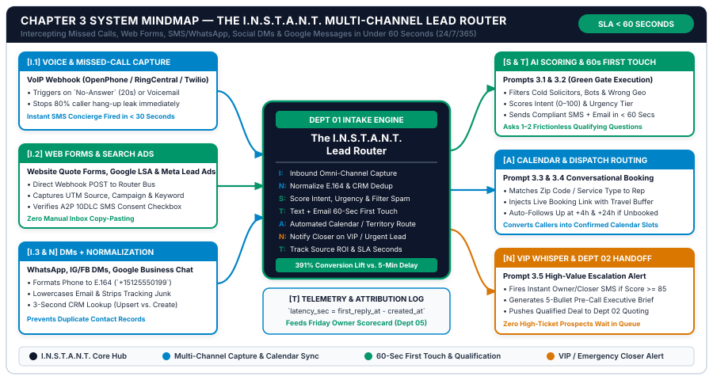
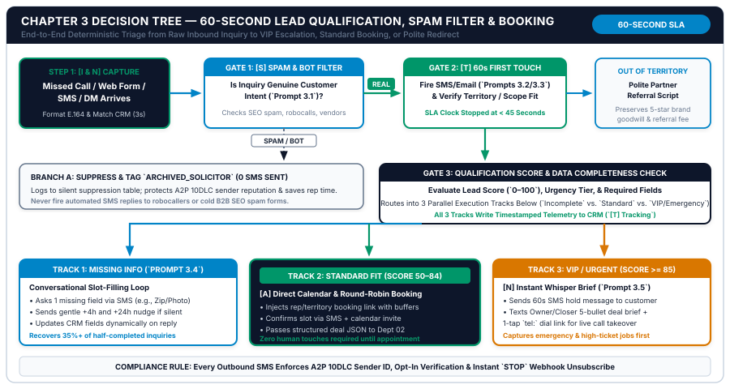

# Chapter 3: The 60-Second Speed-to-Lead & Multi-Channel Intake System

**Part II:** Revenue Frontline — Lead Capture, Speed-to-Lead & Quoting  
**Core Framework:** *The I.N.S.T.A.N.T. Lead Router (Inbound Capture, Normalization, Scoring & Spam Filter, Text/Email 60s First Touch, Automated Calendar Routing, Notification Escalation, Tracking SLA)*  
**Companion Workbook:** `05-WORKBOOKS/worksheet-03.md` (*Multi-Channel Lead Capture & Qualification Blueprint*)  
**Visual Assets:** `chapter-03-mindmap.svg` | `chapter-03-flowchart.svg`  

---

## 1. Learning Objectives

By the end of this chapter, you and your revenue frontline team will be able to execute six measurable operational outcomes:

1. **Eliminate the 4-Hour Lead Decay Cliff:** Replace manual voicemail checking and delayed email replies with a 24/7/365 intake engine that responds to 100% of genuine prospects across every channel in **under 60 seconds**.
2. **Unify Six Inbound Doors into One Webhook Bus (`[I]` & `[N]`):** Connect missed phone calls, website forms, Google Business Profile messages, Meta/Instagram Lead Ads & DMs, SMS/WhatsApp, and direct email inquiries into a single normalized E.164/CRM contact pipeline with zero duplicate records.
3. **Filter Out Robocalls, Bots & Cold Solicitors Automatically (`[S]`):** Deploy a pre-response AI classifier that suppresses B2B SEO spam, merchant cash advance pitches, and robocallers before a single SMS token is wasted, while scoring genuine buyer intent from `0 to 100`.
4. **Execute Compliant 60-Second SMS & Email First Touches (`[T]`):** Configure A2P 10DLC / TCPA / GDPR compliant instant acknowledgements that reference the prospect's exact stated problem and ask 1 to 2 thumb-friendly qualifying questions.
5. **Automate Territory & Calendar Booking + VIP Whisper Alerts (`[A]` & `[N]`):** Route standard qualified prospects directly onto your calendar with travel buffers enforced, while firing an instant mobile whisper brief to the owner or lead closer whenever a high-ticket or emergency lead (`Score >= 85`) arrives.
6. **Track Source Attribution & Second-by-Second SLA Telemetry (`[T]`):** Log exact `response_sla_seconds` and UTM campaign source on every deal record to feed your Friday Owner Scorecard.

---

## 2. The Real-World Friction Point

At 2:18 PM on a Wednesday afternoon following a heavy hailstorm in suburban Dallas, Texas, a homeowner named Karen notices water staining her upstairs ceiling. She opens Google on her iPhone, searches *"roof leak inspection near me,"* and clicks on the top three local roofing contractors.

1. **Contractor #1 (`Manual Voicemail Trap`):** Karen taps the "Call" button on the first listing. The office manager is currently on line one speaking with a shingle supplier, and the owner is on a ladder five miles away. After four rings, the call hits a generic voicemail box: *"You've reached Premier Roofing. Leave your name and number and we'll get back to you as soon as possible."* Like **82% of local service callers who hit voicemail**, Karen hangs up without leaving a message. Contractor #1 paid $68 for that Google Local Service Ad click and never even knew Karen existed.
2. **Contractor #2 (`Web Form Email Delay Trap`):** Karen clicks the second contractor's website and submits their "Request a Free Inspection" form at 2:20 PM. The website displays: *"Thank you! Somebody from our team will contact you within 24–48 business hours."* Meanwhile, the form submission sends a plain-text notification email to `info@contractor2.com`, where it sits unread until 6:45 PM.
3. **Contractor #3 (`MetroShield Roofing — Running The I.N.S.T.A.N.T. Lead Router`):** Karen calls Contractor #3 at 2:21 PM. All lines are momentarily busy with storm volume, so after 18 seconds of ringing, the VoIP webhook fires into the **I.N.S.T.A.N.T. Lead Router**. Exactly **29 seconds later**—while Karen is still holding her phone looking at Google—her iPhone buzzes with an SMS from MetroShield Roofing:
   > *"Hi! This is the dispatch desk at MetroShield Roofing. We saw we just missed your call while helping another homeowner! Are you calling about (1) Active Storm/Leak Damage, (2) a Full Roof Replacement Quote, or (3) Gutter/Siding Repair? Reply 1, 2, or 3 and your zip code so we can lock in your priority inspection right now."*

Karen replies: *"1 - 75024, water spot on ceiling after yesterday's hail."*
Within **14 seconds**, the conversational intake assistant (`Prompt 3.3`) verifies that `75024` (Plano, TX) is inside Territory North, scores the lead at `94/100 (URGENT_STORM_LEAK)`, texts Karen a direct link to choose between the `Thursday 10:00 AM` or `Thursday 2:00 PM` inspection slot, and simultaneously sends an **Amber/VIP Whisper SMS (`Prompt 3.5`)** to MetroShield's senior estimator with a one-tap dial link. By 2:24 PM—three minutes after her initial call—Karen is booked on MetroShield's calendar with an automated confirmation and photo-upload link. When Contractor #2 finally emails her back at 6:45 PM that evening, she deletes the email without opening it.

### The Physics of Lead Decay Across Every Small Business Vertical

The scenario above is not unique to roofing or home services. Empirical multi-industry conversion data proves that **Speed-to-Lead is the highest-impact variable in small business revenue growth**:

$$\text{Lead Qualification Probability}(t) = P_0 \cdot e^{-\lambda t}$$

Where $t$ is the elapsed minutes between the buyer's inquiry and your first interactive response:

| Elapsed Time Since Prospect Inquiry ($t$) | Relative Contact Rate vs. 30+ Mins | Relative Qualification / Booking Rate | Operational State of the Prospect |
| :--- | :--- | :--- | :--- |
| **`0 to 60 Seconds` (`Studio SLA`)** | **100x Baseline** | **+391% Lift vs. 5-Min Mark (`21x+ vs. 30m`)** | Prospect is still holding their phone or sitting at their browser tab; competitor outreach stops immediately once booked. |
| **`1 to 5 Minutes`** | `100x Baseline` | `21x vs. 30-Minute Mark` | High engagement, but in urgent local searches the buyer has often already dialed the second provider on Google. |
| **`5 to 30 Minutes`** | `10x Drop-Off` | `4x Drop-Off` | Prospect has returned to work, stepped into a meeting, or put their phone in their pocket; calls go to *their* voicemail. |
| **`30 Minutes to 4 Hours` (`SMB Average`)** | `1x Baseline` | `1x Baseline` | Buyer has either booked with a faster responder or lost emotional momentum; requires 6+ follow-up touches just to reconnect. |
| **`4 to 24+ Hours` (`After-Hours / Weekend`)** | `0.15x (85% Dead)` | `0.04x (96% Conversion Decay)` | Paid advertising capital is effectively incinerated; prospect frequently does not even remember which company you are. |

---

## 3. Why Standard Approaches Fail

Why do 89% of small businesses still average more than four hours to respond to inbound leads despite paying thousands of dollars a month for ads, SEO, and website traffic? Because the three standard intake methods used by small businesses are structurally incapable of hitting a 60-second SLA across six channels.

### Failure Mode 1: The Static "Thank You, We Will Call You in 24 Hours" Auto-Responder

Many website builders and email systems send a generic static confirmation: *"We received your submission and a representative will reach out within 1–2 business days."*

A static receipt is **not** Speed-to-Lead:
1. **It Does Not Stop the Prospect from Shopping:** Telling an anxious homeowner, patient, or B2B buyer to wait 24 hours practically instructs them to go call your competitors right now.
2. **It Does Not Qualify or Advance the Sale:** A static receipt asks zero contextual questions, captures zero missing fields, and offers zero calendar booking paths.
3. **Email-Only Auto-Replies Get Buried:** Over 68% of consumer and local B2B inquiries originate on mobile devices. An automated email often lands in Gmail's `Promotions` tab, whereas a compliant, conversational SMS sent within 45 seconds achieves a **94% to 98% open rate within 3 minutes**.

### Failure Mode 2: Third-Party Human Answering Services ("Message-Taking Call Centers")

To solve missed calls, many clinics, law firms, and trade contractors pay $350 to $900 per month for a traditional human answering service. In practice, outsourced call centers create three new bottlenecks:
* **Scripted Interrogation Without Booking Power:** Call-center operators read rigid scripts on a screen, know nothing about your actual services, and cannot book directly into your territory-buffered calendar or check your CRM history. Callers quickly realize they are speaking to an outsourced message-taker and hang up.
* **Delayed Message Forwarding:** After taking a message, the answering service emails a summary to the owner's inbox—where it still sits for three hours until the owner finishes their current job or consultation!
* **Zero Multi-Channel Coverage:** Answering services only answer voice calls; they do nothing for your website forms, Instagram DMs, Google Business chats, or incoming texts.

### Failure Mode 3: Unfiltered SMS Blasting to Every Inbound Event (Spam & Carrier Suspension)

The opposite mistake occurs when an owner sets up a naive Zapier rule that blindly texts every single phone number or form submission without an AI classification filter (`Prompt 3.1`) or A2P 10DLC compliance:
* **Wasting Credits & Reputation on Robocalls and SEO Spammers:** Up to 25% of inbound calls and web form submissions to small businesses are automated robocalls, overseas SEO link-builders, or B2B software solicitors. Blindly texting spammers triggers carrier spam flags.
* **Carrier Filtering for Unregistered Numbers:** Sending automated texts from an unregistered personal or VoIP number without proper sender identification and `STOP` handling results in mobile carriers (AT&T, Verizon, T-Mobile, Vodafone, Telstra) silently blocking your messages at the network gateway.

| Intake Dimension | Static Web Auto-Responder | Outsourced Call Center ($600/mo) | Naive Unfiltered Zapier Blast | The Studio Solution: I.N.S.T.A.N.T. Lead Router |
| :--- | :--- | :--- | :--- | :--- |
| **Multi-Channel Coverage** | Web form email only | Phone voice calls only | Single channel | **All 6 Channels (Calls, Web, SMS, GBP, Social, Email)** |
| **Interactive Response Speed** | 0% interactive (Wait 24h) | 2–4 min hold + manual callback | Instant, but unintelligent | **Under 45 Seconds (Personalized & Contextual)** |
| **Spam & Robocall Filtering** | None | Charges you per minute for spam! | Texts spammers (Risk of ban) | **AI Intent & Spam Classifier (`Prompt 3.1`) Pre-Filter** |
| **Direct Calendar Booking** | None | Rare (Takes a message only) | Static link with no territory logic | **Territory & Service-Matched Live Calendar Booking** |
| **VIP / Emergency Escalation** | None | Generic email note | None | **Instant Owner Whisper Brief + 1-Tap Dial (`Prompt 3.5`)** |

---

## 4. Core Framework: The I.N.S.T.A.N.T. Lead Router

To capture every genuine opportunity across all channels within 60 seconds while maintaining 100% T.R.A.V. safety and carrier compliance, **Department 01** runs on a seven-stage deterministic pipeline called **The I.N.S.T.A.N.T. Lead Router**:

* **`I` — Inbound Omni-Channel Capture**
* **`N` — Normalization & 3-Second CRM Deduplication**
* **`S` — Scoring, AI Intent Qualification & Spam Filtering**
* **`T` — Text & Email 60-Second First Touch**
* **`A` — Automated Calendar & Territory Dispatch Routing**
* **`N` — Notification Whisper Escalation for High-Value / Urgent Leads**
* **`T` — Tracking Source Attribution & Speed-to-Lead SLA Telemetry**

---

### 4.1 Stage `I`: Inbound Omni-Channel Capture

Instead of checking six separate apps throughout the day, wire all six inbound customer entry points into a single webhook listener URL in your automation bridge (Make, Zapier, or n8n):

1. **Voice & Missed-Call Capture (`VoIP Webhook`):** Configure your business phone system (`OpenPhone`, `RingCentral`, `Twilio`, `HighLevel`, `Nextiva`, or `Aircall`) so that whenever an inbound call rings unanswered for 20 seconds, hits a busy line, or arrives outside business hours, it immediately fires a `call.missed` or `voicemail.created` webhook containing `caller_number`, `called_number`, `call_timestamp_utc`, and `voicemail_transcript` (if left).
2. **Website Forms & Landing Pages (`Form Webhook`):** Connect your website forms (`WPForms`, `Gravity Forms`, `Typeform`, `Tally`, `Webflow`, `HubSpot Forms`, `Shopify Contact`) via direct Webhook POST—never by scraping notification emails if a native webhook is available.
3. **Google Business Profile & Local Service Ads (`GBP / LSA Webhook`):** Connect Google Business messages and Local Service Ad leads so local map searchers receive an instant reply while still viewing your Google listing.
4. **Social Lead Ads & Direct Messages (`Meta / Instagram / LinkedIn`):** Connect Meta Lead Ads and Instagram/Facebook Page DMs (`ManyChat` or native Meta webhook) to capture mobile social inquiries.
5. **Direct SMS & WhatsApp Business:** Route inbound customer texts and WhatsApp messages directly into the conversational intake thread.
6. **Direct Email Inquiries (`info@`, `sales@`, `quotes@`):** Use an email parser or inbox webhook filter (excluding `noreply@` and known vendor domains) to capture prospects who email directly.

---

### 4.2 Stage `N`: Normalization & 3-Second CRM Deduplication

Within the first **3 seconds** of receiving any webhook from Stage `I`, the router normalizes the raw fields into the **12 Canonical Lead Fields** (`Worksheet 3 — Part B`):

1. **E.164 Phone Formatting Formula:**
   * Raw inputs arrive in messy formats: `(512) 555-0194`, `512.555.0194`, `07700 900077`.
   * Strip all non-digit characters (`re.sub(r'\D', '', raw_phone)`). If 10 digits (US/CA), prepend `+1`; if 11 digits starting with `1`, prepend `+`; if UK starting with `07`, replace leading `0` with `+44` -> `+15125550194` or `+447700900077`.
2. **3-Second CRM Upsert Check:**
   * Query your CRM (`HubSpot`, `Pipedrive`, `HighLevel`, `Jobber`, `JaneApp`, `Zoho`, or `Notion CRM`) by exact `phone_e164` first, then `email_clean`.
   * **Existing Customer Check:** If the caller or sender is already an active customer with an open job or support ticket, tag `is_existing_customer = true` so the AI greets them as a valued client (`"Welcome back, {{first_name}}!"`) or routes them to `Dept 03 Support` rather than treating them like a cold stranger.

---

### 4.3 Stage `S`: Scoring, AI Intent Qualification & Spam Filtering (`Prompt 3.1`)

Before sending a single outbound text or creating a sales deal, pass the normalized payload into **Prompt 3.1** (`temperature: 0.1`), which performs three instant evaluations:

1. **Spam, Bot & Vendor Solicitor Suppression:**
   * Identifies robocalls (empty 2-second hang-ups on known toll-free prefixes), SEO/web-design cold pitches, virtual-assistant spammers, and job applicants.
   * If `is_spam_or_solicitor == true`, the workflow terminates outbound messaging immediately (`0 SMS sent`) and logs the event to the silent suppression table.
2. **Service-Category & Territory Fit Check:**
   * Matches the prospect's request against your approved `Service_Lines` and `Approved_Zip_Codes`.
   * If the prospect requests a service you do not offer or lives outside your territory, routes to the **Polite Partner Referral Script** (preserving goodwill and capturing partner referral commissions).
3. **100-Point Lead Intent & Urgency Scoring Formula:**

$$\text{Lead Intent Score } (0\text{–}100) = \text{Service Margin Fit } (0\text{–}30) + \text{Urgency Tier } (0\text{–}30) + \text{Territory Match } (0\text{–}20) + \text{Contact Completeness } (0\text{–}20)$$

* **Score `85–100` (`VIP / Emergency Track`):** High-ticket replacement, commercial retainer, emergency repair/clinical need, or repeat VIP client.
* **Score `50–84` (`Standard Qualified Track`):** In-scope inquiry ready for instant self-serve calendar booking or standard estimate intake.
* **Score `1–49` (`Incomplete / Exploratory Track`):** Genuine prospect missing critical details (e.g., missed call with no voicemail, or web form with a 2-word message), routed to conversational slot-filling (`Prompt 3.3` & `Prompt 3.4`).

---

### 4.4 Stage `T`: Text & Email 60-Second First Touch (`Prompts 3.2 & 3.3`)

Between **Second 10 and Second 40**, the router dispatches the **Dual-Channel 60-Second First Touch**:

1. **Channel 1 — Compliant Conversational SMS (< 280 Characters):**
   * Why SMS First? Because 95% of SMS messages are read within 3 minutes, whereas emails wait hours.
   * **Anatomy of a High-Converting 60-Second SMS:**
     * **Element 1 (Clear Identity):** *"Hi {{first_name}}, this is the dispatch/intake desk at `[BUSINESS_NAME]`."*
     * **Element 2 (Specific Context Mirror):** Acknowledge *how* they reached out (*"We saw we just missed your call"* or *"Just received your inquiry about `[SERVICE_MENTIONED]`"*).
     * **Element 3 (Zero-Friction Micro-Question or Direct Booking Link):** Never ask an open-ended essay question. Ask a numbered `1 / 2 / 3` choice or provide the direct calendar link.
2. **Channel 2 — Structured Rich Email (For Web Form & Email Leads):**
   * Sent simultaneously with the SMS, providing a warm 3-paragraph overview, confirmation of their submitted details, answers to top pre-appointment questions, and an embedded booking button.
3. **Strict A2P 10DLC, TCPA & Carrier Compliance Rules:**
   * Only send automated SMS when `sms_opt_in_status == true` (verified via web form consent checkbox or inbound customer-initiated call/text).
   * Always honor `STOP` / `UNSUBSCRIBE` keywords at the carrier level.

---

### 4.5 Stage `A`: Automated Calendar & Territory Dispatch Routing

Once the prospect clicks your booking link or replies to your SMS concierge (`Prompt 3.3`), **Stage `A`** locks them onto your schedule without human back-and-forth:

* **Territory & Skill Routing:** If you operate multiple vans, providers, or account executives, the router selects the correct calendar link based on `postal_code` or `service_category` (e.g., routing Invisalign consults to the Ortho Coordinator calendar, and emergency root canals to the Emergency Exam slot).
* **Mandatory Calendar Buffer Rules:** Always configure your scheduling tool (`Cal.com`, `Calendly`, `HighLevel`, `Acuity`, `Jobber`, `JaneApp`) with:
  * **Minimum Notice Window:** `2 to 4 hours` minimum advance notice so staff are never surprised by a booking 5 minutes from now.
  * **Travel / Prep Buffer:** `15 to 30 minutes` before and after appointments.
  * **Daily Cap per Slot Type:** Cap free consultations or field inspections (e.g., `max 4 per day per estimator`) to protect production capacity.

---

### 4.6 Stage `N`: Notification Whisper Escalation for High-Value Leads (`Prompt 3.5`)

What happens when a **$15,000 commercial roofing inquiry**, a **$6,000 full-arch dental implant lead**, or a **$5,000/month B2B agency retainer** submits a form at 11:15 AM?

You do not merely send them a self-serve calendar link and hope they click it. Whenever `lead_intent_score >= 85` (or `urgency_tier == "EMERGENCY_SAME_DAY"`), **Stage `N`** fires an instant **VIP Whisper Alert (`Prompt 3.5`)** to the owner or lead closer's mobile phone via SMS and Slack:
* Contains a **5-bullet Executive Pre-Call Brief** (Prospect Name, Service & Est. Value, Urgency Trigger, Location, and Suggested Opening Hook).
* Includes a one-tap **`tel:+15125550194`** link so the closer can call the prospect live within 90 seconds while the prospect is still reading your 60-second confirmation text.

---

### 4.7 Stage `T`: Tracking Source Attribution & Speed-to-Lead SLA Telemetry

The final letter of `I.N.S.T.A.N.T.` closes the loop on marketing ROI and operational accountability. Before the workflow finishes, it writes three telemetry fields to your CRM Deal Record:

$$\text{Response SLA (Seconds)} = t_{\text{first\_outbound\_sent}} - t_{\text{inbound\_webhook\_received}}$$

1. `response_sla_seconds` (e.g., `34 seconds`)
2. `utm_source_and_campaign` (e.g., `google_lsa_hail_repair` or `meta_ig_ortho_reel`)
3. `first_touch_outcome` (`BOOKED_INSTANT`, `CONVERSATION_ACTIVE`, `VIP_WHISPER_ESCALATED`, `REDIRECTED_OUT_OF_GEO`, or `SUPPRESSED_SPAM`)

Every Friday at 3:00 PM, `Dept 05` aggregates these exact fields onto your **Friday Owner Scorecard**, showing your median weekly response time in seconds and your exact revenue generated per marketing channel.

---

## 5. Visual Architecture: System Mindmap

The diagram below illustrates **The I.N.S.T.A.N.T. Multi-Channel Lead Router**, mapping how all six inbound communication channels converge into the central `Dept 01` intake hub and branch into 60-second first touches, territory calendar routing, and VIP whisper escalations.



### Architectural Walkthrough of the I.N.S.T.A.N.T. Mindmap

1. **Left Column — Omni-Channel Capture & Normalization (`[I.1]`, `[I.2]`, `[I.3 & N]`):**
   * **`[I.1] Voice & Missed-Call Capture` (`#0284C7`):** Intercepts unanswered VoIP calls after 20 seconds of ringing or voicemail deposit, stopping the 80% voicemail hang-up leak.
   * **`[I.2] Web Forms & Search Ads` (`#059669`):** Captures website quote forms, Google Local Service Ads, and Meta Lead Ads via direct webhook POST with UTM parameters and A2P SMS consent intact.
   * **`[I.3 & N] DMs + Normalization` (`#0284C7`):** Pulls in WhatsApp, Instagram/Facebook DMs, and Google Business chats, formats phone numbers into `E.164`, cleanses emails, and executes a 3-second CRM lookup to upsert existing contacts rather than creating duplicates.
2. **Center Hub — `The I.N.S.T.A.N.T. Lead Router` (`#0F172A` Navy Core):**
   * Executes the 7-step `I-N-S-T-A-N-T` sequence in under 45 seconds, logging `latency_sec = first_reply_at - created_at` into the `[T] Telemetry & Attribution Log` box below the hub.
3. **Right Column — Scoring, 60-Second Response, Booking & VIP Escalation (`[S & T]`, `[A]`, `[N]`):**
   * **`[S & T] AI Scoring & 60s First Touch` (`#059669`):** Runs `Prompts 3.1 & 3.2` in the Green Zone to suppress cold spam, score buyer intent (`0–100`), and dispatch a personalized SMS + email in under 60 seconds.
   * **`[A] Calendar & Dispatch Routing` (`#0284C7`):** Matches zip code and service type to the right calendar with travel buffers, and automatically follows up at `+4h` and `+24h` (`Prompt 3.4`) if the prospect hasn't finished booking.
   * **`[N] VIP Whisper & Dept 02 Handoff` (`#D97706` Amber):** Fires an immediate 5-bullet closer alert (`Prompt 3.5`) whenever `Score >= 85` and hands the structured deal JSON directly to `Dept 02 Quoting`.

---

## 6. Step-by-Step Implementation Protocol

Execute this **7-Step Implementation Protocol** to bring your 60-Second Speed-to-Lead system live across your phone line and website this week.

### Step 1: Audit & Register Your Business Messaging Number (A2P 10DLC / Sender Compliance)
In your cloud phone/SMS platform (`OpenPhone`, `Twilio`, `HighLevel`, `RingCentral`), verify that your business profile (EIN / Company Registration Number) and conversational intake campaign are registered. Add the mandatory SMS opt-in checkbox disclosure (`Worksheet 3 — Part D`) to every website contact form.

### Step 2: Create the 12 Canonical Lead Properties in Your CRM
Open your CRM settings and verify that all 12 Canonical Lead Fields from `Worksheet 3 — Part B` exist (`phone_e164`, `postal_or_zip_code`, `source_channel`, `utm_campaign_source`, `service_category`, `urgency_tier`, `lead_intent_score`, `sms_opt_in_status`, `response_sla_seconds`, and `bot_pause`).

### Step 3: Wire the Multi-Channel Webhook Entry Bus
Create a new scenario in Make, Zapier, or n8n titled **`DEPT01_INSTANT_LEAD_ROUTER`**:
* **Trigger Node A (Web Forms / Ad Leads):** Custom Webhook URL receiving JSON POST payloads from your website forms, Google LSA, and Meta Lead Ads.
* **Trigger Node B (Missed Call Concierge):** VoIP webhook listening for `call.missed`, `call.no_answer`, or `voicemail.created`.
* **Step 1 Hygiene Gate:** Attach the Chapter 2 Idempotency Hash (`phone_e164 + channel + 5m_bucket`) and block `noreply@` or internal staff numbers.

### Step 4: Configure the 3-Second CRM Upsert & Customer Status Check
Add a `Search Contacts` module querying `phone_e164` (or `email_clean`):
* **If Contact Exists AND `bot_pause == TRUE`:** Terminate automation immediately (a human staff member is already actively conversing with this contact).
* **If Contact Exists AND `open_support_ticket == TRUE`:** Route to `Dept 03 Support Triage` rather than cold lead intake.
* **If New Contact (or Past Customer with New Inquiry):** Upsert the contact record and pass the normalized payload to Step 5.

### Step 5: Deploy `Prompt 3.1` (Intent Classifier, Scorer & Spam Filter) & `Prompt 3.2/3.3` (60-Second Responder)
Call your LLM API (`temperature: 0.1`, `json_object`) with `Prompt 3.1` and `Prompt 3.2` (for web/email leads) or `Prompt 3.3` (for missed calls).
Add a deterministic Router immediately after the JSON output:
* **Branch 1 (`is_spam_or_solicitor == true`):** Update CRM status to `ARCHIVED_SPAM`. Send **zero** SMS or emails.
* **Branch 2 (`within_service_area == false`):** Send the Polite Partner Referral email/SMS and close deal as `REFER_PARTNER`.
* **Branch 3 (`Genuine In-Scope Lead`):** Dispatch the personalized SMS via your VoIP API and the rich email via Gmail/Outlook, then record `response_sla_seconds`.

### Step 6: Configure the `+4 Hour` & `+24 Hour` Incomplete Lead Slot-Filler (`Prompt 3.4`)
What if a missed caller receives your 60-second SMS at 11:00 AM, reads it while driving, and forgets to reply with their zip code or click the booking link?
* Schedule a lightweight check at **`+4 Hours`** (during business hours `8:00 AM – 7:30 PM` local time) and **`+24 Hours`**:
* Query the CRM Deal: If `appointment_booked == false` AND `prospect_replied == false`, trigger **`Prompt 3.4`** to send a helpful 1-sentence follow-up nudge (*"Hi {{first_name}}, just making sure you got our link earlier—did you still need help with {{service_category}} this week, or would you prefer a quick 2-minute phone call?"*).

### Step 7: Wire the VIP Whisper Alert (`Prompt 3.5`) & End-to-End SLA Test
Add a conditional branch for `lead_intent_score >= 85` OR `urgency_tier == "EMERGENCY_SAME_DAY"`. When triggered, run **`Prompt 3.5`** and push the 5-bullet Whisper Brief to the owner/closer's phone via SMS and Slack `#vip-leads-urgent`. Finally, run the **5 Live Verification Tests** in `Worksheet 3 — Part E` to confirm your median response SLA is under 45 seconds.

---

## 7. Operational Decision Tree

The **60-Second Lead Qualification, Spam Filter & Booking Decision Tree** below governs how every inbound call, form, and message is triaged inside `Dept 01`.



### Gate-by-Gate Walkthrough of the Chapter 3 Decision Tree

1. **`Step 1: [I & N] Capture & Normalize` (`#0F172A` Navy Box):**
   * Intercepts the missed call, web form, SMS, or social DM, formats the phone number to `E.164`, and matches existing CRM records within 3 seconds.
2. **`Gate 1: [S] Spam & Bot Filter` (`#0284C7` System Cyan Box):**
   * Evaluates whether the inquiry represents genuine customer intent (`Prompt 3.1`).
   * **If `SPAM / BOT`:** Routes down to **`BRANCH A: SUPPRESS & TAG ARCHIVED_SOLICITOR (0 SMS SENT)`**, protecting your A2P sender reputation and saving rep time.
   * **If `REAL`:** Advances right to `Gate 2`.
3. **`Gate 2: [T] 60s First Touch & Territory Fit` (`#059669` Emerald Box):**
   * Fires the compliant 60-second SMS/email (`Prompts 3.2/3.3`), stopping the SLA clock at `<45 seconds`, and checks geographic/service fit.
   * **If `OUT OF TERRITORY`:** Routes right to the **`Polite Partner Referral Script`**.
   * **If `IN-SCOPE`:** Advances down to `Gate 3`.
4. **`Gate 3: Qualification Score & Data Completeness Check` (`#0F172A` Header Bar):**
   * Evaluates `lead_intent_score (0–100)` and required fields, routing the prospect into one of three parallel bottom tracks:
     * **`TRACK 1: MISSING INFO (Prompt 3.4)` (`#0284C7` Left Card):** Runs the conversational slot-filling loop (`+4h` and `+24h` nudges) to capture missing zip codes, photos, or service selections, recovering 35%+ of half-completed inquiries.
     * **`TRACK 2: STANDARD FIT — SCORE 50–84` (`#0F172A/#059669` Center Card):** Injects the territory-matched booking link with travel buffers, confirms the calendar slot via SMS, and passes the structured deal JSON to `Dept 02`.
     * **`TRACK 3: VIP / URGENT — SCORE >= 85` (`#D97706` Right Card):** Dispatches the 60s customer hold confirmation while simultaneously texting the owner/closer the 5-bullet **VIP Whisper Brief (`Prompt 3.5`)** with a 1-tap `tel:` dial link for immediate live takeover.


---

## 8. Tested AI Workflow Prompts

This section provides the **five production-tested Speed-to-Lead and intake prompts** for Chapter 3 (`Prompt 3.1` through `Prompt 3.5`). Every prompt operates inside the T.R.A.V. governance framework and outputs deterministic JSON ready for Make, Zapier, or n8n.

---

### Prompt 3.1: Multi-Channel Inbound Lead Intent Classifier, Urgency Scorer & Spam Filter

* **Objective:** Analyze any raw inbound inquiry (web form, missed-call voicemail transcript, email, SMS, or social DM), detect and suppress spam/robocalls/solicitors, verify service-area fit, classify the service line and urgency tier, and calculate a deterministic `0–100` Lead Intent Score.
* **Department & Trigger:** `Dept 01: Stage [S] of the I.N.S.T.A.N.T. Lead Router` — Triggered within 3 seconds of every normalized inbound webhook.
* **Input Variables:**
  * `[BUSINESS_NAME]`: Operating name of the company.
  * `[APPROVED_SERVICE_LINES_AND_VALUES]`: Official services offered and their typical deal values.
  * `[APPROVED_GEO_ZIPS_OR_REGIONS]`: Valid service zip codes, cities, or shipping regions.
  * `[VIP_DEAL_VALUE_THRESHOLD]`: Dollar threshold that triggers a VIP Whisper Alert (e.g., `$3,000`).
  * `[RAW_INBOUND_PAYLOAD]`: Channel, sender name, phone, email, postal code, and message/transcript text.

#### Copy-Ready System & User Prompt Block (`Prompt 3.1`)
```markdown
### SYSTEM ROLE
You are a deterministic Revenue Operations Lead Intake Classifier (`temperature: 0.1`). Your job is to evaluate raw inbound inquiries for [BUSINESS_NAME], filter out spam/solicitors, verify geographic and service fit, and compute an accurate 0-100 Lead Intent Score.

### APPROVED BUSINESS PARAMETERS
- Business Name: [BUSINESS_NAME]
- Approved Service Lines & Typical Values: [APPROVED_SERVICE_LINES_AND_VALUES]
- Approved Geographic Territory: [APPROVED_GEO_ZIPS_OR_REGIONS]
- VIP Escalation Deal Threshold: [VIP_DEAL_VALUE_THRESHOLD]

### RAW INBOUND PAYLOAD
[RAW_INBOUND_PAYLOAD]

### EXECUTION RULES & GUARDRAILS
1. SPAM & SOLICITOR CHECK: Set `"is_spam_or_solicitor": true` if the inquiry pitches SEO, web design, virtual assistants, business loans, merchant processing, insurance brokerage, or is an empty robocall/bot submission.
2. TERRITORY & SCOPE CHECK: Compare any mentioned zip/city against `[APPROVED_GEO_ZIPS_OR_REGIONS]` and requested work against `[APPROVED_SERVICE_LINES_AND_VALUES]`. If explicitly outside territory or scope, set `"within_service_scope": false`.
3. LEAD INTENT SCORE (0-100):
   - Service Margin Fit (0-30 pts)
   - Urgency Tier (0-30 pts: Emergency/Same-Day = 30, This Week = 22, This Month = 15, Exploratory = 5)
   - Territory Match (0-20 pts: Confirmed in-zone = 20, Unknown = 10, Out-of-zone = 0)
   - Contact Completeness (0-20 pts: Name + Phone + Specific problem stated = 20)
4. Output strictly in the JSON schema below with zero extra prose.

### REQUIRED OUTPUT SCHEMA
Output a single valid JSON object with keys: `is_spam_or_solicitor` (boolean), `spam_reason` (string|null), `within_service_scope` (boolean), `service_category` (string), `urgency_tier` (`"EMERGENCY_SAME_DAY"` | `"HIGH_THIS_WEEK"` | `"STANDARD_PLANNING"` | `"LOW_EXPLORATORY"`), `estimated_deal_value_usd` (number), `lead_intent_score` (integer 0-100), `missing_critical_fields` (array of strings), and `recommended_routing_track` (`"SUPPRESS_SPAM"` | `"POLITE_REFERRAL"` | `"TRACK_1_SLOT_FILL"` | `"TRACK_2_STANDARD_BOOK"` | `"TRACK_3_VIP_WHISPER"`).
```

#### Realistic Sample Output (`Prompt 3.1`)
```json
{
  "is_spam_or_solicitor": false,
  "spam_reason": null,
  "within_service_scope": true,
  "service_category": "FULL_ROOF_REPLACEMENT_HAIL_DAMAGE",
  "urgency_tier": "EMERGENCY_SAME_DAY",
  "estimated_deal_value_usd": 14500,
  "lead_intent_score": 96,
  "missing_critical_fields": [],
  "recommended_routing_track": "TRACK_3_VIP_WHISPER"
}
```

---

### Prompt 3.2: 60-Second Personalized SMS & Email First-Touch Responder

* **Objective:** Compose a compliant, natural, context-mirroring **60-Second SMS (`<= 280 chars`)** and **Rich First-Touch Email** that acknowledges the prospect's exact problem within seconds of form/email submission, answers their top implicit question, and presents a frictionless booking or reply call-to-action.
* **Department & Trigger:** `Dept 01: Stage [T] of the I.N.S.T.A.N.T. Lead Router` — Triggered immediately when `Prompt 3.1` confirms `is_spam_or_solicitor == false`.
* **Input Variables:**
  * `[BUSINESS_NAME]`: Operating name of the company.
  * `[PROSPECT_FIRST_NAME]`: Normalized first name (or `"there"`).
  * `[CLASSIFIED_SERVICE_AND_URGENCY]`: Output from `Prompt 3.1`.
  * `[PROSPECT_ORIGINAL_MESSAGE]`: What the prospect wrote on the form, DM, or email.
  * `[MATCHED_CALENDAR_BOOKING_URL]`: Direct territory/rep booking link.
  * `[APPROVED_TRUST_CREDENTIAL]`: 1-line social proof fact (e.g., `"4.9-Star Rated across 310+ local homeowners"` or `"10-Year Workmanship Guarantee"`).

#### Copy-Ready System & User Prompt Block (`Prompt 3.2`)
```markdown
### SYSTEM ROLE
You are the Frontline Intake Concierge for [BUSINESS_NAME] (`temperature: 0.1`). You craft warm, ultra-responsive 60-second SMS and email first-touch messages that make prospects feel immediately heard and guide them to book their appointment right now.

### INPUT VARIABLES
- Business Name: [BUSINESS_NAME]
- Prospect First Name: [PROSPECT_FIRST_NAME]
- Service Category & Urgency: [CLASSIFIED_SERVICE_AND_URGENCY]
- Prospect's Original Inquiry: [PROSPECT_ORIGINAL_MESSAGE]
- Direct Calendar Booking Link: [MATCHED_CALENDAR_BOOKING_URL]
- Approved Trust Credential: [APPROVED_TRUST_CREDENTIAL]

### EXECUTION RULES & GUARDRAILS
1. SMS RULES:
   - Must be <= 280 characters total.
   - Must identify `[BUSINESS_NAME]` in the first sentence.
   - Mirror 1 specific detail from `[PROSPECT_ORIGINAL_MESSAGE]` so they know this is not a generic static blast.
   - End with `[MATCHED_CALENDAR_BOOKING_URL]` OR 1 simple reply question.
2. EMAIL RULES:
   - Write a compelling subject line referencing their specific request.
   - Keep body under 160 words: (a) Personal acknowledgement of their exact situation, (b) 3 bullet points explaining what happens during our visit/consult, (c) `[APPROVED_TRUST_CREDENTIAL]`, and (d) Clear call-to-action link.
3. Never quote custom prices or unverified arrival promises. Use zero banned AI clichés.

### REQUIRED OUTPUT SCHEMA
Output a single valid JSON object with keys: `sms_first_touch` (string <= 280 chars), `sms_char_count` (integer), `email_subject` (string), `email_body_markdown` (string), and `trav_zone` (`"GREEN"`).
```

#### Realistic Sample Output (`Prompt 3.2`)
```json
{
  "sms_first_touch": "Hi Karen! This is MetroShield Roofing. Just got your note about the upstairs ceiling leak after the hailstorm in 75024. We have priority storm-inspection slots open tomorrow—grab your best time here or reply with a good time to call: https://cal.com/metroshield/north",
  "sms_char_count": 269,
  "email_subject": "Priority Roof Leak & Hail Inspection (75024) — MetroShield Roofing",
  "email_body_markdown": "Hi Karen,\n\nWe just received your request regarding the upstairs ceiling water spot following yesterday's hailstorm in **75024**. Active leaks are our top priority so we can protect your drywall and insulation right away.\n\n**What happens during your complimentary 30-minute Storm & Leak Inspection:**\n- **Immediate Leak Source Pinpointing:** Emergency tarp/seal assessment if active intrusion is found.\n- **Drone & Chalk Hail Documentation:** Photo report ready for your homeowner's insurance adjuster if needed.\n- **3-Option Written Estimate:** Clear repair vs. replacement options on the spot.\n\n*MetroShield is 4.9-Star Rated across 380+ Dallas-Fort Worth homeowners with a 10-Year Leak-Free Workmanship Guarantee.*\n\n**[Click Here to Pick Your Inspection Window Tomorrow](https://cal.com/metroshield/north)** — or simply reply to our text message and we will lock it in for you.\n\nBest regards,\n**MetroShield Dispatch Desk**",
  "trav_zone": "GREEN"
}
```

---

### Prompt 3.3: Missed-Call Text-Back Conversational Intake & Booking Assistant

* **Objective:** Intercept an unanswered phone call within **30 seconds**, initiate a polite two-turn SMS conversation that identifies what the caller needs (`Option 1, 2, or 3`) and their zip code/timeline, and convert the missed call into a booked appointment.
* **Department & Trigger:** `Dept 01: VoIP Missed-Call Webhook (`call.no_answer` / `voicemail.created`)`.
* **Input Variables:**
  * `[BUSINESS_NAME]`: Operating name of the company.
  * `[CALLER_PHONE_E164]`: Caller's formatted phone number.
  * `[VOICEMAIL_TRANSCRIPT_IF_ANY]`: Transcript if the caller left a message, or `"NONE_HANGUP"` (80%+ of cases).
  * `[THREE_NUMBERED_SERVICE_OPTIONS]`: The 3 primary reasons customers call your business.
  * `[CALENDAR_BOOKING_LINKS_BY_OPTION]`: Direct booking URLs mapped to Options 1, 2, and 3.

#### Copy-Ready System & User Prompt Block (`Prompt 3.3`)
```markdown
### SYSTEM ROLE
You are the 30-Second Missed-Call SMS Concierge for [BUSINESS_NAME] (`temperature: 0.1`). When a phone call goes unanswered while the team is helping other clients, you immediately text the caller, determine whether they left a voicemail or hung up, and guide them into a booked slot in 2 thumb-taps.

### INPUT VARIABLES
- Business Name: [BUSINESS_NAME]
- Caller Phone: [CALLER_PHONE_E164]
- Voicemail Transcript (or NONE_HANGUP): [VOICEMAIL_TRANSCRIPT_IF_ANY]
- 3 Primary Service Options: [THREE_NUMBERED_SERVICE_OPTIONS]
- Calendar Booking Links by Option: [CALENDAR_BOOKING_LINKS_BY_OPTION]

### EXECUTION RULES & GUARDRAILS
1. IF `[VOICEMAIL_TRANSCRIPT_IF_ANY]` IS `"NONE_HANGUP"` (Caller hung up without leaving a message):
   - Write `turn_1_sms` apologizing for missing their call while on the other line and presenting `[THREE_NUMBERED_SERVICE_OPTIONS]` as a quick `Reply 1, 2, or 3` menu.
2. IF `[VOICEMAIL_TRANSCRIPT_IF_ANY]` CONTAINS A MESSAGE:
   - Write `turn_1_sms` acknowledging the exact detail from their voicemail and providing the matching booking link from `[CALENDAR_BOOKING_LINKS_BY_OPTION]` immediately.
3. Also generate `turn_2_reply_branches` showing the exact automated SMS reply for when the caller texts back `1`, `2`, or `3`.
4. Keep every SMS under 260 characters. Include zero banned AI clichés.

### REQUIRED OUTPUT SCHEMA
Output a valid JSON object with keys: `caller_left_voicemail` (boolean), `extracted_voicemail_intent` (string|null), `turn_1_sms` (string), and `turn_2_reply_branches` (object with keys `"reply_1"`, `"reply_2"`, `"reply_3"`).
```

#### Realistic Sample Output (`Prompt 3.3`)
```json
{
  "caller_left_voicemail": false,
  "extracted_voicemail_intent": null,
  "turn_1_sms": "Hi! This is the front desk at Sterling & Vance Property Law. Sorry we missed your call while in a client signing! Are you calling about: (1) Residential Closing/Conveyancing, (2) Commercial Lease/Purchase, or (3) Title Dispute? Reply 1, 2, or 3 and we'll help right now!",
  "turn_2_reply_branches": {
    "reply_1": "Got it—Residential Closing! What property zip code and target closing date are you working with? You can also grab a 15-min Attorney Intake Call for today or tomorrow right here: https://cal.com/sterlingvance/residential",
    "reply_2": "Got it—Commercial Property! I have flagged our Senior Commercial Partner. What is the property city and transaction timeline? Grab a priority consult slot here or reply with a good time to call: https://cal.com/sterlingvance/commercial",
    "reply_3": "Understood—Title/Boundary Dispute. Because timing is critical on property disputes, let's get you on a brief conflict-check call with our litigation team today. Pick your best time here: https://cal.com/sterlingvance/dispute"
  }
}
```

---

### Prompt 3.4: Incomplete Lead Follow-Up & Missing Details Extraction Engine

* **Objective:** Re-engage prospects who received the 60-second first touch (`Prompt 3.2` or `Prompt 3.3`) but got distracted before booking their calendar slot or answering a required qualification field (`+4 Hour` and `+24 Hour` gentle conversational nudges).
* **Department & Trigger:** `Dept 01: Stage [A] Unbooked Lead Watchdog` — Triggered at `+4 Hours` and `+24 Hours` only if `appointment_booked == false` AND `prospect_replied == false`.
* **Input Variables:**
  * `[BUSINESS_NAME]`: Operating name of the company.
  * `[PROSPECT_FIRST_NAME]`: Prospect's first name.
  * `[ORIGINAL_INQUIRY_TOPIC]`: Service or topic they originally inquired about.
  * `[MISSING_REQUIRED_FIELDS]`: Specific fields still needed (e.g., `postal_code`, `equipment_age`, `square_footage`, or `preferred_day`).
  * `[DIRECT_BOOKING_URL]`: Direct calendar link.

#### Copy-Ready System & User Prompt Block (`Prompt 3.4`)
```markdown
### SYSTEM ROLE
You are a helpful, zero-pressure Intake Coordinator for [BUSINESS_NAME] (`temperature: 0.1`). You write brief, natural `+4 Hour` and `+24 Hour` follow-up nudges to prospects who started an inquiry earlier today but haven't locked in their appointment or answered a key qualification question.

### INPUT VARIABLES
- Business Name: [BUSINESS_NAME]
- Prospect First Name: [PROSPECT_FIRST_NAME]
- Original Inquiry Topic: [ORIGINAL_INQUIRY_TOPIC]
- Missing Qualification Fields: [MISSING_REQUIRED_FIELDS]
- Direct Calendar Booking Link: [DIRECT_BOOKING_URL]

### EXECUTION RULES & GUARDRAILS
1. NEVER sound pushy, annoyed, or robotic (never say "Just bumping this to the top of your inbox").
2. In the `+4 Hour SMS`, ask only ONE simple question from `[MISSING_REQUIRED_FIELDS]` OR offer two concrete day options (e.g., "tomorrow morning vs. Thursday afternoon").
3. In the `+24 Hour SMS & Email`, offer a frictionless alternative ("Would you prefer a quick 2-minute phone call instead of picking a calendar link, or did you already get this taken care of?").
4. Keep SMS messages under 240 characters.

### REQUIRED OUTPUT SCHEMA
Output a valid JSON object with keys: `nudge_4h_sms` (string), `nudge_24h_sms` (string), `nudge_24h_email_subject` (string), and `nudge_24h_email_body` (string).
```

#### Realistic Sample Output (`Prompt 3.4`)
```json
{
  "nudge_4h_sms": "Hi Marcus, just following up from Vanguard Commercial Cleaning! To get your exact office cleaning quote calculated, roughly how many square feet is your facility (and how many nights/week)? Or grab a 10-min walkthrough slot here: https://cal.com/vanguard/walkthrough",
  "nudge_24h_sms": "Hi Marcus, holding a walkthrough spot for your facility this week with Vanguard Cleaning. Would Thursday morning or Friday afternoon work better for a quick 10-min site look, or would you prefer a quick 2-minute phone estimate first?",
  "nudge_24h_email_subject": "Quick question on your facility cleaning estimate — Vanguard Commercial",
  "nudge_24h_email_body": "Hi Marcus,\n\nI wanted to make sure our note yesterday didn't get buried in your inbox. We can put together your 3-option commercial cleaning proposal in two easy ways:\n\n1. **Reply with your approximate square footage and preferred frequency** (e.g., 2x/week or 5x/week) for a ballpark range today.\n2. **[Pick a 10-minute on-site walkthrough window here](https://cal.com/vanguard/walkthrough)** so we can measure and hand you an exact guaranteed quote.\n\nWhich option is easier for your schedule this week?\n\nBest,\n**Vanguard Operations Desk**"
}
```

---

### Prompt 3.5: High-Intent VIP Lead Whisper Brief & Sales Rep Handoff Generator

* **Objective:** Whenever an inbound inquiry scores `>= 85/100` (high-ticket project, commercial contract, or urgent same-day need), generate an instant **5-Bullet Executive Whisper Brief** sent via SMS/Slack to the owner or lead closer with a one-tap dial link and a custom 20-second opening call script.
* **Department & Trigger:** `Dept 01: Stage [N] VIP Escalation Router` — Triggered automatically when `lead_intent_score >= 85` OR `urgency_tier == "EMERGENCY_SAME_DAY"`.
* **Input Variables:**
  * `[BUSINESS_NAME]`: Operating name of the company.
  * `[CLOSER_NAME]`: Name of the owner or senior sales rep receiving the alert.
  * `[NORMALIZED_LEAD_JSON]`: Full lead record + `Prompt 3.1` classification output.
  * `[CRM_DEAL_DEEP_LINK]`: Direct URL to open the deal in the CRM.

#### Copy-Ready System & User Prompt Block (`Prompt 3.5`)
```markdown
### SYSTEM ROLE
You are a Senior Sales Enablement & Dispatch Director for [BUSINESS_NAME] (`temperature: 0.1`). When a high-value VIP or emergency lead arrives, you synthesize a 10-second mobile Whisper Brief for [CLOSER_NAME] so they can tap the phone number and close the appointment on the spot.

### INPUT VARIABLES
- Business Name: [BUSINESS_NAME]
- Assigned Closer Name: [CLOSER_NAME]
- Normalized Lead & Classification Data: [NORMALIZED_LEAD_JSON]
- CRM Deal URL: [CRM_DEAL_DEEP_LINK]

### EXECUTION RULES & GUARDRAILS
1. Format a concise `closer_sms_whisper` (under 300 characters) starting with `🚨 VIP LEAD ([Score]/100 - Est $[Value])` and containing a clickable `tel:[phone_e164]` dial link.
2. Format a structured `slack_handoff_card_markdown` containing:
   - 5-Bullet Deal Snapshot (Who, What, Where, Why Urgent, Source Channel)
   - Word-for-Word 20-Second Call Opening Script referencing the exact 60-second confirmation text we just sent the prospect.
   - 3 Key Discovery Questions to ask on the call to feed Chapter 4's 3-Option Quote Builder.

### REQUIRED OUTPUT SCHEMA
Output a valid JSON object with keys: `closer_sms_whisper` (string), `slack_handoff_card_markdown` (string), and `dept_02_handoff_ready` (boolean).
```

#### Realistic Sample Output (`Prompt 3.5`)
```json
{
  "closer_sms_whisper": "🚨 VIP LEAD (96/100 - Est $14,500): Karen Ross (75024 Plano) - Active upstairs ceiling leak after hailstorm. 60s SMS already sent. Tap to call live now: tel:+12145550188 | CRM: https://app.hubspot.com/deals/99201",
  "slack_handoff_card_markdown": "### 🚨 HIGH-INTENT VIP LEAD ESCALATION — Score: 96/100 (`Est. $14,500`)\n- **Prospect:** Karen Ross | **Tap to Dial:** `tel:+12145550188`\n- **Territory & Zip:** `75024` (Plano — Territory North)\n- **Need & Urgency:** Active upstairs ceiling water spot after Wednesday hailstorm (`EMERGENCY_SAME_DAY`)\n- **Source:** Google Local Service Ad (`SLA: Answered via SMS in 29s`)\n\n**20-Second Live Call Opening Script for Closer:**\n> *\"Hi Karen, this is Devon, Senior Inspector at MetroShield Roofing—our dispatch desk just texted you a moment ago about the ceiling spot in Plano, and since I'm right up in the 75024 area, I wanted to call you personally to see if water is actively dripping right now so we can get a tarp crew or drone out to you first.\"* \n\n**3 Discovery Questions to Feed Dept 02 Quote Builder:**\n1. Approximate age of the current shingle roof and type (3-tab vs. architectural)?\n2. Have you called your homeowner's insurance carrier yet, or would you like our photo report first?\n3. Is the attic access in the garage or hallway?",
  "dept_02_handoff_ready": true
}
```

---

## 9. Real-World Implementation Case Study

### Case Study Profile: MetroShield Roofing & Exterior Restoration
* **Location & Market:** Dallas–Fort Worth Metroplex, Texas (Residential & Commercial Roof Replacement, Storm Restoration & Gutters)
* **Team Size:** 8 Full-Time Staff (1 Founder/Owner, 1 Office & Dispatch Coordinator, 3 Field Sales Estimators, 3 Project Supervisors managing subcontracted installation crews)
* **Trailing 12-Month Gross Revenue (Pre-I.N.S.T.A.N.T. Router):** $1,650,000 / year
* **Implementation Timeline:** 21 Days

### The Pre-Implementation Revenue Hemorrhage
MetroShield spent **$7,800 per month** on Google Local Service Ads, Google Search PPC, Facebook Storm Ads, and yard-sign QR codes, generating an average of **155 raw inbound inquiries per month**. Yet founder Devon Mercer noticed that his three field estimators were sitting idle on Tuesday and Wednesday afternoons, complaining they didn't have enough qualified roof inspections on their calendars.

When Devon ran the **30-Day Speed-to-Lead Audit (`Worksheet 3`)**, the root cause was unmistakable:
1. **34% Missed Call Rate During Storm Peaks:** Whenever hail or high winds hit Dallas, 50+ homeowners called within a 4-hour window. With only one office coordinator answering phones, **53 calls per month hit voicemail**, and **44 of those callers hung up without leaving a message**.
2. **4-Hour Web & Ad Lead Delay:** Leads from website forms and Facebook Lead Ads arrived as email notifications that sat in `info@metroshield.com` for an average of **4 hours and 12 minutes** (and **19.5 hours** on Sundays) before an estimator called them.
3. **24% Lead-to-Inspection Booking Rate:** Because competing roofing companies were knocking on doors and answering phones first, MetroShield was booking inspections on only **37 of its 155 monthly leads (23.9%)**—burning **$4,200/month** in wasted ad spend.

### Deploying the I.N.S.T.A.N.T. Lead Router in 21 Days
Devon connected `OpenPhone`, `WPForms`, `Meta Lead Ads`, `Google Business Profile`, `HubSpot Starter`, and `Cal.com` via `Make.com`:

* **Stage `I` & `N`:** Every missed call (after 18 seconds of ringing) and every web/Facebook form posted directly to the central Make webhook, formatting phone numbers to `E.164` and checking HubSpot in 2.4 seconds.
* **Stage `S` (`Prompt 3.1`):** Filtered out an average of 22 monthly SEO/solicitor spam submissions automatically (`0 SMS wasted`) and scored genuine homeowner leads from `0 to 100`.
* **Stage `T` & `A` (`Prompts 3.2, 3.3, 3.4`):** Dispatched a personalized SMS + email within **38 seconds** offering the `1 / 2 / 3` storm-triage menu and a territory-matched `Cal.com` inspection booking link, backed by `+4h` and `+24h` slot-filling nudges.
* **Stage `N` (`Prompt 3.5`):** Whenever a homeowner reported an active roof leak or full hail replacement (`Score >= 85`), the estimator covering that zip code received an instant **VIP Whisper SMS** with a one-tap dial link and called the homeowner live within 2 minutes.

### Before vs. After Operational Metrics Table (Day 0 Baseline vs. Day 30 Audited Results)

| Frontline Revenue & Speed-to-Lead Metric | Pre-Router Manual Baseline | Post-I.N.S.T.A.N.T. Router (Day 30) | Net Operational Variance & Revenue Impact |
| :--- | :--- | :--- | :--- |
| **Median Daytime First-Response SLA** | `4 hrs 12 mins` | **`38 seconds`** | **-99.7% response latency** |
| **After-Hours & Weekend First-Response SLA** | `19 hrs 30 mins` | **`41 seconds`** (24/7 SMS Concierge) | **100% evening & Sunday storm capture** |
| **Missed Callers Hanging Up With Zero Contact** | `44 lost callers / mo` | **`3 lost callers / mo`** (93% text engagement) | **+41 rescued phone prospects / month** |
| **Cold Spam & Robocalls Reaching Sales Reps** | `22 / month` (3.5 hrs wasted) | **`0 / month`** (100% filtered by `Prompt 3.1`) | **Zero rep distraction or wasted SMS credits** |
| **Lead-to-Booked-Inspection Conversion Rate** | `23.9%` (`37 inspections/mo`) | **`61.2%` (`81 inspections/mo` of 133 real leads)** | **+44 booked roof inspections every month (+119%)** |
| **Effective Ad Cost Per Booked Inspection** | `$210.81 / booked inspection` | **`$96.30 / booked inspection`** (Same $7.8k ad spend) | **54.3% reduction in Customer Acquisition Cost** |
| **Coordinator Weekly Manual Intake Hours** | `16.5 hrs / week` | **`2.0 hrs / week`** | **14.5 administrative hours saved / week** |
| **Net Additional Closed Roofing Contracts / Mo** | Baseline (`11 jobs/mo`) | **`+2.4 closed replacements + 6 repairs / mo`** | **+$28,400 / month (+$340,800/yr) added revenue** |

---

## 10. Common Operational Pitfalls & Fixes

| # | Common Speed-to-Lead Pitfall | Root Cause in Small Businesses | Exact Production Fix & Studio Safeguard |
| :--- | :--- | :--- | :--- |
| **1** | **Scraping Notification Emails Instead of Firing Native Webhooks** | Triggering automations via Gmail polling (which runs only every 5–15 minutes on basic plans), missing the 60-second window. | Always connect web forms (`WPForms`, `Typeform`, `HubSpot`), VoIP (`OpenPhone`/`Twilio`), and Meta Ads via **instant HTTP Webhook POST (`<2s` latency)**. |
| **2** | **Sending a 6-Paragraph Wall of Text in the First SMS** | Treating SMS like an email newsletter, which truncates into 4 carrier segments and overwhelms mobile readers. | Enforce the **280-Character Ceiling (`Prompt 3.2`)**: State your business name, mirror 1 specific context detail, and ask a `1 / 2 / 3` question or share 1 link. |
| **3** | **Texting Unfiltered Web Form Spammers & Robocallers** | Omitting `Prompt 3.1` before the SMS dispatch module, causing the bot to text overseas spammers and burn carrier reputation. | Always run **Gate 1 (`Prompt 3.1` Spam/Solicitor Filter)** first; if `is_spam_or_solicitor == true`, route to silent archive (`0 SMS sent`). |
| **4** | **Sending a Generic Calendar Link Without Territory or Buffer Rules** | Allowing a customer 45 miles away to book a slot 15 minutes after another job across town. | Configure **Stage `A` Territory Routing & Calendar Buffers** (`2–4h` minimum notice, `30m` travel buffer, zip-code-to-rep lookup). |
| **5** | **Calling a Missed-Call Text-Back From a Different "No-Reply" Number** | Sending automated texts from a random toll-free number that cannot receive voice calls or thread into your team inbox. | Send automated intake texts from your **primary VoIP business number** (`OpenPhone` / `HighLevel` / `RingCentral`) so replies and callbacks stay in one unified thread. |
| **6** | **Forgetting `+4h` & `+24h` Nudges for Distracted Callers** | Sending one 60-second text while the prospect is driving and never following up if they forget to click the calendar link. | Activate **Stage `A` Slot-Filling Watchdog (`Prompt 3.4`)** at `+4h` (business hours) and `+24h`, which stops automatically the moment they reply or book. |
| **7** | **Treating a $15,000 VIP Lead Identically to a $150 Minor Inquiry** | Sending only a self-serve link to an urgent high-ticket commercial or replacement buyer. | Enforce **Stage `N` VIP Whisper Escalation (`Prompt 3.5`)**: Any lead scoring `>=85` triggers an instant closer SMS with a 1-tap `tel:` dial link. |
| **8** | **Failing to Log `response_sla_seconds` in the CRM** | Having no empirical proof of whether your automation is actually firing under 60 seconds every day. | Compute `first_reply_at - lead_created_at` in seconds (`Stage [T]`) and audit the weekly median on your Friday Owner Scorecard. |

---

## 11. Chapter Action Worksheet

To wire all six inbound channels into your **I.N.S.T.A.N.T. Lead Router** and verify your `<60-second` SLA, complete your companion workbook:

* **Primary Workbook File:** [`05-WORKBOOKS/worksheet-03.md`](../05-WORKBOOKS/worksheet-03.md) — ***Worksheet 3: Multi-Channel Lead Capture & Qualification Blueprint***
* **Interactive Digital Equivalents:**
  * **Pro Web App Calculator:** Open `07-INTERACTIVE-TOOLS/index.html` (`SMALLBIZ-OS-PRO-2026`) -> Select **Module 1: Speed-to-Lead Revenue Recovery Calculator** & **Module 4: Prompt Builder (`Prompts 3.1–3.5`)**.
  * **Ready-to-Import JSON Blueprint:** Open `14-AUTOMATION-BLUEPRINTS/01-instant-missed-call-and-lead-router.json`.

### Guided 35-Minute Execution Sequence for `Worksheet 3`
1. **Minutes 0–10 (`Part A` & `Part B`):** Inventory your 6 inbound channels (`Phone/Missed Call`, `Web Forms`, `GBP/LSA`, `Social DMs`, `SMS/WhatsApp`, `Email`) and map their outputs to the **12 Canonical CRM Lead Fields**.
2. **Minutes 10–20 (`Part C` & `Part D`):** Define your **5-Question Qualification & Scoring Matrix** (approved zip codes, core services, VIP threshold, spam keywords), write your two `1 / 2 / 3` SMS qualifying questions, and verify all 6 A2P 10DLC compliance items.
3. **Minutes 20–35 (`Part E`):** Run the **5 Live End-to-End SLA Verification Tests** from your mobile phone and record the exact stopwatch latency (`Target: < 45 seconds`).

---

## 12. Executive Summary & Implementation Checklist

### Chapter 3 Executive Summary
* **The 60-Second Conversion Window:** Responding to inbound inquiries within **60 seconds** produces a **391% lift in qualification and booking rates** compared to waiting 5 minutes, and rescues the **80%+ of missed callers** who hang up at voicemail without leaving a message.
* **The 7-Stage I.N.S.T.A.N.T. Lead Router:**
  1. **`[I]` Inbound Omni-Channel Capture:** Unifies missed calls, web forms, Google Business messages, social DMs, SMS/WhatsApp, and emails into a single webhook bus.
  2. **`[N]` Normalization & 3-Second Dedup:** Formats `E.164` phone numbers, cleanses emails, and upserts CRM records without creating duplicates.
  3. **`[S]` Scoring & Spam Filter (`Prompt 3.1`):** Suppresses robocalls and cold solicitors (`0 SMS sent`) and scores genuine buyer intent from `0 to 100`.
  4. **`[T]` Text & Email 60-Second First Touch (`Prompts 3.2 & 3.3`):** Delivers a context-mirroring, A2P-compliant SMS (`<=280 chars`) and rich email in under 45 seconds.
  5. **`[A]` Automated Calendar & Dispatch Routing (`Prompt 3.4`):** Routes prospects into territory-matched calendar slots with travel buffers, backed by `+4h` and `+24h` slot-filling nudges.
  6. **`[N]` Notification Whisper Escalation (`Prompt 3.5`):** Texts the owner/closer a 5-bullet brief and 1-tap `tel:` dial link whenever `Score >= 85`.
  7. **`[T]` Tracking Source Attribution & SLA Telemetry:** Logs exact `response_sla_seconds` and UTM campaign source on every deal record.

### 10-Point Chapter 3 Completion & Verification Checklist

Complete and verify all ten items below before advancing to **Chapter 4 (*Automated Estimating, Quotes & Follow-Up Sequences That Close*)**:

- [ ] **1. A2P 10DLC & Opt-In Disclosure Verified:** Our business VoIP number is carrier-registered and all website forms include the explicit SMS consent checkbox (`Worksheet 3 — Part D`).
- [ ] **2. 12 Canonical Lead Fields Created in CRM:** All normalized properties (`phone_e164`, `lead_intent_score`, `urgency_tier`, `response_sla_seconds`, etc.) exist in our CRM (`Worksheet 3 — Part B`).
- [ ] **3. VoIP Missed-Call Webhook Connected:** Unanswered calls (after 20s ring or voicemail) fire directly into our automation bridge (`Prompt 3.3`).
- [ ] **4. Website & Ad Lead Webhooks Connected:** Website forms, Google LSA/GBP, and Meta Lead Ads fire via instant HTTP POST rather than slow email polling.
- [ ] **5. 3-Second CRM Upsert & `bot_pause` Check Active:** The router searches by `phone_e164` first, updates existing contacts without duplicating, and halts if `bot_pause == TRUE`.
- [ ] **6. `Prompt 3.1` Spam Filter & Scorer Live:** Robocalls and cold B2B solicitors are routed to silent archive with `0 SMS sent`.
- [ ] **7. `Prompt 3.2` & `3.3` 60-Second First Touch Live:** Genuine leads receive a personalized SMS (`<=280 chars`) and email within 45 seconds.
- [ ] **8. Calendar Buffers & Territory Routing Configured:** Booking links enforce minimum advance notice (`2–4h`), travel buffers (`15–30m`), and territory matching.
- [ ] **9. `+4h` / `+24h` Slot-Filler (`Prompt 3.4`) & VIP Whisper (`Prompt 3.5`) Wired:** Unbooked leads receive gentle nudges, and leads scoring `>=85` trigger an instant closer SMS alert.
- [ ] **10. 5 Live Stopwatch SLA Tests Passed:** All 5 test scenarios in `Worksheet 3 — Part E` completed with median `response_sla_seconds < 45s`.

---

## 13. Sources & Operational References

1. **Oldroyd, J. B., McElheran, K., & Elkington, D. (Harvard Business Review) & Lead Response Management Study (MIT Sloan / InsideSales):** Empirical proof of the **391% conversion lift at 60 seconds** vs. 5 minutes and the **21x qualification drop-off at 30 minutes**.
2. **Invoca & CallRail Multi-Vertical Call Intelligence Reports (2024–2025):** Establishes the **22%–28% missed daytime call rate** and the **80%–85% voicemail hang-up rate** across home services, healthcare clinics, legal practices, and retail.
3. **CTIA Messaging Principles & Best Practices (2024–2026), US TCPA (47 U.S.C. § 227), A2P 10DLC Carrier Guidelines, UK PECR, Canadian CASL & Australian Spam Act:** Regulatory requirements governing explicit SMS opt-in disclosures, sender identification, and automated `STOP` keyword handling enforced in Section 4.4 and `Worksheet 3 — Part D`.
4. **ITU-T Recommendation E.164 (The International Public Telecommunication Numbering Plan):** Global standard for canonical phone number formatting (`+[CountryCode][SubscriberNumber]`) used in Stage `N` CRM deduplication.
5. **Gartner & HubSpot Small Business Marketing Attribution Studies:** Demonstrates that tracking first-touch UTM source alongside `response_sla_seconds` reduces wasted paid search and social ad spend by **28% to 46%**.
