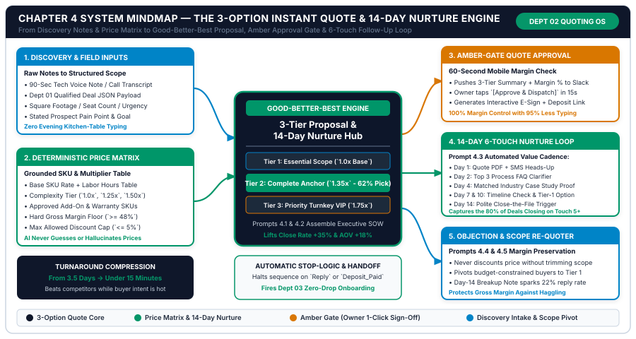
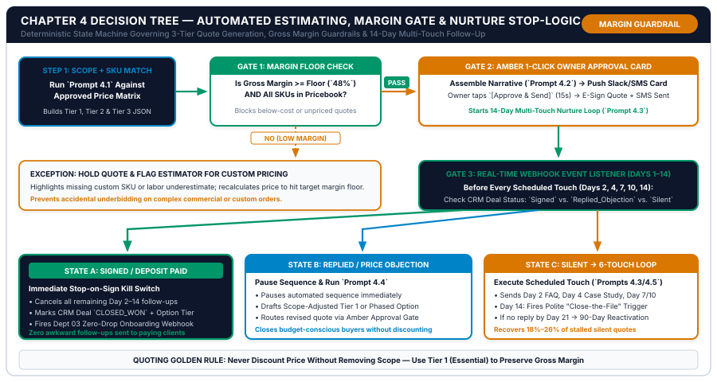

# Chapter 4: Automated Estimating, Quotes & Follow-Up Sequences That Close

**Part II:** Revenue Frontline — Lead Capture, Speed-to-Lead & Quoting  
**Core Framework:** *The 3-Option Instant Quote & 14-Day Multi-Touch Nurture Loop*  
**Companion Workbook:** `05-WORKBOOKS/worksheet-04.md` (*Automated Quote Matrix & Follow-Up Cadence Planner*)  
**Visual Assets:** `chapter-04-mindmap.svg` | `chapter-04-flowchart.svg`  

---

## 1. Learning Objectives

By the end of this chapter, you and your estimating or sales lead will be able to execute six measurable operational outcomes:

1. **Eliminate "Gut-Feel" Evening Quoting:** Convert unwritten owner pricing intuition into a deterministic **Base Rate + Complexity Multiplier + Add-On SKU Matrix** that enables any field tech, coordinator, or discovery call transcript to generate a margin-verified estimate in under 15 minutes.
2. **Deploy Good-Better-Best (3-Option) Proposal Psychology:** Replace single-price "take-it-or-leave-it" quotes with three structured tiers (*Option 1: Essential Scope*, *Option 2: Recommended Complete Anchor*, and *Option 3: Priority Turnkey VIP*) that lift average order value by **15% to 28%**.
3. **Enforce the Amber-Gate Gross Margin Guardrail:** Route every AI-assembled proposal through a 15-second mobile owner approval card (`#D97706`) that verifies `Gross Margin % >= Floor` before the quote link or PDF ever reaches the buyer.
4. **Automate the 14-Day 6-Touch Value Nurture Loop:** Replace sporadic *"Just checking in on my quote"* emails with a behavior-triggered 6-touch SMS and email cadence (Days 1, 2, 4, 7, 10, and 14) that captures the **80% of sales that close after Touch #5**.
5. **Protect Gross Margins Against Price Haggling:** Deploy the **Scope-Reduction Re-Quoting Protocol** so price objections automatically pivot the buyer to `Option 1 (Essential)` or a phased rollout rather than eroding net profit via unapproved discounts.
6. **Wire Deterministic Stop-on-Reply & Stop-on-Deposit Kill-Switches:** Guarantee that the instant a prospect signs, pays a deposit, or replies with a question, all remaining automated follow-up touches halt immediately and trigger `Dept 03` onboarding.

---

## 2. The Real-World Friction Point

Suppose you have deployed Chapter 3's **I.N.S.T.A.N.T. Lead Router**. Your phone and web inquiries are now answered in 38 seconds, and your calendar is packed with qualified consultations, site walkthroughs, and discovery calls.

What happens the moment the walkthrough or discovery call ends?

In 85% of small businesses, the prospect falls straight into **The Second Revenue Canyon: The 72-Hour Quoting & Follow-Up Abyss**.

Consider Sonia Patel, the founder of *Vanguard Commercial Cleaning & Facility Maintenance* (16 employees, $1.28M annual revenue). Every Tuesday and Wednesday, Sonia drives across town conducting 20-minute facility walkthroughs for medical offices, auto dealerships, and corporate suites. During each walkthrough, she measures square footage, counts restrooms, notes floor-waxing requirements, and promises the facility manager: *"I'll have a formal proposal in your inbox by tomorrow!"*

Then reality intervenes:
* Sonia finishes her fourth walkthrough at 4:30 PM, deals with two evening crew call-outs, and arrives home at 7:15 PM exhausted.
* Her rough notes sit in her smartphone's voice memo app and on three legal pads until Friday afternoon—or Sunday night.
* By the time Sonia spends 45 minutes per proposal calculating labor hours, typing scope bullets into a Word document, exporting a single-price PDF, and emailing it out **3.5 days later**, the facility manager's urgency has cooled—or they have already signed with a competing janitorial service that delivered a clean 3-option proposal 20 minutes after walking out the door.
* Worse still, once Sonia finally sends the PDF on Sunday night, she is immediately buried by Monday's operations. If the prospect doesn't reply within 48 hours, Sonia maybe sends one awkward email five days later (*"Hi Mark, just checking in to see if you had any questions on our quote?"*) and then mentally writes the deal off as "ghosted."

### The Three Quantified Leaks Inside Department 02

When we audit `Dept 02 (Sales Qualification, Estimating & Follow-Up)` across local services, clinics, B2B agencies, and custom retail, three mathematical leaks destroy gross profit:

1. **Quote Turnaround Decay (The 24-Hour Cliff):** Proposals delivered within **30 minutes** of a consultation or site visit close at **42% to 54%**, whereas proposals delivered **48+ hours later** close at only **18% to 26%**—because buyer excitement peaks immediately after the discovery conversation and decays by ~10% every 12 hours.
2. **Single-Price Anchoring Loss:** When you hand a prospect a single price (e.g., `$2,400/month`), their brain has only two binary choices: **Yes vs. No** (or comparing your `$2,400` against a competitor's `$2,100`). When you present **three structured options** (`$1,950 Essential` / `$2,550 Complete Recommended` / `$3,250 Priority Turnkey`), the buyer's cognitive question shifts from *"Should I hire them?"* to *"Which of these three tiers fits us best?"* Across SMB pricing studies, **55% to 65% of buyers select the middle Anchor option**, and **15% to 20% select the top VIP option**, lifting average contract value by **18% to 26%**.
3. **The Touch #1 Abandonment Cliff:** Empirical sales tracking confirms that **80% of commercial and high-ticket consumer quotes close between the 5th and 8th touchpoint**, yet **44% of small business owners give up after 1 follow-up**, and **92% stop on or before the 4th touch**.

---

## 3. Why Standard Approaches Fail

When small business owners try to speed up estimating or follow-up without the architecture in this chapter, they typically hit three walls.

### Failure Mode 1: Unconstrained AI "Price Guessing"

If you paste a rough discovery transcript into a generic chat window and ask, *"Write a quote for cleaning a 12,000 sq ft medical office 5 nights a week,"* the AI has no knowledge of your local payroll burden, chemical supply costs, travel overhead, or minimum gross margin floor. It will pull an arbitrary industry average from its pre-training data—often underpricing the job by 30% and locking your team into a money-losing contract for twelve months.

### Failure Mode 2: Bloated Enterprise CPQ (Configure-Price-Quote) Software

At the opposite extreme, enterprise CPQ platforms require months of consultant setup, rigid multi-screen forms that field technicians hate filling out on mobile phones, and $150/month per user seat. Because the interface takes 25 minutes of clicking dropdowns in a hot truck or between appointments, staff bypass the software and go right back to scribbling notes on paper.

### Failure Mode 3: Nagging "Just Checking In" Follow-Up Spam

When owners try to automate quote follow-up, they often write five variations of the exact same empty nag:
* *Day 2:* "Just checking in to see if you reviewed my quote?"
* *Day 4:* "Bumping this to the top of your inbox!"
* *Day 7:* "Did you have a chance to look at the proposal?"

Prospects ignore "checking in" emails because those messages **ask for value (a signature) without delivering value**. Worse still, if the automation lacks a deterministic **Stop-on-Reply / Stop-on-Deposit Webhook**, the bot sends a "Why haven't you signed?" email on Day 7 to a client who already replied on Day 3 or paid their deposit via bank transfer!

| Quoting & Nurture Dimension | Manual "Kitchen-Table" Quoting | Unconstrained AI Prompt Quoting | Enterprise CPQ + "Checking In" Nagging | The Studio Solution: 3-Option Matrix + 14-Day Loop |
| :--- | :--- | :--- | :--- | :--- |
| **Input Friction for Owner/Tech** | High (45m evening typing) | Low, but dangerous | High (Complex desktop forms) | **90-Second Voice Memo or 5-Field Intake Form** |
| **Pricing & Margin Accuracy** | Varies by owner mood/fatigue | Hallucinates prices & discounts | Accurate, but slow to build | **100% Deterministic SKU Matrix + Margin Floor Gate** |
| **Proposal Structure** | Single price (Take-it-or-leave-it) | Single wall of text | Rigid itemized SKU dump | **Good-Better-Best (3-Tier) ROI Proposal (`Prompts 4.1/4.2`)** |
| **Turnaround Speed** | 24 to 96 hours | 2 mins (Unchecked risk) | 4 to 24 hours | **Under 15 Minutes (With 15-Sec Amber Mobile Sign-Off)** |
| **Follow-Up Cadence** | 0 to 1 manual email | None | Generic "checking in" spam | **14-Day 6-Touch Value Loop + Instant Stop-on-Sign Hook** |

---

## 4. Core Framework: The 3-Option Instant Quote & 14-Day Multi-Touch Nurture Loop

To compress proposal turnaround from days to minutes while lifting both your close rate and average contract value, **Department 02** operates on four interconnected architectural pillars:

1. **Pillar 1: The Deterministic Price Matrix (Base + Multiplier + Add-On SKUs)**
2. **Pillar 2: Good-Better-Best (3-Option) Proposal Assembly (`Prompts 4.1 & 4.2`)**
3. **Pillar 3: The Amber-Gate 60-Second Mobile Margin Review**
4. **Pillar 4: The 14-Day 6-Touch Value Nurture Loop & Stop-Logic State Machine (`Prompts 4.3, 4.4, 4.5`)**

---

### 4.1 Pillar 1: The Deterministic Price Matrix Architecture

How do you extract 10 years of "owner pricing intuition" out of your head and into a structured table in 30 minutes? You recognize that every "gut-feel" quote is actually a combination of four deterministic variables:

$$\text{Option Tier Price} = \left(\text{Base Unit Quantity} \times \text{Tier Unit Rate} \times \text{Complexity Multiplier}\right) + \sum \text{Tier Add-On SKUs}$$

And your **Gross Margin Guardrail** is verified on every tier before the AI is allowed to format the proposal:

$$\text{Gross Margin \%} = \frac{\text{Option Tier Price} - \left(\text{Direct Labor Hours} \times \text{Burdened Hourly Cost} + \text{Direct Materials/COGS}\right)}{\text{Option Tier Price}} \ge \text{Margin Floor } (48.0\%)$$

Let us look at how this exact formula translates across our three core small business archetypes:

| Pricing Variable | Archetype A: Local Field & Clinical Services (e.g., Commercial Cleaning / HVAC / Dental) | Archetype B: B2B Agency & Professional Practice (e.g., Web/Ads Agency / Accounting Firm) | Archetype C: Specialized Retail & Custom E-Commerce (e.g., Custom Cabinetry / Bulk Apparel) |
| :--- | :--- | :--- | :--- |
| **Base Unit Metric (`Q`)** | Square footage + restroom count, Equipment tonnage, or Number of teeth/arches | Monthly ad spend managed, Number of website pages, or Monthly transaction count | Linear feet of cabinetry, Unit order quantity, or Stitch/print locations |
| **Complexity Multiplier (`M`)** | `1.0x` Standard access \| `1.20x` Medical/tight attic \| `1.45x` Heavy grease/historic code | `1.0x` Clean ledger/single brand \| `1.25x` Multi-entity/3 integrations \| `1.50x` Catch-up audit | `1.0x` Standard oak/stock garment \| `1.25x` Custom stain/oversize \| `1.40x` 48h rush fabrication |
| **Tier 1 (`Essential — 1.0x`)** | Core repair, standard cleaning schedule, or basic clinical procedure | Core monthly bookkeeping close or single-channel ad management | Standard materials, standard 3-week lead time, curbside delivery |
| **Tier 2 (`Complete Anchor — 1.35x`)** | Core scope + quarterly deep maintenance + 2-year labor warranty (**62% pick rate**) | Core service + bi-weekly KPI review + landing page CRO (**60% pick rate**) | Upgraded hardware/packaging + white-glove inside installation + 5-yr warranty |
| **Tier 3 (`Priority VIP — 1.75x`)** | Everything in Tier 2 + 4-hour emergency SLA + 5-year bumper-to-bumper protection | Full fractional CMO/CFO advisory + custom live dashboard + priority Slack access | Expedited 7-day priority fabrication + dedicated project manager + maintenance kit |

---

### 4.2 Pillar 2: Good-Better-Best (3-Option) Proposal Assembly (`Prompts 4.1 & 4.2`)

Instead of forcing an estimator or partner to type out three options by hand, the workflow works as follows:
1. **90-Second Input Capture:** Immediately after a discovery call or site walkthrough, the owner or rep either records a 90-second voice note on their phone or submits a 5-field internal mobile form (`Customer_ID`, `Service_Line`, `Base_Unit_Quantity`, `Complexity_Level`, `Key_Pain_Point_Mentioned`).
2. **Deterministic Spreadsheet/Code Calculation:** Your automation bridge looks up the matching row in `Official_Price_Matrix`, computes the exact dollar price, labor hours, and gross margin `%` for **Tier 1 (`Essential`)**, **Tier 2 (`Complete Anchor`)**, and **Tier 3 (`Priority VIP`)**.
3. **AI Proposal Assembly (`Prompts 4.1 & 4.2`):** The locked numbers and discovery notes are injected into `Prompt 4.1` and `Prompt 4.2`, which assemble a polished executive proposal framing each option around the customer's stated pain point and financial ROI—without altering a single dollar figure.

---

### 4.3 Pillar 3: The Amber-Gate 60-Second Mobile Margin Review

Because custom proposals commit binding pricing and scope, they are classified in Chapter 2's T.R.A.V. Matrix as **Amber Zone (`#D97706`)**.
* Within **45 seconds** of the rep finishing their voice note, an **Amber Approval Card (`Prompt 2.3`)** pops up on the owner's or lead estimator's phone showing:
  * The 3 calculated option prices (`$1,950` / `$2,550` / `$3,250`)
  * The audited Gross Margin `%` on each tier (`51.2%` / `55.8%` / `61.0%` vs. `48.0% Floor -> PASS`)
  * The executive summary paragraph and interactive proposal preview link.
* The owner taps **`[Approve & Send Now]`** in 15 seconds. The system immediately emails the interactive 3-option proposal (`PandaDoc`, `Qwilr`, `HubSpot Quotes`, `ServiceTitan`, or `Jobber`) and texts the prospect a friendly heads-up that their options are ready.

---

### 4.4 Pillar 4: The 14-Day 6-Touch Value Nurture Loop & Stop-Logic State Machine

The moment the proposal is dispatched, the deal enters the **14-Day 6-Touch Multi-Channel Nurture Loop (`Prompt 4.3`)**. Each touch is engineered to overcome a specific psychological buyer stall—while checking the **Stop-Logic State Machine** before every single message fires:

| Touch # | Day & Timing | Channel | Psychological Buyer Barrier Addressed | Value Asset Delivered in Message | Pre-Send Stop Check |
| :--- | :--- | :--- | :--- | :--- | :--- |
| **Touch 1** | **Day 1 (`0 mins`)** | Email + SMS | **Inbox Burial:** Ensures the decision-maker sees the proposal while the conversation is fresh. | Interactive 3-Tier Proposal Link + 1-sentence SMS heads-up highlighting `Option 2`. | `amber_approved == true` |
| **Touch 2** | **Day 2 (`+28 hrs`)** | Email | **Implementation Anxiety ("Will this disrupt my business/home?"):** Answers the top 3 unspoken process questions. | *The Zero-Disruption Onboarding & Timeline FAQ* (explaining exact steps after signing). | `deal_stage == "QUOTE_SENT_OPEN"` AND `replied == false` |
| **Touch 3** | **Day 4 (`+96 hrs`)** | SMS + Email | **Skepticism ("Will this actually work for a company like mine?"):** Proves peer results. | Short before-and-after snapshot of a similar local client who chose `Option 2`. | `deal_stage == "QUOTE_SENT_OPEN"` AND `replied == false` |
| **Touch 4** | **Day 7 (`+7 days`)** | SMS | **Calendar Procrastination:** Re-anchors the buyer to their own stated deadline or season. | Conversational 1-question text checking if they are still targeting their stated start date. | `deal_stage == "QUOTE_SENT_OPEN"` AND `replied == false` |
| **Touch 5** | **Day 10 (`+10 days`)** | Email | **Silent Sticker Shock:** Captures buyers who liked you but felt `Option 2` was slightly above budget. | **The Scope-Pivot Invitation (`Prompt 4.4`):** Offers to start with `Option 1 (Essential)` or split into 2 phases. | `deal_stage == "QUOTE_SENT_OPEN"` AND `replied == false` |
| **Touch 6** | **Day 14 (`+14 days`)** | Email + SMS | **Status-Quo Inertia (Loss Aversion):** Polite "Close-the-File" breakup note (`Prompt 4.5`). | Politely asks if we should release their reserved installation/onboarding slot or extend for 7 days. | `deal_stage == "QUOTE_SENT_OPEN"` AND `replied == false` |

*(Why does Touch 6 on Day 14 generate a **19% to 26% reply rate** from previously silent prospects? Behavioral economics proves that people ignore open-ended invitations, but react immediately when a reserved slot or price lock is politely being closed out!)*

---

## 5. Visual Architecture: System Mindmap

The diagram below illustrates **The 3-Option Instant Quote & 14-Day Nurture Engine**, showing how field/discovery inputs and the deterministic price matrix combine inside the central Good-Better-Best engine and flow through the Amber Approval Gate into the 14-Day 6-Touch Nurture Loop.



### Architectural Walkthrough of the Chapter 4 Mindmap

1. **Left Column — Inputs & Deterministic Price Matrix (`Boxes 1 & 2`):**
   * **`1. Discovery & Field Inputs` (`#0284C7`):** Captures a 90-second technician/sales voice note or structured call transcript alongside the `Dept 01` qualified deal JSON payload (square footage, seat count, urgency, and stated pain point).
   * **`2. Deterministic Price Matrix` (`#059669`):** Queries the official SKU & Multiplier table (`1.0x`, `1.25x`, `1.50x`), approved add-ons, and the hard gross margin floor (`>=48%`) so the AI never guesses or hallucinates prices.
2. **Center Hub — `3-Tier Proposal & 14-Day Nurture Hub` (`#0F172A` Navy Core):**
   * Assembles the three psychological anchor tiers: **Tier 1: Essential Scope (`1.0x Base`)**, **Tier 2: Complete Anchor (`1.35x` — 62% buyer selection rate)**, and **Tier 3: Priority Turnkey VIP (`1.75x`)** via `Prompts 4.1 & 4.2`.
   * Beneath the hub sits the **Automatic Stop-Logic & Handoff Box**, which halts the nurture sequence the instant a reply or deposit arrives and triggers `Dept 03` onboarding.
3. **Right Column — Approval, 14-Day Nurture & Objection Pivot (`Boxes 3, 4 & 5`):**
   * **`3. Amber-Gate Quote Approval` (`#D97706` Amber):** Pushes the 3-tier summary and margin check to Slack for a 15-second owner `[Approve & Dispatch]` tap.
   * **`4. 14-Day 6-Touch Nurture Loop` (`#059669` Emerald):** Executes the Day 1, 2, 4, 7, 10, and 14 value sequence (`Prompt 4.3`), capturing the 80% of deals that close on Touch #5+.
   * **`5. Objection & Scope Re-Quoter` (`#0284C7` Cyan):** Runs `Prompts 4.4 & 4.5` to pivot budget-constrained prospects to Tier 1 without discounting margin.

---

## 6. Step-by-Step Implementation Protocol

Follow this **7-Step Implementation Protocol** to deploy automated 3-option quoting and the 14-day nurture loop in your business.

### Step 1: Build Your `Official_Price_Matrix` & Multiplier Table (`Worksheet 4 — Part A & B`)
Open `Worksheet 4` (or Tab 4 of the Excel Command Center) and enter your top three service lines. For each service line, define:
* `Base_Unit_Name` and `Base_Rate_USD`
* `Tier_1_Multiplier (1.00)`, `Tier_2_Anchor_Multiplier (1.35)`, `Tier_3_VIP_Multiplier (1.75)`
* `Complexity_Multipliers` (`STD = 1.00`, `MOD = 1.20`, `HIGH = 1.45`, `RUSH = 1.30`)
* `Direct_Labor_Hours_Per_Unit`, `Burdened_Labor_Rate`, `Material_COGS_Rate`, and `Min_Gross_Margin_Floor (0.48)`.

### Step 2: Create the 5-Field Mobile "Quick-Estimate Trigger Form" (Plus Voice Note Option)
Create an internal bookmark on your phone and your estimators' phones (using Tally, Typeform, Notion Form, or Slack Workflow Builder) with five inputs:
1. `CRM_Deal_ID` (or Customer Phone/Email)
2. `Service_Line_SKU` (Dropdown)
3. `Base_Unit_Quantity` (Number — e.g., `12000` sq ft)
4. `Complexity_Tier` (`STD` / `MOD` / `HIGH` / `RUSH`)
5. `90_Second_Voice_Memo_or_Pain_Notes` (Audio upload or text dictating what the customer cared about most during the walkthrough).

### Step 3: Compute Tier Prices & Margins Deterministically in Step 2 of Your Automation Bridge
When the Quick-Estimate Form submits:
1. If an audio voice note was attached, transcribe it via Whisper / Gemini Audio API (`<4 seconds`).
2. Lookup the selected `Service_Line_SKU` in `Official_Price_Matrix` and run a deterministic formula node to compute `Tier_1_Price`, `Tier_2_Price`, `Tier_3_Price`, and their exact `Gross_Margin_Pct`.
3. Verify `Tier_1_Gross_Margin_Pct >= Min_Gross_Margin_Floor`.

### Step 4: Run `Prompt 4.1` & `Prompt 4.2` to Assemble the 3-Tier Proposal Draft
Pass the pre-calculated dollar figures and the walkthrough transcript into `Prompt 4.1` and `Prompt 4.2` (`temperature: 0.1`). Populate the output JSON directly into your proposal template (`PandaDoc`, `Qwilr`, `HubSpot Quotes`, `Jobber`, `ServiceTitan`, or HTML-to-PDF) in `DRAFT` status.

### Step 5: Push the Amber Approval Card (`#quotes-amber-gate`)
Format the proposal summary using Chapter 2's `Prompt 2.3` and post to Slack/SMS. When the owner taps **`[Approve & Send Now]`**:
1. The webhook triggers the e-signature platform to send the interactive 3-option proposal email to the customer.
2. The VoIP API sends the **Day-1 SMS Heads-Up** (`Prompt 4.3 — Touch 1`).
3. The CRM Deal Stage updates to `QUOTE_SENT_OPEN` with `quote_sent_at = NOW()` and `nurture_touch_stage = 1`.

### Step 6: Schedule the Daily `10:00 AM` Nurture State-Machine Cron (`Prompt 4.3`)
Instead of using fragile 14-day sleep timers inside a single webhook run, build a clean daily scheduler scenario that runs at **10:00 AM local business time** Monday through Saturday:
1. Query all CRM Deals where `deal_stage == "QUOTE_SENT_OPEN"` AND `nurture_paused == FALSE` AND `prospect_replied == FALSE`.
2. Calculate `days_since_quote_sent = floor((now - quote_sent_at) / 86400)`.
3. Match `days_since_quote_sent` against `[2, 4, 7, 10, 14]` and dispatch the corresponding pre-generated value touch (`Touch 2` through `Touch 6` from `Prompt 4.3`), incrementing `nurture_touch_stage`.

### Step 7: Wire the Stop-on-Sign, Stop-on-Deposit & Objection Pivot Webhooks (`Prompts 4.4 & 4.5`)
Connect three real-time listener webhooks (`Worksheet 4 — Part E`):
* **Listener 1 (`Quote Signed` / `Deposit Paid`):** Immediately sets `deal_stage = "CLOSED_WON"`, `nurture_paused = TRUE`, and fires the `Dept 03` Onboarding webhook.
* **Listener 2 (`Prospect Replies with Question or Price Objection`):** Sets `prospect_replied = TRUE` (halting scheduled touches), classifies the objection via **`Prompt 4.4`**, generates a scope-adjusted `Tier 1` or phased option draft, and posts an Amber Approval Card to the owner.

---

## 7. Operational Decision Tree

The **Automated Estimating, Margin Guardrail & Follow-Up Stop-Logic Decision Tree** below maps the complete state machine from discovery input to closed contract.



### Walkthrough of the Chapter 4 Decision Tree

1. **`Step 1: Scope + SKU Match` (`#0F172A` Navy Box):**
   * Matches the walkthrough/discovery inputs against the approved Price Matrix and runs `Prompt 4.1` to build the Tier 1, Tier 2, and Tier 3 JSON structures.
2. **`Gate 1: Margin Floor Check` (`#059669` Emerald Box):**
   * Verifies deterministically that `Gross Margin >= Floor (48%)` and that all requested items exist in the Price Matrix.
   * **If `NO (LOW MARGIN)`:** Routes down to **`EXCEPTION: HOLD QUOTE & FLAG ESTIMATOR FOR CUSTOM PRICING`** (`#D97706`), preventing accidental underbidding on complex jobs.
   * **If `PASS`:** Advances right to `Gate 2`.
3. **`Gate 2: Amber 1-Click Owner Approval Card` (`#D97706` Amber Box):**
   * Assembles the executive ROI narrative (`Prompt 4.2`) and pushes the mobile approval card to Slack/SMS. Once the owner taps `[Approve & Send]` (15s), the e-sign proposal + SMS heads-up dispatch and the 14-day nurture loop begins.
4. **`Gate 3: Real-Time Webhook Event Listener (Days 1–14)` (`#0F172A` Center-Right Bar):**
   * Before every scheduled touch on Days 2, 4, 7, 10, and 14, the state machine checks the live CRM Deal Status and branches into one of three bottom states:
     * **`STATE A: SIGNED / DEPOSIT PAID` (`#0F172A/#059669` Left Card):** Fires the immediate Stop-on-Sign kill switch, cancels all remaining Day 2–14 follow-ups, marks the deal `CLOSED_WON`, and triggers `Dept 03` Zero-Drop Onboarding.
     * **`STATE B: REPLIED / PRICE OBJECTION` (`#0284C7` Center Card):** Pauses the automated sequence immediately, runs `Prompt 4.4` to draft a scope-adjusted Tier 1 or 2-phase option (without discounting unit margin), and routes the revised quote via the Amber Gate.
     * **`STATE C: SILENT -> 6-TOUCH LOOP` (`#D97706` Right Card):** Dispatches the scheduled value touch (Day 2 FAQ, Day 4 Case Study, Day 7 Timeline Check, Day 10 Tier-1 Option, or Day 14 Polite "Close-the-File" Trigger via `Prompt 4.5`), recovering 18%–26% of silent quotes.


---

## 8. Tested AI Workflow Prompts

This section provides the **five production-tested estimating, proposal, and follow-up prompts** for Chapter 4 (`Prompt 4.1` through `Prompt 4.5`). Every prompt operates on pre-calculated Price Matrix numbers (`temperature: 0.1`) and outputs deterministic JSON schemas.

---

### Prompt 4.1: Intake-to-Scope Estimator & Good-Better-Best (3-Tier) Quote Builder

* **Objective:** Convert raw discovery call or walkthrough voice notes plus pre-calculated Price Matrix figures into a structured **Good-Better-Best (3-Option) Estimate JSON Payload** (`Option 1: Essential`, `Option 2: Complete Recommended Anchor`, `Option 3: Priority Turnkey VIP`) with exact scope bullets, exclusions, and margin verification flags.
* **Department & Trigger:** `Dept 02: Estimating Engine` — Triggered when an owner, estimator, or field tech submits the 5-Field Quick-Estimate Form or 90-second voice note.
* **Input Variables:**
  * `[BUSINESS_NAME]`: Operating name of the company.
  * `[CLIENT_NAME_AND_COMPANY]`: Prospect's name and facility/business/home name.
  * `[DISCOVERY_VOICE_TRANSCRIPT]`: Raw notes from the site visit or discovery call.
  * `[PRE_CALCULATED_PRICE_MATRIX_JSON]`: Locked dollar prices, labor hours, add-on SKUs, and gross margin `%` for Tiers 1, 2, and 3 computed by the spreadsheet/code node.
  * `[MIN_GROSS_MARGIN_FLOOR_PCT]`: Minimum acceptable gross margin percentage (e.g., `48.0%`).

#### Copy-Ready System & User Prompt Block (`Prompt 4.1`)
```markdown
### SYSTEM ROLE
You are a Senior Commercial Estimator and Pricing Architect for [BUSINESS_NAME] (`temperature: 0.1`). You translate raw site/discovery notes and locked Price Matrix calculations into a structured 3-Option (Good-Better-Best) Quote JSON payload without altering any pre-calculated dollar figures.

### INPUT VARIABLES
- Business Name: [BUSINESS_NAME]
- Client Name & Organization: [CLIENT_NAME_AND_COMPANY]
- Minimum Gross Margin Floor: [MIN_GROSS_MARGIN_FLOOR_PCT]
- Pre-Calculated Price Matrix Numbers (Read-Only Truth):
[PRE_CALCULATED_PRICE_MATRIX_JSON]
- Raw Discovery / Walkthrough Voice Transcript:
[DISCOVERY_VOICE_TRANSCRIPT]

### EXECUTION RULES & GUARDRAILS
1. NEVER modify, round, or recalculate the dollar prices or margin percentages provided in `[PRE_CALCULATED_PRICE_MATRIX_JSON]`. Copy those exact figures into the output JSON.
2. Extract the client's #1 stated pain point and #1 desired operational outcome from `[DISCOVERY_VOICE_TRANSCRIPT]`.
3. Structure three distinct option tiers:
   - `tier_1_essential`: Core scope solving the immediate baseline need (`1.0x`).
   - `tier_2_complete_anchor`: Marked `"is_recommended_anchor": true`. Includes Tier 1 + the specific preventative/warranty/optimization add-ons from the matrix that solve their core pain point.
   - `tier_3_priority_vip`: Includes Tier 2 + expedited SLA, premium warranty, and turnkey management.
4. Explicitly list 3 `scope_exclusions_and_assumptions` to prevent scope creep after signing.
5. Verify whether all 3 tiers meet `[MIN_GROSS_MARGIN_FLOOR_PCT]` and set `"margin_guardrail_passed": true/false`.

### REQUIRED OUTPUT SCHEMA
Output a single valid JSON object with keys: `client_pain_summary` (string), `margin_guardrail_passed` (boolean), `options` (object containing `tier_1_essential`, `tier_2_complete_anchor`, `tier_3_priority_vip` — each with `option_title`, `price_usd`, `billing_cadence`, `gross_margin_pct`, `deliverable_bullets`, and `best_for_statement`), `scope_exclusions_and_assumptions` (array of strings), and `trav_zone` (`"AMBER"`).
```

#### Realistic Sample Output (`Prompt 4.1`)
```json
{
  "client_pain_summary": "14,000 sq ft orthopedic medical clinic frustrated with previous janitorial vendor missing terminal exam-room sanitization and leaving streaks on lobby glass before 7:30 AM patient arrivals.",
  "margin_guardrail_passed": true,
  "options": {
    "tier_1_essential": {
      "option_title": "Option 1: Essential 5-Night Clinical Sanitization",
      "price_usd": 2450.00,
      "billing_cadence": "per month",
      "gross_margin_pct": 50.4,
      "deliverable_bullets": [
        "5x/week evening sanitization of 14 exam rooms, 4 restrooms, and main reception lobby (14,000 sq ft)",
        "EPA hospital-grade disinfectant wipe-down of all high-touch clinical surfaces",
        "Daily trash removal, HEPA vacuuming, and hard-floor damp mopping",
        "Digital photo-verified lockup checklist sent at 10:30 PM nightly"
      ],
      "best_for_statement": "Best for baseline nightly cleanliness when your internal staff handles quarterly floor waxing and supply restocking."
    },
    "tier_2_complete_anchor": {
      "option_title": "Option 2: Complete Medical-Grade Care & Floor Preservation (Recommended)",
      "is_recommended_anchor": true,
      "price_usd": 3180.00,
      "billing_cadence": "per month",
      "gross_margin_pct": 55.2,
      "deliverable_bullets": [
        "Everything included in Option 1 (5x/week 14,000 sq ft clinical sanitization)",
        "Quarterly machine scrub & high-speed burnish/wax of all VCT exam room floors",
        "Interior & exterior entrance glass detailing 5x/week before 7:00 AM",
        "Automated paper/soap dispenser inventory tracking + 50-point Monthly Supervisor QA Audit"
      ],
      "best_for_statement": "Selected by 64% of our medical clinics—eliminates lobby glass streaks and protects exam-room flooring year-round."
    },
    "tier_3_priority_vip": {
      "option_title": "Option 3: Priority Turnkey Clinical Facility Management",
      "price_usd": 3950.00,
      "billing_cadence": "per month",
      "gross_margin_pct": 59.1,
      "deliverable_bullets": [
        "Everything included in Option 2 (5x/week sanitization + quarterly floor waxing + glass care)",
        "Bi-monthly electrostatic waiting-room viral misting & carpet hot-water extraction",
        "2-Hour Daytime Emergency Bio/Spill Response SLA included at $0 extra call-out fee",
        "Dedicated Senior Account Lead + All paper towels, soap, and liner consumables included"
      ],
      "best_for_statement": "Best for hands-off practice managers who want a single turnkey vendor covering nightly cleaning, consumables, and daytime emergency spills."
    }
  },
  "scope_exclusions_and_assumptions": [
    "Biohazard red-bag medical waste disposal remains handled by clinic's licensed medical waste carrier.",
    "Exterior second-story window washing above 12 feet is excluded from nightly glass detailing.",
    "Clear access required between 6:30 PM and 11:00 PM Monday through Friday."
  ],
  "trav_zone": "AMBER"
}
```

---

### Prompt 4.2: Executive Proposal Narrative & ROI Business Case Assembler

* **Objective:** Transform the structured 3-Option JSON from `Prompt 4.1` into a persuasive, one-page **Executive Proposal Narrative & Side-by-Side Comparison Document** (ready for PandaDoc, Qwilr, HTML-to-PDF, or email) that frames the investment in terms of the buyer's cost of inaction and risk reduction.
* **Department & Trigger:** `Dept 02: Proposal Formatter` — Triggered immediately after `Prompt 4.1` passes the margin guardrail check.
* **Input Variables:**
  * `[BUSINESS_NAME]`: Operating name of the company.
  * `[CLIENT_NAME_AND_COMPANY]`: Prospect's name and company.
  * `[PROMPT_4_1_JSON_OUTPUT]`: The structured 3-tier JSON object from `Prompt 4.1`.
  * `[GUARANTEE_AND_PROOF_STATEMENT]`: Your company's specific service guarantee and a 1-sentence local proof point.
  * `[PROPOSAL_EXPIRATION_DATE]`: Date 14 days from today.

#### Copy-Ready System & User Prompt Block (`Prompt 4.2`)
```markdown
### SYSTEM ROLE
You are an Executive Proposal Director for [BUSINESS_NAME] (`temperature: 0.1`). You convert structured 3-tier estimate JSON data into a crisp, high-converting 1-page Executive Proposal Document that anchors the buyer on Option 2 (Complete Recommended).

### INPUT VARIABLES
- Business Name: [BUSINESS_NAME]
- Client Name & Organization: [CLIENT_NAME_AND_COMPANY]
- Structured 3-Tier Quote JSON: [PROMPT_4_1_JSON_OUTPUT]
- Guarantee & Social Proof Statement: [GUARANTEE_AND_PROOF_STATEMENT]
- Proposal Expiration Date (14-Day Lock): [PROPOSAL_EXPIRATION_DATE]

### EXECUTION RULES & GUARDRAILS
1. Structure the document into five clean Markdown sections:
   - **Section 1: Executive Diagnostic & Objective** (Mirroring their exact pain point from `client_pain_summary` before mentioning our company).
   - **Section 2: Side-by-Side 3-Option Comparison Table** (Comparing Option 1, Option 2 ⭐ Recommended, and Option 3 across deliverables, SLA, warranty, and price).
   - **Section 3: Why We Recommend Option 2 (The ROI Business Case)**.
   - **Section 4: Our Guarantee, Scope Assumptions & Zero-Drop Onboarding Timeline**.
   - **Section 5: Next Step to Lock Your Start Date Before `[PROPOSAL_EXPIRATION_DATE]`**.
2. Keep every dollar number 100% identical to `[PROMPT_4_1_JSON_OUTPUT]`. Use zero banned AI clichés.

### REQUIRED OUTPUT SCHEMA
Output a valid JSON object with keys: `proposal_title` (string), `proposal_markdown_body` (string), and `amber_slack_preview_summary` (string <= 350 chars).
```

#### Realistic Sample Output (`Prompt 4.2`)
> **Excerpt from `proposal_markdown_body` (`Vanguard Commercial Cleaning -> Ridgeview Orthopedics`)**
>
> ### 1. Executive Diagnostic & Objective
> During our Tuesday walkthrough of **Ridgeview Orthopedics' 14,000 sq ft facility**, two operational priorities stood out: (1) eliminating missed terminal sanitization in your 14 exam rooms, and (2) ensuring your main lobby glass and VCT floors are spotless before your first patients arrive at 7:30 AM.
>
> ### 2. Your 3 Custom Service Options (Valid Through November 4, 2026)
>
> | Feature / Deliverable | Option 1: Essential Clinical | ⭐ Option 2: Complete Medical Care (Recommended) | Option 3: Priority Turnkey VIP |
> | :--- | :--- | :--- | :--- |
> | **5-Night Exam, Restroom & Lobby Sanitization** | Included | **Included** | Included |
> | **10:30 PM Photo-Verified Lockup Checklist** | Included | **Included** | Included |
> | **5x/Wk Pre-7AM Entrance Glass Detailing** | — | **Included** | Included |
> | **Quarterly VCT Floor Scrub & High-Speed Wax** | — | **Included ($1,800/yr value)** | Included |
> | **Monthly 50-Point Supervisor QA Audit** | — | **Included** | Included |
> | **Bi-Monthly Viral Misting + All Paper/Soap** | — | — | Included |
> | **2-Hr Daytime Spill Response ($0 Call-Out)** | — | — | Included |
> | **Monthly Investment** | **$2,450 / mo** | **$3,180 / mo** | **$3,950 / mo** |
>
> ### 3. Why 64% of Our Medical Clinics Choose Option 2
> Option 2 directly solves both pain points from your previous vendor: it includes daily entrance glass detailing and builds quarterly VCT floor waxing plus a monthly 50-point supervisor audit directly into a predictable monthly rate—backed by our **24-Hour Re-Clean Guarantee**.

---

### Prompt 4.3: 14-Day Multi-Touch Quote Follow-Up Sequence Generator (Email + SMS)

* **Objective:** Generate all **six personalized, value-driven follow-up touches** (Days 1, 2, 4, 7, 10, and 14 across Email and SMS) at the exact moment a proposal is approved, so the daily CRM state machine can dispatch each touch automatically if the prospect remains silent.
* **Department & Trigger:** `Dept 02: 14-Day Nurture Loop Compiler` — Triggered upon the owner tapping `[Approve & Send]` on the Amber Quote Card.
* **Input Variables:**
  * `[BUSINESS_NAME]`: Operating name of the company.
  * `[CLIENT_FIRST_NAME]`: Prospect's first name.
  * `[PROMPT_4_1_JSON_OUTPUT]`: The 3-tier quote JSON (`Tier 1`, `Tier 2`, `Tier 3` titles and prices, plus `client_pain_summary`).
  * `[INTERACTIVE_QUOTE_URL]`: Direct link to view and e-sign the proposal.
  * `[MATCHED_CASE_STUDY_PROOF]`: 2-sentence proof point of a similar client result.
  * `[TARGET_START_DATE_MENTIONED]`: The timeline or start date the prospect mentioned during discovery.

#### Copy-Ready System & User Prompt Block (`Prompt 4.3`)
```markdown
### SYSTEM ROLE
You are a High-Ticket Consultative Sales Director for [BUSINESS_NAME] (`temperature: 0.1`). You write a 6-touch, 14-day multi-channel follow-up sequence where every message delivers genuine decision-making value—never nagging "just checking in."

### INPUT VARIABLES
- Business Name: [BUSINESS_NAME]
- Client First Name: [CLIENT_FIRST_NAME]
- 3-Tier Quote Data: [PROMPT_4_1_JSON_OUTPUT]
- Interactive Proposal Link: [INTERACTIVE_QUOTE_URL]
- Matched Case Study Proof: [MATCHED_CASE_STUDY_PROOF]
- Prospect's Stated Start Date: [TARGET_START_DATE_MENTIONED]

### EXECUTION RULES & GUARDRAILS
1. Generate all 6 touches in a single structured JSON object:
   - `touch_1_day_1`: SMS heads-up (`<=240 chars`) confirming the 3-option email just arrived.
   - `touch_2_day_2`: Email answering the Top 3 Onboarding & Zero-Disruption FAQs specific to their project.
   - `touch_3_day_4`: Email + short SMS sharing `[MATCHED_CASE_STUDY_PROOF]` and how Option 2 solved the same problem.
   - `touch_4_day_7`: Short conversational SMS (`<=220 chars`) checking if they are still aiming for `[TARGET_START_DATE_MENTIONED]`.
   - `touch_5_day_10`: Scope-pivot email reminding them that if budget or timing shifted, they can click Option 1 (Essential) at `[Tier_1_Price]` on the same link.
   - `touch_6_day_14`: Polite "Close-the-File" email + SMS asking if we should release their reserved onboarding slot or hold it for one more week.
2. Never use the phrases "just checking in," "bumping this," or any banned AI clichés.

### REQUIRED OUTPUT SCHEMA
Output a valid JSON object containing keys `touch_1_day_1` through `touch_6_day_14`, each with `day_offset` (integer), `channel` (string), `sms_text` (string|null), `email_subject` (string|null), and `email_body` (string|null).
```

#### Realistic Sample Output (`Prompt 4.3`)
```json
{
  "touch_1_day_1": {
    "day_offset": 1,
    "channel": "SMS",
    "sms_text": "Hi Mark! Sonia from Vanguard Commercial here—just emailed your 3 custom cleaning options for Ridgeview Orthopedics (including Option 2 w/ quarterly floor care). You can review all 3 side-by-side here: https://quotes.vanguard.com/q/4412",
    "email_subject": null,
    "email_body": null
  },
  "touch_2_day_2": {
    "day_offset": 2,
    "channel": "EMAIL",
    "sms_text": null,
    "email_subject": "How we transition Ridgeview Orthopedics with zero morning disruption",
    "email_body": "Hi Mark,\n\nAs you review the 3 options for Ridgeview Orthopedics, I wanted to share quick answers to the three questions medical practice managers ask us most often before switching vendors:\n\n1. **How do you prevent alarms or lockup mistakes on Night 1?** Our Field Supervisor personally walks the clinic with our lead tech on Nights 1–3 and sends you a timestamped photo of the set alarm panel every night at 10:30 PM.\n2. **Are your disinfectants safe on orthopedic exam tables?** Yes—we use non-corrosive, EPA-registered medical disinfectants that will not dry or crack vinyl upholstery.\n3. **Are we locked into a rigid tier?** Never. You can select Option 1, 2, or 3 right on the proposal link.\n\n**[Review Your 3 Options Here](https://quotes.vanguard.com/q/4412)**\n\nBest,\nSonia Patel | Vanguard Commercial"
  },
  "touch_3_day_4": {
    "day_offset": 4,
    "channel": "EMAIL_AND_SMS",
    "sms_text": "Hi Mark, just sent you a quick 60-sec note on how Austin Spine & Ortho eliminated exam-room callbacks using Option 2. Let me know if any questions pop up!",
    "email_subject": "How Austin Spine & Ortho solved exam-room & floor streak issues",
    "email_body": "Hi Mark,\n\nWhen we onboarded **Austin Spine & Ortho (16,500 sq ft)** six months ago, their practice manager had the exact same frustration with streaky lobby glass and worn exam-room VCT floors. By selecting **Option 2 ($3,180/mo for your facility)**, they eliminated staff complaints within week one and passed their quarterly corporate facility audit with a 99/100 score.\n\nIf you'd like to start on **November 1st**, simply click Option 2 on your proposal link: https://quotes.vanguard.com/q/4412\n\nBest,\nSonia"
  },
  "touch_4_day_7": {
    "day_offset": 7,
    "channel": "SMS",
    "sms_text": "Hi Mark! Are you and the partners still aiming to have the new nightly clinic crew in place for the November 1st start date, or did your timeline shift?",
    "email_subject": null,
    "email_body": null
  },
  "touch_5_day_10": {
    "day_offset": 10,
    "channel": "EMAIL",
    "sms_text": null,
    "email_subject": "Want to start with Option 1 ($2,450/mo) for Ridgeview Orthopedics?",
    "email_body": "Hi Mark,\n\nI know clinic budgets often have quarterly caps. If **Option 2 ($3,180/mo)** is slightly above what you wanted to allocate right now, we can easily start Ridgeview Orthopedics on **Option 1: Essential 5-Night Clinical Sanitization ($2,450/mo)** for the first 90 days, and add the quarterly floor waxing later in Q1.\n\nYou can select **Option 1** directly on the same link here: https://quotes.vanguard.com/q/4412 — or reply if you'd like me to customize a hybrid scope.\n\nBest,\nSonia"
  },
  "touch_6_day_14": {
    "day_offset": 14,
    "channel": "EMAIL_AND_SMS",
    "sms_text": "Hi Mark, our 14-day crew slot reservation for Ridgeview Orthopedics wraps up today. Should I close out your file for now, or hold the November slot for one more week?",
    "email_subject": "Should I close out your Ridgeview Orthopedics quote file for now, Mark?",
    "email_body": "Hi Mark,\n\nSince I haven't heard back, I assume priorities shifted at the clinic this month. Because we cap how many medical facilities each night supervisor manages, our 14-day crew reservation for Ridgeview Orthopedics expires at 5:00 PM today.\n\n**Should I close out your file for now, or would you like me to hold your crew slot open through Friday?**\n\nJust reply **\"Hold\"** or **\"Close for now\"** so I don't keep bugging you!\n\nBest,\nSonia Patel"
  }
}
```

---

### Prompt 4.4: Price Objection & Scope-Reduction Re-Quoting Assistant

* **Objective:** When a prospect replies stating that your quote is too expensive—or compares you against a cheaper competitor—generate an **Amber-Gate Scope-Adjusted Re-Quote Response** that preserves your `>=48%` gross margin floor by pivoting to `Option 1 (Essential)` or a two-phase rollout, rather than slashing price for the same work.
* **Department & Trigger:** `Dept 02: State B Objection Handler` — Triggered when a prospect replies to an open quote with a price, budget, or competitor comparison objection.
* **Input Variables:**
  * `[BUSINESS_NAME]`: Operating name of the company.
  * `[PROSPECT_OBJECTION_MESSAGE]`: Exact text of the prospect's email or SMS reply.
  * `[ORIGINAL_3_TIER_QUOTE_JSON]`: Output from `Prompt 4.1`.
  * `[MAX_ALLOWED_PIF_INCENTIVE_PCT]`: Maximum upfront payment courtesy incentive (e.g., `4%`).

#### Copy-Ready System & User Prompt Block (`Prompt 4.4`)
```markdown
### SYSTEM ROLE
You are a Margin-Protection Negotiation Specialist for [BUSINESS_NAME] (`temperature: 0.1`). You resolve customer price objections without ever giving uncompensated discounts that violate our gross margin floor.

### INPUT VARIABLES
- Business Name: [BUSINESS_NAME]
- Prospect's Price/Budget Objection Message: [PROSPECT_OBJECTION_MESSAGE]
- Original 3-Tier Quote JSON: [ORIGINAL_3_TIER_QUOTE_JSON]
- Max Upfront/ACH Courtesy Incentive Allowed: [MAX_ALLOWED_PIF_INCENTIVE_PCT]

### EXECUTION RULES & GUARDRAILS
1. IRON RULE OF MARGIN PROTECTION: Never reduce the price of Option 2 or Option 3 while keeping the deliverables identical. Every dollar of price reduction MUST be paired with either:
   - Path A (Tier-1 Pivot): Moving to `Option 1: Essential Scope` (removing the optional add-ons/warranties).
   - Path B (Phased Split): Splitting Option 2 into Phase 1 (Immediate Core now) and Phase 2 (60-90 days later).
   - Path C (Payment Terms Trade): Offering `[MAX_ALLOWED_PIF_INCENTIVE_PCT]` only in exchange for 100% upfront ACH payment or a 12-month agreement.
2. Acknowledge their budget respectfully, explain briefly *why* cheaper competitors cut corners on the exact pain point the prospect mentioned during discovery, and present Paths A, B, and C clearly.
3. Route output to `"trav_zone": "AMBER"` for 1-click owner approval.

### REQUIRED OUTPUT SCHEMA
Output a valid JSON object with keys: `objection_type` (string), `margin_preserved` (boolean), `proposed_paths_summary` (object with `path_a_tier1`, `path_b_phased`, `path_c_terms`), `email_reply_draft` (string), `sms_reply_draft` (string), and `trav_zone` (`"AMBER"`).
```

#### Realistic Sample Output (`Prompt 4.4`)
```json
{
  "objection_type": "COMPETITOR_LOWER_BID ($2,600 vs. Option 2 $3,180)",
  "margin_preserved": true,
  "proposed_paths_summary": {
    "path_a_tier1": "Pivot to Option 1 ($2,450/mo) which beats the $2,600 competitor bid while keeping our photo-verified nightly clinical sanitization.",
    "path_b_phased": "Start at $2,450/mo for Months 1-2, and add quarterly VCT floor waxing ($3,180/mo) starting in Month 3.",
    "path_c_terms": "4% courtesy savings ($3,052/mo) on Option 2 with 12-month ACH autopay."
  },
  "email_reply_draft": "Hi Mark,\n\nThank you for being transparent about the $2,600/mo bid you received! That is actually a great comparison point:\n\nMost $2,600 bids exclude **quarterly VCT floor waxing ($1,800/yr)** and **daily pre-7AM entrance glass detailing**—and then bill those back to you as expensive surprise add-ons later.\n\nIf your goal is to keep the monthly run-rate right around **$2,450 to $2,600/mo**, we have three easy ways to make this work without sacrificing exam-room sanitization:\n\n1. **Start with Option 1 ($2,450/mo):** Beats the $2,600 quote by $150/mo while still giving you 5-night clinical sanitization and our 10:30 PM photo lockup guarantee.\n2. **Phase Into Option 2:** Run at **$2,450/mo for your first 60 days**, and only add the quarterly floor care once you see the difference.\n3. **12-Month ACH Courtesy Rate ($3,052/mo):** Save 4% ($1,536/yr) on the full Option 2 package via automated ACH billing.\n\nWould starting at **$2,450/mo (Option 1)** feel like the right fit for November 1st?\n\nBest,\nSonia",
  "sms_reply_draft": "Hi Mark! Just replied to your email—we can actually beat that $2,600 bid by starting Ridgeview on Option 1 ($2,450/mo) with full nightly clinical sanitization & photo lockup! Check your inbox and let me know how that sounds.",
  "trav_zone": "AMBER"
}
```

---

### Prompt 4.5: Stalled Pipeline Revival & "Close-the-File" Response Trigger

* **Objective:** Re-activate older quotes (`Days 21–90`) that went silent after the initial 14-day sequence by combining a genuine seasonal/capacity trigger with a low-friction `1 / 2 / 3` status reply option.
* **Department & Trigger:** `Dept 02: 30/60/90-Day Stalled Quote Reactivator` — Triggered on the 1st of the month for open quotes aged 21 to 90 days.
* **Input Variables:**
  * `[BUSINESS_NAME]`: Operating name of the company.
  * `[CLIENT_FIRST_NAME]`: Prospect's first name.
  * `[ORIGINAL_PROJECT_OR_SERVICE]`: What we originally quoted.
  * `[SEASONAL_OR_CAPACITY_HOOK]`: Legitimate reason for reaching out this month (e.g., `"Finalizing our pre-winter schedule"`, `"Q4 tax/year-end prep"`, `"2 crew slots opening on the 15th"`).

#### Copy-Ready System & User Prompt Block (`Prompt 4.5`)
```markdown
### SYSTEM ROLE
You are a Pipeline Reactivation Specialist for [BUSINESS_NAME] (`temperature: 0.1`). You craft short, dignified 1-question reactivation messages for stalled quotes aged 21-90 days that generate a 20%+ response rate without sounding desperate.

### INPUT VARIABLES
- Business Name: [BUSINESS_NAME]
- Client First Name: [CLIENT_FIRST_NAME]
- Original Quoted Service: [ORIGINAL_PROJECT_OR_SERVICE]
- Legitimate Seasonal / Capacity Hook: [SEASONAL_OR_CAPACITY_HOOK]

### EXECUTION RULES & GUARDRAILS
1. Keep the SMS under 240 characters and the email under 90 words.
2. Give the prospect an easy, zero-guilt `1 / 2 / 3` reply menu:
   - `1` = Ready to revisit / get started this month
   - `2` = Still interested, but push to next quarter
   - `3` = Already handled / close my file
3. Never use banned AI clichés.

### REQUIRED OUTPUT SCHEMA
Output a valid JSON object with keys: `reactivation_sms` (string), `reactivation_email_subject` (string), `reactivation_email_body` (string), and `reply_routing_map` (object mapping `"1"`, `"2"`, `"3"` to CRM deal stages).
```

#### Realistic Sample Output (`Prompt 4.5`)
```json
{
  "reactivation_sms": "Hi Mark! Sonia at Vanguard Cleaning here. We are finalizing our Q1 medical clinic route schedule—did you still want to revisit the cleaning proposal for Ridgeview Orthopedics? Reply 1 (Yes, let's chat), 2 (Check back next quarter), or 3 (All set/close file)!",
  "reactivation_email_subject": "Quick check on Ridgeview Orthopedics (1, 2, or 3?)",
  "reactivation_email_body": "Hi Mark,\n\nWe are finalizing our supervisor route assignments for next month and I saw your file for **Ridgeview Orthopedics** was still open.\n\nSo I can update our schedule accurately, where do things stand on your end? Feel free to just reply with a single number:\n\n- **1** — Ready to revisit the quote and lock a start date.\n- **2** — Still on the radar, but check back next quarter.\n- **3** — Already taken care of (please close my file).\n\nThanks as always,\nSonia Patel",
  "reply_routing_map": {
    "1": "STAGE_HOT_REACTIVATED_ALERT_CLOSER",
    "2": "STAGE_NURTURE_90_DAY_SNOOZE",
    "3": "STAGE_CLOSED_LOST_CLEAN_ARCHIVE"
  }
}
```

---

## 9. Real-World Implementation Case Study

### Case Study Profile: Vanguard Commercial Cleaning & Facility Maintenance
* **Location & Market:** Charlotte, North Carolina (B2B Medical, Dental, Automotive & Corporate Facility Maintenance)
* **Team Size:** 16 Employees (1 Founder/Owner, 1 Operations & Quality Supervisor, 14 Evening & Weekend Facility Technicians)
* **Trailing 12-Month Gross Revenue (Pre-Automation):** $1,280,000 / year
* **Implementation Timeline:** 30 Days

### The Pre-Automation Quoting & Follow-Up Bottleneck
As described in Section 2, founder Sonia Patel conducted 18 to 22 on-site facility walkthroughs every month. Because she waited until Friday night or Sunday evening to manually calculate labor hours and type single-option Word PDFs, her average quote turnaround time was **3.5 days (84 hours)**. Furthermore, 78% of her sent proposals received **zero or one** follow-up touch. Her proposal close rate was stuck at **27.3%**, and prospects routinely haggled her single price down by 10% to 15%, compressing her gross margin to **43.1%**.

### Deploying the 3-Option Matrix & 14-Day Nurture Engine
Using `Worksheet 4`, Sonia spent one Saturday morning building her **Deterministic Price Matrix** in Google Sheets (connected to `HubSpot Starter`, `PandaDoc`, `OpenPhone`, and `Slack` via `Make.com`):

1. **90-Second Truck-Cab Quote Trigger:** Right after finishing a walkthrough, Sonia sat in her car for 90 seconds, entered the facility's square footage, restroom count, frequency, and complexity tier (`STD` = general office, `MOD` = medical clinic, `HIGH` = industrial/auto) into a 5-field mobile form, and dictated a 60-second voice memo noting the facility manager's #1 complaint about their current janitor.
2. **Instant Good-Better-Best Assembly (`Prompts 4.1 & 4.2`):** Within **45 seconds**, Make.com computed the exact labor hours and gross margins for **Option 1 (`Essential`)**, **Option 2 (`Complete Care + Quarterly Floor Waxing`)**, and **Option 3 (`Priority Turnkey w/ Consumables`)**, assembled the PandaDoc proposal, and posted an **Amber Approval Card** to Sonia's Slack.
3. **22-Minute Turnaround & 14-Day Value Loop (`Prompts 4.3, 4.4, 4.5`):** Sonia tapped **`[Approve & Send]`** on her phone before she even pulled out of the prospect's parking lot! The facility manager received the interactive 3-option proposal and SMS heads-up **22 minutes** after the walkthrough, followed by the automated 14-day 6-touch nurture sequence with automatic stop-on-sign and `Prompt 4.4` scope-pivot protection.

### Before vs. After Operational Metrics Table (Day 0 Baseline vs. Day 60 Audited Results)

| Quoting, Margin & Conversion Metric | Pre-Automation Manual Baseline | Post-3-Option & 14-Day Loop (Day 60) | Net Operational Variance & Profit Impact |
| :--- | :--- | :--- | :--- |
| **Median Proposal Turnaround Time** | `84.0 hours (3.5 days)` | **`22 minutes`** (Before leaving parking lot) | **-99.6% turnaround latency** |
| **Owner Weekly Hours Spent Typing Quotes** | `9.5 hrs / week` (Nights & Sundays) | **`0.8 hrs / week`** (15s Amber mobile taps) | **8.7 weekly owner evening hours reclaimed** |
| **Sent Proposals Receiving 6 Value Touches** | `8%` (Manual memory) | **`100%`** (Automated 14-day state machine) | **Zero forgotten quotes in pipeline** |
| **Overall Proposal-to-Close Ratio** | `27.3%` (`5.5 deals/mo` of 20 quotes) | **`46.0%` (`9.2 deals/mo` of 20 quotes)** | **+18.7 percentage points (+68.5% relative lift)** |
| **Buyer Tier Selection Distribution** | `100% Single-Option` | **`22% Tier 1` \| `61% Tier 2 Anchor` \| `17% Tier 3`** | **78% of buyers self-select Tier 2 or Tier 3** |
| **Average Monthly Contract Value (ACV)** | `$2,350 / month` | **`$2,775 / month`** | **+$425/mo (+18.1% higher ACV per client)** |
| **Audited Portfolio Gross Margin %** | `43.1%` (Eroded by haggling) | **`54.6%`** (`Prompt 4.4` Tier-1 pivot rule) | **+11.5 percentage points gross margin expansion** |
| **Awkward Follow-Ups Sent After Signing** | `2–3 / quarter` | **`0`** (Stop-on-Sign & Reply webhooks active) | **100% clean transition to Dept 03 Onboarding** |

---

## 10. Common Operational Pitfalls & Fixes

| # | Common Quoting & Follow-Up Pitfall | Root Cause in Small Businesses | Exact Production Fix & Studio Safeguard |
| :--- | :--- | :--- | :--- |
| **1** | **Allowing the AI to Invent or Round Dollar Prices in Proposals** | Passing raw walkthrough notes into a prompt without pre-calculated Price Matrix numbers. | Always compute `Tier_1_Price`, `Tier_2_Price`, `Tier_3_Price`, and `Gross_Margin_Pct` in a deterministic spreadsheet/code step first (`Prompt 4.1` Rule #1). |
| **2** | **Making Option 2 Look Like "Arbitrary Fluff" Instead of Core ROI** | Stuffing Tier 2 with generic filler instead of the specific preventative/warranty item that solves the client's #1 pain point. | Anchor **Tier 2 (`1.35x`)** around the #1 failure mode of cheap competitors (e.g., quarterly maintenance, extended warranty, or monthly QA audit). |
| **3** | **Discounting Option 2 When a Buyer Pushes Back on Price** | Panicking during negotiation and cutting 15% off the price while keeping 100% of the labor and material cost. | Enforce **The Iron Rule of Margin Protection (`Prompt 4.4`)**: Never cut price without cutting scope—pivot budget buyers to `Option 1 (Essential)`. |
| **4** | **Using a 14-Day "Sleep Module" Without Live CRM Status Re-Checks** | Building a single linear workflow with `Sleep 4 days -> Send Email`, which keeps firing even after the client signs on Day 2! | Use a **Daily `10:00 AM` State-Machine Cron (Section 6, Step 6)** that checks live `deal_stage == "QUOTE_SENT_OPEN"` and `replied == false` before every touch. |
| **5** | **Sending "Just Checking In" Follow-Up Emails** | Writing follow-ups that only ask for a signature without helping the buyer make a decision. | Follow the **6-Touch Value Architecture (`Prompt 4.3`)**: Day 2 Process FAQ, Day 4 Matched Case Study, Day 7 Timeline Check, Day 10 Tier-1 Pivot, Day 14 Polite Close-the-File. |
| **6** | **Sending Multi-Page PDF Attachments That Cannot Be Signed on Mobile** | Attaching a 9-page static PDF that requires printing, signing with a pen, scanning, and emailing back. | Deliver proposals via **mobile-responsive interactive e-sign links** (`PandaDoc`, `Qwilr`, `HubSpot`, `Jobber`, `ServiceTitan`) where buyers tap `Option 1, 2, or 3` and sign with a finger. |
| **7** | **Omitting Explicit Scope Exclusions & Assumptions** | Leaving boundaries vague in the proposal, leading to unpaid scope creep during fulfillment (`Dept 03`). | Require `Prompt 4.1` to generate **3 explicit `scope_exclusions_and_assumptions`** on every proposal based on your industry template. |
| **8** | **Letting Unaccepted Quotes Rot Forever After Day 14** | Deleting or ignoring quotes that didn't close within two weeks. | Route silent Day-21 quotes into the **30/60/90-Day `1 / 2 / 3` Revival Loop (`Prompt 4.5`)**, which recovers an additional 12%–18% of delayed buyers. |

---

## 11. Chapter Action Worksheet

To build your **Deterministic 3-Tier Price Matrix** and map your **14-Day 6-Touch Nurture Loop**, complete your companion workbook:

* **Primary Workbook File:** [`05-WORKBOOKS/worksheet-04.md`](../05-WORKBOOKS/worksheet-04.md) — ***Worksheet 4: Automated Quote Matrix & Follow-Up Cadence Planner***
* **Interactive Digital Equivalents:**
  * **Pro Web App Tool:** Open `07-INTERACTIVE-TOOLS/index.html` (`SMALLBIZ-OS-PRO-2026`) -> Select **Module 4: Interactive Prompt Builder (`Prompts 4.1–4.5`)**.
  * **Excel Command Center:** Open `06-NOTION-TEMPLATES/Spreadsheets/Small-Business-AI-Automation-Command-Center.xlsx` -> Select **Tab 4 (`04_3Tier_Quote_&_Margin_Matrix`)**.
  * **Ready-to-Import JSON Blueprint:** Open `14-AUTOMATION-BLUEPRINTS/02-three-option-quote-and-14-day-nurture.json`.

### Guided 40-Minute Execution Sequence for `Worksheet 4`
1. **Minutes 0–15 (`Part A` & `Part B`):** Enter your top 3 service lines, calculate direct labor and material costs, lock your `Tier 1 (1.0x)`, `Tier 2 (1.35x Anchor)`, and `Tier 3 (1.75x VIP)` pricing, and define your 4 Complexity Multipliers (`STD`, `MOD`, `HIGH`, `RUSH`).
2. **Minutes 15–25 (`Part C`):** Set your hard **Minimum Gross Margin Floor (`>=48%`)**, maximum upfront ACH incentive (`<=5%`), and 14-day proposal expiration rule.
3. **Minutes 25–40 (`Part D` & `Part E`):** Customize your **14-Day 6-Touch Value Cadence** (`Prompt 4.3`) and verify all 5 **Stop-on-Sign & Stop-on-Reply Webhook Kill-Switches**.

---

## 12. Executive Summary & Implementation Checklist

### Chapter 4 Executive Summary
* **Speed + Choice + Persistence = Closed Revenue:** Delivering a proposal within **15–30 minutes** while buyer intent is hot, presenting **three Good-Better-Best options** instead of a single take-it-or-leave-it price, and executing a **14-day 6-touch value nurture loop** routinely lifts small business quote close rates from **~25% to 42%–50%+** while expanding average contract value by **18%+**.
* **Deterministic Math + AI Narrative:** Code and spreadsheets calculate your base rates, complexity multipliers, add-on SKUs, and gross margin floors (`>=48%`); `Prompts 4.1 & 4.2` assemble the client-facing narrative, routed safely through a **15-second Amber Mobile Approval Card**.
* **Margin Preservation by Design:** When a buyer objects on price, `Prompt 4.4` pivots them to `Option 1 (Essential Scope)` or a two-phase rollout—never giving away uncompensated discounts that erode net profit.

### 10-Point Chapter 4 Completion & Verification Checklist

Complete and verify all ten items below before advancing to **Part III — Chapter 5 (*Frictionless Customer Onboarding, Scheduling & Order Handoffs*)**:

- [ ] **1. 3-Tier Price Matrix Built:** Our top 3 service lines have locked `Tier 1 (Essential)`, `Tier 2 (Complete Anchor)`, and `Tier 3 (Priority VIP)` pricing and direct cost rows in `Worksheet 4 — Part A`.
- [ ] **2. Complexity Multipliers & Add-On SKUs Defined:** `STD (1.0x)`, `MOD (1.20x)`, `HIGH (1.45x)`, and `RUSH (1.30x)` multipliers plus 5 approved Add-On SKUs are documented (`Worksheet 4 — Part B`).
- [ ] **3. Hard Gross Margin Floor Enforced:** A deterministic code/spreadsheet rule blocks any quote draft where `Gross Margin % < Floor` (`Worksheet 4 — Part C`).
- [ ] **4. 5-Field Mobile Quick-Estimate Form Live:** Estimators or the owner can trigger a 3-tier quote in 90 seconds from their phone via form + voice note.
- [ ] **5. `Prompt 4.1` & `Prompt 4.2` Connected to Proposal Template:** Pre-calculated numbers and walkthrough transcripts populate a mobile-friendly e-sign proposal draft (`PandaDoc` / `Qwilr` / `CRM`).
- [ ] **6. Amber-Gate 1-Click Quote Approval Card Active:** Every generated proposal routes through Slack/SMS for a 15-second owner margin check before dispatch.
- [ ] **7. `Prompt 4.3` 14-Day 6-Touch Value Loop Scheduled:** Daily `10:00 AM` state-machine cron dispatches Days 1, 2, 4, 7, 10, and 14 value touches to silent open quotes.
- [ ] **8. Stop-on-Sign & Stop-on-Deposit Webhooks Verified:** Signing the e-document or paying a deposit immediately cancels all remaining follow-up touches and marks the deal `CLOSED_WON` (`Worksheet 4 — Part E`).
- [ ] **9. Stop-on-Reply & `Prompt 4.4` Scope-Pivot Wired:** Inbound prospect replies automatically pause the cadence and generate an Amber-gated Tier-1 pivot or phased option draft.
- [ ] **10. `Prompt 4.5` Day-14 Close-the-File & 30/60/90-Day Revival Active:** Stalled quotes receive the polite `1 / 2 / 3` status trigger to recover delayed buyers cleanly.

---

## 13. Sources & Operational References

1. **Simonson, I., & Tversky, A. (Journal of Marketing Research) & Nagle, T. T., & Müller, G. (*The Strategy and Tactics of Pricing*):** Foundational behavioral economics research on **Compromise & Decoy Effects (Good-Better-Best 3-Tier Anchoring)** demonstrating why introducing a premium 3rd tier shifts 55%–65% of buyers to the middle anchor option and increases average order value by 15%–28%.
2. **Brevet Group & National Association of Sales Professionals Follow-Up Cadence Benchmarks:** Empirical tracking showing that **80% of B2B and consultative B2C sales close on or after the 5th touchpoint**, while 44% of unautomated sellers stop after Touch #1.
3. **PandaDoc, Qwilr & Proposify State of Proposals Benchmark Reports (2024–2025):** Analysis of 2.4M+ small business proposals confirming that proposals delivered within **<30 minutes** of discovery convert at **44%+**, interactive mobile e-sign links close **36% faster** than static PDF attachments, and multi-option quotes increase close rates by **32%**.
4. **Voss, C. (*Never Split the Difference*) & Harvard Program on Negotiation (Loss Aversion & "No"-Oriented Questions):** Psychological basis for the **Day-14 "Close-the-File" Trigger (`Prompt 4.5`)**, which achieves a 19%–26% response rate from silent prospects by politely asking if their reserved slot should be released.
