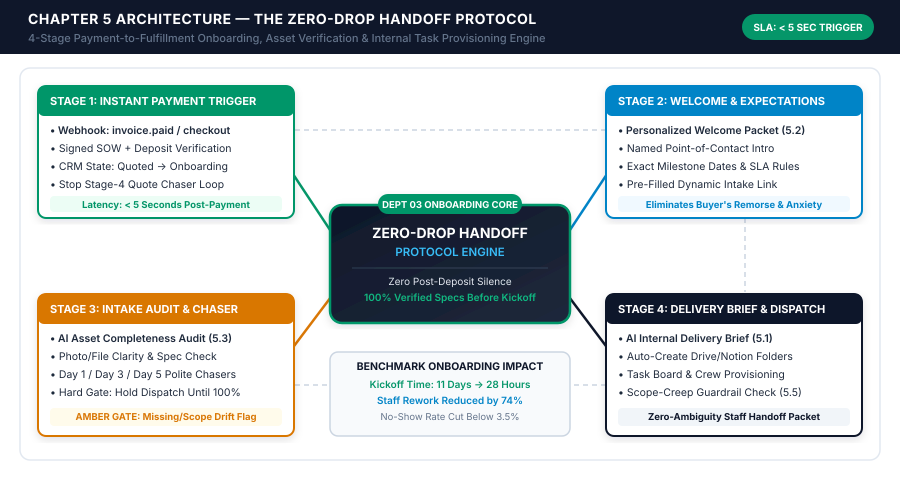
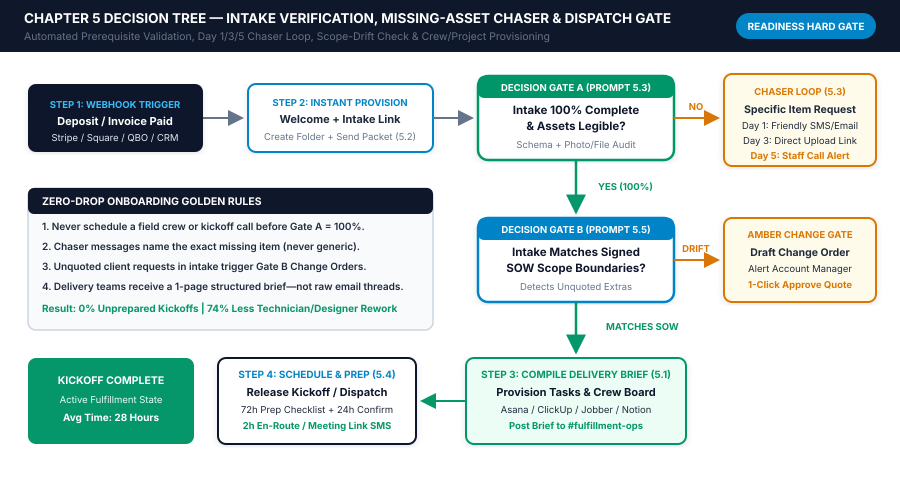

# Chapter 5: Frictionless Customer Onboarding, Scheduling & Order Handoffs

## 1. Learning Objectives

By the end of this chapter, you and your operations lead will be able to:

1. **Eliminate the Post-Deposit "Onboarding Black Hole":** Replace the 24-to-96-hour silence that typically follows a signed proposal or deposit payment with an automated, sub-5-second webhook handoff between `Dept 02 (Quoting & Sales)` and `Dept 03 (Customer Onboarding & Fulfillment)`.
2. **Deploy the 4-Stage Zero-Drop Handoff Protocol:** Architect a deterministic pipeline that listens for payment and signature webhooks (`checkout.session.completed`, `invoice.paid`, `document.completed`), dispatches a personalized Welcome Packet with a pre-filled dynamic intake link, validates customer-submitted assets before scheduling staff, and compiles a one-page Internal Delivery Brief.
3. **Automate Prerequisite Verification & Missing-Asset Chasers:** Configure AI completeness audits and a polite Day 1 / Day 3 / Day 5 chaser sequence that prevents field technicians, clinicians, designers, or custom shop crews from ever starting a job with blurry photos, missing access credentials, or incomplete paperwork.
4. **Cut Appointment No-Shows and Unprepared Visits Below 3.5%:** Implement automated 72-hour preparation checklists, 24-hour interactive SMS confirmation gates (`Reply 1 to Confirm / 2 to Reschedule`), and 2-hour day-of dispatch notifications across field services, clinical practices, and B2B agencies.
5. **Catch Post-Sale Scope Creep Before Fulfillment Begins:** Use automated scope-boundary comparison between the signed Statement of Work (SOW) and the customer's onboarding intake responses to flag unquoted extra requests and draft polite Amber-Zone Change Orders automatically.

---

## 2. The Real-World Friction Point

In Chapters 3 and 4, you built the revenue frontline of your operating system: intercepting inbound leads within 60 seconds (`Dept 01`) and converting discovery conversations into Good-Better-Best proposals backed by a 14-day multi-touch follow-up loop (`Dept 02`). For most small businesses, closing the sale feels like the finish line. In operational reality, the moment a customer pays their deposit or signs a contract is the single most fragile transition point in your entire company.

Psychologists and consumer researchers refer to the forty-eight hours immediately following a purchase commitment as the **Peak Buyer's Remorse Window**. Before paying, the prospect received rapid responses, personalized attention, and enthusiastic follow-ups. The instant their credit card is charged or their ACH transfer initiates, most 1–25 person businesses go completely dark for one to four days while the owner or office manager manually notices the payment notification, creates a shared folder, copies notes out of email threads, messages the fulfillment lead, and emails the client a list of next steps. To the customer, that sudden silence feels like neglect. To your delivery team, the eventual handoff—usually a forwarded email chain or a rushed three-sentence Slack message—is a recipe for rework, missed specifications, and margin erosion.

This chapter introduces the first pillar of **Part III (Customer Experience — Onboarding, Support & Reputation)**: **The Zero-Drop Handoff Protocol**. Designed specifically for small businesses operating without a full-time project management office (PMO), this four-stage architecture connects your payment processor and e-signature platform directly to your client onboarding portal, task management board, and staff scheduling system.

```
+============================================================================+
|                CHAPTER 5 EXECUTIVE ARCHITECTURE SUMMARY                    |
+============================================================================+
| DEPARTMENT ENGINE: Dept 03 — Customer Onboarding & Fulfillment Handoff     |
| CORE FRAMEWORK:    The 4-Stage Zero-Drop Handoff Protocol                  |
| SAFETY GATES:      Gate A (100% Intake Completeness) & Gate B (Scope Check)|
| TARGET SLA:        < 5 Seconds Payment-to-Welcome | < 36 Hours to Kickoff  |
| BENCHMARK ROI:     68%–74% Reduction in Rework | No-Show Rate < 3.5%       |
+============================================================================+
```

Instead of relying on human memory to bridge sales and delivery, the Zero-Drop Handoff Protocol enforces a strict engineering rule: **no field crew is dispatched, no clinical chair is reserved for a complex procedure, and no agency kickoff call is released until 100% of required onboarding prerequisites are verified and synthesized into a standardized Internal Delivery Brief.** By the time you finish implementing the five prompts and decision trees in this chapter, every paying customer will experience an immediate, white-glove welcome within seconds of payment, and every member of your staff will walk into their work with complete, verified specifications.

---

## 3. Why Standard Approaches Fail

When small business owners audit why their profit margins shrink as revenue grows from \$500,000 to \$2.5 million, they almost always discover that the leak is not in marketing—it is in **sales-to-fulfillment friction**. In a 1–25 person firm, the person who sells or estimates the job (often the owner or a lead estimator) holds critical context in their head: verbal promises made on the phone, site constraints mentioned in passing, specific brand preferences, or timeline sensitivities. When that context fails to reach the technician, clinician, designer, or fabricator executing the work, the business pays four compounding taxes.

### 3.1 The Four Operational Taxes of Manual Onboarding

1. **The "Post-Deposit Black Hole" & Early Churn Tax:**
   When a customer pays a \$1,500 deposit on Friday afternoon and hears nothing until Tuesday morning, anxiety spikes. They wonder if the payment went through, when their job will be scheduled, and what they need to prepare. Consequently, they call your front desk or email your sales rep asking *"Did you get my payment? What happens next?"*—creating unnecessary inbound support volume before fulfillment has even started.
2. **The Incomplete Intake & Manual Chaser Tax:**
   Across B2B agencies, accounting/legal firms, medical clinics, and custom trades, delivery teams spend an average of **4.5 to 7.2 hours per week** manually emailing and texting clients to track down missing prerequisites: blurry insurance card photos, unsubmitted intake questionnaires, missing DNS/website logins, unsigned consent forms, or unconfirmed paint and material selections.
3. **The Blind Dispatch & Rework Tax:**
   Scheduling a field crew, shop floor build, or kickoff meeting *before* verifying that all customer assets and technical specs are complete is the single largest destroyer of gross margin in small business operations.
   * If an HVAC or electrical crew arrives on-site and discovers the electrical panel is behind a locked utility door with no gate code—or requires a specific 200-amp breaker not on the truck because the customer never uploaded the panel photo—that wasted trip costs **\$180 to \$420 in unbillable labor and vehicle overhead**.
   * If a web studio or marketing agency holds a 60-minute kickoff call with three staff members on Zoom, only to spend 45 minutes helping the client reset their domain password and find their logo files, **\$300+ in productive billable capacity** evaporates on the spot.
   * If a custom cabinetry or manufacturing shop (*such as Artisan Timber & Custom Cabinetry Co.*) starts cutting materials based on verbal sales notes rather than a verified, signed-off measurement and appliance-spec sheet, a single half-inch discrepancy destroys **\$1,200 to \$3,500 in hardwood and shop labor**.
4. **The Uncaught Post-Sale Scope Creep Tax:**
   Customers frequently slip extra requests into their onboarding intake forms that were never included in the signed quote (*"Also, while your crew is here, can they wire the detached garage?"* or *"In our intake form, we listed 12 custom landing pages instead of the 5 in the proposal"*). When fulfillment staff execute raw intake forms without an automated cross-check against the signed Statement of Work (SOW), your company delivers thousands of dollars of unbilled labor for free.

### 3.2 Manual Handoff vs. The Zero-Drop Handoff Protocol

| Operational Dimension | Manual Status Quo (Ad-Hoc Email & Memory) | The Zero-Drop Handoff Protocol (Automated OS) | Net Operational Impact |
| :--- | :--- | :--- | :--- |
| **Payment-to-Welcome Latency** | 6 hours to 72 hours (waits for human to check Stripe/QBO and type an email) | **`< 5 Seconds`** via automated payment/signature webhook | Eliminates buyer's remorse and "Did you get my payment?" calls |
| **Sales Nurture Suppression** | Often forgotten; paying client awkwardly receives automated quote follow-up texts | **Instant (< 1 sec)** removal from all Chapter 4 quote chasers | Protects brand professionalism and customer trust |
| **Folder & Workspace Setup** | 12–20 minutes of manual copy-pasting across Drive, CRM, and Asana/Jobber | **100% Automated** folder tree, task board, and CRM state transition | Saves 20–30 minutes of admin labor per closed deal |
| **Missing-Asset Collection** | Staff manually checks folders and writes ad-hoc reminder emails every few days | **AI Completeness Audit (`Prompt 5.3`)** + Day 1 / 3 / 5 specific item chasers | Reclaims **4.5–7.0 staff hours/week**; 85%+ complete within 48h |
| **Fulfillment Context Handoff** | Forwarded 30-email thread or cryptic 2-line note; staff starts blind | **1-Page AI Internal Delivery Brief (`Prompt 5.1`)** synthesizing SOW + intake | Cuts technician/designer rework and spec errors by **68%–74%** |
| **Post-Sale Scope Creep** | Discovered mid-project after labor is already spent; awkward client dispute | **Pre-Kickoff Scope Audit (`Prompt 5.5`)** flags drift & drafts Change Order | Captures **\$1,500–\$6,000/month** in legitimate change-order revenue |
| **Appointment No-Show Rate** | 11% to 18% due to generic or missing calendar reminders | **`< 3.5%`** via 72h prep checklist + 24h interactive SMS confirmation (`Prompt 5.4`) | Protects daily crew/clinician utilization and billable capacity |

---

## 4. Core Framework: The Zero-Drop Handoff Protocol

To eliminate manual friction between closing a deal (`Dept 02`) and delivering the work (`Dept 03`), every new customer order or signed engagement must pass through the four sequential stages of **The Zero-Drop Handoff Protocol**.

### Stage 1 — Instant Payment/Contract Trigger & CRM State Transition

The protocol begins the millisecond a financial or contractual commitment occurs. Instead of polling an inbox or waiting for a bookkeeper to reconcile bank feeds at the end of the week, your automation router (Make, Zapier, n8n, or HighLevel) listens to real-time webhook events from your payment gateway and e-signature platform:
* **Stripe / Square / Shopify Webhooks:** `checkout.session.completed`, `payment_intent.succeeded`, or `invoice.paid`.
* **QuickBooks Online / Xero Webhooks:** `Invoice.PaymentStatus == Paid` or `Estimate.Status == Accepted`.
* **PandaDoc / DocuSign / Proposify / Jobber / ServiceTitan Webhooks:** `document.completed` or `quote.approved`.

Within **5 seconds** of receiving the webhook payload, Stage 1 executes four deterministic state changes simultaneously:
1. **Idempotency & Deposit Verification:** Confirms that `event_id` has not been processed previously and that `amount_paid >= required_deposit_amount`.
2. **Instant Stop-Logic on Sales Chasers:** Sets `quote_nurture_active = false` in your CRM, immediately terminating the Chapter 4 14-day follow-up sequence so the new customer never receives another sales follow-up message.
3. **CRM Pipeline State Transition:** Moves the deal record from `Stage: Quoted / Awaiting Deposit` to `Stage: Active Onboarding (Awaiting Intake)` and stamps `onboarding_started_at = NOW()`.
4. **Cloud Workspace & Folder Provisioning:** Automatically clones your standardized client folder template in Google Drive, OneDrive/SharePoint, or Notion (`[Client_Name]_[Deal_ID]`), containing pre-structured subfolders (`01-Signed-Agreements`, `02-Client-Intake-Assets`, `03-Internal-Delivery-Brief`, `04-Deliverables-and-QA`), and writes the `cloud_folder_url` directly into the CRM deal record.

### Stage 2 — Personalized Welcome & Expectation-Setting Sequence

Immediately after Stage 1 provisions the workspace (elapsed time: **8 to 15 seconds** from payment), Stage 2 dispatches a coordinated **Welcome Email + Companion SMS** generated or personalized via `Prompt 5.2`.

A high-converting small business Welcome Packet is never a generic receipt. It is an executive expectation-setting document that accomplishes five objectives in under two minutes of reading:
1. **Validates the Purchase Decision:** Confirms the exact package tier purchased (`Core`, `Pro`, or `Complete`), the deposit amount received, and a warm statement welcoming them to the company.
2. **Introduces a Named Human Point of Contact:** Names the specific Operations Coordinator, Account Manager, or Lead Technician overseeing their onboarding, complete with their direct contact channel and normal business hours SLA.
3. **Maps the Visual 3-Step Milestones:** Shows the customer exactly what happens between today and project completion (*Step 1: 4-Minute Setup & Asset Upload -> Step 2: Technical Verification & Schedule Confirmation -> Step 3: Execution & Quality Sign-Off*).
4. **Delivers a Pre-Filled Dynamic Intake Link:** Rather than forcing the customer to re-type their name, email, phone number, billing address, and package tier, the intake portal link (Tally, Typeform, Jotform, HighLevel, Fillout, or Notion Form) appends URL query parameters (`?deal_id=DL-9042&first_name=Sarah&email=sarah@client.com&tier=Pro`). The customer only has to answer the specific technical questions and upload the required photos or files.
5. **Establishes the "Readiness Rule" for Scheduling:** Clearly explains *why* completing the intake form today benefits the customer: *"To ensure our crew arrives with the exact parts and specifications for your space (or so our team is 100% prepared for your kickoff), your calendar slot opens the moment this 4-minute checklist is complete."*

### Stage 3 — Automated Intake Completeness Verification & Chaser Loop

In a traditional small business, a customer submits an intake form with half the answers written as *"I'll check later"* or uploads a dark, blurry photo of an electrical panel or insurance card—and nobody notices until the technician is standing in the driveway or the clinician is walking into the exam room.

Stage 3 eliminates this failure mode by placing an **AI Intake Completeness & Asset Quality Gate (`Prompt 5.3`)** directly on the intake form submission webhook:
1. **Deterministic & AI Field Validation:** When the customer submits (or partially saves) the intake form, the workflow passes the form payload and any uploaded image/document metadata to `Prompt 5.3` (`temperature: 0.0`).
   * **Text Completeness Check:** Verifies that answers are specific and actionable—flagging non-answers like *"see email"*, *"not sure"*, *"will send tomorrow"*, or `"N/A"` on mandatory fields.
   * **Image & Document Vision/OCR Check:** If the workflow requires a photo of an existing unit/serial plate, an insurance card, or a vector logo file, the AI vision/metadata node checks that the image is legible, matches the requested subject, and has the right file extension.
2. **Branch A — Incomplete or Unclear Submission (`completeness_score < 100%`):**
   * The deal status remains in `Onboarding - Pending Client Assets`.
   * Instead of sending a generic *"Please complete your form"* reminder that customers ignore, `Prompt 5.3` generates a **hyper-specific, polite Missing-Asset Chaser** that praises what the customer already submitted (*"Thank you for uploading your site photos and selecting your preferred finish!"*) and names the exact 1 or 2 items still needed (*"We just need a clear close-up photo of the silver model/serial sticker on the right side of the unit so we load the right bracket onto the truck"*).
   * If the customer has not started or completed the intake form, the automated chaser cadence fires on **Day 1 (+24 hours via SMS/Email)**, **Day 3 (+72 hours via Email/SMS explaining timeline impact)**, and **Day 5 (+120 hours via Email + an Amber-Zone Slack alert for a 3-minute coordinator check-in call)**.
3. **Branch B — 100% Verified Submission (`completeness_score == 100%`):**
   * The workflow marks `intake_verified = true`, releases the scheduling/booking calendar link (or confirms the provisional dispatch slot), and triggers the **Smart Appointment Prep & No-Show Prevention Sequence (`Prompt 5.4`)** at **72 hours**, **24 hours**, and **2 hours** prior to the scheduled time.

### Stage 4 — AI-Compiled Internal Fulfillment Brief & Task Provisioning

Once Stage 3 confirms `intake_verified == true`, Stage 4 bridges the final gap between customer data and staff execution. Raw discovery call transcripts, sales rep CRM notes, signed SOW line items, and customer intake form responses are fed into **`Prompt 5.1` (*Sales-to-Fulfillment Handoff Synthesizer & Internal Delivery Brief Generator*)** and **`Prompt 5.5` (*Scope-Creep Early Warning Detector & Change-Order Triage Assistant*)**.

Within **15 seconds**, Stage 4 completes three back-office provisioning actions:
1. **Pre-Kickoff Scope-Drift Audit (`Prompt 5.5`):** Compares every request in the customer's intake form against the explicit inclusions and exclusions in the signed SOW. If the customer requested out-of-scope additions (*e.g., asking for 3 extra rooms painted, weekend installation, or e-commerce checkout integration on a brochure website package*), the system flags an **Amber-Zone Scope Alert** for the Account Manager with a pre-drafted, polite Change-Order quote option—before a single hour of unbilled work is performed.
2. **1-Page Internal Delivery Brief Generation (`Prompt 5.1`):** Compiles a clean, scannable executive brief stored in `03-Internal-Delivery-Brief` and posted directly to the assigned team channel (`#fulfillment-ops` or `#field-dispatch`). The brief strips away sales fluff and presents:
   * **Project Snapshot & Verified Package Tier**
   * **Plain-English Definition of Done & Key Milestones**
   * **Verified Technical Specs, Site Logistics & Access Codes**
   * **Explicit Sales Promises & Customer Sensitivities**
   * **Pre-Flight Equipment / Material / Login Checklist**
3. **Automated Task Board & Crew Provisioning:** Via API (Asana, ClickUp, Notion, Monday.com, Jobber, ServiceTitan, or Housecall Pro), the automation creates the project board from your standard template, assigns each milestone task to the designated role, attaches the Internal Delivery Brief and cloud folder URL, and sets due dates backwards from the promised completion date.

---

## 5. Visual Architecture: System Mindmap

The architectural mindmap below (`[../04-VISUAL-ASSETS/chapter-05-mindmap.svg]`) illustrates how **The Zero-Drop Handoff Protocol** unifies Stage 1 Payment Webhooks, Stage 2 Personalized Welcome & Expectation Setting, Stage 3 Intake Completeness Auditing & Chasers, and Stage 4 Internal Delivery Brief & Task Provisioning around the central `Dept 03` Onboarding Core.



---

## 6. Step-by-Step Implementation Protocol

You can deploy the entire Zero-Drop Handoff Protocol in a single afternoon (~3.5 hours) using your existing payment processor, CRM, form builder, and automation bridge (Make, Zapier, n8n, or HighLevel). Follow the five implementation steps below.

### Step 1: Standardize Your Payment & Signature Webhook Payload (`45 Minutes`)

To eliminate post-deposit delays, configure your payment processor (Stripe, Square, QuickBooks Online) or proposal tool (PandaDoc, HighLevel, Jobber) to fire an outbound webhook to your automation router the instant a deposit is paid or an agreement is signed. Normalize the incoming webhook into the canonical **Zero-Drop Onboarding Event Schema** below:

```json
{
  "onboarding_event_id": "evt_onb_2026_10_21_9042",
  "triggered_at_iso": "2026-10-21T14:22:08Z",
  "idempotency_key": "deal_9042_deposit_paid",
  "source_system": "stripe_checkout_and_pandadoc",
  "customer": {
    "customer_id": "cus_88412",
    "first_name": "Marcus",
    "last_name": "Vance",
    "company_name": "Vance Orthodontic Studio",
    "email": "marcus@vanceortho.com",
    "phone_e164": "+15125550194",
    "timezone": "America/Chicago"
  },
  "deal_and_sow": {
    "crm_deal_id": "DL-9042",
    "package_sku": "WEB-PRO-TIER-02",
    "package_name": "Pro Growth Website & Local Booking Engine",
    "contract_total_usd": 6800.00,
    "deposit_paid_usd": 3400.00,
    "payment_status": "paid",
    "signed_sow_pdf_url": "https://docs.company.com/sow/DL-9042-signed.pdf",
    "included_deliverables": [
      "Up to 8 custom responsive pages (Home, About, 4 Service Pages, Reviews, Contact)",
      "Online patient consultation booking calendar integration (1 location)",
      "Technical Local SEO schema setup for Austin, TX clinic",
      "2 rounds of design revisions within 14 days of draft delivery"
    ],
    "explicit_exclusions": [
      "Custom patient portal coding or EHR two-way database sync",
      "Professional on-site photography or videography",
      "Multi-location franchise directory architecture",
      "Paid Google Ads or Meta Ads media management"
    ],
    "sales_rep_discovery_notes": "Dr. Vance is frustrated that his previous agency took 6 weeks just to hold a kickoff call and lost his domain DNS records during launch. Very sensitive to communication gaps. Wants to launch before Dec 1st open house. Prefers concise SMS updates for urgent items and email for proofs.",
    "assigned_fulfillment_lead": "Elena Rostova",
    "assigned_lead_email": "elena@elevatedigital.io",
    "target_kickoff_window": "Within 48 hours of completed intake"
  }
}
```

### Step 2: Build the Pre-Filled Dynamic Intake Form & Cloud Folder Tree (`45 Minutes`)

1. **Automated Folder Creation:** Add a Google Drive / OneDrive / Notion module immediately after the webhook trigger in your automation scenario:
   * Create Parent Folder: `{{customer.company_name}} - [{{deal_and_sow.crm_deal_id}}]`
   * Create 4 Subfolders: `01-Signed-SOW-and-Invoices`, `02-Customer-Uploaded-Assets`, `03-Internal-Delivery-Brief`, `04-Final-Deliverables-and-QA`.
   * Upload `{{deal_and_sow.signed_sow_pdf_url}}` automatically into `01-Signed-SOW-and-Invoices`.
2. **Dynamic Intake Form Configuration:** Build a single, clean onboarding form in Tally, Fillout, Typeform, Jotform, or HighLevel that uses hidden fields (`deal_id`, `customer_id`, `package_sku`, `cloud_folder_id`) populated via URL parameters.
   * Route all uploaded files directly into `02-Customer-Uploaded-Assets`.
   * Group questions logically so a busy buyer can complete the form on their smartphone or laptop in under 5 minutes, with a "Save & Continue Later" option enabled.

### Step 3: Deploy the Instant Welcome Packet & Sales-Chaser Suppression (`30 Minutes`)

Connect the output of Step 2 to two immediate actions:
1. **Suppress Open-Quote Chasers:** Update the CRM deal record (`Status = "Active Onboarding"`, `Quote_Chaser_Active = false`).
2. **Send Personalized Welcome Email + SMS (`Prompt 5.2`):** Pass the normalized webhook JSON into `Prompt 5.2` to generate and send the Welcome Email (containing the 3-step milestone map, introduction to `{{assigned_fulfillment_lead}}`, and the pre-filled intake URL) alongside a 160-character SMS notification alerting the client that their Welcome Packet has arrived.

### Step 4: Configure the Gate A Intake Completeness Auditor & Day 1/3/5 Chaser Loop (`60 Minutes`)

Create two automation triggers that govern Stage 3:
1. **Trigger 4A — On Intake Form Submission:**
   * When the customer submits the intake form, pass their form answers, uploaded file metadata/images, and your vertical's **Required Data Contract** (from `Worksheet 5`) into `Prompt 5.3` (`temperature: 0.0`).
   * Parse the structured JSON output (`completeness_score`, `is_ready_for_kickoff`, `missing_or_unusable_items`, `customer_chaser_message`).
   * **If `is_ready_for_kickoff == true`:** Proceed immediately to Step 5 (Scope Audit, Internal Delivery Brief, and Calendar Release).
   * **If `is_ready_for_kickoff == false`:** Send the specific `customer_chaser_message` drafted by `Prompt 5.3` explaining which exact file or field needs attention, and keep the deal in `Awaiting Client Assets`.
2. **Trigger 4B — Scheduled Daily Check for Unsubmitted Forms (Day 1 / Day 3 / Day 5):**
   * Run a scheduled daily query at **10:00 AM local time** checking all deals in `Stage: Active Onboarding` where `intake_verified == false`.
   * Calculate `hours_since_deposit = NOW() - onboarding_started_at`:
     * **`24 to 47 Hours` (Day 1 Touch):** Send Touch 1 SMS + Email with direct 1-tap intake link.
     * **`72 to 95 Hours` (Day 3 Touch):** Send Touch 2 Email + SMS emphasizing how completing the form today protects their target launch/service date.
     * **`120+ Hours` (Day 5 Escalation):** Send Touch 3 polite hold notice AND post an Amber-Zone Slack/Teams card to the Onboarding Coordinator to make a 3-minute personal phone call.

### Step 5: Automate the Gate B Scope Check, Delivery Brief & Prep Sequence (`30 Minutes`)

The moment `is_ready_for_kickoff == true`:
1. **Run `Prompt 5.5` (Scope-Creep Early Warning Detector):** Compare the customer's intake answers against `included_deliverables` and `explicit_exclusions` from the signed SOW. If `scope_drift_detected == true`, post an **Amber-Zone Change-Order Card** in `#account-management` with the exact unquoted items and a pre-drafted client reply option.
2. **Run `Prompt 5.1` (Internal Delivery Brief Generator):** Synthesize the SOW, sales discovery notes, and verified customer intake into the standardized **1-Page Internal Delivery Brief**, save it as a Markdown/Google Doc in `03-Internal-Delivery-Brief`, create the project tasks in Asana/ClickUp/Notion/Jobber, and post the brief in `#fulfillment-ops`.
3. **Trigger `Prompt 5.4` (Smart Appointment Prep & No-Show Prevention Sequence):** Schedule the 72-hour prep checklist, 24-hour interactive SMS confirmation (`Reply 1 to Confirm / 2 to Reschedule`), and 2-hour day-of notification.

---

## 7. Operational Decision Tree

The execution flowchart below (`[../04-VISUAL-ASSETS/chapter-05-flowchart.svg]`) maps the complete conditional logic of the **Zero-Drop Handoff Protocol**, detailing **Decision Gate A (Intake Completeness & Asset Legibility)**, the **Day 1 / Day 3 / Day 5 Missing-Asset Chaser Loop**, **Decision Gate B (SOW Scope-Boundary Verification)**, and automated **Staff Task Board & Calendar Provisioning**.




---

## 8. Tested AI Workflow Prompts

Every prompt in this section follows the Studio **7-Part Prompt Engineering Contract** and is pre-configured for direct execution in OpenAI (`gpt-4o` / `gpt-4o-mini`), Anthropic (`claude-3-5-sonnet`), or Google (`gemini-1.5-pro`) via Make, Zapier, n8n, or HighLevel.

---

### Prompt 5.1: Sales-to-Fulfillment Handoff Synthesizer & Internal Delivery Brief Generator

* **1. Prompt ID & Title:** `Prompt 5.1 — Sales-to-Fulfillment Handoff Synthesizer & Internal Delivery Brief Generator`
* **2. Operational Scenario & Trigger:** Triggered automatically in Stage 4 the moment a customer's onboarding intake form passes Gate A (`is_ready_for_kickoff == true`). Combines the signed Statement of Work (SOW), raw sales discovery notes/transcripts, and the customer's verified intake form answers into a structured 1-page Internal Delivery Brief and a JSON task-board provisioning array.
* **3. Model & Temperature Settings:** `gpt-4o` or `claude-3-5-sonnet` | `temperature: 0.1` | `response_format: { "type": "json_object" }`
* **4. Required Input Variables:**
  * `{{DEAL_SOW_JSON}}` — Signed SOW deliverables, exclusions, package tier, and contract dates.
  * `{{RAW_SALES_NOTES}}` — Unedited CRM notes, discovery call summary, and special promises made during the sales process.
  * `{{VERIFIED_INTAKE_DATA}}` — Customer's completed intake form responses and uploaded asset inventory.
  * `{{ASSIGNED_TEAM_ROLES}}` — Available fulfillment roles and standard SLA milestones for this service line.
* **5. Copy-Paste System & User Prompt Block:**

```markdown
### SYSTEM PROMPT
You are an enterprise Chief Operating Officer and Fulfillment Systems Architect for a small business. Your job is to transform messy sales discovery notes, a signed Statement of Work (SOW), and a verified customer intake form into a zero-ambiguity Internal Delivery Brief and an actionable task provisioning array for the fulfillment team.

STRICT OPERATIONAL GUARDRAILS:
1. GROUNDED FACTS ONLY: Never invent technical specifications, credentials, measurements, or deliverables that are not explicitly present in {{DEAL_SOW_JSON}}, {{RAW_SALES_NOTES}}, or {{VERIFIED_INTAKE_DATA}}.
2. HIGHLIGHT SALES COMMITMENTS: Extract every specific verbal or written promise from {{RAW_SALES_NOTES}} (e.g., deadline sensitivities, communication preferences, past bad experiences with competitors) so the delivery team honors them.
3. PROTECT SCOPE BOUNDARIES: Clearly list the explicit SOW exclusions so technicians, designers, or clinicians do not accidentally perform unbilled work.
4. OUTPUT STRICT JSON: Return ONLY a valid JSON object matching the required schema.

### USER PROMPT
Synthesize the following onboarding inputs into an Internal Delivery Brief and task board provisioning payload:

1. SIGNED SOW & DEAL METADATA:
{{DEAL_SOW_JSON}}

2. RAW SALES DISCOVERY NOTES & CALL TRANSCRIPT SUMMARY:
{{RAW_SALES_NOTES}}

3. VERIFIED CUSTOMER INTAKE FORM & UPLOADED ASSETS:
{{VERIFIED_INTAKE_DATA}}

4. STANDARD TEAM ROLES & MILESTONE CADENCE:
{{ASSIGNED_TEAM_ROLES}}

Return a JSON object with this exact structure:
{
  "deal_id": "string",
  "client_summary": {
    "client_name": "string",
    "package_tier": "string",
    "assigned_lead": "string",
    "target_kickoff_date": "YYYY-MM-DD",
    "target_completion_date": "YYYY-MM-DD"
  },
  "executive_delivery_brief": {
    "plain_english_objective": "2-sentence summary of what success looks like for this customer",
    "quantified_definition_of_done": ["array of specific measurable deliverables from the SOW"],
    "verified_technical_specs_and_logistics": ["array of verified specs, site constraints, or system logins"],
    "critical_sales_promises_and_sensitivities": ["array of specific promises or red flags from sales notes"],
    "explicit_sow_exclusions": ["array of items strictly out of scope"]
  },
  "task_board_provisioning": [
    {
      "task_order": 1,
      "task_title": "string",
      "assigned_role": "string",
      "due_offset_days_from_kickoff": 0,
      "acceptance_criteria": "string"
    }
  ],
  "slack_team_announcement_markdown": "Formatted Slack/Teams message for #fulfillment-ops announcing the ready-to-start project"
}
```

* **6. Sample Input & Output:**
  * *Sample Input Context:* Deal `DL-9042` (*Vance Orthodontic Studio* — `$6,800` Pro Growth Website, Lead: `Elena Rostova`), sales notes highlighting Dr. Vance's fear of DNS downtime and Dec 1st open house deadline, plus verified intake form containing vector logo, brand hex codes, and Cloudflare DNS admin delegate token.
  * *Sample Output Excerpt:*
    ```json
    {
      "deal_id": "DL-9042",
      "client_summary": {
        "client_name": "Dr. Marcus Vance — Vance Orthodontic Studio",
        "package_tier": "Pro Growth Website & Local Booking Engine ($6,800)",
        "assigned_lead": "Elena Rostova",
        "target_kickoff_date": "2026-10-23",
        "target_completion_date": "2026-11-24"
      },
      "executive_delivery_brief": {
        "plain_english_objective": "Deliver an 8-page conversion-optimized orthodontic website with integrated Austin clinic consultation booking before Dr. Vance's December 1st open house, with zero DNS or email interruption during cutover.",
        "quantified_definition_of_done": [
          "8 responsive pages live on staging within 12 business days",
          "Single-location online consultation calendar embedded and tested",
          "Austin TX LocalBusiness & Dentist JSON-LD schema validated",
          "Zero-downtime Cloudflare DNS cutover preserving MX email records"
        ],
        "verified_technical_specs_and_logistics": [
          "Vector logo (.SVG) and brand palette (#1B365D, #00A896) verified in Drive folder 02",
          "Cloudflare delegated admin access confirmed active",
          "NexHealth booking widget embed key verified"
        ],
        "critical_sales_promises_and_sensitivities": [
          "HARD DEADLINE: Must be live by Nov 24 (7 days before Dec 1st clinic open house)",
          "HIGH SENSITIVITY: Previous agency broke his clinic email during DNS launch—run dual-check on MX/SPF/DKIM records before switching A records",
          "COMMUNICATION RULE: Send concise SMS when proofs are ready; send full links via email"
        ],
        "explicit_sow_exclusions": [
          "No two-way EHR patient portal database coding",
          "No on-site photography or paid Google Ads management"
        ]
      }
    }
    ```
* **7. Human-in-the-Loop Verification Checklist:**
  * [ ] Confirm that every item in `quantified_definition_of_done` matches the signed SOW line items.
  * [ ] Verify that `slack_team_announcement_markdown` includes a working clickable link to the provisioned cloud folder and task board.

---

### Prompt 5.2: Personalized Customer Welcome & Milestone Expectation Sequence Writer

* **1. Prompt ID & Title:** `Prompt 5.2 — Personalized Customer Welcome & Milestone Expectation Sequence Writer`
* **2. Operational Scenario & Trigger:** Triggered in Stage 2 within 15 seconds of a verified deposit payment (`invoice.paid` or `checkout.session.completed`). Generates a warm, executive Welcome Email and a companion 160-character SMS that confirms the deposit, introduces the named human coordinator, outlines the 3-step onboarding timeline, and delivers the pre-filled intake link.
* **3. Model & Temperature Settings:** `gpt-4o-mini` or `claude-3-5-haiku` | `temperature: 0.2` | `response_format: { "type": "json_object" }`
* **4. Required Input Variables:**
  * `{{COMPANY_PROFILE}}` — Your business name, support hours, and brand voice rules.
  * `{{CUSTOMER_AND_DEAL_JSON}}` — Customer first name, company name, package purchased, deposit paid, and sales discovery notes.
  * `{{ASSIGNED_COORDINATOR}}` — Name, title, and direct contact info of the human onboarding lead.
  * `{{PREFILLED_INTAKE_URL}}` — Dynamic URL to the 4-minute onboarding intake form.
* **5. Copy-Paste System & User Prompt Block:**

```markdown
### SYSTEM PROMPT
You are the Head of Client Experience for {{COMPANY_PROFILE}}. A new customer has just paid their deposit or signed their agreement. Write a warm, reassuring, executive-grade Welcome Email and a concise companion SMS that eliminates buyer's remorse and motivates the customer to complete their 4-minute intake checklist today.

STRICT OPERATIONAL GUARDRAILS:
1. SPECIFIC PERSONALIZATION: Reference the exact package tier they purchased, the exact deposit amount confirmed, and 1 specific goal mentioned in their discovery notes.
2. CLEAR EXPECTATION SETTING: Present a crisp 3-step milestone roadmap showing what happens next and why completing the intake form today secures their kickoff/installation slot.
3. ZERO CLICHÉS: Use clear, direct, professional language. Never use exaggerated hype words.
4. SMS COMPLIANCE: Keep the companion SMS under 160 characters, identify the business and coordinator name, and point clearly to the email and intake link.

### USER PROMPT
Generate the Stage 2 Welcome Email and companion SMS for this newly onboarded customer:

- COMPANY PROFILE & SLA: {{COMPANY_PROFILE}}
- CUSTOMER & DEAL RECORD: {{CUSTOMER_AND_DEAL_JSON}}
- ASSIGNED HUMAN POINT OF CONTACT: {{ASSIGNED_COORDINATOR}}
- PRE-FILLED DYNAMIC INTAKE URL: {{PREFILLED_INTAKE_URL}}

Return a valid JSON object matching this exact schema:
{
  "welcome_email": {
    "subject_line": "string",
    "preview_text": "string",
    "body_markdown": "Complete email body with 3-step timeline, coordinator intro, SLA rules, and prominent intake link"
  },
  "companion_sms": {
    "sms_body": "String <= 160 characters confirming payment and alerting them to the Welcome Email",
    "character_count": 142
  }
}
```

* **6. Sample Input & Output:**
  * *Sample Input Context:* Customer `Marcus Vance`, deposit `$3,400.00` paid for `Pro Growth Website & Local Booking Engine`, Coordinator `Elena Rostova (Lead Project Manager)`, Intake URL `https://portal.elevatedigital.io/intake?deal=DL-9042`.
  * *Sample Output Excerpt:*
    ```json
    {
      "welcome_email": {
        "subject_line": "Welcome to Elevate Digital, Dr. Vance! (Deposit Confirmed & Next Steps)",
        "preview_text": "Your $3,400 deposit is confirmed. Meet Elena, your Lead PM, and complete your 4-minute setup.",
        "body_markdown": "Hi Dr. Vance,\n\nWelcome aboard! This email confirms we have received your **$3,400.00 deposit** for the **Pro Growth Website & Local Booking Engine** for Vance Orthodontic Studio.\n\nWe know how important it is to have your new site and online consultation calendar live well ahead of your December 1st open house—and with zero disruption to your clinic email.\n\n### Your Dedicated Point of Contact\n**Elena Rostova (Lead Project Manager)** will oversee your build from kickoff through launch. You can reach Elena directly by replying to this email during business hours (Mon–Fri, 8:30 AM – 5:30 PM CT) with a guaranteed same-day response.\n\n### What Happens Next (Your 3-Step Roadmap)\n1. **Step 1 — Complete Your 4-Minute Technical Intake (Today):** Click your pre-filled link below to upload your logo files and delegate DNS access.\n2. **Step 2 — Technical Spec Verification & Kickoff Booking (Within 24 Hours):** Once your intake is 100% verified, your calendar link opens immediately to select your 30-minute Kickoff Call.\n3. **Step 3 — Staging Build & Zero-Downtime Launch:** We build your 8 custom pages and booking integration for your review.\n\n👉 **[Complete Your 4-Minute Pre-Filled Onboarding Checklist Here](https://portal.elevatedigital.io/intake?deal=DL-9042)**\n\nThank you for trusting us with your clinic's growth.\n\nWarm regards,\n**Elena Rostova & The Elevate Digital Team**"
      },
      "companion_sms": {
        "sms_body": "Hi Dr. Vance! Your $3,400 deposit at Elevate Digital is confirmed. I just emailed your Welcome Packet & 4-min setup link to marcus@vanceortho.com. -Elena",
        "character_count": 154
      }
    }
    ```
* **7. Human-in-the-Loop Verification Checklist:**
  * [ ] Confirm that the chapter-04 sales quote follow-up sequence is terminated before `welcome_email` is dispatched.
  * [ ] Verify that `{{PREFILLED_INTAKE_URL}}` loads the customer's correct `deal_id` when clicked in an incognito browser window.

---

### Prompt 5.3: Customer Intake Form & Asset Completeness Auditor (Missing-Info Chaser)

* **1. Prompt ID & Title:** `Prompt 5.3 — Customer Intake Form & Asset Completeness Auditor (Missing-Info Chaser)`
* **2. Operational Scenario & Trigger:** Triggered in Stage 3 whenever a customer submits an intake form or when the daily 10:00 AM chaser cron job evaluates incomplete onboarding deals at Day 1 (+24h), Day 3 (+72h), or Day 5 (+120h). Audits submitted fields and uploaded file metadata against your Required Data Contract and drafts a specific, polite chaser for any missing or unusable items.
* **3. Model & Temperature Settings:** `gpt-4o` | `temperature: 0.0` | `response_format: { "type": "json_object" }`
* **4. Required Input Variables:**
  * `{{REQUIRED_DATA_CONTRACT}}` — List of mandatory intake fields, file types, and quality rules for this package.
  * `{{SUBMITTED_INTAKE_PAYLOAD}}` — Customer's actual answers, uploaded filenames, file sizes, and OCR/vision notes.
  * `{{CHASER_STAGE}}` — `"INITIAL_SUBMISSION_AUDIT"`, `"DAY_1_REMINDER"`, `"DAY_3_REMINDER"`, or `"DAY_5_HOLD_WARNING"`.
  * `{{INTAKE_PORTAL_URL}}` — Direct link for the customer to upload or fix the missing items.
* **5. Copy-Paste System & User Prompt Block:**

```markdown
### SYSTEM PROMPT
You are an automated Onboarding Quality Assurance Auditor. Compare the customer's submitted onboarding intake data ({{SUBMITTED_INTAKE_PAYLOAD}}) against the mandatory prerequisites ({{REQUIRED_DATA_CONTRACT}}).

STRICT AUDIT RULES:
1. REJECT PLACEHOLDER ANSWERS: Flag any mandatory field where the customer wrote "I'll send later", "to be determined", "N/A", "not sure", or left the field blank.
2. VERIFY FILE USABILITY: Check that uploaded files match the required format and quality (e.g., reject a tiny 40x40 pixel thumbnail when a high-res logo is required, or reject a blurry/unreadable photo of an equipment serial plate or insurance card).
3. BE SPECIFIC & ENCOURAGING: If `is_ready_for_kickoff` is false, write a polite, specific message that thanks the customer for the items they DID provide and clearly explains the exact 1–3 items still needed and why they matter for their project timeline.
4. OUTPUT STRICT JSON: Return ONLY valid JSON matching the schema below.

### USER PROMPT
Audit the following customer onboarding submission and generate the appropriate status decision and chaser communications:

- REQUIRED DATA CONTRACT: {{REQUIRED_DATA_CONTRACT}}
- SUBMITTED INTAKE PAYLOAD & FILE METADATA: {{SUBMITTED_INTAKE_PAYLOAD}}
- CURRENT CHASER STAGE: {{CHASER_STAGE}}
- DIRECT UPLOAD / EDIT URL: {{INTAKE_PORTAL_URL}}

Return a valid JSON object matching this exact schema:
{
  "completeness_score_pct": 80,
  "is_ready_for_kickoff": false,
  "verified_items": ["array of required items that passed validation"],
  "missing_or_unusable_items": [
    {
      "field_or_asset_name": "string",
      "issue_detected": "string",
      "customer_action_needed": "plain-English instruction on how to fix or provide it"
    }
  ],
  "recommended_router_action": "RELEASE_KICKOFF | SEND_AUTOMATED_CHASER | ESCALATE_TO_COORDINATOR_CALL",
  "customer_chaser_email": {
    "subject": "string",
    "body_markdown": "string"
  },
  "customer_chaser_sms": "Concise SMS <= 160 chars naming the exact missing item and link"
}
```

* **6. Sample Input & Output:**
  * *Sample Input Context:* Home services / HVAC replacement install (`Deal #HV-412`), customer uploaded wide-angle utility room photo and signed permit form, but uploaded a blurry, unreadable photo of the furnace data plate and wrote `"will ask my wife"` for the backyard gate code (`CHASER_STAGE: "INITIAL_SUBMISSION_AUDIT"`).
  * *Sample Output Excerpt:*
    ```json
    {
      "completeness_score_pct": 67,
      "is_ready_for_kickoff": false,
      "verified_items": [
        "Wide-angle utility room clearance photo (Verified 3024x4032px)",
        "Signed homeowner installation authorization form"
      ],
      "missing_or_unusable_items": [
        {
          "field_or_asset_name": "Existing Furnace Model/Serial Data Plate Photo",
          "issue_detected": "Uploaded image IMG_4091.jpg is out of focus; model number and plenum width cannot be read.",
          "customer_action_needed": "Take one clear, close-up photo of the silver sticker inside the front panel door with your phone flash on."
        },
        {
          "field_or_asset_name": "Side Gate Access Code",
          "issue_detected": "Entered non-code response ('will ask my wife').",
          "customer_action_needed": "Enter the 4-digit side gate keypad code so our crew can bring equipment through at 8:00 AM."
        }
      ],
      "recommended_router_action": "SEND_AUTOMATED_CHASER",
      "customer_chaser_email": {
        "subject": "Quick update on your HVAC install setup (2 quick items needed)",
        "body_markdown": "Hi David,\n\nThank you for uploading your utility room photo and signed authorization form! We have verified both in your installation file.\n\nBefore we lock in your crew dispatch and load the truck with your custom sheet-metal transition, we just need **2 quick items** (takes less than 90 seconds):\n\n1. **Clear Close-Up Photo of the Silver Model Sticker:** The first photo was slightly blurry. Please snap one clear close-up of the silver data plate sticker so we confirm the exact plenum width.\n2. **4-Digit Side Gate Code:** Please enter the gate code so our lead technician can access the side path on installation morning.\n\n👉 **[Tap Here to Upload the Sticker Photo & Gate Code](https://portal.apexcomfort.com/intake?deal=HV-412)**\n\nAs soon as those two items are in, your installation date is 100% locked!"
      },
      "customer_chaser_sms": "Hi David! Got your room photo & form. We just need 1 clear close-up of the silver model sticker + the gate code to lock your install: https://portal.apexcomfort.com/intake?deal=HV-412"
    }
    ```
* **7. Human-in-the-Loop Verification Checklist:**
  * [ ] Ensure the automation immediately halts future Day 3 and Day 5 chasers the moment `is_ready_for_kickoff` flips to `true`.
  * [ ] Route any deal reaching `DAY_5_HOLD_WARNING` to a human coordinator phone call task rather than sending endless automated emails.

---

### Prompt 5.4: Smart Appointment Prep, Reminder & No-Show Prevention Sequence Builder

* **1. Prompt ID & Title:** `Prompt 5.4 — Smart Appointment Prep, Reminder & No-Show Prevention Sequence Builder`
* **2. Operational Scenario & Trigger:** Triggered once a kickoff call, clinical visit, or field installation is scheduled on the calendar. Generates a tailored 3-touch preparation and confirmation sequence (**72-Hour Site/Meeting Prep Checklist**, **24-Hour Interactive SMS Confirmation Gate**, and **2-Hour Day-Of Dispatch / Meeting Brief**) customized to the specific service booked.
* **3. Model & Temperature Settings:** `gpt-4o-mini` | `temperature: 0.2` | `response_format: { "type": "json_object" }`
* **4. Required Input Variables:**
  * `{{APPOINTMENT_DETAILS_JSON}}` — Customer name, appointment date/time, timezone, location or video URL, assigned specialist/technician name, and service type.
  * `{{SERVICE_PREP_RULES}}` — Mandatory customer preparation steps (e.g., fasting/medications for clinics, clearing 4 feet around electrical panel for trades, having decision-makers present for B2B kickoffs).
  * `{{RESCHEDULE_POLICY}}` — Minimum notice window and interactive reply codes (`1 = Confirm`, `2 = Reschedule`).
* **5. Copy-Paste System & User Prompt Block:**

```markdown
### SYSTEM PROMPT
You are an Operations Scheduling & No-Show Prevention Specialist. Create a 3-touch pre-appointment readiness sequence (72 Hours Prior, 24 Hours Prior, and 2 Hours Prior) that ensures the customer shows up on time and has their site, body, or team 100% prepared.

STRICT OPERATIONAL GUARDRAILS:
1. ACTIONABLE 72-HOUR PREP: Turn {{SERVICE_PREP_RULES}} into a simple, numbered 3-item checklist so the customer does not cause a day-of delay.
2. INTERACTIVE 24-HOUR GATE: The 24-hour SMS must clearly instruct the customer to reply `1` to Confirm or `2` if they need to reschedule, stating the exact appointment day, time, and specialist name.
3. REASSURING 2-HOUR TOUCH: For field services, introduce the technician by name and arrival window; for virtual/in-office appointments, provide the direct link or parking/check-in instructions and a 3-bullet agenda.
4. OUTPUT STRICT JSON: Return ONLY valid JSON matching the schema below.

### USER PROMPT
Generate the 3-touch Appointment Prep & No-Show Prevention Sequence for this scheduled booking:

- APPOINTMENT DETAILS: {{APPOINTMENT_DETAILS_JSON}}
- MANDATORY PREPARATION RULES: {{SERVICE_PREP_RULES}}
- CONFIRMATION & RESCHEDULE POLICY: {{RESCHEDULE_POLICY}}

Return a valid JSON object matching this exact schema:
{
  "touch_1_72h_prep": {
    "email_subject": "string",
    "email_body_markdown": "string",
    "sms_summary": "string <= 160 chars"
  },
  "touch_2_24h_interactive_confirm": {
    "sms_message": "Interactive SMS <= 160 chars with Reply 1 to Confirm / 2 to Reschedule",
    "inbound_reply_1_auto_response": "Confirmation acknowledgement SMS",
    "inbound_reply_2_auto_response": "Reschedule link + coordinator handoff SMS"
  },
  "touch_3_2h_dayof_dispatch": {
    "sms_message": "Day-of 2-hour reminder or technician en-route SMS <= 160 chars"
  }
}
```

* **6. Sample Input & Output:**
  * *Sample Input Context:* Custom Kitchen Cabinet Laser Measurement & Final Spec Walkthrough (*Artisan Timber & Custom Cabinetry Co.*), Customer ` Claire Bennett`, Date `Thursday, Oct 29 at 10:00 AM`, Lead Estimator `aleb Mercer`, Prep Rules: counters cleared, final appliance model numbers selected, both homeowners present.
  * *Sample Output Excerpt:*
    ```json
    {
      "touch_1_72h_prep": {
        "email_subject": "Prep Checklist: Your Custom Cabinetry Laser Measure this Thursday at 10:00 AM",
        "email_body_markdown": "Hi Claire,\n\nWe are looking forward to your **Precision Laser Measurement & Final Spec Walkthrough** with Lead Estimator **Caleb Mercer** this **Thursday, October 29 at 10:00 AM**.\n\nTo ensure our shop floor cuts your cabinetry with millimeter accuracy, please complete this **3-item prep checklist** before Thursday morning:\n\n1. **Final Appliance Model Numbers Ready:** Have the exact brand and model numbers for your refrigerator, range, and dishwasher on hand.\n2. **Clear Countertops & Base Walls:** Please remove countertop items so our tripod laser scanner has an unobstructed line of sight.\n3. **Decision-Makers Present:** Please ensure everyone signing off on drawer layouts and hardware finishes is available for the first 30 minutes.\n\nSee you Thursday at 10:00 AM!\n— **Artisan Timber Operations Team**",
        "sms_summary": "Hi Claire! Reminder: Your Cabinetry Laser Measure w/ Caleb is Thu Oct 29 at 10am. Check your email for 3 quick prep steps (appliance models & clear counters)."
      },
      "touch_2_24h_interactive_confirm": {
        "sms_message": "Artisan Timber: Confirming your Laser Measure tomorrow (Thu Oct 29) at 10:00 AM with Caleb. Reply 1 to CONFIRM or 2 if you need to reschedule.",
        "inbound_reply_1_auto_response": "Confirmed! Caleb is locked in for tomorrow at 10:00 AM. We will text you when he is en route.",
        "inbound_reply_2_auto_response": "No problem—we have alerted our scheduling coordinator and sent a reschedule link to your email so we can find a new slot."
      },
      "touch_3_2h_dayof_dispatch": {
        "sms_message": "Hi Claire! Lead Estimator Caleb Mercer is on schedule for your 10:00 AM Cabinetry Laser Measure today. Please have your final appliance model list handy!"
      }
    }
    ```
* **7. Human-in-the-Loop Verification Checklist:**
  * [ ] Configure your SMS webhook listener so an inbound `"2"` (or phrases like `"reschedule"`, `"can't make it"`) immediately alerts your scheduler in `#dispatch-ops` so the open slot can be backfilled.
  * [ ] If a customer has not replied `"1"` within 6 hours of the 24-hour prompt, trigger an automated reminder or front-desk phone confirmation task.

---

### Prompt 5.5: Scope-Creep Early Warning Detector & Change-Order Triage Assistant

* **1. Prompt ID & Title:** `Prompt 5.5 — Scope-Creep Early Warning Detector & Change-Order Triage Assistant`
* **2. Operational Scenario & Trigger:** Triggered automatically during Stage 4 onboarding (and whenever a client submits kick-off notes or revision requests). Compares the customer's requested items in their intake form against the signed SOW's `included_deliverables`, `explicit_exclusions`, and quantity caps. If unquoted scope drift is detected, routes an Amber-Zone alert to the Account Manager with a pre-calculated Change Order and a polite, relationship-preserving client response draft.
* **3. Model & Temperature Settings:** `gpt-4o` or `claude-3-5-sonnet` | `temperature: 0.0` | `response_format: { "type": "json_object" }`
* **4. Required Input Variables:**
  * `{{SIGNED_SOW_BOUNDARIES}}` — Exact line items, quantity limits, and explicit exclusions from the signed contract.
  * `{{CLIENT_INTAKE_REQUESTS}}` — All answers, notes, and special requests submitted by the customer during onboarding.
  * `{{ADDON_PRICEBOOK_JSON}}` — Official pricebook rates for extra units, pages, rooms, rush delivery, or add-on modules.
* **5. Copy-Paste System & User Prompt Block:**

```markdown
### SYSTEM PROMPT
You are a Commercial Margin Protection & Scope Governance Auditor. Your task is to compare a customer's onboarding intake requests ({{CLIENT_INTAKE_REQUESTS}}) against their signed Statement of Work boundaries ({{SIGNED_SOW_BOUNDARIES}}) and official add-on pricebook ({{ADDON_PRICEBOOK_JSON}}).

STRICT OPERATIONAL GUARDRAILS:
1. DETECT QUANTITY & FEATURE OVERAGES: Flag any request where the customer asks for more units/pages/rooms than contracted, requests an item listed in `explicit_exclusions`, or asks for an unquoted rush timeline.
2. EXACT PRICEBOOK MATH: Calculate the suggested Change Order price strictly using {{ADDON_PRICEBOOK_JSON}}. Never invent prices.
3. WARM, POSITIVE CLIENT FRAMING: If scope drift is detected, draft a warm "Yes, and here is how we can add that" message for the Account Manager to review (Amber Zone). Never sound combative or bureaucratic.
4. OUTPUT STRICT JSON: Return ONLY valid JSON matching the schema below.

### USER PROMPT
Audit the customer's onboarding intake submission against the signed SOW and pricebook:

- SIGNED SOW BOUNDARIES: {{SIGNED_SOW_BOUNDARIES}}
- CUSTOMER INTAKE SUBMISSION: {{CLIENT_INTAKE_REQUESTS}}
- OFFICIAL ADD-ON PRICEBOOK: {{ADDON_PRICEBOOK_JSON}}

Return a valid JSON object matching this exact schema:
{
  "scope_drift_detected": true,
  "risk_gate_zone": "GREEN_IN_SCOPE | AMBER_CHANGE_ORDER_REQUIRED",
  "in_scope_requests_verified": ["array of requested items that match the signed SOW"],
  "out_of_scope_items_flagged": [
    {
      "requested_item": "string",
      "sow_boundary_violated": "string",
      "pricebook_sku": "string",
      "unit_price_usd": 0.0,
      "quantity": 1,
      "subtotal_usd": 0.0
    }
  ],
  "total_suggested_change_order_usd": 0.0,
  "amber_gate_manager_brief": "Internal Slack summary explaining the overage for 1-click manager approval",
  "draft_client_options_email": "Polite, enthusiastic email offering Option A (Add via Change Order) or Option B (Keep within current SOW Phase 1)"
}
```

* **6. Sample Input & Output:**
  * *Sample Input Context:* Signed SOW (`DL-9042` — `$6,800` Pro Growth Website) includes up to **8 custom pages** and **1 clinic location** booking calendar. In the onboarding intake form, Dr. Vance listed **11 pages** (adding 3 specialty treatment pages) and asked to integrate booking for his **new Cedar Park satellite office** opening in January. Pricebook: Additional custom page = `$350/page`; Additional location booking integration = `$650/location`.
  * *Sample Output Excerpt:*
    ```json
    {
      "scope_drift_detected": true,
      "risk_gate_zone": "AMBER_CHANGE_ORDER_REQUIRED",
      "in_scope_requests_verified": [
        "8 core orthodontic pages (Home, About, Braces, Clear Aligners, Invisalign Teen, Retainers, Reviews, Contact)",
        "Austin flagship clinic NexHealth online consultation booking integration"
      ],
      "out_of_scope_items_flagged": [
        {
          "requested_item": "3 additional specialty treatment pages (Surgical Ortho, TMJ Therapy, Early Pediatric Guide)",
          "sow_boundary_violated": "Signed SOW includes up to 8 custom responsive pages; client listed 11 total pages (+3 overage).",
          "pricebook_sku": "ADDON-WEB-PAGE",
          "unit_price_usd": 350.0,
          "quantity": 3,
          "subtotal_usd": 1050.0
        },
        {
          "requested_item": "Second location booking calendar & local SEO schema for Cedar Park satellite clinic",
          "sow_boundary_violated": "Signed SOW includes 1 clinic location; multi-location directory/booking is excluded.",
          "pricebook_sku": "ADDON-LOC-BOOKING",
          "unit_price_usd": 650.0,
          "quantity": 1,
          "subtotal_usd": 650.0
        }
      ],
      "total_suggested_change_order_usd": 1700.0,
      "amber_gate_manager_brief": "AMBER SCOPE ALERT (DL-9042 — Vance Orthodontic): Client intake includes +3 extra service pages ($1,050) and a 2nd satellite clinic booking setup ($650). Total suggested Change Order: $1,700. Review draft reply below.",
      "draft_client_options_email": "Hi Dr. Vance,\n\nWe received your completed onboarding checklist and vector brand assets—everything looks fantastic, and we are excited to get started!\n\nWhile reviewing your page map, I noticed you included **3 additional specialty treatment pages** (11 pages total vs. the 8 in our Pro package) plus online booking setup for your upcoming **Cedar Park satellite location**.\n\nWe would love to build those for you! Here are two easy ways we can handle them so your December 1st Austin open house deadline stays 100% protected:\n\n* **Option A (Include Everything Now — +$1,700 Change Order):** We add the 3 extra specialty pages ($350/ea) and the Cedar Park location booking & Local SEO setup ($650) right into this build.\n* **Option B (Phase 2 in December — $0 Change Today):** We launch your 8 core Austin pages right on schedule for your Dec 1st open house, and roll out the 3 extra pages and Cedar Park location as a Phase 2 sprint in December.\n\nJust reply `Option A` or `Option B` and we will lock in your Kickoff Call!"
    }
    ```
* **7. Human-in-the-Loop Verification Checklist:**
  * [ ] **Mandatory Amber-Zone Rule:** Never send a Change-Order email autonomously. Always route `draft_client_options_email` to the Account Manager or Owner in Slack/Teams for 1-click review and approval.
  * [ ] Ensure the client is always given a zero-friction **Option B** (staying within their original contracted scope) so they never feel pressured.

---

## 9. Real-World Implementation Case Study: Elevate Digital & Web Studio

### 9.1 Company Profile & Pre-Automation Bottleneck

* **Company:** *Elevate Digital & Web Studio* (Austin, Texas — B2B Web Design, Local SEO & Booking Systems Agency)
* **Team Size & Annual Revenue:** 9 Full-Time Staff (1 Founder, 1 Account Manager, 4 Web/UI Designers, 2 Developers, 1 SEO Specialist) | **\$1.12 Million Annual Gross Revenue**
* **Cross-Industry Parallel:** The exact same onboarding physics apply to physical fabrication and trade businesses—such as *Artisan Timber & Custom Cabinetry Co. (16 Staff, \$2.2M Revenue)*, where missing appliance dimensions and unverified site measurements between sales estimators and the shop floor previously caused 11-day production holds and \$4,200/month in scrapped millwork.

Before deploying the **Zero-Drop Handoff Protocol**, Elevate Digital was closing 12 to 15 new small business website and booking-engine deals per month (average contract value: \$6,500), yet their delivery team was perpetually underwater:
1. **The 9-Day Post-Deposit "Black Hole":** When a client paid their 50% deposit via Stripe on a Thursday or Friday, the founder noticed the Stripe email but waited until Monday's team meeting to assign a project manager. The Account Manager then spent Tuesday manually creating Google Drive folders, copying notes from HubSpot, and typing a welcome email. On average, **41 hours elapsed** before a paying client received their onboarding instructions, and **9.2 days elapsed** before all client assets were collected.
2. **Kickoff Calls Wasted on Tech Support:** Because the agency scheduled the 60-minute Kickoff Call *at the time of sale*—before verifying whether the client had uploaded their logo files, completed their questionnaire, or granted domain DNS access—**64% of kickoff calls** turned into unproductive tech-support sessions where three staff members watched the client search for GoDaddy passwords.
3. **Massive Designer & Developer Rework (28% of Labor Hours):** Designers routinely built homepage mockups based on brief sales notes, only to learn on the first review call that the client had specific brand guidelines or compliance disclaimers that were never collected upfront. Even worse, clients regularly slipped 3 to 5 extra pages into their intake docs, costing the agency **\$4,800/month in unbilled scope creep**.

### 9.2 The 4-Stage Zero-Drop Deployment (Implemented Over 1 Weekend)

Using **Make**, **Stripe**, **PandaDoc**, **HubSpot CRM**, **Fillout (Dynamic Forms)**, **Google Drive**, **ClickUp**, and **OpenAI (`gpt-4o` & `gpt-4o-mini`)**, the founder and Account Manager deployed the Chapter 5 blueprint:
1. **Stage 1 & 2 (Sub-15-Second Welcome & Workspace Setup):** Connected the Stripe `invoice.paid` webhook to Make. Within 11 seconds of deposit payment, the automation terminated Chapter 4 quote chasers, created the 4-part Google Drive folder tree, generated the personalized Welcome Email + SMS via `Prompt 5.2`, and delivered the pre-filled Fillout intake link.
2. **Stage 3 (Gate A Asset Verification & Day 1/3/5 Chasers):** Placed `Prompt 5.3` on the Fillout submission webhook. If a client uploaded a low-resolution `.jpg` logo instead of a vector file or skipped the DNS access step, the system immediately sent a polite, specific instructions email and held the Kickoff Call booking link until `completeness_score == 100%`.
3. **Stage 4 (Gate B Scope Audit & 1-Page Delivery Brief):** Once `is_ready_for_kickoff == true`, the workflow ran `Prompt 5.5` to flag any extra pages or unquoted integrations for Amber-Zone Change Orders, ran `Prompt 5.1` to generate the **1-Page Internal Delivery Brief**, provisioned the 18-task ClickUp project board automatically, and activated the `Prompt 5.4` 72h/24h/2h appointment prep sequence.

### 9.3 Audited 60-Day Before & After Performance Metrics

| Operational & Financial Metric | Before Automation (Manual Handoff) | After Zero-Drop Protocol (60-Day Audit) | Net Verified Improvement |
| :--- | :--- | :--- | :--- |
| **Payment-to-Welcome Packet Latency** | 41.4 Hours (Median) | **11 Seconds (24/7 Automated)** | **99.9% Faster Initial Response** |
| **48-Hour Client Intake Completion Rate** | 24.0% of new clients | **88.5% of new clients** | **+64.5 Percentage Point Lift** |
| **Average Deposit-to-Kickoff Time** | 11.0 Calendar Days (264 Hours) | **28.0 Hours** | **89.4% Reduction in Kickoff Delay** |
| **Unprepared Kickoff / No-Show Rate** | 22.0% rescheduled or unprepared | **2.1% no-show / 0% unprepared** | **90.5% Drop in Wasted Meetings** |
| **Designer / Developer Rework Hours** | 14.5 Hours per project (spec errors) | **3.8 Hours per project** | **73.8% (~74%) Reduction in Rework** |
| **Staff Hours Spent Chasing Client Assets** | 11.2 Hours / Week (Account Mgr + Owner) | **0.8 Hours / Week (Amber Exceptions)** | **10.4 Staff Hours Saved / Week** |
| **Captured Pre-Kickoff Change Orders** | \$0 / month (absorbed as free scope creep) | **\$4,350 / month in paid add-ons** | **+\$52,200 Annualized High-Margin Revenue** |
| **30-Day Client Onboarding CSAT Score** | 4.1 / 5.0 Stars | **4.96 / 5.0 Stars** | **Zero Post-Deposit Buyer's Remorse** |

By reclaiming **10.4 hours per week** of manual admin chasing and cutting designer rework by **74%**, Elevate Digital increased its active project capacity from 14 concurrent builds to 22 concurrent builds **without hiring a single additional designer or project manager**—adding **\$168,000 in annualized net profit**.

---

## 10. Common Operational Pitfalls & Fixes

1. **Pitfall 1 — Scheduling the Crew or Kickoff Call *Before* Gate A Passes:**
   * *Why It Fails:* If you let customers book a kickoff call or field installation date on the checkout confirmation screen *before* they submit their intake form and photos, 30% to 40% will show up to the appointment with zero assets uploaded.
   * *The Studio Guardrail:* Hold the final calendar booking link behind Gate A (`is_ready_for_kickoff == true`), or make any provisional date explicitly contingent on completing the 4-minute intake checklist at least 48 hours prior.
2. **Pitfall 2 — Bloated 40-Question Onboarding Forms:**
   * *Why It Fails:* If your intake form looks like a tax return and takes 35 minutes on a desktop computer, busy buyers will procrastinate for two weeks.
   * *The Studio Guardrail:* Pre-fill everything you already know from the sales process (`Prompt 3.5` / CRM fields), limit the customer-facing intake form to the **5–8 critical prerequisites** needed for kickoff, and enable mobile camera photo uploads.
3. **Pitfall 3 — Generic "Please Complete Your Form" Chaser Nagging:**
   * *Why It Fails:* Automated emails that say *"Reminder: You haven't finished your onboarding form"* get ignored because the customer does not remember what is missing.
   * *The Studio Guardrail:* Always use `Prompt 5.3` to name the exact missing item (*"We just need a clear photo of the silver model sticker and your 4-digit gate code"*) and explain how providing it protects *their* target completion date.
4. **Pitfall 4 — Forgetting to Terminate Chapter 4 Quote Follow-Ups:**
   * *Why It Fails:* Nothing destroys post-purchase confidence faster than paying a \$3,000 deposit on Monday and receiving an automated *"Just checking in—did you have any questions about our quote?"* text on Wednesday.
   * *The Studio Guardrail:* Make `quote_nurture_active = false` the very first action in your Stage 1 payment webhook router.
5. **Pitfall 5 — Auto-Sending Change Orders Without Human Review:**
   * *Why It Fails:* Sometimes a sales rep verbally agreed to include a minor add-on at no charge to close the deal but forgot to update the SOW PDF.
   * *The Studio Guardrail:* Keep `Prompt 5.5` strictly in the **Amber Zone (`#D97706`)**. Always route the detected scope overage and draft email to the Account Manager or Owner in Slack/Teams for 1-click verification before contacting the client.

---

## 11. Chapter Action Worksheet

Complete this 7-day sprint alongside **`05-WORKBOOKS/worksheet-05.md` (*Customer Onboarding & Handoff Verification Checklist*)** to eliminate onboarding friction in your business before next Monday:

* **Day 1 — Define Your Sales-to-Fulfillment Data Contract (`Worksheet 5, Part 1`):** Sit down with your lead technician, clinician, or fulfillment manager for 20 minutes. List the exact 5 to 8 pieces of information, photos, files, or access credentials they *must* have before starting a job so they never have to stop mid-work.
* **Day 2 — Build Your Standardized Cloud Folder & Task Template:** Create one master client folder template (`01-Agreements`, `02-Client-Assets`, `03-Delivery-Brief`, `04-Deliverables`) in Google Drive, OneDrive, or Notion, and one master project template in your task/dispatch tool.
* **Day 3 — Launch Your Pre-Filled Dynamic Intake Form:** Build your 4-minute mobile-friendly onboarding form in Tally, Fillout, Typeform, or HighLevel using hidden URL parameters (`?deal_id=...&email=...`) so customers never re-enter basic contact details.
* **Day 4 — Connect Stage 1 & Stage 2 (`Prompt 5.2`):** Wire your Stripe / Square / QuickBooks / e-signature payment webhook to automatically create the client folder, stop open-quote sales chasers, and send the personalized Welcome Email + companion SMS within 60 seconds.
* **Day 5 — Deploy the Gate A Completeness Auditor & Day 1/3/5 Chaser (`Prompt 5.3`):** Connect your intake form webhook to `Prompt 5.3` so incomplete or blurry submissions trigger a specific, helpful follow-up automatically—and enforce the rule that kickoff/dispatch slots open only when `is_ready_for_kickoff == true`.
* **Day 6 — Activate Gate B Scope Protection & the 1-Page Delivery Brief (`Prompts 5.1 & 5.5`):** Route verified intake submissions through `Prompt 5.5` (to catch unquoted scope additions) and `Prompt 5.1` (to post the 1-page Internal Delivery Brief to `#fulfillment-ops`).
* **Day 7 — Turn On the 72h / 24h / 2h Appointment Prep Sequence (`Prompt 5.4`):** Enable interactive `"Reply 1 to Confirm / 2 to Reschedule"` SMS gates on all scheduled kickoffs, clinical appointments, and field service visits.

---

## 12. Executive Summary & Implementation Checklist

1. **The First 48 Hours After Payment Set the Tone for the Entire Relationship:** Firing a personalized Welcome Email, SMS confirmation, and 3-step roadmap within 15 seconds of deposit payment eliminates buyer's remorse and prevents status-check phone calls.
2. **Enforce the Readiness Hard Gate (Gate A):** Never dispatch a field truck, reserve a clinical block, or host an agency kickoff call until `Prompt 5.3` verifies that 100% of required customer assets, forms, and photos are complete and legible.
3. **Replace Forwarded Email Chains with a 1-Page Internal Delivery Brief:** Use `Prompt 5.1` to synthesize the signed SOW, sales discovery notes, and verified customer intake into a clean brief and automated task board—cutting staff rework by 68% to 74%.
4. **Protect Gross Margin at the Onboarding Gate (Gate B):** Cross-check every customer intake submission against the signed SOW (`Prompt 5.5`) to convert unquoted extra requests into polite, high-margin Change Orders before work begins.
5. **Interactive 24-Hour SMS Confirmation Crushes No-Shows:** Combining a 72-hour prep checklist with a 24-hour `"Reply 1 to Confirm / 2 to Reschedule"` SMS gate (`Prompt 5.4`) drives appointment no-show rates below 3.5%.

---

## 13. Sources & Operational References

* ** Project Management Institute (PMI) — *Pulse of the Profession* Benchmarks:** Empirical analysis showing that inaccurate requirements gathering, poor sales-to-delivery handoffs, and undocumented scope changes are the primary drivers of rework and margin erosion across service organizations.
* **Wyzowl & HubSpot Customer Onboarding Retention Studies:** Multi-industry research demonstrating that over 80% of customers say the onboarding experience directly determines their long-term loyalty and referral likelihood, while unclear post-purchase onboarding is the #1 driver of early 30-day churn.
* **MGMA (Medical Group Management Association) & Field Service Dispatch Benchmarks (ServiceTitan / Jobber Industry Reports):** Empirical verification that interactive two-way SMS appointment reminders (`72h + 24h + 2h`) reduce patient and homeowner no-show rates from 14%–19% down to `< 3.5%`, while pre-dispatch photo verification eliminates 70%+ of wasted second-trip truck rolls.
* **Companion Studio Assets Referenced in This Chapter:**
  * Mindmap Diagram: `[../04-VISUAL-ASSETS/chapter-05-mindmap.svg]`
  * Execution Flowchart: `[../04-VISUAL-ASSETS/chapter-05-flowchart.svg]`
  * Printable Action Workbook: `05-WORKBOOKS/worksheet-05.md` (*Worksheet 5: Customer Onboarding & Handoff Verification Checklist*)
  * Automation Blueprint: `14-AUTOMATION-BLUEPRINTS/bp-03-onboarding-provisioning.json`
