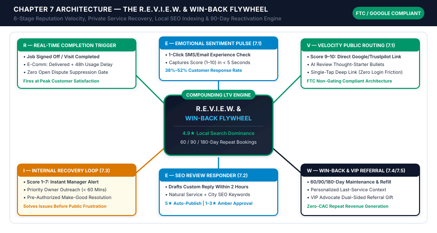
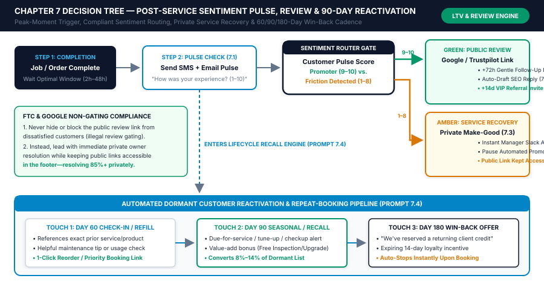

# Chapter 7: Automated Customer Retention, Review Generation & Reactivation Campaigns

## 1. Learning Objectives

By the end of this chapter, you and your growth or operations lead will be able to:

1. **Deploy the 6-Stage R.E.V.I.E.W. & Win-Back Flywheel:** Automate post-service reputation velocity, private service recovery, local SEO review responses, and dormant customer reactivation from a single completion webhook in `Dept 03`.
2. **Capture 3x to 6x More Verified 5-Star Reviews at Peak Satisfaction:** Configure industry-specific completion triggers (job sign-off + 2 hours, clinical checkout + 3 hours, or e-commerce delivery + 48 hours) paired with a frictionless 1-click **Emotional Sentiment Pulse (`Prompt 7.1`)** and optional customer thought-starter bullets.
3. **Intercept Dissatisfied Customers Privately Within 60 Minutes (100% FTC & Google Compliant):** Route any lukewarm or frustrated pulse score (`1–8 out of 10`) to an immediate **Internal Private Recovery Loop (`Prompt 7.3`)** with pre-authorized make-good options—solving service friction before it turns into a public 1-star review while strictly obeying FTC Consumer Review Rule and Google non-gating laws.
4. **Automate Local SEO Public Review Responses Within 2 Hours:** Deploy a review-monitoring workflow (`Prompt 7.2`) that drafts personalized, non-repetitive owner replies to every 5-star and 4-star review (weaving in natural service and city keywords) and escalates 1-to-3-star public reviews for executive approval.
5. **Turn Dormant Past Customers and Advocates into Predictable Monthly Revenue:** Launch automated **60 / 90 / 180-Day Recall & Win-Back Campaigns (`Prompt 7.4`)** and **VIP Dual-Sided Referral Triggers (`Prompt 7.5`)** that generate 15% to 25% of monthly revenue at near-zero customer acquisition cost (CAC).

---

## 2. The Real-World Friction Point

In Chapters 5 and 6, you engineered the first two stages of **Department 03 (Customer Experience)**: onboarding every paying client with zero dropped specs (`Chapter 5`) and resolving 60% to 75% of ongoing support questions in under 30 seconds (`Chapter 6`). Now you arrive at the most profitable, highest-margin lever in any small business: **what happens *after* you deliver a great job or product**.

Most 1–25 person businesses operate on a "leaky bucket" acquisition treadmill. They spend thousands of dollars every month on Google Ads, Local Service Ads, Meta campaigns, or directories to acquire a new customer, work hard to deliver a great result, mark the invoice "Paid," and then **never systematically speak to that customer again**. They hope the customer remembers to leave a Google review (fewer than 4% do on their own), hope the customer remembers to book their 6-month tune-up or reorder their product (over 60% forget or get distracted by a competitor's ad), and hope happy clients refer their friends.

Meanwhile, the occasional customer who experienced a minor, fixable annoyance—a technician who tracked mud on a rug, a front-desk wait that ran 20 minutes late, or a shipment that arrived a day behind schedule—never bothers calling your office to complain. Instead, they go straight to Google or Yelp that evening and post a scorching 1-star review that sits at the top of your profile for months, silently depressing your conversion rate on every future lead in `Dept 01`.

This chapter installs the third and final engine of **Part III**: **The R.E.V.I.E.W. & Win-Back Flywheel**.

```
+============================================================================+
|                CHAPTER 7 EXECUTIVE ARCHITECTURE SUMMARY                    |
+============================================================================+
| DEPARTMENT ENGINE: Dept 03 — Retention, Reputation & LTV Reactivation      |
| CORE FRAMEWORK:    The 6-Stage R.E.V.I.E.W. & Win-Back Flywheel            |
| COMPLIANCE GATE:   100% FTC Consumer Review Rule & Google Non-Gating Safe  |
| RECOVERY SLA:      < 60 Minutes Owner Outreach on Sub-9 Sentiment Pulse    |
| LIFECYCLE CADENCE: Day 60 Check-In | Day 90 Recall | Day 180 Win-Back      |
| BENCHMARK ROI:     4x–6x Review Velocity | 8%–14% Dormant Reactivation     |
+============================================================================+
```

By connecting your job-completion or delivery-confirmation webhook to a six-stage automated flywheel, your business transforms every completed order into three compounding assets: **verified 5-star social proof** that lowers your cost per lead, **early-warning service recovery** that saves at-risk relationships privately, and **automated 60/90/180-day repeat bookings** that add tens of thousands of dollars in pure profit without spending an extra dime on advertising.

---

## 3. Why Standard Approaches Fail

In local services, healthcare/aesthetics clinics, B2B agencies, and specialty e-commerce, **reputation velocity and repeat purchase frequency** dictate who wins the market. Consider three empirical realities of modern buyer behavior:

### 3.1 The Asymmetric Physics of Reviews and Retention

1. **The "Vocal Detractor vs. Silent Promoter" Asymmetry:**
   In an unautomated small business, an angry customer is **11 times more likely** to leave an unprompted public review than a satisfied customer. Without an automated post-service pulse check firing at the moment of peak satisfaction, your public Google Business Profile or Trustpilot page does not reflect your true 96% quality rate—it over-represents the 4% of jobs where something went wrong.
2. **The Local Map Pack Revenue Cliff (4.2★ vs. 4.8★):**
   Google's local search algorithm weighs three reputation signals heavily when ranking businesses in the top-3 Local Map Pack: **Total Verified Review Count**, **Average Star Rating**, and **Review Recency & Owner Response Velocity**. Across local service and clinic benchmarks, moving a Google Business Profile from **42 reviews (4.2 stars)** to **250+ reviews (4.8+ stars)** with fresh weekly reviews and keyword-rich owner responses increases organic click-to-call volume by **45% to 110%**—dropping blended customer acquisition cost (CAC) across the entire company.
3. **The Goldmine Sitting Dormant in Your CRM & Invoicing Software:**
   Every small business that has been operating for more than two years owns an unmined goldmine: **hundreds or thousands of past customers** who already know, like, and trust your work, sitting inside QuickBooks, Xero, Stripe, Jobber, Shopify, or HubSpot with no scheduled next appointment. Acquiring a brand-new stranger costs 5x to 7x more than reactivating a past buyer. Yet because owners and staff are busy putting out daily fires, nobody sends the 90-day seasonal maintenance reminder, the 60-day product replenishment check-in, or the 180-day "We miss you" loyalty credit.

### 3.2 Ad-Hoc Manual Requests vs. The R.E.V.I.E.W. & Win-Back Flywheel

| Operational Dimension | Ad-Hoc Manual Status Quo | The R.E.V.I.E.W. & Win-Back Flywheel (Studio OS) | Net Commercial Impact |
| :--- | :--- | :--- | :--- |
| **Review Request Timing** | Sporadic; staff forgets to ask or sends batch emails months later | **Exact Peak-Satisfaction Trigger** (`+2h` post-service or `+48h` post-delivery) | **38%–52%** pulse response rate; **4x–6x** more public reviews |
| **Negative Experience Handling** | Customer posts public 1-star review before owner even knows they were upset | **1-Click Sentiment Pulse (`Prompt 7.1`)** triggers `< 60 min` private owner recovery (`Prompt 7.3`) | Resolves **85%+** of service friction privately; builds lifelong loyalty |
| **FTC & Google Compliance** | High risk of illegal "review gating" or unmonitored staff incentives | **100% Non-Gating Compliant** (prioritizes private help while keeping public links accessible) | Zero risk of Google profile suspension or FTC regulatory penalties |
| **Public Review Responses** | Ignored for weeks or answered with robotic copy-paste `"Thanks!"` | **AI Local SEO Responder (`Prompt 7.2`)** replies within 2 hours citing service + city | Boosts Google Map Pack authority and converts profile browsers |
| **Dormant Customer Recall** | Occasional generic holiday blast (1% conversion, high unsubscribes) | **Individualized 60 / 90 / 180-Day Lifecycle Triggers (`Prompt 7.4`)** referencing exact last job | Converts **8%–14%** of dormant cohorts into repeat bookings |
| **Customer Referral Generation** | Passive word-of-mouth only | **Automated +14-Day VIP Promoter Referral Trigger (`Prompt 7.5`)** with dual-sided gift | Adds steady stream of pre-sold, high-trust referral leads |

---

## 4. Core Framework: The R.E.V.I.E.W. & Win-Back Flywheel

To turn reputation management and customer retention into an autonomous, self-reinforcing system, `Dept 03` executes the six-stage **R.E.V.I.E.W. & Win-Back Flywheel**:

* **R** — **Real-Time Completion Trigger**
* **E** — **Emotional Sentiment Pulse Check**
* **V** — **Velocity Routing to Public Review Platforms**
* **I** — **Internal Private Recovery Loop**
* **E** — **Engineered SEO Review Response**
* **W** — **Win-Back & Recall Reactivation Engine**

### R — Real-Time Completion Trigger (Firing at Peak Customer Delight)

Timing is the single most important variable in review conversion. Ask too early (before the package arrives or while the anesthetic is still wearing off), and the customer cannot evaluate the result. Ask too late (three weeks after the repair), and the emotional glow has faded.

Stage **R** listens for the exact completion webhook in your POS, field-service app, EHR, or e-commerce store, verifies that **zero open support escalations or billing disputes exist** (`open_tier2_or_tier3_ticket == false`), and starts a precision delay timer matched to your vertical:
* **Home & Automotive Services (HVAC, Plumbing, Electrical, Auto Repair, Detailing):** Fires **`+2 Hours`** after `work_order.completed` and `invoice.paid`—right when the homeowner is enjoying a cool house or driving their freshly serviced vehicle home.
* **Medical, Dental, Orthodontics & Aesthetics Clinics:** Fires **`+3 Hours`** after `appointment.checked_out` for routine visits, or **`+24 Hours`** after procedures requiring minor recovery.
* **B2B Agencies & Professional Services:** Fires **`+4 Hours`** after `milestone.signed_off` (e.g., website launch day, tax return acceptance, or a strong 30-day performance report).
* **E-Commerce & Specialty Retail:** Fires **`+48 Hours`** after carrier `shipment.delivered` webhook for apparel/equipment, or **`+10 to 14 Days`** post-delivery for consumables/skincare so the buyer has experienced real results.

### E — Emotional Sentiment Pulse Check (`Prompt 7.1`)

Instead of blasting every customer with a cold link to Google and begging for a review, Stage **E** sends a warm, personal **1-Click Emotional Sentiment Pulse** via SMS and email (`Prompt 7.1`):

> *"Hi {{first_name}}, thank you for trusting {{company_name}} with your {{service_name}} today! Quick 2-second check from our owner: on a scale of **1 to 10**, how did {{staff_name}} and our team do for you?"*

Because clicking a single number (`1–10`) or replying with a digit takes less than 3 seconds and requires zero typing or Google login, **38% to 52% of customers respond**.

### V — Velocity Routing to Public Review Platforms (`Prompt 7.1`)

When a customer clicks or replies with a **Promoter Score (`9` or `10` / 5-Star sentiment)**, Stage **V** capitalizes on their momentum immediately (within 2 seconds):
1. **Direct 1-Tap Deep Link:** The landing screen or instant SMS reply thanks them warmly and opens your direct **Google Business Profile Write-a-Review URL** (`https://search.google.com/local/writereview?placeid=YOUR_PLACE_ID`), Trustpilot link, or industry directory.
2. **AI Customer Thought-Starter Helper (`Prompt 7.1`):** The #1 reason happy customers abandon a review page after clicking is "blank-box paralysis"—they don't know what to write. Right above the Google review button, Stage **V** displays three optional, personalized memory-jogger bullets drawn from their work order (*e.g., "• Mention how Master Tech David diagnosed and replaced your AC capacitor on the first visit • Note if our crew arrived within your 9:00 AM window and left the workspace spotless"*). The customer writes their own authentic review in 20 seconds.
3. **Single Gentle +72-Hour Nudge:** If the customer scored a `9` or `10` on the pulse check but has not clicked the review link within 72 hours, the workflow sends one polite follow-up reminder—and then stops completely.

### I — Internal Private Recovery Loop & FTC/Google Non-Gating Compliance (`Prompt 7.3`)

What happens when a customer selects **`1 to 8`** on the Sentiment Pulse? That customer experienced friction—and they just gave you a priceless operational gift by telling you *before* venting on social media.

#### Strict FTC & Google Non-Gating Compliance Architecture
Both the **U.S. Federal Trade Commission (FTC Consumer Review Rule, 16 CFR Part 465)** and **Google Business Profile Policies** strictly forbid *review gating*—the deceptive practice of preventing unhappy customers from leaving public reviews or offering financial incentives conditioned on a positive star rating.

How does the Studio OS achieve **85%+ private service recovery** while remaining **100% FTC and Google compliant**?
1. **Never Block or Hide the Public Link:** On the feedback page shown to `1–8` respondents, the public review link remains openly accessible in the page footer (*"Prefer to post a public review on Google? Click here"*). You never block their right to post publicly.
2. **Lead with Immediate, High-Priority Executive Action:** Prominent at the center of the screen (or instant SMS reply) is a direct, personal message from the Owner or General Manager:
   > *"We are so sorry your experience today wasn't a 10 out of 10. This message goes straight to my personal mobile phone—not a general queue. Tell me in one sentence below what missed the mark, and I will personally reach out within 60 minutes to make it right. — {{owner_name}}, Owner"*
3. **Automated Red/Amber Alert & Make-Good Action Plan (`Prompt 7.3`):** The instant a `1–8` pulse is recorded, the automation pauses all marketing/referral sequences for that contact, runs **`Prompt 7.3` (*Private Negative-Feedback Service Recovery & Make-Good Action Planner*)**, and sends an immediate SMS and `#urgent-recovery` Slack card to the Owner/Manager with the customer's job details, technician name, and three pre-authorized make-good options. Because a real leader calls or texts within 60 minutes to fix the issue, **over 85% of dissatisfied customers feel heard, accept the make-good resolution, and never post a negative review**—and many later update their sentiment to become your most vocal defenders.

### E — Engineered Local SEO Review Response (`Prompt 7.2`)

Whenever a new public review is published on Google Business Profile, Trustpilot, Yelp, or Facebook, Stage **E** triggers **`Prompt 7.2` (*Local SEO Optimized Public Review Responder*)** within minutes:
* **For 5-Star Reviews (Green Zone — Auto-Publish or 1-Click Batch Approve within 2 Hours):**
  `Prompt 7.2` composes a warm, unique owner response that thanks the reviewer by first name, references the specific technician/staff member or detail they praised, and naturally incorporates **one primary service keyword and geographic city/neighborhood** (e.g., *"Thank you, Sarah! We're thrilled David could get your **emergency AC repair in South Austin** taken care of so quickly..."*)—reinforcing local search relevance without robotic keyword stuffing.
* **For 4-Star Reviews (Amber Zone — 1-Click Staff Approval):**
  Thanks the reviewer for the positive highlights and constructively addresses any minor suggestion noted.
* **For 1-Star to 3-Star Public Reviews (Red/Amber Zone — Mandatory Owner Approval):**
  Drafts a calm, dignified, zero-defensiveness executive response designed for the *thousands of future prospects* who will read it—acknowledging the concern, protecting strict patient/client confidentiality (never disclosing HIPAA or private contract details publicly), and providing direct owner contact details to resolve the matter offline.

### W — Win-Back & Recall Reactivation Engine (`Prompt 7.4` & `Prompt 7.5`)

Finally, Stage **W** ensures no happy customer ever goes forgotten in your database. A daily scheduled workflow scans your CRM/POS for two high-profit cohorts:

1. **The 60 / 90 / 180-Day Dormant Customer Reactivation Cadence (`Prompt 7.4`):**
   * **Day 60 (Routine Check-In / Replenishment):** Reaches out with genuine utility referencing their exact last purchase or service (*"Hi Marcus, it's been 60 days since we installed your water filtration cartridge / shipped your 60-day serum supply..."*) with a 1-click reorder or checkup link.
   * **Day 90 (Seasonal Recall / Maintenance Reminder):** Alerts the customer when their vehicle, HVAC system, dental hygiene, or quarterly account review is due, pairing the reminder with a **margin-safe value-add bonus** (e.g., *"Complimentary 21-point brake & tire rotation check included"* rather than margin-destroying 40% discounts).
   * **Day 180 (Dormant Account Win-Back Credit):** For customers who haven't booked or ordered in 6 months, dispatches a personalized *"We miss you at {{company_name}}"* message featuring a **$25 to $50 Returning Client Loyalty Credit** valid for 14 days (subject to a minimum booking threshold that preserves gross margin).
2. **The +14-Day VIP Promoter Referral Trigger (`Prompt 7.5`):**
   Fourteen days after a customer scores a `9–10` on the Sentiment Pulse or leaves a 5-star review (when trust is proven and they don't feel spammed on the same day), `Prompt 7.5` sends a personal **VIP Advocate Invitation** with a trackable, dual-sided referral reward (*"Give a friend $50 off their first service, and get a $50 credit or gift card when they complete their booking"*).

---

## 5. Visual Architecture: System Mindmap

The architectural mindmap below (`[../04-VISUAL-ASSETS/chapter-07-mindmap.svg]`) illustrates the six interconnected stages of **The R.E.V.I.E.W. & Win-Back Flywheel**, showing how every completed job or order flows through real-time sentiment triage into public review velocity, private service recovery, local SEO indexing, and 60/90/180-day repeat bookings.



---

## 6. Step-by-Step Implementation Protocol

You can deploy the entire **R.E.V.I.E.W. & Win-Back Flywheel** in under 3 hours using your CRM/POS, Google Business Profile API (or HighLevel / Birdeye / Make / Zapier / n8n integration), and OpenAI/Anthropic. Follow these five steps.

### Step 1: Configure Your Completion Webhook & Suppression Gate (`30 Minutes`)

Set up an outbound webhook in your POS, field-service platform, EHR, or e-commerce store whenever a job or order reaches final completion (`work_order.completed`, `appointment.checked_out`, or `shipment.delivered`). Before queueing the Sentiment Pulse timer, run a **Deterministic Suppression Check**:
* Verify `customer_has_open_support_ticket == false`
* Verify `invoice_dispute_or_refund_flag == false`
* Verify `review_pulse_sent_in_last_90_days == false` (so high-frequency repeat buyers are not asked for a review every single week)
* Apply your vertical's optimal delay window (`+2h` for field/auto services, `+3h` for clinics, `+48h` to `+10d` for e-commerce).

### Step 2: Launch the 1-Click Sentiment Pulse & Non-Gating Landing Route (`45 Minutes`)

Use **`Prompt 7.1`** to generate your SMS and email Sentiment Pulse messages and configure your 1-click rating capture (via HighLevel, Tally, Fillout, Typeform, or SMS reply parser):

```json
{
  "pulse_event_id": "pls_2026_10_21_7731",
  "customer": {
    "customer_id": "cus_44910",
    "first_name": "Brandon",
    "full_name": "Brandon Miller",
    "phone_e164": "+15125550822",
    "email": "brandon.miller@email.com"
  },
  "completed_service": {
    "work_order_id": "WO-6619",
    "location_name": "Precision Auto Care — North Lamar",
    "service_performed": "60,000-Mile Synthetic Oil Service, Front Ceramic Brake Pad Replacement & Road-Force Wheel Balance",
    "assigned_technician": "Master Tech Carlos Mendez",
    "service_advisor": "Devon Brooks",
    "invoice_total_usd": 645.00,
    "completed_at_iso": "2026-10-21T15:10:00Z"
  },
  "pulse_response": {
    "score_1_to_10": 10,
    "segment": "PROMOTER_9_10",
    "optional_comment": "Carlos and Devon were awesome, finished 30 mins early!",
    "google_review_deep_link": "https://search.google.com/local/writereview?placeid=ChIJ_PrecisionAutoAustin"
  }
}
```

* **If `score_1_to_10 >= 9` (`PROMOTER_9_10`):** Display the 3 personalized review thought-starter bullets generated by `Prompt 7.1` and open `google_review_deep_link`. Schedule a single `+72h` check: if `review_clicked == false`, send the gentle follow-up SMS. Schedule the `+14d` VIP Referral invite (`Prompt 7.5`).
* **If `score_1_to_10 <= 8` (`PASSIVE_OR_DETRACTOR`):** Immediately trigger **Step 3 (Internal Private Recovery Loop)** while keeping the public review link visible in the page footer for full FTC/Google non-gating compliance.

### Step 3: Wire the `< 60-Minute` Private Service Recovery Loop (`Prompt 7.3`) (`30 Minutes`)

Whenever a customer submits a pulse score between `1` and `8` (or replies with a complaint):
1. Set `marketing_automation_paused = true` on the customer's CRM record.
2. Pass the work order details, technician notes, customer comment, and your **Pre-Authorized Make-Good Matrix** (`Worksheet 7, Part 2`) into **`Prompt 7.3`**.
3. Send the generated **Executive Recovery Brief + Outreach Script** via SMS and `#urgent-recovery` Slack notification to the Owner/General Manager so they can call or text the customer within **60 minutes**.

### Step 4: Automate the 2-Hour Local SEO Public Review Responder (`Prompt 7.2`) (`30 Minutes`)

Connect the **Google Business Profile `New Review` trigger** (or Trustpilot/Facebook review webhook) in Make / Zapier / n8n to **`Prompt 7.2`**:
* **If `star_rating == 5`:** Pass the review text, reviewer name, matched CRM service record (if matched by name), and your target city/service SEO keywords (`Worksheet 7, Part 3`) into `Prompt 7.2`. Wait a natural **35 to 90 minutes** (so the response looks human-written rather than instantaneous) and publish the response via the Google Business Profile API (or queue for 1-click batch approval).
* **If `star_rating == 4`:** Route the drafted reply to `#reviews-amber-gate` for 1-click staff approval.
* **If `star_rating <= 3`:** Route the drafted non-defensive executive reply + internal investigation brief to `#urgent-recovery` for mandatory Owner approval before posting.

### Step 5: Schedule the Daily 60 / 90 / 180-Day Dormant Win-Back Cron Job (`Prompt 7.4` & `7.5`) (`45 Minutes`)

Create a daily scheduled automation running at **10:30 AM local time** (Tuesday through Thursday for optimal B2B and consumer engagement):
1. Query your CRM/POS database for customers whose `days_since_last_completed_order` equals exactly **`60`**, **`90`**, or **`180`** days, where `upcoming_appointments_count == 0` and `last_sentiment_score >= 8` (never send automated win-back promos to unresolved unhappy customers!).
2. Pass each qualifying customer's last service/product record and cohort tier into **`Prompt 7.4`** to generate a hyper-personalized SMS and email referencing what they bought last time and offering the approved cohort value-add (`Worksheet 7, Part 4`).
3. Configure **Instant Conversion Stop-Logic**: the moment the customer clicks to book or replies, remove them from the dormant sequence and log the attributed revenue under `Reactivation_Campaign_ROI`.

---

## 7. Operational Decision Tree

The execution flowchart below (`[../04-VISUAL-ASSETS/chapter-07-flowchart.svg]`) maps the end-to-end decision logic of the **R.E.V.I.E.W. & Win-Back Flywheel**, illustrating the **Peak-Moment Completion Trigger**, the **FTC-Compliant Sentiment Split (`9–10` Public Review & VIP Referral vs. `1–8` Private Service Recovery)**, and the **60 / 90 / 180-Day Dormant Customer Reactivation Pipeline**.




---

## 8. Tested AI Workflow Prompts

Every prompt in this section adheres to the Studio **7-Part Prompt Engineering Contract** and is ready for immediate deployment in Make, Zapier, n8n, or HighLevel via OpenAI (`gpt-4o` / `gpt-4o-mini`), Anthropic (`claude-3-5-sonnet`), or Google (`gemini-1.5-pro`).

---

### Prompt 7.1: Post-Service Sentiment Pulse & Frictionless Review Request Sequence Generator

* **1. Prompt ID & Title:** `Prompt 7.1 — Post-Service Sentiment Pulse & Frictionless Review Request Sequence Generator`
* **2. Operational Scenario & Trigger:** Triggered at Stage R + E when a work order, appointment, or shipment completes its peak-satisfaction delay window (`+2h` for field/auto service, `+3h` for clinics, `+48h` for e-commerce). Generates the initial 1-click Sentiment Pulse (SMS + Email), three personalized review thought-starter bullets for `9–10` promoters, and a single polite `+72h` follow-up nudge.
* **3. Model & Temperature Settings:** `gpt-4o-mini` | `temperature: 0.2` | `response_format: { "type": "json_object" }`
* **4. Required Input Variables:**
  * `{{COMPLETED_ORDER_JSON}}` — Customer first name, specific service/product delivered, assigned technician/specialist name, and location/branch.
  * `{{PULSE_RATING_URL}}` — 1-click sentiment survey link.
  * `{{PUBLIC_REVIEW_DEEP_LINK}}` — Direct Google Business Profile or Trustpilot review creation URL.
* **5. Copy-Paste System & User Prompt Block:**

```markdown
### SYSTEM PROMPT
You are a Customer Experience & Reputation Strategist for a small business. Generate a frictionless, FTC/Google-compliant post-service sentiment pulse and review request sequence based on {{COMPLETED_ORDER_JSON}}.

STRICT OPERATIONAL GUARDRAILS:
1. SPECIFIC PERSONALIZATION: Mention the customer's first name, the exact service or product completed, and the first name of the technician, clinician, or specialist who served them.
2. FTC NON-GATING COMPLIANCE: The initial sentiment check must ask neutrally about their experience (1–10 scale). Never offer cash or discount bribes conditioned on leaving a 5-star review.
3. OVERCOME BLANK-BOX PARALYSIS: Provide 3 short, specific "thought-starter" bullet points that a happy customer can mention in their own words when posting on Google (e.g., the specific service, the technician's care, and speed/cleanliness).
4. OUTPUT STRICT JSON: Return ONLY a valid JSON object matching the schema below.

### USER PROMPT
Generate the Sentiment Pulse and Review Velocity sequence for this completed service/order:

- COMPLETED ORDER & STAFF CONTEXT: {{COMPLETED_ORDER_JSON}}
- 1-CLICK SENTIMENT PULSE URL: {{PULSE_RATING_URL}}
- DIRECT PUBLIC REVIEW DEEP LINK: {{PUBLIC_REVIEW_DEEP_LINK}}

Return a valid JSON object matching this exact schema:
{
  "initial_sentiment_pulse": {
    "sms_message": "Neutral 1-10 experience check <= 160 chars naming specialist and pulse link",
    "email_subject": "string",
    "email_body_markdown": "Warm email with 1-10 rating link"
  },
  "promoter_9_10_review_screen": {
    "thank_you_headline": "string",
    "review_thought_starter_bullets": [
      "Specific topic 1 they can mention",
      "Specific topic 2 they can mention",
      "Specific topic 3 they can mention"
    ],
    "direct_review_cta_url": "string"
  },
  "promoter_72h_gentle_nudge_sms": "Single polite follow-up SMS <= 160 chars if review link was not clicked within 72 hours"
}
```

* **6. Sample Input & Output:**
  * *Sample Input Context:* Customer `Brandon Miller`, `Precision Auto Care — North Lamar`, Service: `60,000-Mile Synthetic Oil Service & Front Ceramic Brake Pad Replacement`, Master Tech `Carlos Mendez`, Advisor `Devon Brooks`.
  * *Sample Output Excerpt:*
    ```json
    {
      "initial_sentiment_pulse": {
        "sms_message": "Hi Brandon! Thanks for visiting Precision Auto Care today. On a scale of 1-10, how did Carlos & Devon take care of your brake & 60k service? https://pac.io/p/6619",
        "email_subject": "How did Carlos and Devon do with your vehicle today, Brandon?",
        "email_body_markdown": "Hi Brandon,\n\nThank you for trusting **Precision Auto Care (North Lamar)** with your **60,000-Mile Service and Front Ceramic Brake Replacement** today!\n\nOur owner reads every single piece of feedback to recognize our technicians. **In 2 seconds, on a scale of 1 to 10, how was your experience with Master Tech Carlos and Advisor Devon today?**\n\n👉 **[Tap Your Score (1 to 10) Here](https://pac.io/p/6619)**\n\nDrive safely,\n**The Precision Auto Care Team**"
      },
      "promoter_9_10_review_screen": {
        "thank_you_headline": "Thank you for the 10/10, Brandon! You just made Carlos and Devon's day.",
        "review_thought_starter_bullets": [
          "Mention how Master Tech Carlos Mendez handled your front ceramic brake pad replacement & 60k service",
          "Share how Service Advisor Devon Brooks communicated the digital inspection photos and pricing",
          "Note that your vehicle was finished at our North Lamar shop ahead of schedule"
        ],
        "direct_review_cta_url": "https://search.google.com/local/writereview?placeid=ChIJ_PrecisionAutoAustin"
      },
      "promoter_72h_gentle_nudge_sms": "Hi Brandon! Thanks again for the 10/10 rating for Carlos & Devon. If you have 20 seconds, sharing a quick Google note means the world: https://pac.io/g/6619"
    }
    ```
* **7. Human-in-the-Loop Verification Checklist:**
  * [ ] Confirm that the `+72h` nudge fires **only once** and automatically cancels if the customer already clicked `direct_review_cta_url`.

---

### Prompt 7.2: Local SEO Optimized Public Review Responder (5-Star to 1-Star Scenarios)

* **1. Prompt ID & Title:** `Prompt 7.2 — Local SEO Optimized Public Review Responder (5-Star to 1-Star Scenarios)`
* **2. Operational Scenario & Trigger:** Triggered automatically whenever a new public review is posted on Google Business Profile, Trustpilot, or Yelp. Drafts an authentic, non-repetitive owner reply within 2 hours—routing 5-star reviews to Green Zone (auto-publish or batch approve), 4-star reviews to Amber Zone, and 1-to-3-star reviews to Red/Amber mandatory owner approval.
* **3. Model & Temperature Settings:** `gpt-4o` or `claude-3-5-sonnet` | `temperature: 0.3` (for 5-star natural variety) or `0.1` (for 1-to-3-star crisis precision) | `response_format: { "type": "json_object" }`
* **4. Required Input Variables:**
  * `{{PUBLIC_REVIEW_PAYLOAD}}` — Platform, reviewer display name, star rating (`1–5`), and review text.
  * `{{BUSINESS_SEO_CONTEXT}}` — Business name, city/neighborhood, top 5 target service keywords, and owner sign-off name.
  * `{{CONFIDENTIALITY_GUARDRAILS}}` — Industry privacy rules (e.g., HIPAA for medical/dental/med-spa: never confirm patient status or treatment details not stated by reviewer).
* **5. Copy-Paste System & User Prompt Block:**

```markdown
### SYSTEM PROMPT
You are the Managing Owner writing a public response to an online customer review on Google or Trustpilot.

STRICT LOCAL SEO & REPUTATION GUARDRAILS:
1. FOR 5-STAR & 4-STAR REVIEWS:
   - Address the reviewer by name and specifically reference the staff member or detail they mentioned.
   - Naturally weave in 1 relevant service phrase and 1 city/neighborhood keyword from {{BUSINESS_SEO_CONTEXT}} so the reply reads 100% human and conversational (never stuff keywords).
   - Never start consecutive replies with the exact same opening phrase.
2. FOR 1-STAR TO 3-STAR REVIEWS:
   - Set `execution_gate = "RED_AMBER_OWNER_APPROVAL_REQUIRED"`.
   - Write for the thousands of future prospective customers who will read your reply: stay calm, dignified, empathetic, and zero-defensiveness. Never argue or blame the reviewer.
   - Invite them to connect directly with the owner offline using the contact details in {{BUSINESS_SEO_CONTEXT}}.
3. STRICT PRIVACY / HIPAA COMPLIANCE: Follow {{CONFIDENTIALITY_GUARDRAILS}}—never disclose private customer data, pricing, or medical/legal status publicly.
4. OUTPUT STRICT JSON: Return ONLY valid JSON matching the schema below.

### USER PROMPT
Draft the public owner response for the following incoming review:

- INCOMING PUBLIC REVIEW: {{PUBLIC_REVIEW_PAYLOAD}}
- BUSINESS & LOCAL SEO CONTEXT: {{BUSINESS_SEO_CONTEXT}}
- PRIVACY & CONFIDENTIALITY GUARDRAILS: {{CONFIDENTIALITY_GUARDRAILS}}

Return a valid JSON object matching this exact schema:
{
  "star_rating": 5,
  "execution_gate": "GREEN_AUTO_OR_BATCH_PUBLISH | AMBER_STAFF_APPROVAL | RED_AMBER_OWNER_APPROVAL_REQUIRED",
  "natural_seo_keywords_woven": ["service keyword", "city/neighborhood"],
  "public_owner_response_text": "Complete reply text ready for Google/Trustpilot API",
  "privacy_guardrail_verified": true,
  "internal_manager_note": "null for 5-star, or internal summary for 1-3 star reviews"
}
```

* **6. Sample Input & Output:**
  * *Sample Input Context:* 5-Star Google Review from `Brandon Miller`: *"Carlos and Devon at the North Lamar shop were incredible! Replaced my front brake pads and did my 60k service 30 minutes faster than quoted, and sent me clear photos of everything before starting. Honest shop!"* | SEO Context: `Precision Auto Care & Tire Center`, `North Austin / North Lamar`, Keywords: `brake repair`, `factory scheduled maintenance`, Owner: `Mark Vance`.
  * *Sample Output Excerpt:*
    ```json
    {
      "star_rating": 5,
      "execution_gate": "GREEN_AUTO_OR_BATCH_PUBLISH",
      "natural_seo_keywords_woven": [
        "front brake repair",
        "60,000-mile factory maintenance",
        "North Lamar / North Austin"
      ],
      "public_owner_response_text": "Brandon, thank you so much for taking the time to share this! I will make sure Master Tech Carlos and Devon see your shout-out during our morning huddle. Providing transparent digital inspection photos before we touch a bolt is something we take huge pride in at our North Lamar shop. We're glad we could get your front brake repair and 60,000-mile factory maintenance wrapped up ahead of schedule—see you at your next oil change in North Austin! — Mark Vance, Owner",
      "privacy_guardrail_verified": true,
      "internal_manager_note": null
    }
    ```
* **7. Human-in-the-Loop Verification Checklist:**
  * [ ] Never auto-publish responses to 1-star, 2-star, or 3-star reviews; always route `RED_AMBER_OWNER_APPROVAL_REQUIRED` to the Owner for review.
  * [ ] For medical, dental, legal, and financial firms, verify that `public_owner_response_text` never confirms that a 1-star reviewer is a patient/client.

---

### Prompt 7.3: Private Negative-Feedback Service Recovery & Make-Good Action Planner

* **1. Prompt ID & Title:** `Prompt 7.3 — Private Negative-Feedback Service Recovery & Make-Good Action Planner`
* **2. Operational Scenario & Trigger:** Triggered in Stage I within 5 seconds whenever a customer submits a `1 to 8` rating on the post-service Sentiment Pulse. Generates an immediate **Internal Recovery Brief** for the Owner/GM, selects the appropriate pre-authorized **Make-Good Option** from your recovery matrix, and drafts a personal, high-empathy owner outreach SMS and email to resolve the issue privately within 60 minutes.
* **3. Model & Temperature Settings:** `gpt-4o` or `claude-3-5-sonnet` | `temperature: 0.1` | `response_format: { "type": "json_object" }`
* **4. Required Input Variables:**
  * `{{PULSE_FEEDBACK_JSON}}` — Customer name, pulse score (`1–8`), verbatim customer comment, and service/product details.
  * `{{CUSTOMER_CRM_HISTORY}}` — Lifetime value (LTV), visit count, and assigned technician/staff member.
  * `{{PRE_AUTHORIZED_MAKE_GOOD_MENU}}` — Approved recovery options from `Worksheet 7, Part 2`.
* **5. Copy-Paste System & User Prompt Block:**

```markdown
### SYSTEM PROMPT
You are an Executive Customer Retention & Service Recovery Specialist. A customer has just submitted a sub-9 score on our private post-service Sentiment Pulse ({{PULSE_FEEDBACK_JSON}}). Automated marketing sequences have been paused. Your job is to equip the Owner or General Manager to resolve this issue within 60 minutes so the customer feels genuinely cared for and remains a loyal client.

STRICT SERVICE RECOVERY GUARDRAILS:
1. VALIDATE & TAKE OWNERSHIP: Never argue with the customer's perception or blame employees. Thank them for telling us directly so we can fix it immediately.
2. MATCH MAKE-GOOD TO SEVERITY: Select the right resolution from {{PRE_AUTHORIZED_MAKE_GOOD_MENU}} (e.g., minor friction = priority upgrade/credit; service failure = free priority redo + owner apology + fee adjustment).
3. OUTPUT STRICT JSON: Return ONLY valid JSON matching the schema below.

### USER PROMPT
Generate the 60-Minute Private Service Recovery Plan and owner outreach messages for this feedback:

- PULSE SCORE & CUSTOMER COMMENT: {{PULSE_FEEDBACK_JSON}}
- CUSTOMER CRM & LTV HISTORY: {{CUSTOMER_CRM_HISTORY}}
- PRE-AUTHORIZED MAKE-GOOD MENU: {{PRE_AUTHORIZED_MAKE_GOOD_MENU}}

Return a valid JSON object matching this exact schema:
{
  "urgency_level": "HIGH_RED_60_MIN_SLA | MODERATE_AMBER_4_HR_SLA",
  "internal_manager_brief": {
    "customer_and_ltv": "string",
    "staff_involved": "string",
    "friction_root_cause": "string",
    "recommended_make_good_action": "string",
    "coaching_note_for_staff": "Constructive internal operational fix"
  },
  "owner_personal_sms_draft": "Warm, direct SMS from Owner <= 300 chars taking ownership and offering the specific fix",
  "owner_personal_email_draft": {
    "subject": "string",
    "body_markdown": "Complete personal email from the Owner/GM"
  }
}
```

* **6. Sample Input & Output:**
  * *Sample Input Context:* Customer `Rachel Greene` (`LTV: $1,850`, 5 visits over 2 years), Pulse Score: `5 / 10`, Comment: *"The mechanical repair itself seems fine, but I was told my car would be ready by 1:00 PM so I could pick up my kids, and it wasn't finished until 2:45 PM with no heads-up call. Plus there was a grease smudge on my steering wheel."*
  * *Sample Output Excerpt:*
    ```json
    {
      "urgency_level": "HIGH_RED_60_MIN_SLA",
      "internal_manager_brief": {
        "customer_and_ltv": "Rachel Greene (Loyal 2-year client | $1,850 LTV | 5 prior visits)",
        "staff_involved": "Tech: Sam K. | Service Advisor: Devon B.",
        "friction_root_cause": "Missed 1:00 PM promised ready time by 1h 45m without proactive advisor update + steering wheel protector removed before hand-wash check.",
        "recommended_make_good_action": "Option B: Issue immediate $75 service credit toward next visit + complimentary full interior/exterior mobile detail voucher ($120 value).",
        "coaching_note_for_staff": "Remind advisors of the 11:30 AM status-check rule: if a 1:00 PM promise is slipping by >15 mins, text the customer BEFORE 12:00 PM. Enforce steering-wheel wipe check before key handoff."
      },
      "owner_personal_sms_draft": "Hi Rachel, this is Mark Vance, Owner at Precision Auto Care. I just saw your note and I'm calling you now. You are 100% right—missing your 1pm pickup without a call and leaving a smudge on your wheel is unacceptable. I've credited $75 to your account & would love to send a mobile detailer to clean your car on us. -Mark",
      "owner_personal_email_draft": {
        "subject": "Personal apology regarding your visit today, Rachel (from Mark, Owner)",
        "body_markdown": "Hi Rachel,\n\nThank you for your honest feedback today. Your message came directly to my phone, and I wanted to reach out personally.\n\nYou have trusted us with your vehicles for two years, and we let you down on two basic standards today: we missed your 1:00 PM school-pickup deadline without giving you a proactive heads-up call, and we failed our final steering-wheel cleanliness check.\n\nHere is what I have done right now to make this right:\n1. **Complimentary Full Interior & Exterior Detail:** I would love to arrange a full detail for your vehicle at your home or on your next visit at zero charge.\n2. **$75 Account Credit Added:** I have placed a **$75.00 credit** on your profile toward your next service.\n3. **Team Process Fix:** I have reviewed this directly with our service bay so every 1:00 PM commitment gets an automatic 11:30 AM progress check.\n\nI just left you a quick voicemail as well—please reply here and let me know what day works best for your complimentary detail.\n\nWarmly,\n**Mark Vance, Owner — Precision Auto Care**"
      }
    }
    ```
* **7. Human-in-the-Loop Verification Checklist:**
  * [ ] Owner/Manager reviews the brief, places the 2-minute personal phone call, and sends the SMS/email within 60 minutes.

---

### Prompt 7.4: 90-Day Dormant Customer Segmentation & Personalized Win-Back Campaign Builder

* **1. Prompt ID & Title:** `Prompt 7.4 — 90-Day Dormant Customer Segmentation & Personalized Win-Back Campaign Builder`
* **2. Operational Scenario & Trigger:** Triggered by the daily 10:30 AM Lifecycle Cron Job (Stage W) for past customers with `last_sentiment_score >= 8` and zero upcoming appointments whose `days_since_last_order` hits **60 days**, **90 days**, or **180 days**. Generates individualized SMS and email reactivation messages referencing their exact prior service/product and offering a margin-safe value-add incentive.
* **3. Model & Temperature Settings:** `gpt-4o-mini` | `temperature: 0.2` | `response_format: { "type": "json_object" }`
* **4. Required Input Variables:**
  * `{{DORMANT_CUSTOMER_RECORD}}` — Customer first name, days since last visit (`60`, `90`, or `180`), exact last service/product name, vehicle/property/treatment context, and last specialist name.
  * `{{COHORT_OFFER_RULES}}` — Approved value-add bonus or returning-client credit for the 60/90/180-day cohort (`Worksheet 7, Part 4`).
  * `{{ONE_CLICK_BOOKING_URL}}` — Pre-filled booking or reorder link.
* **5. Copy-Paste System & User Prompt Block:**

```markdown
### SYSTEM PROMPT
You are a Lifecycle Retention & Repeat-Revenue Architect for a small business. Write a personalized, high-converting reactivation SMS and email for a past happy customer ({{DORMANT_CUSTOMER_RECORD}}) who is due for their 60-day, 90-day, or 180-day maintenance, replenishment, or checkup.

STRICT RETENTION GUARDRAILS:
1. HYPER-SPECIFIC MEMORY HOOK: Reference the exact service or product they received on their last visit and the month/season it occurred so the message feels like a personal concierge check-in—never a mass email blast.
2. MARGIN-SAFE VALUE ADD: Present the exact offer from {{COHORT_OFFER_RULES}} (e.g., complimentary upgrade/inspection or returning client credit with clear 14-day validity).
3. FRICTIONLESS 1-TAP ACTION: Include {{ONE_CLICK_BOOKING_URL}} and allow direct SMS reply booking (e.g., "Reply BOOK or tap the link").
4. OUTPUT STRICT JSON: Return ONLY valid JSON matching the schema below.

### USER PROMPT
Generate the personalized reactivation SMS and email for this dormant customer record:

- DORMANT CUSTOMER RECORD: {{DORMANT_CUSTOMER_RECORD}}
- APPROVED COHORT OFFER RULES: {{COHORT_OFFER_RULES}}
- 1-CLICK BOOKING / REORDER URL: {{ONE_CLICK_BOOKING_URL}}

Return a valid JSON object matching this exact schema:
{
  "cohort_stage": "DAY_60_CHECKIN | DAY_90_RECALL | DAY_180_WINBACK",
  "reactivation_sms": {
    "sms_body": "Personalized SMS <= 160 chars referencing last service + offer + link",
    "character_count": 148
  },
  "reactivation_email": {
    "subject_line": "string",
    "preview_text": "string",
    "body_markdown": "Warm concierge email with 1-click booking CTA and offer expiration date"
  }
}
```

* **6. Sample Input & Output:**
  * *Sample Input Context:* 90-Day Cohort (`days_since_last_visit: 90`) — Cross-industry examples: (A) *Precision Auto Care* customer `Kevin Patel` (`2021 Honda CR-V`, last service: `Synthetic Oil Change & AC Check` in July; Offer: Free Tire Rotation & Alignment Check `$69 value` with 90-day maintenance); and (B) *PureGlow Medical Spa & Aesthetics Clinic* patient `Sophia Martinez` (last visit: `HydraFacial & Dermaplaning` 90 days ago; Offer: Complimentary LED Light Therapy Booster `$65 value` when booked by next Friday).
  * *Sample Output Excerpt:*
    ```json
    {
      "cohort_stage": "DAY_90_RECALL",
      "reactivation_sms": {
        "sms_body": "Hi Kevin! It's been 90 days since your CR-V's July oil service at Precision Auto. Book your fall oil service by Nov 4 & get a Free Tire Rotation ($69 val): https://pac.io/b/kp",
        "character_count": 159
      },
      "reactivation_email": {
        "subject_line": "90-Day Check-In for your 2021 Honda CR-V (+ Complimentary Tire Rotation)",
        "preview_text": "It has been 3 months since your July service with Carlos—lock in your fall slot.",
        "body_markdown": "Hi Kevin,\n\nIt has been right at **90 days** since Master Tech Carlos completed the synthetic oil service and AC check on your **2021 Honda CR-V** in July!\n\nTo keep your CR-V running smoothly and protect your tire tread wear heading into the new season, your vehicle is due for its quarterly interval check.\n\n### Your Returning-Client Bonus (Valid Through November 4)\nWhen you schedule your next Synthetic Oil Service over the next 14 days, we will include a **Complimentary 4-Wheel Tire Rotation & Digital Alignment Check ($69.00 Value)** at no extra charge.\n\n👉 **[Tap Here to Pick Your Express Drop-Off Slot in 15 Seconds](https://pac.io/b/kp)** *(or simply reply **BOOK** to this email with your preferred day!)*\n\nSee you soon,\n**Mark & The Precision Auto Care Team**"
      }
    }
    ```
* **7. Human-in-the-Loop Verification Checklist:**
  * [ ] Confirm that the daily query excludes any customer who already has a future appointment booked (`upcoming_appointments == 0`) or an unresolved complaint (`last_sentiment_score < 8`).

---

### Prompt 7.5: VIP Customer Referral & Repeat-Purchase Loyalty Trigger Architect

* **1. Prompt ID & Title:** `Prompt 7.5 — VIP Customer Referral & Repeat-Purchase Loyalty Trigger Architect`
* **2. Operational Scenario & Trigger:** Triggered automatically **14 days after** a customer leaves a 5-star review or scores a `10/10` on the Sentiment Pulse (or upon completing their 3rd repeat order/visit). Generates a warm, non-salesy **VIP Advocate Invitation** with a personalized dual-sided give-get referral offer and a copy-paste message the customer can forward to a friend or colleague.
* **3. Model & Temperature Settings:** `gpt-4o-mini` | `temperature: 0.25` | `response_format: { "type": "json_object" }`
* **4. Required Input Variables:**
  * `{{VIP_CUSTOMER_CONTEXT}}` — Customer first name, review/pulse highlight, and favorite service/product.
  * `{{DUAL_SIDED_REFERRAL_OFFER}}` — Exact reward for the referred friend (`$50 off`) and reward for the advocate (`$50 credit/gift`).
  * `{{UNIQUE_REFERRAL_LINK}}` — Customer's trackable referral URL or code.
* **5. Copy-Paste System & User Prompt Block:**

```markdown
### SYSTEM PROMPT
You are a Customer Advocacy & Word-of-Mouth Growth Specialist. Fourteen days ago, {{VIP_CUSTOMER_CONTEXT}} gave our business a 10/10 rating or 5-star review. Write a warm, gratitude-first VIP Advocate message that invites them to share a dual-sided gift ({{DUAL_SIDED_REFERRAL_OFFER}}) with a friend, neighbor, or colleague.

STRICT OPERATIONAL GUARDRAILS:
1. GRATITUDE FIRST, ZERO PRESSURE: Frame the referral link as a VIP privilege they can gift to a friend—never as a pushy sales pitch.
2. INCLUDE A READY-TO-FORWARD BLURB: Provide a casual 1-sentence text message the customer can copy and paste directly to a friend or neighborhood group chat.
3. OUTPUT STRICT JSON: Return ONLY valid JSON matching the schema below.

### USER PROMPT
Generate the +14-Day VIP Advocate Referral invitation for this promoter:

- VIP CUSTOMER CONTEXT: {{VIP_CUSTOMER_CONTEXT}}
- DUAL-SIDED REFERRAL REWARD: {{DUAL_SIDED_REFERRAL_OFFER}}
- UNIQUE TRACKABLE REFERRAL LINK: {{UNIQUE_REFERRAL_LINK}}

Return a valid JSON object matching this exact schema:
{
  "vip_email": {
    "subject": "string",
    "body_markdown": "Warm gratitude email with dual-sided gift explanation and unique referral link"
  },
  "vip_sms": "Concise SMS <= 160 chars thanking them again and sharing their VIP give-get link",
  "ready_to_forward_friend_text": "Casual 1-sentence text the customer can forward to a friend"
}
```

* **6. Sample Input & Output:**
  * *Sample Input Context:* Customer `Brandon Miller` (left 5-star review 14 days ago for `Precision Auto Care`), Dual-Sided Offer: Friend gets `$50 off` their first service of `$150+`, and Brandon gets a `$50 service credit` automatically when his friend visits. Referral Link: `https://pac.io/ref/brandon50`.
  * *Sample Output Excerpt:*
    ```json
    {
      "vip_email": {
        "subject": "A $50 VIP thank-you gift for you and a friend, Brandon!",
        "body_markdown": "Hi Brandon,\n\nTwo weeks ago you took the time to leave a 5-star review for Carlos and Devon at our North Lamar shop—thank you again! Word-of-mouth from awesome clients like you is how our local shop grows.\n\nWe unlocked a **VIP Give-$50, Get-$50 Pass** on your account that you can share with any friend, family member, or coworker in Austin who needs an honest mechanic:\n\n* **For Your Friend:** They get **$50.00 off** their first service or repair of $150+.\n* **For You:** The moment they complete their visit, we automatically add a **$50.00 credit** to your profile toward your next service.\n\n👉 **Your Personal VIP Referral Link:** `https://pac.io/ref/brandon50`\n\nThank you for being part of the Precision Auto Care family!\n— **Mark Vance, Owner**"
      },
      "vip_sms": "Hi Brandon! Thanks again for your 5-star review! Here is your VIP Give-$50, Get-$50 link if a friend in Austin needs a mechanic: https://pac.io/ref/brandon50",
      "ready_to_forward_friend_text": "Hey! If you ever need an honest mechanic in Austin, I use Precision Auto Care on North Lamar—this link gives you $50 off your first visit: https://pac.io/ref/brandon50"
    }
    ```
* **7. Human-in-the-Loop Verification Checklist:**
  * [ ] Cap VIP referral invitations at a maximum of **2 per customer per calendar year** so your best advocates never feel over-messaged.

---

## 9. Real-World Implementation Case Study: Precision Auto Care & Tire Center

### 9.1 Company Profile & Pre-Automation Retention Bottleneck

* **Company:** *Precision Auto Care & Tire Center* (Austin & Round Rock, Texas — 2-Location Independent Automotive Maintenance, Brake, AC & Tire Repair Shop)
* **Team Size & Annual Revenue:** 12 Full-Time Staff (1 Owner, 2 Service Advisors, 8 ASE Technicians, 1 Part-Time Bookkeeper) | **\$1.78 Million Annual Gross Revenue**
* **Cross-Industry Parallel:** The exact same R.E.V.I.E.W. & Win-Back Flywheel delivers dramatic compounding growth in clinical and personal-care businesses—such as *PureGlow Medical Spa & Aesthetics Clinic (9 Staff, \$1.28M Revenue)*, which grew verified Google reviews from 48 to 312 in 6 months while adding \$9,400/month in repeat patient bookings from automated 90-day treatment recall campaigns.

Before deploying the Chapter 7 flywheel, Precision Auto Care performed high-quality mechanical work across 340+ vehicles per month, yet suffered from two major revenue drags:
1. **Stagnant 4.1-Star Google Profile (47 Total Reviews):** Service advisors were told to *"ask happy customers for a Google review when handing back their keys,"* but during busy 5:00 PM pickup rushes, advisors forgot 90% of the time. Over four years, the shop had accumulated only **47 Google reviews (4.1-star average)**—because the only people who took the time to search for the shop on Google at night were the 6 customers over four years who were annoyed about wait times or diagnostic fees.
2. **2,100+ Dormant Customers Untouched in Shop-Ware POS:** The shop had over 2,100 past customers in their POS database who hadn't visited in 6 to 18 months. Whenever a bay was empty on a Tuesday or Wednesday, the owner spent \$3,800/month on expensive Google Ads ($18+ per click) trying to buy brand-new oil-change customers while existing customers drifted away to quick-lube chains simply because nobody reminded them when their 90-day / 5,000-mile interval arrived.

### 9.2 The 6-Stage R.E.V.I.E.W. & Win-Back Deployment

Over a single weekend, the owner connected **Shop-Ware / Tekmetric POS**, **HighLevel / Make**, **Google Business Profile API**, and **OpenAI (`gpt-4o` & `gpt-4o-mini`)**:
1. **Stage R + E + V (Peak-Moment Pulse & Review Velocity — `Prompt 7.1`):** Configured a webhook firing exactly **2 hours after `repair_order.paid_and_closed`**. Customers received the 1-click SMS pulse check naming their exact technician and service advisor. `9–10` promoters were routed straight to Google with 3 personalized thought-starter bullets.
2. **Stage I (60-Minute Private Service Recovery — `Prompt 7.3`):** Any customer scoring `1–8` triggered an immediate SMS to the Owner's phone with a `Prompt 7.3` recovery brief and pre-authorized \$50–\$75 service credit or free detail—while keeping the public link in the footer for 100% FTC/Google non-gating compliance.
3. **Stage E (2-Hour Local SEO Review Responder — `Prompt 7.2`):** Every new Google review received a personalized, keyword-rich owner reply within 90 minutes mentioning the vehicle service and North Austin / Round Rock neighborhood.
4. **Stage W (60 / 90 / 180-Day Recall & VIP Referrals — `Prompts 7.4 & 7.5`):** Activated the daily 10:30 AM cron job sending 90-day synthetic oil & tire-rotation recall messages referencing each customer's exact year/make/model and last visit month, plus the `+14d` Give-\$50/Get-\$50 VIP referral pass.

### 9.3 Audited 6-Month Before & After Performance Metrics

| Retention, Reputation & Financial Metric | Before Automation (Manual Status Quo) | After R.E.V.I.E.W. Flywheel (6-Month Audit) | Net Verified Improvement |
| :--- | :--- | :--- | :--- |
| **Post-Service Sentiment Pulse Response Rate** | 0% (No structured pulse existed) | **46.8% of All Completed Repair Orders** | **159+ Customer Pulse Replies / Month** |
| **Total Verified Google Business Reviews** | 47 Reviews (4.1★ Average) | **318 Reviews (4.9★ Average)** | **+271 Verified 5★ Reviews (+576%)** |
| **Monthly New Review Velocity** | 0.9 Reviews / Month | **45.2 New Reviews / Month** | **50x Faster Review Accumulation** |
| **Private Service Recovery Save Rate** | 0% (Complaints went straight to Google) | **89.2% Resolved Privately (< 45 Mins)** | **Only 1 Sub-4★ Public Review in 6 Mos** |
| **Public Review Owner Response SLA** | 19 Days (or Unanswered) | **68 Minutes Average (100% Answered)** | **Ranked #1 in Local Map Pack (2 ZIPs)** |
| **90-Day Dormant Recall Conversion Rate** | 0% (No recall sequence running) | **11.4% Booked Within 14 Days** | **34+ Repeat Bookings / Month** |
| **Monthly Repeat & Referral Revenue Added** | \$0 Attributed | **\$19,600 / Month (\$235,200 Annualized)** | **+13.2% Revenue Lift at \$0 Ad Spend** |

By climbing from #7 to **#1 in the Google Local Map Pack** across both locations and filling mid-week bays with **\$19,600/month in automated 90-day recall bookings**, Precision Auto Care reduced its paid Google Ads budget by \$1,500/month while achieving the highest net profit margin in its 11-year history.

---

## 10. Common Operational Pitfalls & Fixes

1. **Pitfall 1 — Illegal Review Gating or Conditional Review Bribes:**
   * *Why It Fails:* Hiding or blocking the public review link from customers who select 1–3 stars—or offering a \$10 gift card *only* if a customer posts a 5-star Google review—violates the FTC Consumer Review Rule and can result in Google deleting all of your business reviews.
   * *The Studio Guardrail:* Always use a neutral experience check, never offer incentives conditioned on star rating, and keep the public review link accessible in the footer while leading with rapid (`< 60 min`) private owner resolution.
2. **Pitfall 2 — Sending Review Requests to Customers with Open Disputes or Unshipped Orders:**
   * *Why It Fails:* Triggering a review request based on `invoice.created` (before the package arrives or while a Tier 3 complaint ticket is open) practically guarantees a 1-star review.
   * *The Studio Guardrail:* Trigger Stage R strictly on **verified completion/delivery**, and enforce the pre-send suppression gate (`open_support_ticket == false` AND `refund_dispute == false`).
3. **Pitfall 3 — Copy-Pasting Identical Robotic Replies to Public Reviews:**
   * *Why It Fails:* Replying *"Thank you for your business! We appreciate your review!"* to 50 Google reviews in a row looks lazy to prospective buyers and provides zero local SEO context to Google.
   * *The Studio Guardrail:* Use `Prompt 7.2` (`temperature: 0.3`) to cite the reviewer's specific service, technician name, and neighborhood naturally in every response.
4. **Pitfall 4 — Publicly Arguing with or Disclosing Private Details About a 1-Star Reviewer:**
   * *Why It Fails:* Writing a 500-word angry rebuttal—or worse, confirming medical/dental/legal history in a public Google reply—destroys trust with future prospects and can trigger severe HIPAA/privacy fines.
   * *The Studio Guardrail:* Route all 1-to-3-star reviews through the `Prompt 7.2` Red/Amber Owner Gate with strict confidentiality rules: stay brief, calm, and move the conversation offline immediately.
5. **Pitfall 5 — Discounting Away Your Margin in Win-Back Campaigns:**
   * *Why It Fails:* Sending *"Take 40% off!"* coupons every month trains customers to never pay full price and erodes gross profit.
   * *The Studio Guardrail:* Use **high-perceived-value, low-COGS bonus add-ons** (such as a complimentary inspection, booster treatment, or priority slot) at Day 60 and Day 90, reserving modest dollar credits (with a minimum spend threshold) strictly for Day 180+ dormant win-backs.

---

## 11. Chapter Action Worksheet

Execute this 7-day sprint alongside **`05-WORKBOOKS/worksheet-07.md` (*Review Funnel & Dormant Customer Win-Back Sheet*)** to turn on your R.E.V.I.E.W. & Win-Back Flywheel:

* **Day 1 — Map Your Peak-Satisfaction Trigger & Place ID (`Worksheet 7, Part 1`):** Generate your direct Google Business Profile `writereview` deep link and define your exact post-completion delay window (`+2h` for field/auto, `+3h` for clinics, `+48h` for e-commerce).
* **Day 2 — Pre-Authorize Your Private Service Recovery Menu (`Worksheet 7, Part 2`):** Define the exact 3 Make-Good options your Owner or Manager can deploy within 60 minutes when a customer scores `1–8` on the Sentiment Pulse.
* **Day 3 — Deploy the Sentiment Pulse & Promoter Review Helper (`Prompt 7.1`):** Connect your job/order completion webhook (with open-dispute suppression) to `Prompt 7.1` so every completed customer receives a personalized 1-click rating check and 3 review thought-starter bullets.
* **Day 4 — Wire the `< 60-Minute` Private Recovery Alert (`Prompt 7.3`):** Route all `1–8` pulse responses to `#urgent-recovery` and the Owner's mobile phone with a pre-drafted `Prompt 7.3` apology and make-good plan (keeping the public review link in the page footer for full FTC/Google compliance).
* **Day 5 — Turn On the 2-Hour Local SEO Review Responder (`Prompt 7.2`):** Connect your Google Business Profile / Trustpilot review trigger to `Prompt 7.2` using your target service and city keywords from `Worksheet 7, Part 3`.
* **Day 6 — Launch Your 60 / 90 / 180-Day Automated Recall Sequence (`Prompt 7.4`):** Schedule your daily 10:30 AM query for past happy customers (`sentiment >= 8`, `upcoming_appointments == 0`) hitting 60, 90, or 180 days since their last order.
* **Day 7 — Run a Immediate "Quick-Cash" Dormant Batch & Activate VIP Referrals (`Prompt 7.5`):** Turn on the `+14d` VIP Referral invite for new promoters, and run a one-time batch of **50 dormant past customers** (from 6–12 months ago) through `Prompt 7.4` to book immediate repeat revenue this week.

---

## 12. Executive Summary & Implementation Checklist

1. **Ask at the Moment of Peak Delight (Stage R + E):** Firing a personalized 1-click Sentiment Pulse 2 to 48 hours after service/delivery captures 38% to 52% response rates and increases verified 5-star review velocity by 4x to 6x.
2. **Eliminate "Blank-Box Paralysis" with Thought-Starter Bullets (`Prompt 7.1`):** Showing 9–10 promoters three optional bullets about their specific service and technician doubles the percentage of customers who finish posting their Google review.
3. **Fast Private Ownership Beats Review Gating (`Prompt 7.3`):** By alerting the Owner within seconds of a `1–8` pulse score and reaching out personally within 60 minutes with a pre-authorized make-good offer, you resolve 85%+ of issues privately while staying 100% FTC and Google compliant.
4. **Every Public Review Is a Local SEO Asset (`Prompt 7.2`):** Replying to 100% of reviews within 2 hours with natural service and city keywords strengthens your Google Local Map Pack rankings.
5. **Mine Your Dormant Database Automatically (`Prompts 7.4 & 7.5`):** Automated 60/90/180-day recall sequences referencing the customer's exact prior job convert 8% to 14% of dormant contacts into zero-CAC repeat revenue.

---

## 13. Sources & Operational References

* **BrightLocal Local Consumer Review Survey & Whitespark Local Search Ranking Factors (2025–2026 Editions):** Empirical research confirming that review recency, total review volume, star rating (`4.8+`), and owner response velocity are top-tier ranking and conversion factors in Google's Local Map Pack.
* **U.S. Federal Trade Commission (FTC) — *Trade Regulation Rule on the Use of Consumer Reviews and Testimonials (16 CFR Part 465)* & Google Business Profile User-Contributed Content Policy:** Official regulatory standards prohibiting fake reviews, conditional review incentives, and deceptive review suppression/gating.
* **Bain & Company / Harvard Business School Customer Retention Economics (Reichheld):** Foundational empirical analysis demonstrating that customer acquisition costs 5x to 7x more than repeat retention, and lifting customer retention rates by 5% increases net business profits by 25% to 95%.
* **Companion Studio Assets Referenced in This Chapter:**
  * Mindmap Diagram: `[../04-VISUAL-ASSETS/chapter-07-mindmap.svg]`
  * Execution Flowchart: `[../04-VISUAL-ASSETS/chapter-07-flowchart.svg]`
  * Printable Action Workbook: `05-WORKBOOKS/worksheet-07.md` (*Worksheet 7: Review Funnel & Dormant Customer Win-Back Sheet*)
  * Automation Blueprint: `14-AUTOMATION-BLUEPRINTS/bp-05-review-and-winback-engine.json`
