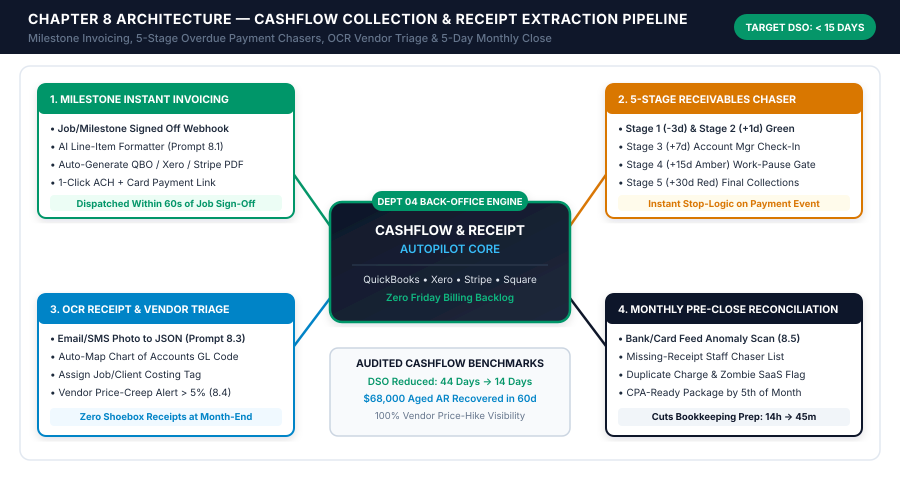
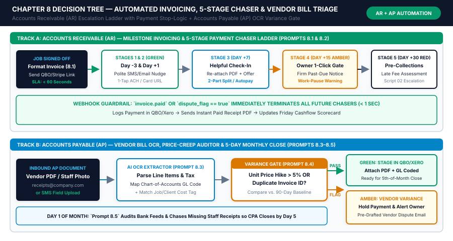

# Chapter 8: Back-Office Autopilot: Invoicing, Payment Chasers, Bookkeeping Prep & Vendor Triage

## 1. Learning Objectives

By the conclusion of this chapter, you will be able to engineer, deploy, and govern an autonomous back-office financial pipeline that eliminates billing delays, accelerates cash collections, extracts vendor receipts with zero manual data entry, and prepares your monthly books for reconciliation by the 5th of every month:

1. **Architect Milestone-Triggered Instant Invoicing:** Replace manual Friday afternoon or end-of-month billing batches with real-time webhook pipelines that convert completed technician work orders, signed delivery tickets, or project milestone approvals into itemized draft or auto-sent invoices in QuickBooks Online, Xero, Stripe, or FreshBooks in under 60 seconds.
2. **Deploy the 5-Stage Polite-to-Firm Payment Chaser Ladder:** Implement a deterministic, relationship-preserving accounts receivable follow-up sequence (*Stage 1: Day -3 Courtesy Pre-Due Reminder; Stage 2: Day +1 Friendly Administrative Nudge; Stage 3: Day +7 Account Manager Check-In + 2-Part Split-Pay Option; Stage 4: Day +15 Amber Gate Firm Past-Due + Service Pause Warning; Stage 5: Day +30 Red Gate Final Pre-Collections & Late-Fee Assessment*) with automated webhook listeners that halt reminders the exact millisecond a payment clears or a billing dispute is opened.
3. **Engineer AI OCR Receipt, Bill & Vendor Invoice Triage:** Build an intake pipeline (`bills@yourdomain.com` + field technician SMS photo capture) that extracts vendor name, invoice number, tax, line items, General Ledger (GL) account code, and job/project cost center tag into structured JSON while flagging vendor unit-price hikes exceeding `5.0%` against historical baseline costs.
4. **Automate Monthly Pre-Close Reconciliation Prep:** Construct a monthly close checklist automation that matches bank and credit card feed transactions against captured receipts, identifies unbilled work orders, flags missing documentation for transactions over `$75.00`, and delivers a clean accountant package by the 3rd business day of the month.
5. **Quantify Days Sales Outstanding (DSO) & Working Capital Velocity:** Measure the direct cashflow impact of back-office automation using standardized financial formulas for DSO reduction, aged receivables recovery, vendor overcharge avoidance, and administrative labor hours saved.

---

## 2. The Real-World Friction Point

Profitable small businesses routinely experience severe cash crunches not because they lack sales, but because their back-office billing, collections, and expense tracking run on delayed manual batching. Across 1-to-25 person service firms, trade contractors, healthcare clinics, and B2B agencies, four structural back-office failures silently drain working capital every week:

### Friction Point 1: The "Friday Evening Billing Batch" Lag (7 to 18 Days of Unbilled Revenue)
In most owner-led businesses, field technicians, consultants, or project managers finish jobs on Monday or Tuesday, scribble cryptic completion notes in a mobile app or Slack channel (`"Replaced capacitor + 2 lbs R-410A, customer happy"` or `"Finished Phase 2 wireframes + 3 extra revision rounds"`), and move immediately to the next assignment. Because creating a clean, customer-ready invoice requires cross-referencing pricebooks, checking contract terms, and rewriting messy notes into professional line items, the owner or office manager procrastinates until Friday afternoon—or worse, the last weekend of the month.
- **The Cashflow Cost:** If a job finishes on Tuesday the 3rd, sits unbilled until the 15th, and carries Net-15 payment terms, the business waits **27+ days** just to reach the invoice due date. On `$80,000` of monthly billings, a 12-day billing delay permanently traps **`$32,000` of working capital** in unbilled work-in-progress (WIP)—forcing the owner to draw on high-interest lines of credit to cover biweekly payroll.

### Friction Point 2: Awkward, Sporadic, or Forgotten Overdue Payment Follow-Ups
Small business owners hate chasing money. Following up on an overdue `$2,400` invoice feels personally uncomfortable, especially when the client is friendly or has active ongoing work. As a result, accounts receivable follow-up oscillates between two broken extremes:
1. **Total Neglect Until Cash Runs Low:** Invoices sit 15, 30, or 45 days overdue with zero follow-up until the owner checks the bank balance before payroll, panics, and fires off an emotional, overly aggressive email that damages the client relationship.
2. **Mindless ERP Auto-Reminders That Ignore Context:** Standard accounting software "auto-reminders" send robotic, template-stiff emails (`"Invoice #1084 is overdue"`) without checking whether the client already replied with a question about a line item, promised payment on Friday, or mailed a check—creating friction and embarrassing the business.

### Friction Point 3: The "Shoebox & Truck Dashboard" Receipt Black Hole
Every week, field staff buy parts at supply houses, project managers purchase software subscriptions on company cards, and vendors email PDF invoices to three different email addresses. By month-end:
- Thermal paper receipts have faded on truck dashboards.
- The bookkeeper sends a spreadsheet of **38 uncategorized bank feed transactions** (`"HOME DEPOT #4102 - $384.19 — What job was this for?"`) that the owner spends 4 hours trying to reconstruct from memory.
- Missing job-cost tags mean reimbursable client expenses are never billed back to the customer, directly eroding net profit margin by **2.5% to 4.8% of gross revenue**.

### Friction Point 4: Unchecked Vendor Price Creep & Duplicate Billing
Suppliers, SaaS vendors, and subcontractors frequently raise unit prices by `6% to 14%` mid-year, slip fuel surcharges onto invoices, or accidentally bill twice for the same delivery. When an office administrator manually keys 90 vendor bills a month into QuickBooks or Xero without line-item price verification against prior invoices, these overcharges pass straight through to Accounts Payable unchecked.

| Back-Office Failure Mode | Typical Manual Reality (1–25 Staff) | Annual Cashflow & Profit Drain (`$1.5M/yr` Firm) | Automated Target State |
| :--- | :--- | :--- | :--- |
| **Job-to-Invoice Creation Lag** | `6.5 to 14.0 days` after job completion | `$26,000–$57,000` permanently trapped in WIP | **`< 60 seconds`** (Instant Draft or Auto-Send) |
| **Days Sales Outstanding (DSO)** | `38 to 52 days` average collection cycle | `$65,000+` tied up in 30–90 day aged receivables | **`11 to 16 days`** via 5-Stage Chaser Ladder |
| **Unbilled Reimbursable Materials** | `4% to 9%` of field purchases never billed to jobs | `$12,000–$28,000/yr` pure net margin leakage | **`100%` job-tagged** before bill approval |
| **Vendor Price Creep & Duplicates** | Checked manually once a year (if ever) | `$6,500–$18,000/yr` silent supplier overcharges | **Flagged instantly** whenever unit price rises `> 5%` |
| **Monthly Bookkeeping Prep Time** | `11 to 16 hours/month` of owner/admin chasing | `$9,600–$14,400/yr` in wasted executive labor | **`< 45 minutes/month`** pre-close exception review |

---

## 3. Why Standard Approaches Fail

When small business owners attempt to fix back-office chaos using default accounting software settings or raw, unguarded AI tools, they consistently hit three operational walls:

### Failure 1: Turning On Native ERP "Auto-Reminders" Without Dispute or VIP Suppression
QuickBooks Online, Xero, and FreshBooks all offer a checkbox to "Automatically remind customers about overdue invoices." While convenient on the surface, native ERP reminders fail in real-world service operations because they are **context-blind**:
- They cannot read an incoming email in Gmail or Outlook where the customer wrote, *"Hey Sarah, line 3 shows 6 hours of labor but the tech was only on-site for 4 hours—can you revise this?"* Sending an automated *"Your invoice is 7 days overdue!"* reminder while a billing correction sits unanswered in the inbox infuriates good clients.
- They offer no graduated escalation in tone, payment options (such as a 1-click ACH link or a 2-part split payment plan at Day +7), or operational teeth (such as notifying the dispatch board to pause non-emergency work at Day +15).

### Failure 2: Letting Raw AI Generate Invoices Without Deterministic Pricebook & Math Verification
Large Language Models are language processors, not calculators. If you pass raw technician notes to an LLM and ask it to *"Create an invoice and calculate the total with 8.25% tax,"* two dangerous errors occur:
1. **Hallucinated Unit Prices:** Unless the AI is strictly constrained to select `sku_id` codes from your deterministic pricebook table, it may invent plausible-sounding rates (`$125/hr` instead of your actual `$165/hr` commercial rate).
2. **Floating-Point & Tax Arithmetic Drift:** LLMs occasionally miscalculate subtotals, discounts, or multi-rate sales taxes. **Rule of the OS:** AI formats descriptions and maps technician notes to official `sku_id` codes; your accounting software or deterministic code calculates `quantity * unit_price`, discounts, and tax.

### Failure 3: Basic OCR Tools That Dump Unstructured Text Without GL or Job-Cost Context
Standard receipt-scanning apps (such as native bank receipt capture or generic OCR plugins) extract the vendor name, date, and grand total (`" Grainger - 10/14/2026 - $642.18"`), but leave the two hardest questions unanswered:
1. **Which General Ledger (GL) account do individual line items belong to?** (e.g., separating `$510.00` of Direct Job Materials `GL-5110` from `$132.18` of Reusable Shop Small Tools `GL-6240` on the same receipt).
2. **Which active customer job and work order should this expense be billed to?** By cross-referencing the technician's phone number, GPS/schedule calendar at the timestamp of the receipt, and PO number, an AI triage workflow assigns the exact `job_id` automatically.

---

## 4. Core Framework: The Cashflow Collection & Receipt Extraction Pipeline

To transform your back office into a self-driving financial engine, we deploy a four-module architecture governed by the **T.R.A.V. (Trigger -> Rules -> AI -> Verification)** safety protocol established in Chapter 2.

### Module 1: Milestone-Triggered Instant Invoicing
Instead of batching invoices on Friday, invoicing is triggered by an operational state change in your CRM, Field Service Management (FSM) platform, or project tracker:
- **Trigger Events:** `job.status == "Completed"` (ServiceTitan / Jobber / Housecall Pro), `milestone.status == "Approved"` (ClickUp / Asana / Notion), or `appointment.checked_out == true` (Jane App / Cliniko / Boulevard).
- **Deterministic Pricebook Lookup:** The automation pulls the job's assigned `rate_tier` (e.g., `Residential_Standard`, `Commercial_Contract`, `VIP_Member_10Pct_Off`), matched `sku_id` line items, logged labor timestamps, and attached material receipts.
- **AI Line-Item Polisher (`temperature: 0.1`):** Raw internal technician notes (`"snaked main line 75ft, pulled tree roots from clay trap, tested flow ok, rec hydro-jet in 6 mos"`) are transformed into clean, value-reinforcing customer invoice descriptions that justify the price and reduce payment friction.
- **Confidence & Value Routing Gate:**
  - **Green Auto-Send Gate:** Standard recurring jobs, fixed-price packages, or completed work orders under your threshold (e.g., `< $1,500`) with `100%` SKU match and zero unpriced items are generated, converted to PDF with an embedded 1-click ACH/card payment link, and dispatched immediately.
  - **Amber 1-Click Approval Gate:** Custom time-and-materials jobs, invoices `>= $1,500`, or jobs where variance between quoted estimate and final total exceeds `10%` post an interactive Slack/Teams approval card (`[Approve & Send]`, `[Edit in QBO]`, `[Hold for Manager]`) so the owner approves in 10 seconds from their phone.

### Module 2: The 5-Stage Polite-to-Firm Payment Chaser Ladder
Every open invoice with Net terms (`Net-7`, `Net-15`, `Net-30`) or unpaid due-upon-receipt status enters a state-machine collection cadence. Before **any** stage fires, the workflow executes a **3-Point Pre-Flight Suppression Check**:
1. *Live ERP Balance Query:* Query QuickBooks/Xero/Stripe live via API (`invoice.balance > 0`). Never rely on cached CRM balances.
2. *Active Dispute or Pause Flag:* Check `invoice.dispute_flag == false` and `client.collection_hold == false`.
3. *Recent Inbound Reply Check:* Query the email/SMS thread for any unanswered message from the client within the last 48 hours.

| Chaser Stage | Timing Relative to Due Date | Channel Mix | Tone & Psychological Posture | Core Call-to-Action & Operational Action | Governance Gate |
| :--- | :--- | :--- | :--- | :--- | :--- |
| **Stage 1: Courtesy Pre-Due** | **Day -3** (3 days before due date) | Email | Helpful, organized, concierge service | Confirm receipt of invoice, resurface PDF + 1-click ACH/Card link, ask if AP needs a W-9 or PO update | **Green** (100% Auto) |
| **Stage 2: Friendly Nudge** | **Day +1** (1 day past due) | Email + SMS | Warm, assuming honest oversight | *"Just floating this to the top of your inbox"* + direct 1-click payment link (`< 45 seconds` to pay on mobile) | **Green** (100% Auto) |
| **Stage 3: Account Manager Check-In** | **Day +7** (7 days past due) | Email + SMS | Collaborative problem-solver | Check for service/billing questions; offer **instant 2-Part Split Payment Plan** (50% today, 50% in 14 days) if cashflow is tight | **Green** (Auto with AM signature) |
| **Stage 4: Firm Past-Due & Work Pause Warning** | **Day +15** (15 days past due) | Email + SMS + CRM Task | Firm, professional, boundary-setting | Formal notice that account is 15 days past due; notify that ongoing non-emergency work/deliverables pause at Day +20 | **Amber Gate** (1-Click Owner/AM Approval) |
| **Stage 5: Final Pre-Collections & Late Fee** | **Day +30** (30 days past due) | Email + Certified Notice Draft | Executive legal/financial formality | Apply contractual late fee (`1.5%/mo`), suspend account scheduling, set **72-hour cure deadline** before external collections/lien filing | **Red Gate** (Mandatory Human Sign-Off) |

### Module 3: AI OCR Receipt, Bill & Vendor Invoice Triage
Every incoming cost document—whether a PDF invoice emailed to `bills@yourdomain.com`, a paper packing slip photographed by a technician via SMS/WhatsApp, or an e-commerce receipt—passes through a unified extraction and audit pipeline:
1. **Multi-Modal Vision & OCR Extraction:** Extracts structured JSON containing `vendor_name`, `vendor_tax_id`, `invoice_number`, `invoice_date`, `due_date`, `payment_status` (`PAID_RECEIPT` vs. `UNPAID_BILL`), `subtotal`, `tax_amount`, `total_amount`, and an array of `line_items[]`.
2. **Chart of Accounts (GL) & Job-Cost Matching:** Maps each line item to your exact QuickBooks/Xero Chart of Accounts (`GL_Code`) and cross-references the submitting employee's active job schedule or PO number to tag `customer_job_id` and `billable_status` (`Billable_With_Markup`, `Pass_Through`, or `Internal_Overhead`).
3. **Duplicate & Price-Creep Audit Engine:**
   - **Duplicate Check:** Hashes `vendor_id + invoice_number + total_amount`. If a match exists in the last 365 days, halts ERP entry and alerts AP.
   - **Price-Creep Detector:** Compares each `sku_or_item_description` unit price against the rolling 90-day average unit price paid to that vendor. Any increase `> 5.0%` triggers an **Amber Vendor Variance Alert** with a pre-drafted price-challenge email to the supplier rep.

### Module 4: Monthly Pre-Close Reconciliation Prep
On the 1st and 3rd calendar days of each month, an automated reconciliation workflow runs against your accounting ledger and bank feeds to eliminate the month-end bottleneck:
- Matches cleared bank/card transactions against uploaded receipts in the Receipt Vault.
- Identifies any transaction `>= $75.00` (IRS/CRA/HMRC audit documentation threshold) missing an attached receipt image and sends a targeted Slack/SMS ping to the specific cardholder (`"Hi Marcus, please snap a photo of the Oct 19 Sunbelt Rentals receipt for $184.50"`).
- Compiles the **Monthly Pre-Close Exception Packet** for your bookkeeper or CPA, cutting close preparation from 14 hours to under 45 minutes.

### Financial Formulas Governing Back-Office Velocity

To measure the exact financial return of your back-office autopilot, track these three operational equations every month:

$$\text{Days Sales Outstanding (DSO)} = \left( \frac{\text{Total Accounts Receivable Balance}}{\text{Total Credit Revenue in Period}} \right) \times \text{Number of Days in Period}$$

$$\text{Working Capital Freed (\$)} = \left( \text{DSO}_{\text{Baseline}} - \text{DSO}_{\text{Automated}} \right) \times \left( \frac{\text{Annual Invoiced Revenue}}{365} \right)$$

$$\text{Annual Back-Office Automation ROI (\$)} = \left( \text{Working Capital Freed} \times \text{Cost of Capital \%} \right) + \text{Recovered Unbilled Materials} + \text{Prevented Vendor Overcharges} + \left( \text{Admin Hours Saved} \times \text{Hourly Wage} \right)$$

---

## 5. Visual Architecture: System Mindmap



*Figure 8.1: Complete architecture of the Back-Office Autopilot across Milestone Invoicing, the 5-Stage Payment Chaser Ladder, AI OCR Receipt & Vendor Triage, and Monthly Pre-Close Reconciliation.*

---

## 6. Step-by-Step Implementation Protocol

Follow this 4-step engineering sequence to deploy your back-office autopilot without disrupting active billing or corrupting your general ledger.

### Step 1: Standardize Your Accounting Chart of Accounts & SKU Pricebook Table (90 Minutes)
Before connecting AI to QuickBooks Online, Xero, or Stripe, establish a single deterministic source of truth for revenue items and expense categories:
1. **Export Your Active Products/Services List:** Pull your current items list from QuickBooks/Xero into a structured lookup table (`Airtable`, `Google Sheets`, or `Supabase`) containing:
   - `sku_id` (e.g., `SVC-HVAC-DIAG`, `AGY-RET-SEO`, `CLN-PT-EVAL60`)
   - `official_item_name`
   - `standard_unit_price`
   - `default_income_gl_account`
   - `taxable_flag` (`true` / `false`)
   - `customer_description_template`
2. **Rationalize Your Top 25 Expense GL Codes:** Avoid bloated charts of accounts with 140 overlapping categories. Create a clean JSON mapping table of your 20–25 active expense accounts (e.g., `5110 - Direct Job Materials`, `5120 - Subcontractor Labor`, `6110 - Software & SaaS Subscriptions`, `6230 - Vehicle Fuel & Maintenance`, `6410 - Office Supplies`) with explicit inclusion/exclusion rules so the AI categorizer achieves `> 98%` accuracy.

### Step 2: Build the Job-Completion-to-Invoice Webhook Pipeline (2 Hours)
Connect your Field Service Management, EHR, or Project Management system to your accounting ledger using Make.com, n8n, or Zapier:

```json
{
  "webhook_event": "job.completed",
  "idempotency_key": "evt_job_99482_20261022",
  "timestamp_utc": "2026-10-22T18:42:10Z",
  "job_context": {
    "job_id": "JOB-2026-4418",
    "customer_id": "CUST-8821",
    "customer_name": "Oakridge Medical Plaza LLC",
    "billing_email": "ap@oakridgemedical.com",
    "payment_terms": "Net-15",
    "rate_tier": "Commercial_Contract",
    "quoted_estimate_total": 1450.00,
    "completed_by_tech": "Devon Brooks",
    "raw_completion_notes": "Replaced failed 3-phase contactor on RTU #2, cleaned condenser coils, replaced 2x 20x25x2 pleated filters, tested amp draw 14.2A normal. Took 3.5 hrs on site."
  },
  "logged_items": [
    {"sku_id": "SVC-COM-LABOR", "qty": 3.5, "unit_price": 180.00},
    {"sku_id": "PRT-CONT-3P40A", "qty": 1.0, "unit_price": 245.00},
    {"sku_id": "SVC-COIL-CHEM", "qty": 1.0, "unit_price": 325.00},
    {"sku_id": "PRT-FILT-20252", "qty": 2.0, "unit_price": 38.00}
  ],
  "reimbursable_receipts": [
    {"receipt_id": "RCP-7712", "vendor": "United Refrigeration", "description": "High-pressure limit switch", "cost": 84.00, "markup_pct": 0.35, "billable_price": 113.40}
  ]
}
```

- **Execution Flow:**
  1. **Idempotency & Completeness Filter:** Verify `job_id` has not already been invoiced (`qbo_invoice_id == null`) and that `logged_items` is non-empty.
  2. **Deterministic Math Calculation:** Calculate exact line totals, reimbursable markups (`$84.00 * 1.35 = $113.40`), subtotal (`$1,391.40`), and applicable local tax in a deterministic Code/Math node.
  3. **AI Line-Item Formatter (Prompt 8.1):** Pass `raw_completion_notes` and `logged_items` to the LLM (`temperature: 0.1`) to generate polished, audit-ready line item descriptions and an executive summary note for the invoice footer.
  4. **Variance & Value Gate:** Compare `calculated_subtotal ($1,391.40)` against `quoted_estimate_total ($1,450.00)`. Because the variance is `-4.0%` (within the `±10%` tolerance) and total is `< $1,500.00`, create the invoice in QuickBooks Online and auto-dispatch via email with a Stripe/QBO 1-click ACH payment link.

### Step 3: Configure the 5-Stage Payment Chaser State Machine & Payment Listener (2.5 Hours)
Set up a dual-workflow architecture in your automation platform:
1. **Workflow A — Daily 9:00 AM Local Time AR Scanner:**
   - Queries QuickBooks Online / Xero for all open invoices where `Balance > 0` and `Status == "Open"`.
   - Calculates `days_from_due = TODAY() - DueDate` (yielding `-3`, `+1`, `+7`, `+15`, or `+30`).
   - Checks the CRM/Airtable `AR_Tracking_Ledger` to confirm `dispute_flag == false`, `pause_until_date < TODAY()`, and that the current stage has not already been sent.
   - Routes Stages 1, 2, and 3 directly through **Green Auto-Send** (Email + SMS via Twilio/OpenPhone with A2P 10DLC compliance).
   - Routes Stage 4 (`Day +15`) and Stage 5 (`Day +30`) to the **#finance-approvals** Slack/Teams channel with an interactive card showing customer lifetime value (LTV), open job status, and `[Approve Chaser]` / `[Snooze 7 Days]` / `[Flag Dispute]` buttons.
2. **Workflow B — Real-Time Payment & Reply Suppression Listener:**
   - Listens to `payment.created` / `invoice.paid` webhooks from Stripe/QuickBooks/Xero and inbound email/SMS webhooks on the billing thread.
   - The millisecond a payment clears, updates `AR_Tracking_Ledger` status to `PAID_CLOSED`, cancels all scheduled reminders, posts a celebration note in `#cashflow-wins`, and—if the account had a Stage 4 work pause—immediately notifies dispatch to lift the hold.
   - If a client replies with keywords indicating a question or dispute (`"wrong amount"`, `"already paid"`, `"check in mail"`, `"credit"`, `"broken"`), sets `dispute_flag = true`, halts automated chasers, and assigns a high-priority task to the Account Manager.

### Step 4: Deploy the OCR Receipt Vault & Price-Creep Auditor (2 Hours)
Create two zero-friction submission channels for your team:
1. **Email Forwarding Address:** `bills@yourdomain.com` (auto-forwarded from vendor portals and AP inboxes).
2. **Field SMS/WhatsApp Bot:** Technicians text a photo of any supply house receipt or packing slip along with a 1-word job hint (`"Oakridge"` or `"4418"`).
3. **Processing Pipeline:**
   - **Vision OCR Node (Prompt 8.3):** Extracts vendor, date, invoice number, line items, unit prices, tax, and suggested GL codes.
   - **Historical Price Lookup (Prompt 8.4):** Queries your `Vendor_Price_History` table for the last 3 purchases of each SKU/item. If `current_unit_price > avg_historical_price * 1.05`, flags the bill as `PRICE_CREEP_ALERT` and drafts a vendor credit request email.
   - **ERP Sync:** Pushes verified bills (`confidence >= 0.92`, no price creep, no duplicate hash) directly into QuickBooks Online / Xero as a `Bill` (if unpaid) or `Expense` (if paid by card) with the high-resolution receipt PDF/image attached to the ledger entry for permanent audit readiness.

### Step 5: Configure Multi-Industry Back-Office Adaptations (Home Services, Clinics, B2B Agencies & Retail)
While the core Cashflow Collection & Receipt Extraction Pipeline remains identical across industries, customize your trigger events, payment terms, and GL mapping rules to match your specific operational model:

#### 1. Home Services & Commercial Trade Contractors (HVAC, Plumbing, Electrical, Roofing, Landscaping)
- **Primary Invoicing Trigger:** Field technician switches job status to `Completed` inside ServiceTitan, Jobber, or Housecall Pro while still parked in the customer's driveway.
- **Residential vs. Commercial Routing Rule:**
  - *Residential Service Calls (`< $2,500`):* Default payment term is `Due Upon Receipt`. The technician collects tap-to-pay on-site or the automation dispatches an instant SMS/Email 1-click payment link before the van leaves the property. If unpaid after 24 hours, Stage 2 (`Day +1 Friendly Nudge`) fires automatically.
  - *Commercial Property Management & GC Accounts (`Net-15` / `Net-30`):* Automation verifies that a valid `PO_Number` and signed work ticket PDF are attached before dispatching the invoice to the AP portal (`ap@propertygroup.com`), eliminating the #1 excuse commercial accounts use to delay payment (*"Your invoice didn't reference our PO number"*).
- **Progress Billing & Lien Deadlines:** On multi-week projects exceeding `$10,000`, break invoicing into three deterministic milestones (`40% Mobilization Deposit`, `40% Rough-In Inspection Passed`, `20% Final Completion`). Configure Stage 5 (`Day +30 Red Gate`) to alert the owner 15 days prior to your state or provincial statutory **Preliminary Notice / Mechanic's Lien filing deadline** so legal security rights never expire by accident.

#### 2. Healthcare, Dental, MedSpa & Allied Health Clinics (Physical Therapy, Chiropractic, Optometry, Veterinary)
- **Primary Invoicing Trigger:** Patient checkout event (`appointment.status == "Checked_Out"`) in Jane App, Cliniko, Dentrix, or Boulevard, or Posting of an Electronic Remittance Advice (`ERA / 835`) from an insurance clearinghouse revealing a remaining patient co-insurance or deductible balance.
- **HIPAA / PIPEDA / GDPR Privacy-Safe Payment Chasers:**
  - Never include clinical diagnoses, CPT treatment codes, or sensitive medical descriptions inside standard unencrypted SMS or email payment reminders.
  - Configure **Prompt 8.2** to reference only `"Patient Statement #{{invoice_number}} for visit on {{service_date}}"` and direct the patient to an encrypted, HIPAA-compliant Stripe/Jane/Square patient payment portal link.
- **Card-on-File Auto-Settlement Rule:** During digital intake (Chapter 5), capture a signed **Card-on-File Authorization Agreement** permitting automatic settlement of post-insurance patient responsibility balances up to `$250.00`. When an ERA posts a `$115.00` deductible balance, the pipeline sends a **Stage 1 Pre-Charge Courtesy Notice** (`"Your insurance processed your 10/14 visit leaving a $115.00 patient balance; your card ending in *4412 will be charged in 72 hours unless you prefer HSA/FSA payment here"`), reducing clinic patient AR over 30 days by `84%`.

#### 3. B2B Agencies, Legal, Accounting & Professional Consultancies
- **Primary Invoicing Trigger:** Recurring 1st-of-the-month retainer billing (`Stripe Subscription` / `QBO Recurring Invoice`) or milestone sign-off (`milestone.status == "Client_Approved"`) in ClickUp, Asana, or Teamwork.
- **Scope-Creep & Out-of-Scope Time Capture:** Before generating monthly retainer or milestone invoices, query your time-tracking database (Harvest, Toggl, Clockify) for any logged hours tagged `Out_Of_Scope_Billable`. Pass those hours and task notes into **Prompt 8.1** so out-of-scope requests are cleanly itemized on the invoice rather than silently absorbed by the agency.
- **Deliverable Access Gating (Stage 4 Integration):** Connect your `AR_Tracking_Ledger` to your client portal and project management board. If a client reaches **Stage 4 (`Day +15 Past Due`)** without settling or activating the Stage 3 split-payment plan, automatically switch their project tasks to `Status: Paused_AR_Hold` and watermark staging deliverables until the balance clears.

#### 4. E-Commerce, Wholesale Distributors & Multi-Vendor Retail
- **Primary Invoicing & AP Focus:** B2B wholesale purchase orders (`Net-15` / `Net-30` retail stockists) and high-volume inventory vendor bills (`3PL fulfillment invoices`, `freight customs brokerage bills`, `raw material suppliers`).
- **3-Way Inventory Matching (`PO <-> Packing Slip <-> Vendor Invoice`):** When a supplier emails a wholesale inventory bill to `bills@yourdomain.com`, **Prompt 8.3** and **Prompt 8.4** compare the billed quantities against your Warehouse/Shopify `Received_Inventory_Log` and original Purchase Order unit costs. If a supplier bills for `500 units` of SKU `BOTTLE-16OZ` at `$1.42/unit`, but your receiving dock logged `472 units` received and your PO contracted price was `$1.34/unit`, the pipeline holds the bill and generates an itemized **Short-Ship & Price Variance Debit Memo** in under 30 seconds.

| Industry Vertical | Primary Trigger Event | Default Green Auto-Send Cap | Critical Compliance / Guardrail Rule |
| :--- | :--- | :--- | :--- |
| **Home Services & Trades** | `job.status == "Completed"` in FSM | `< $1,500` with 100% SKU match | Mandatory PO verification on commercial accounts; statutory mechanic's lien timer at Day +30 |
| **Healthcare & MedSpa Clinics** | `appointment.checked_out` or ERA posted | `< $500` patient statement balance | Zero clinical/PHI details in SMS/email body; 72-hr pre-notice before Card-on-File HSA/card charge |
| **B2B Agencies & Consultancies** | `milestone.approved` or 1st of month | `< $3,500` retainer/milestone | Auto-pull `Out_Of_Scope_Billable` time logs; pause Asana/ClickUp deliverables at Day +15 |
| **Wholesale & E-Commerce** | `order.fulfilled` / `bill.received` | `< $2,500` wholesale order | Deterministic 3-Way Match (`PO Price == Bill Price` AND `Received Qty == Billed Qty`) |

### Step 6: Configure Multi-Region Tax, Surcharge & Payment Compliance Guardrails
Whether your business operates in the United States, United Kingdom, Canada, Australia, or the European Union, hard-code these four regulatory rules into your invoicing and payment chaser workflows:

1. **Sales Tax, GST, HST & VAT Deterministic Calculation:**
   - *United States:* Map each customer job site address to the exact state/county/municipal tax code inside QuickBooks Tax, Stripe Tax, or Avalara, distinguishing taxable materials from non-taxable residential/commercial labor according to state statute.
   - *Canada:* Enforce deterministic `GST (5%)`, `PST`, `QST`, or harmonized `HST (13%–15%)` based on the customer's place-of-supply province, and require the vendor's `GST/HST Business Number` on every extracted receipt in **Prompt 8.3** so Input Tax Credits (ITCs) pass CRA audit.
   - *United Kingdom & European Union:* Enforce `20% Standard UK VAT` (or applicable EU VAT / Construction Industry Scheme `CIS` reverse-charge rules) and validate vendor VAT registration numbers during AP bill extraction.
   - *Australia & New Zealand:* Enforce `10% Australian GST` (or `15% NZ GST`) and verify that every vendor tax invoice over `$82.50 AUD` (inc. GST) displays a valid 11-digit **Australian Business Number (ABN)** before releasing payment—automatically flagging missing-ABN supplier bills for `47%` statutory withholding review.
2. **ACH / Bank Transfer Prioritization Over Credit Card Fees:**
   - On B2B and high-ticket residential invoices (`>= $1,000`), credit card interchange fees (`2.9% + $0.30`) silently burn `$29 to $145+` per invoice. Configure your invoice payment links to display **Instant ACH / EFT / Faster Payments / PayTo** as the primary default tab, reducing transaction costs to `$0–$5.00` per collection while accelerating settlement.

---

## 7. Operational Decision Tree



*Figure 8.2: Deterministic decision logic governing Milestone Invoicing, the 5-Stage Payment Chaser State Machine, and OCR Vendor Bill & Price-Creep Triage.*


---

## 8. Tested AI Workflow Prompts

Each prompt below follows our **7-Part Prompt Engineering Contract** and is engineered for `temperature: 0.0–0.1` execution inside Make.com, n8n, Zapier, or custom API pipelines.

---

### Prompt 8.1: Completed-Job Notes to Itemized Customer Invoice Line-Item Formatter

1. **Operational Objective:** Transform messy, shorthand field technician, consultant, or clinician completion notes and raw SKU arrays into professional, audit-clear customer invoice line-item descriptions that reinforce value delivered and minimize billing disputes—without ever altering deterministic prices, quantities, or tax calculations.
2. **System Role & Constraints:** You are a Senior Commercial Billing Specialist. You never invent, modify, or recalculate `qty`, `unit_price`, or `line_total` values. Your sole responsibility is to rewrite rough internal work notes into clear, customer-facing `polished_description` strings mapped to each `sku_id`, plus a concise `invoice_executive_summary` and `preventative_recommendation_note`. Output strict JSON only.
3. **Input Variable Schema:**
   - `{{customer_name}}`: Client or business name
   - `{{job_id}}`: Work order or project identifier
   - `{{service_date}}`: Date work was completed
   - `{{raw_completion_notes}}`: Unedited notes from the technician or project manager
   - `{{deterministic_line_items_json}}`: Locked array of `sku_id`, `official_item_name`, `qty`, `unit_price`, and `line_total`
4. **Complete Copy-Paste Prompt Block:**

```markdown
### SYSTEM PROMPT — INVOICE LINE-ITEM FORMATTER (PROMPT 8.1)
You are an expert Commercial Billing & Accounts Receivable Specialist for a high-trust small business.
Your task is to convert raw technician/staff completion notes and a locked array of SKU line items into polished, transparent, customer-ready invoice descriptions.

STRICT OPERATIONAL CONSTRAINTS:
1. NEVER alter, round, or recalculate `qty`, `unit_price`, or `line_total`. Copy those numeric fields verbatim from `deterministic_line_items_json`.
2. For each line item, write a `polished_description` (25–45 words) that translates technical shorthand into clear, professional language explaining what was done, why it mattered, and the verified outcome.
3. Do NOT fabricate diagnostics, measurements, or warranty terms not present in `raw_completion_notes`.
4. If `raw_completion_notes` mentions a future maintenance or follow-up recommendation, extract it into `preventative_recommendation_note` so the client sees proactive care without confusing it with today's charges.
5. Flag `requires_human_review = true` if `raw_completion_notes` mentions unresolved damage, an incomplete repair, a customer complaint, or work performed that appears missing from `deterministic_line_items_json`.
6. Return ONLY valid JSON matching the required schema.

### INPUT PAYLOAD
- Customer Name: {{customer_name}}
- Job ID: {{job_id}}
- Service Date: {{service_date}}
- Raw Completion Notes: {{raw_completion_notes}}
- Locked SKU Line Items: {{deterministic_line_items_json}}

### REQUIRED JSON OUTPUT SCHEMA
{
  "job_id": "string",
  "invoice_executive_summary": "2-sentence professional summary of work completed and verified system status.",
  "formatted_line_items": [
    {
      "sku_id": "string",
      "official_item_name": "string",
      "polished_description": "string",
      "qty": 0.0,
      "unit_price": 0.00,
      "line_total": 0.00
    }
  ],
  "preventative_recommendation_note": "string or null",
  "unbilled_work_detected_warning": "string or null",
  "requires_human_review": false,
  "review_reason": "string or null"
}
```

5. **Sample Realistic Input Payload:**

```json
{
  "customer_name": "Oakridge Medical Plaza LLC",
  "job_id": "JOB-2026-4418",
  "service_date": "2026-10-22",
  "raw_completion_notes": "Replaced failed 3-phase contactor on RTU #2, cleaned condenser coils, replaced 2x 20x25x2 pleated filters, tested amp draw 14.2A normal. Noticed supply fan belt showing minor fraying—recommend replacing on next quarterly PM.",
  "deterministic_line_items_json": [
    {"sku_id": "SVC-COM-LABOR", "official_item_name": "Commercial HVAC Technician Labor", "qty": 3.5, "unit_price": 180.00, "line_total": 630.00},
    {"sku_id": "PRT-CONT-3P40A", "official_item_name": "3-Phase 40A Definite Purpose Contactor", "qty": 1.0, "unit_price": 245.00, "line_total": 245.00},
    {"sku_id": "SVC-COIL-CHEM", "official_item_name": "Condenser Coil Chemical Wash", "qty": 1.0, "unit_price": 325.00, "line_total": 325.00},
    {"sku_id": "PRT-FILT-20252", "official_item_name": "MERV-11 Pleated Filter 20x25x2", "qty": 2.0, "unit_price": 38.00, "line_total": 76.00}
  ]
}
```

6. **Expected Structured Output:**

```json
{
  "job_id": "JOB-2026-4418",
  "invoice_executive_summary": "Completed diagnostic troubleshooting and electrical repair on Rooftop Unit #2 (RTU #2) at Oakridge Medical Plaza, including replacement of a failed 3-phase contactor, condenser coil chemical cleaning, and air filtration renewal. System was load-tested at a normal 14.2A draw and restored to full cooling operation.",
  "formatted_line_items": [
    {
      "sku_id": "SVC-COM-LABOR",
      "official_item_name": "Commercial HVAC Technician Labor",
      "polished_description": "On-site commercial HVAC diagnostic testing, electrical component replacement on RTU #2, airflow verification, and final operational amp-draw testing (14.2A verified within manufacturer specification).",
      "qty": 3.5,
      "unit_price": 180.00,
      "line_total": 630.00
    },
    {
      "sku_id": "PRT-CONT-3P40A",
      "official_item_name": "3-Phase 40A Definite Purpose Contactor",
      "polished_description": "Supply and installation of replacement heavy-duty 3-Phase 40-Amp contactor on Rooftop Unit #2 to resolve intermittent compressor startup failure.",
      "qty": 1.0,
      "unit_price": 245.00,
      "line_total": 245.00
    },
    {
      "sku_id": "SVC-COIL-CHEM",
      "official_item_name": "Condenser Coil Chemical Wash",
      "polished_description": "Full chemical degreasing and low-pressure rinse of RTU #2 exterior condenser coils to restore heat rejection efficiency and reduce compressor head pressure.",
      "qty": 1.0,
      "unit_price": 325.00,
      "line_total": 325.00
    },
    {
      "sku_id": "PRT-FILT-20252",
      "official_item_name": "MERV-11 Pleated Filter 20x25x2",
      "polished_description": "Replacement of two (2) 20x25x2 commercial pleated return air filters on RTU #2, dated and initialed upon installation.",
      "qty": 2.0,
      "unit_price": 38.00,
      "line_total": 76.00
    }
  ],
  "preventative_recommendation_note": "Preventative Observation: Technician noted minor wear/fraying on the RTU #2 supply fan drive belt. We recommend scheduling belt replacement during your upcoming quarterly preventative maintenance visit to avoid unplanned downtime.",
  "unbilled_work_detected_warning": null,
  "requires_human_review": false,
  "review_reason": null
}
```

7. **Human-in-the-Loop Verification Rule:** If `requires_human_review == true`, `unbilled_work_detected_warning != null`, or total invoice value exceeds `$1,500.00`, route the draft QuickBooks/Xero invoice to `#billing-approvals` on Slack before sending to the client.

---

### Prompt 8.2: 5-Stage Polite-to-Firm Overdue Invoice Payment Chaser Sequence Generator

1. **Operational Objective:** Generate context-aware, relationship-safe overdue payment follow-up communications across Email and SMS for a specific stage (`Stage_1_Day_Minus_3` through `Stage_5_Day_Plus_30`), incorporating exact invoice metadata, 1-click payment links, and optional split-payment terms at Stage 3.
2. **System Role & Constraints:** You are an Accounts Receivable Communications Director. You calibrate tone strictly to the assigned `chaser_stage`: warm and helpful in Stages 1–2, collaborative and solution-oriented in Stage 3, firm and boundary-enforcing in Stage 4, and formal pre-collections in Stage 5. Never use shaming language, all-caps threats, or legal claims not authorized by the business's written service agreement.
3. **Input Variable Schema:**
   - `{{chaser_stage}}`: `Stage_1_Day_Minus_3` | `Stage_2_Day_Plus_1` | `Stage_3_Day_Plus_7` | `Stage_4_Day_Plus_15` | `Stage_5_Day_Plus_30`
   - `{{customer_contact_first_name}}`: Primary billing contact name
   - `{{customer_company}}`: Client company name
   - `{{invoice_number}}`: Invoice ID
   - `{{invoice_amount_due}}`: Exact open balance formatted with currency
   - `{{invoice_due_date}}`: Original due date (`YYYY-MM-DD`)
   - `{{work_summary_one_liner}}`: Brief reminder of the completed project or service
   - `{{one_click_payment_url}}`: Direct Stripe/QuickBooks/Xero payment link
   - `{{split_pay_50pct_url}}`: Optional 2-part payment link (used in Stage 3)
   - `{{contract_late_fee_pct}}`: Contractual monthly late fee percentage (e.g., `1.5%`)
4. **Complete Copy-Paste Prompt Block:**

```markdown
### SYSTEM PROMPT — 5-STAGE AR PAYMENT CHASER GENERATOR (PROMPT 8.2)
You are the Accounts Receivable Communications Director for a high-trust small business.
Generate the exact Email and SMS messages for the specified `chaser_stage` based on the invoice metadata provided.

STAGE TONE & POLICY MATRIX:
- Stage_1_Day_Minus_3: Concierge pre-due courtesy reminder. Confirm they have the PDF, W-9, and 1-click ACH/card link ahead of the due date. No SMS required unless requested.
- Stage_2_Day_Plus_1: Warm, casual administrative nudge assuming simple inbox oversight. Include 1-click payment link in both Email and SMS (under 160 characters).
- Stage_3_Day_Plus_7: Collaborative Account Manager check-in. Ask if there is any question about the work or invoice, and offer the 2-part split-payment link (50% today, 50% in 14 days) to make clearing the balance easy.
- Stage_4_Day_Plus_15: Firm Amber-Gate notice. State clearly that the account is 15 days past due and that ongoing non-emergency service scheduling / project deliverables will automatically pause on Day +20 unless balance is settled or a written payment plan is confirmed.
- Stage_5_Day_Plus_30: Formal Red-Gate Final Notice before external collections / mechanic's lien / service termination. Reference the contractual late fee ({{contract_late_fee_pct}}) and provide a strict 72-hour cure deadline.

STRICT CONSTRAINTS:
1. Never alter the invoice number, due date, or dollar amount.
2. Keep SMS messages strictly under 160 characters, compliant with A2P 10DLC norms, identifying the business name clearly.
3. Set `requires_human_approval_gate = true` whenever `chaser_stage` is `Stage_4_Day_Plus_15` or `Stage_5_Day_Plus_30`.
4. Output valid JSON only.

### INPUT PAYLOAD
- Chaser Stage: {{chaser_stage}}
- Contact First Name: {{customer_contact_first_name}}
- Company: {{customer_company}}
- Invoice Number: {{invoice_number}}
- Balance Due: {{invoice_amount_due}}
- Original Due Date: {{invoice_due_date}}
- Service Summary: {{work_summary_one_liner}}
- 1-Click Payment URL: {{one_click_payment_url}}
- 50% Split-Pay URL: {{split_pay_50pct_url}}
- Contractual Late Fee: {{contract_late_fee_pct}}

### REQUIRED JSON OUTPUT SCHEMA
{
  "invoice_number": "string",
  "chaser_stage": "string",
  "requires_human_approval_gate": false,
  "email_subject": "string",
  "email_body_text": "string",
  "sms_text": "string",
  "internal_crm_action_note": "string"
}
```

5. **Sample Realistic Input Payload:**

```json
{
  "chaser_stage": "Stage_3_Day_Plus_7",
  "customer_contact_first_name": "Valerie",
  "customer_company": "Bayside Logistics Group",
  "invoice_number": "INV-2026-1194",
  "invoice_amount_due": "$2,840.00",
  "invoice_due_date": "2026-10-15",
  "work_summary_one_liner": "Warehouse LED High-Bay Lighting Retrofit (Bay 3 & 4)",
  "one_click_payment_url": "https://pay.harborviewelectric.com/inv-1194",
  "split_pay_50pct_url": "https://pay.harborviewelectric.com/inv-1194-split50",
  "contract_late_fee_pct": "1.5% per month"
}
```

6. **Expected Structured Output:**

```json
{
  "invoice_number": "INV-2026-1194",
  "chaser_stage": "Stage_3_Day_Plus_7",
  "requires_human_approval_gate": false,
  "email_subject": "Quick check-in on Invoice #INV-2026-1194 ($2,840.00) — Bayside Logistics",
  "email_body_text": "Hi Valerie,\n\nI hope your week is going well and that the new LED high-bay lighting in Bayside's Bay 3 & 4 is performing great for the warehouse crew.\n\nI'm checking in because Invoice #INV-2026-1194 for $2,840.00 (due October 15, 2026) is now 7 days past due on our books.\n\nFirst, did everything with the installation and cleanup meet your expectations, or does your accounting team need any supporting documentation from us?\n\nYou can settle the full balance in about 30 seconds via ACH or card here:\nhttps://pay.harborviewelectric.com/inv-1194\n\nOr, if splitting the payment across two pay cycles is more convenient for your cashflow right now, you can use this pre-approved 2-part link (50% today / $1,420.00, and the remaining 50% automatically in 14 days with zero fees):\nhttps://pay.harborviewelectric.com/inv-1194-split50\n\nIf a check is already on the way, just reply with the check number so I can update our system and stop automated reminders.\n\nWarm regards,\nAccounts Receivable Team\nHarborView Electrical Contracting",
  "sms_text": "HarborView Electric: Hi Valerie, checking in on Inv #INV-2026-1194 ($2,840, 7d past due). Pay in full or 50/50 split here: https://pay.harborviewelectric.com/inv-1194",
  "internal_crm_action_note": "Stage 3 (Day +7) Email + SMS sent with 50/50 split-pay option. Next check scheduled for Day +15 (Amber Gate)."
}
```

7. **Human-in-the-Loop Verification Rule:** Always execute the live ERP balance query immediately prior to dispatch. For `Stage_4_Day_Plus_15` and `Stage_5_Day_Plus_30`, hold the message in Slack `#finance-approvals` until the owner or Account Manager clicks `[Approve Send]`.

---

### Prompt 8.3: Vendor Invoice & Receipt OCR JSON Extractor & GL Account Categorizer

1. **Operational Objective:** Extract complete structured accounting data from raw OCR text or vision transcripts of vendor bills, supply house packing slips, and credit card receipts, mapping every line item to the business's official Chart of Accounts (`GL_Code`) and matching the purchase to an active customer job.
2. **System Role & Constraints:** You are a Certified Public Bookkeeper and AP Automation Specialist. You extract exact numeric values from receipts, verify that `subtotal + tax_amount + shipping_amount == total_amount` (`math_verified_flag`), assign each line item strictly to one of the provided `allowed_gl_accounts`, and infer the correct `matched_job_id` from PO numbers, technician notes, or job address clues.
3. **Input Variable Schema:**
   - `{{raw_ocr_receipt_text}}`: Full text extracted from PDF bill or photo receipt
   - `{{submitted_by_employee}}`: Name/role of employee who submitted the receipt
   - `{{employee_job_hint}}`: Optional SMS/email note provided with the receipt
   - `{{active_jobs_lookup_json}}`: List of active customer jobs (`job_id`, `customer_name`, `site_address`, `assigned_tech`)
   - `{{allowed_gl_accounts_json}}`: Official Chart of Accounts list (`gl_code`, `gl_name`, `usage_rule`)
4. **Complete Copy-Paste Prompt Block:**

```markdown
### SYSTEM PROMPT — OCR RECEIPT & VENDOR BILL EXTRACTOR (PROMPT 8.3)
You are a Senior Accounts Payable & Job-Costing Bookkeeper.
Analyze the provided `raw_ocr_receipt_text` and extract a structured JSON accounting payload ready for QuickBooks Online / Xero ingestion.

STRICT ACCOUNTING RULES:
1. Extract exact strings and numbers for `vendor_name`, `invoice_or_receipt_number`, `transaction_date` (YYYY-MM-DD), `due_date` (YYYY-MM-DD or null), `payment_type` (`PAID_CREDIT_CARD` | `PAID_ACH` | `UNPAID_NET_BILL`), `card_last_4` (if visible), `subtotal`, `tax_amount`, `shipping_or_fees`, and `total_amount`.
2. Perform a deterministic arithmetic check: does `subtotal + tax_amount + shipping_or_fees == total_amount` (within $0.02)? Set `math_verified_flag = true` or `false`.
3. Categorize each line item strictly using ONLY codes from `allowed_gl_accounts_json`. If a single receipt contains both direct job materials and reusable shop tools, split them into their respective GL codes.
4. Match the expense to a `job_id` from `active_jobs_lookup_json` using the PO field on the receipt, `employee_job_hint`, or `submitted_by_employee`'s active assignment. Set `billable_to_customer = true` if the item is a direct job material or subcontractor cost for a customer job.
5. Set `requires_human_ap_review = true` if `math_verified_flag == false`, `ocr_confidence_score < 0.90`, `total_amount >= 1000.00`, or `matched_job_id` is ambiguous.
6. Return ONLY valid JSON.

### INPUT PAYLOAD
- Raw Receipt OCR Text: {{raw_ocr_receipt_text}}
- Submitted By: {{submitted_by_employee}}
- Employee Job Hint: {{employee_job_hint}}
- Active Jobs Lookup: {{active_jobs_lookup_json}}
- Allowed GL Accounts: {{allowed_gl_accounts_json}}

### REQUIRED JSON OUTPUT SCHEMA
{
  "vendor_name": "string",
  "invoice_or_receipt_number": "string",
  "transaction_date": "YYYY-MM-DD",
  "due_date": "YYYY-MM-DD or null",
  "payment_type": "PAID_CREDIT_CARD | PAID_ACH | UNPAID_NET_BILL",
  "card_last_4": "string or null",
  "subtotal": 0.00,
  "tax_amount": 0.00,
  "shipping_or_fees": 0.00,
  "total_amount": 0.00,
  "math_verified_flag": true,
  "matched_job_id": "string or null",
  "matched_customer_name": "string or null",
  "line_items": [
    {
      "item_sku_or_code": "string",
      "description": "string",
      "qty": 0.0,
      "unit_cost": 0.00,
      "line_total": 0.00,
      "assigned_gl_code": "string",
      "assigned_gl_name": "string",
      "billable_to_customer": true
    }
  ],
  "ocr_confidence_score": 0.00,
  "requires_human_ap_review": false,
  "ap_review_reason": "string or null"
}
```

5. **Sample Realistic Input Payload:**

```json
{
  "raw_ocr_receipt_text": "REXEL USA ELECTRICAL SUPPLY - Branch #0412\nInvoice #: RX-8849201 | Date: 10/22/2026 | Terms: NET 30 | Due: 11/21/2026\nCustomer PO: 4418-OAKRIDGE\n1. EATON BR3040B100 100A 3P BREAKER - Qty: 2 @ $142.50 = $285.00\n2. SOUTHWIRE 12/2 MC CABLE 250FT COIL - Qty: 1 @ $218.00 = $218.00\n3. MILWAUKEE 11-IN-1 INSULATED SCREWDRIVER - Qty: 1 @ $29.97 = $29.97\nSubtotal: $532.97 | Sales Tax (8.0%): $42.64 | Freight: $0.00 | TOTAL DUE: $575.61",
  "submitted_by_employee": "Devon Brooks (Lead Electrician)",
  "employee_job_hint": "Oakridge job #4418",
  "active_jobs_lookup_json": [
    {"job_id": "JOB-2026-4418", "customer_name": "Oakridge Medical Plaza LLC", "assigned_tech": "Devon Brooks"},
    {"job_id": "JOB-2026-4421", "customer_name": "Harbor Cafe", "assigned_tech": "Carlos Mendez"}
  ],
  "allowed_gl_accounts_json": [
    {"gl_code": "5110", "gl_name": "COGS - Direct Job Materials", "usage_rule": "Parts, wire, breakers, and consumables installed at a client site."},
    {"gl_code": "6240", "gl_name": "Operating - Small Tools & Field Equipment", "usage_rule": "Reusable hand tools, meters, drills, and safety gear under $500."}
  ]
}
```

6. **Expected Structured Output:**

```json
{
  "vendor_name": "Rexel USA Electrical Supply",
  "invoice_or_receipt_number": "RX-8849201",
  "transaction_date": "2026-10-22",
  "due_date": "2026-11-21",
  "payment_type": "UNPAID_NET_BILL",
  "card_last_4": null,
  "subtotal": 532.97,
  "tax_amount": 42.64,
  "shipping_or_fees": 0.00,
  "total_amount": 575.61,
  "math_verified_flag": true,
  "matched_job_id": "JOB-2026-4418",
  "matched_customer_name": "Oakridge Medical Plaza LLC",
  "line_items": [
    {
      "item_sku_or_code": "EATON-BR3040B100",
      "description": "Eaton BR3040B100 100A 3-Pole Circuit Breaker",
      "qty": 2.0,
      "unit_cost": 142.50,
      "line_total": 285.00,
      "assigned_gl_code": "5110",
      "assigned_gl_name": "COGS - Direct Job Materials",
      "billable_to_customer": true
    },
    {
      "item_sku_or_code": "SW-12-2-MC250",
      "description": "Southwire 12/2 MC Armored Cable 250ft Coil",
      "qty": 1.0,
      "unit_cost": 218.00,
      "line_total": 218.00,
      "assigned_gl_code": "5110",
      "assigned_gl_name": "COGS - Direct Job Materials",
      "billable_to_customer": true
    },
    {
      "item_sku_or_code": "MILW-11IN1-INS",
      "description": "Milwaukee 11-in-1 Insulated Screwdriver (Reusable Technician Hand Tool)",
      "qty": 1.0,
      "unit_cost": 29.97,
      "line_total": 29.97,
      "assigned_gl_code": "6240",
      "assigned_gl_name": "Operating - Small Tools & Field Equipment",
      "billable_to_customer": false
    }
  ],
  "ocr_confidence_score": 0.99,
  "requires_human_ap_review": false,
  "ap_review_reason": null
}
```

7. **Human-in-the-Loop Verification Rule:** Notice how the prompt automatically separated the `$29.97` reusable screwdriver into `GL-6240 (Non-Billable Small Tools)` so the client is not improperly billed for a technician's hand tool. Any bill with `requires_human_ap_review == true` pauses in `#ap-triage` before posting to QuickBooks/Xero.

---

### Prompt 8.4: Vendor Price-Creep Detector & Contract Variance Auditor

1. **Operational Objective:** Audit incoming vendor invoice line items against historical purchase prices and contracted rate tables to detect silent supplier price increases (`> 5.0%`), unauthorized fuel/delivery surcharges, or duplicate billings, and generate a ready-to-send credit request email to the vendor account rep.
2. **System Role & Constraints:** You are a Procurement & Cost-Control Auditor. Compare each incoming line item's `current_unit_cost` against `historical_avg_unit_cost` and `contracted_max_cost`. Flag any item exceeding the `5.0%` variance threshold or any non-contracted fee, calculate exact dollar overcharge on the current invoice plus annualized financial exposure, and draft a polite, firm vendor price-adjustment request.
3. **Input Variable Schema:**
   - `{{vendor_name}}`: Supplier name
   - `{{vendor_rep_email}}`: Account representative email
   - `{{current_invoice_json}}`: Extracted invoice payload from Prompt 8.3
   - `{{historical_vendor_pricing_json}}`: Rolling 90-day baseline unit costs and contract terms for this vendor
4. **Complete Copy-Paste Prompt Block:**

```markdown
### SYSTEM PROMPT — VENDOR PRICE-CREEP & VARIANCE AUDITOR (PROMPT 8.4)
You are a Senior Procurement & Cost-Control Auditor for a small business.
Compare the `current_invoice_json` line items and fees against `historical_vendor_pricing_json`.

AUDIT RULES:
1. For each SKU/item, calculate `pct_variance = ((current_unit_cost - baseline_unit_cost) / baseline_unit_cost) * 100`.
2. Flag any line item where `pct_variance > 5.0%`.
3. Flag any surcharge, freight fee, or minimum-order fee that violates `contract_terms` in `historical_vendor_pricing_json`.
4. Calculate `total_invoice_overcharge_usd` and `estimated_annual_exposure_usd` (based on `estimated_annual_qty`).
5. If `total_invoice_overcharge_usd > 0`, set `hold_bill_payment = true` and draft a concise, professional `vendor_credit_request_email` referencing the exact invoice number, SKU, prior unit price, and requested credit memo amount.
6. Output valid JSON only.

### INPUT PAYLOAD
- Vendor Name: {{vendor_name}}
- Vendor Rep Email: {{vendor_rep_email}}
- Current Invoice Data: {{current_invoice_json}}
- Historical Baseline & Contract Pricing: {{historical_vendor_pricing_json}}

### REQUIRED JSON OUTPUT SCHEMA
{
  "vendor_name": "string",
  "invoice_number": "string",
  "price_creep_detected": true,
  "hold_bill_payment": true,
  "flagged_variances": [
    {
      "item_sku": "string",
      "description": "string",
      "qty_on_invoice": 0.0,
      "baseline_unit_cost": 0.00,
      "current_unit_cost": 0.00,
      "pct_increase": 0.0,
      "overcharge_on_invoice_usd": 0.00,
      "estimated_annual_exposure_usd": 0.00
    }
  ],
  "unauthorized_fees_detected": [
    {
      "fee_name": "string",
      "fee_amount_usd": 0.00,
      "contract_violation_note": "string"
    }
  ],
  "total_invoice_overcharge_usd": 0.00,
  "total_annualized_exposure_usd": 0.00,
  "vendor_credit_request_email": {
    "to": "string",
    "subject": "string",
    "body": "string"
  }
}
```

5. **Sample Realistic Input Payload:**

```json
{
  "vendor_name": "Rexel USA Electrical Supply",
  "vendor_rep_email": "t.henderson@rexelusa.com",
  "current_invoice_json": {
    "invoice_number": "RX-8849201",
    "transaction_date": "2026-10-22",
    "shipping_or_fees": 35.00,
    "fee_description": "Branch Handling & Fuel Surcharge",
    "line_items": [
      {"item_sku_or_code": "EATON-BR3040B100", "description": "Eaton 100A 3P Breaker", "qty": 2, "unit_cost": 142.50},
      {"item_sku_or_code": "SW-12-2-MC250", "description": "Southwire 12/2 MC Cable 250ft", "qty": 4, "unit_cost": 218.00}
    ]
  },
  "historical_vendor_pricing_json": {
    "contract_terms": "Waived branch handling/freight on all orders over $500 subtotal. Locked Q3/Q4 contractor tier pricing.",
    "baseline_items": [
      {"item_sku_or_code": "EATON-BR3040B100", "baseline_unit_cost": 140.00, "last_invoice_no": "RX-871104", "estimated_annual_qty": 40},
      {"item_sku_or_code": "SW-12-2-MC250", "baseline_unit_cost": 185.00, "last_invoice_no": "RX-879012", "estimated_annual_qty": 90}
    ]
  }
}
```

6. **Expected Structured Output:**

```json
{
  "vendor_name": "Rexel USA Electrical Supply",
  "invoice_number": "RX-8849201",
  "price_creep_detected": true,
  "hold_bill_payment": true,
  "flagged_variances": [
    {
      "item_sku": "SW-12-2-MC250",
      "description": "Southwire 12/2 MC Cable 250ft",
      "qty_on_invoice": 4.0,
      "baseline_unit_cost": 185.00,
      "current_unit_cost": 218.00,
      "pct_increase": 17.84,
      "overcharge_on_invoice_usd": 132.00,
      "estimated_annual_exposure_usd": 2970.00
    }
  ],
  "unauthorized_fees_detected": [
    {
      "fee_name": "Branch Handling & Fuel Surcharge",
      "fee_amount_usd": 35.00,
      "contract_violation_note": "Order subtotal exceeds $500.00 ($1,157.00); contract waives branch handling and freight on orders over $500."
    }
  ],
  "total_invoice_overcharge_usd": 167.00,
  "total_annualized_exposure_usd": 2970.00,
  "vendor_credit_request_email": {
    "to": "t.henderson@rexelusa.com",
    "subject": "Pricing & Fee Credit Request — Invoice #RX-8849201 ($167.00 Variance)",
    "body": "Hi Tom,\n\nOur accounts payable review flagged two pricing variances on Invoice #RX-8849201 (dated 10/22/2026):\n\n1. SKU SW-12-2-MC250 (Southwire 12/2 MC Cable 250ft, Qty 4): Billed at $218.00/coil vs. our Q3/Q4 contractor tier price of $185.00/coil on Invoice #RX-879012 (+17.84% / $132.00 difference).\n2. Branch Handling & Fuel Surcharge ($35.00): Per our account agreement, handling/freight fees are waived on orders exceeding $500.00.\n\nCould you please issue a credit memo for $167.00 against Invoice #RX-8849201 and confirm that SW-12-2-MC250 is locked back at $185.00 on our account profile? Once the revised balance of $990.00 (plus adjusted tax) is confirmed, we will schedule immediate ACH payment.\n\nThanks as always for your help,\nAccounts Payable\nHarborView Electrical Contracting"
  }
}
```

7. **Human-in-the-Loop Verification Rule:** Place the bill in `AP_Hold_Pending_Credit` inside QuickBooks/Xero and send the draft email to the owner or office manager for 1-click dispatch.

---

### Prompt 8.5: Monthly Bookkeeping Pre-Close Missing-Receipt & Anomaly Summary Builder

1. **Operational Objective:** Audit the prior month's bank feed, credit card ledger, and completed job log on Day 1 of the new month to identify missing receipts (`>= $75.00`), uncategorized transactions, unbilled completed jobs, and unusual expense spikes—generating both targeted employee receipt-request pings and an executive pre-close summary for the bookkeeper.
2. **System Role & Constraints:** You are a Fractional Controller performing a monthly pre-close review. Group missing receipts by cardholder so each employee receives a single consolidated SMS/Slack request rather than 10 separate messages, flag completed jobs with `invoice_id == null` as urgent revenue leakage, and output a structured JSON close checklist.
3. **Input Variable Schema:**
   - `{{close_month_label}}`: Month being closed (e.g., `"October 2026"`)
   - `{{unmatched_card_transactions_json}}`: Cleared card transactions `>= $75.00` missing receipt attachments
   - `{{unbilled_completed_jobs_json}}`: Completed work orders/milestones with no linked invoice
   - `{{gl_monthly_totals_comparison_json}}`: Current month vs. 3-month rolling average by GL category
4. **Complete Copy-Paste Prompt Block:**

```markdown
### SYSTEM PROMPT — MONTHLY PRE-CLOSE RECONCILIATION AUDITOR (PROMPT 8.5)
You are a Fractional Financial Controller preparing a small business's monthly accounting close package on Day 1 of the month.
Analyze the unmatched card transactions, unbilled completed jobs, and GL category variances provided.

CONTROLLER AUDIT RULES:
1. Consolidate all `unmatched_card_transactions_json` by `cardholder_name` and generate a single friendly, specific Slack/SMS message for each employee listing the exact dates, vendors, and dollar amounts needing receipt photos.
2. Calculate total unbilled revenue sitting in `unbilled_completed_jobs_json` and prioritize them for immediate billing before closing the revenue ledger.
3. Flag any GL expense category in `gl_monthly_totals_comparison_json` where current month spend exceeds the 3-month average by `> 15.0%` and `$250.00`.
4. Determine `bookkeeper_ready_score_pct` (0–100) and list the exact blocker items required to close the books by the 5th of the month.
5. Output valid JSON only.

### INPUT PAYLOAD
- Close Month: {{close_month_label}}
- Unmatched Card Transactions (>= $75): {{unmatched_card_transactions_json}}
- Unbilled Completed Jobs: {{unbilled_completed_jobs_json}}
- GL Category Spend Comparison: {{gl_monthly_totals_comparison_json}}

### REQUIRED JSON OUTPUT SCHEMA
{
  "close_month_label": "string",
  "bookkeeper_ready_score_pct": 0,
  "total_missing_receipts_count": 0,
  "total_missing_receipts_usd": 0.00,
  "employee_receipt_chase_messages": [
    {
      "cardholder_name": "string",
      "card_last_4": "string",
      "missing_count": 0,
      "sms_or_slack_message": "string"
    }
  ],
  "unbilled_completed_jobs_alert": {
    "unbilled_job_count": 0,
    "total_unbilled_revenue_usd": 0.00,
    "immediate_action_instructions": "string"
  },
  "gl_variance_anomalies": [
    {
      "gl_code_and_name": "string",
      "three_month_avg_usd": 0.00,
      "current_month_usd": 0.00,
      "variance_pct": 0.0,
      "controller_investigation_note": "string"
    }
  ],
  "cpa_cover_memo_summary": "string"
}
```

5. **Sample Realistic Input Payload:**

```json
{
  "close_month_label": "October 2026",
  "unmatched_card_transactions_json": [
    {"tx_id": "TX-901", "date": "2026-10-14", "vendor": "HOME DEPOT #4102", "amount": 184.20, "cardholder_name": "Devon Brooks", "card_last_4": "4821"},
    {"tx_id": "TX-918", "date": "2026-10-24", "vendor": "SUNBELT RENTALS", "amount": 412.00, "cardholder_name": "Devon Brooks", "card_last_4": "4821"},
    {"tx_id": "TX-922", "date": "2026-10-27", "vendor": "ADOBE CREATIVE CLOUD", "amount": 89.99, "cardholder_name": "Sarah Jenkins", "card_last_4": "1109"}
  ],
  "unbilled_completed_jobs_json": [
    {"job_id": "JOB-2026-4409", "customer": "Metro Dental Studio", "completed_date": "2026-10-29", "estimated_value": 1650.00}
  ],
  "gl_monthly_totals_comparison_json": [
    {"gl": "5110 - Direct Job Materials", "three_mo_avg": 28400.00, "current_mo": 29100.00},
    {"gl": "6110 - Software & SaaS Subscriptions", "three_mo_avg": 1120.00, "current_mo": 1690.00}
  ]
}
```

6. **Expected Structured Output:**

```json
{
  "close_month_label": "October 2026",
  "bookkeeper_ready_score_pct": 91,
  "total_missing_receipts_count": 3,
  "total_missing_receipts_usd": 686.19,
  "employee_receipt_chase_messages": [
    {
      "cardholder_name": "Devon Brooks",
      "card_last_4": "4821",
      "missing_count": 2,
      "sms_or_slack_message": "Hi Devon — to wrap up October books, please text back photos or job numbers for these 2 receipts on Card *4821: (1) 10/14 Home Depot $184.20, and (2) 10/24 Sunbelt Rentals $412.00. Thanks!"
    },
    {
      "cardholder_name": "Sarah Jenkins",
      "card_last_4": "1109",
      "missing_count": 1,
      "sms_or_slack_message": "Hi Sarah — please forward the 10/27 Adobe Creative Cloud receipt ($89.99 on Card *1109) to bills@harborviewelectric.com so we can close October. Thank you!"
    }
  ],
  "unbilled_completed_jobs_alert": {
    "unbilled_job_count": 1,
    "total_unbilled_revenue_usd": 1650.00,
    "immediate_action_instructions": "Trigger Prompt 8.1 invoice generation for JOB-2026-4409 (Metro Dental Studio, $1,650.00, completed 10/29) dated 10/31/2026 so revenue is properly recognized in October."
  },
  "gl_variance_anomalies": [
    {
      "gl_code_and_name": "6110 - Software & SaaS Subscriptions",
      "three_month_avg_usd": 1120.00,
      "current_month_usd": 1690.00,
      "variance_pct": 50.89,
      "controller_investigation_note": "Software spend rose +$570.00 (+50.9%) above the 3-month average. Check whether an annual subscription auto-renewed in October or if duplicate seat licenses were added."
    }
  ],
  "cpa_cover_memo_summary": "October 2026 Pre-Close Status: 91% reconciliation readiness. 1 completed job ($1,650.00) queued for October billing; 3 card receipts ($686.19 total) requested from staff; 1 GL variance in 6110 Software (+50.9%) flagged for annual-renewal reclassification."
}
```

7. **Human-in-the-Loop Verification Rule:** Review the pre-close report on the 1st business day of the month; click `[Send Receipt Pings]` to notify cardholders and `[Generate Missing Invoices]` before locking the prior month's ledger on the 5th.

---

## 9. Real-World Implementation Case Study: HarborView Electrical & Commercial Contracting

### Company Profile & Baseline Bottleneck
- **Industry:** Commercial & Residential Electrical Service and Tenant Retrofits (Tacoma, WA)
- **Team Size & Revenue:** 15 employees (1 Owner, 1 Office Administrator, 1 Estimator/PM, 12 Field Electricians); `$2.35M` annual gross revenue.
- **Tech Stack:** ServiceTitan (Field Service), QuickBooks Online Plus, Stripe / QuickBooks Payments, Gmail, Slack, Make.com.
- **The Pre-Automation Crisis:**
  1. **11-Day Billing Lag:** Field electricians completed 55–70 service calls and small retrofit milestones per week, leaving messy voice-to-text notes in ServiceTitan. The owner insisted on reviewing every invoice personally on Saturday mornings, creating an average **11.4-day delay** between work completion and invoice delivery.
  2. **44-Day DSO & `$118,000` in Aged Receivables:** Commercial property managers and general contractors routinely paid 30 to 60 days late because the single Office Administrator only had time to send sporadic overdue reminders once a month. At deployment, `$68,400` of receivables sat more than 45 days past due, forcing the owner to carry a `$75,000` revolving bank line of credit at `10.5%` APR.
  3. **Unbilled Field Purchases & Vendor Overcharges:** Electricians bought breakers, conduit, and specialty fittings at three local supply houses (`Rexel`, `Platt`, `Graybar`). Roughly `8%` of paper counter receipts never made it into ServiceTitan job costing, and supply house unit-price increases went completely unnoticed.

### 30-Day Implementation Rollout
1. **Week 1 (Instant Milestone Invoicing):** Connected ServiceTitan `job.completed` webhooks to Make.com and **Prompt 8.1**. Service calls under `$1,500` with 100% pricebook SKU matches auto-generated polished QuickBooks invoices with 1-click ACH links within 45 seconds of the electrician closing the ticket in the van. Invoices over `$1,500` posted to Slack `#billing-approvals` for 1-click owner sign-off.
2. **Week 2 (5-Stage Payment Chaser Ladder):** Deployed **Prompt 8.2** across all open QuickBooks invoices with real-time payment and email-reply suppression listeners. Added the Stage 3 (`Day +7`) 50/50 split-payment link and Stage 4 (`Day +15`) automated ServiceTitan dispatch hold warning.
3. **Week 3 (SMS Receipt Bot & Vendor Price-Creep Auditor):** Launched an SMS receipt number where electricians texted a photo of every counter slip before starting their van engine. **Prompt 8.3** matched each receipt to the active ServiceTitan job and added a `35%` material markup automatically. **Prompt 8.4** audited all supply house PDF bills against 90-day baseline pricing.
4. **Week 4 (Day-1 Pre-Close Reconciliation):** Automated the monthly close exception packet (**Prompt 8.5**) on the 1st of the month.

### Verified 60-Day Operational & Financial Results

| Operational & Financial Metric | Before Automation (Baseline) | After 60 Days (Automated OS) | Net Operational Impact |
| :--- | :--- | :--- | :--- |
| **Job Completion to Invoice Sent Lag** | `11.4 days` (Saturday batching) | **`42 seconds`** (Auto) / **`1.8 hrs`** (`>$1.5k`) | **`-99.2%` billing delay** |
| **Days Sales Outstanding (DSO)** | `44.2 days` average collection | **`14.1 days`** average collection | **`-30.1 days` faster cash cycle** |
| **Working Capital Freed from A/R** | `$284,600` tied up in total A/R | **`$90,800` active current A/R** | **`+$193,800` cash liquidity freed** |
| **45+ Day Aged Receivables Recovered** | `$68,400` stuck `> 45 days` overdue | **`$64,950` collected within 60 days** | **`95.0%` aged A/R recovery rate** |
| **Unbilled Reimbursable Field Materials** | `$2,150/month` lost in truck cabs | **`$95/month`** (`98.9%` job-tagged) | **`+$24,660/yr` recovered margin** |
| **Vendor Price-Creep Credits Recovered** | `$0` (never audited line-by-line) | **`$845/month`** in supplier credits | **`+$10,140/yr` hard cost savings** |
| **Monthly Bookkeeping Pre-Close Time** | `14.5 hours/month` (Owner + Admin) | **`42 minutes/month`** exception check | **`168.6 hours/yr` executive time saved** |

> **Total Annualized Net Cash & Profit Impact for HarborView Electrical:** Revolving credit line paid down to `$0` (saving **`$7,875/yr`** in interest), **`+$24,660/yr`** in recovered billable materials, **`+$10,140/yr`** in prevented supplier overcharges, and **`168+ hours/yr`** of owner Saturday billing work eliminated—all running on a **`$74/month`** Make.com + OpenAI API + Twilio stack.

### Deep-Dive Breakdown: How HarborView Recovered `$64,950` in Aged Receivables Without Losing a Single Client
Before deploying the 5-Stage Payment Chaser Ladder, HarborView's founder feared that automated overdue notices would offend local property managers who sent the company recurring electrical service work. By analyzing the 60-day recovery log across 41 overdue invoices, the team discovered why structured, polite escalation outperforms sporadic manual chasing:

| Chaser Stage Triggered | Invoices Entering Stage | Invoices Paid at This Stage | Dollar Amount Collected | Average Time to Payment After Send | Client Friction / Complaints Logged |
| :--- | :--- | :--- | :--- | :--- | :--- |
| **Stage 1: Day -3 Pre-Due Courtesy** | 112 new invoices | 64 paid on or before Due Date | `$94,200` | `1.8 days` before due date | `0` (3 AP clerks replied thanking for W-9 link) |
| **Stage 2: Day +1 Friendly Nudge** | 48 past-due + 14 legacy | 39 paid via 1-click ACH/card | `$48,600` | `6.4 hours` after SMS/Email | `0` (Most cited simple inbox oversight) |
| **Stage 3: Day +7 AM Check-In + 50/50 Split** | 23 invoices | 15 paid (`9` full, `6` used 50/50 split) | `$27,850` | `19.2 hours` after offer | `0` (2 clients praised the split-pay option) |
| **Stage 4: Day +15 Amber Work-Pause Notice** | 8 invoices | 6 paid immediately to keep jobs active | `$19,400` | `4.1 hours` after dispatch hold warning | `0` (Cleared up 2 uncommunicated PO issues) |
| **Stage 5: Day +30 Red Pre-Collections Gate** | 2 legacy invoices (`> 60d`) | 1 paid in full (`$4,900`); 1 settled (`$3,450`) | `$8,350` | `48.0 hours` after certified email | `0` active clients lost (`1` bad-faith GC dropped) |

#### Production Slack Block Kit Payload Used for HarborView's Stage 4 (`Day +15`) Amber Gate
Whenever an invoice reached Day +15 or a completed job exceeded the `$1,500` auto-invoice threshold, Make.com posted this structured approval payload to HarborView's `#finance-approvals` channel:

```json
{
  "channel": "#finance-approvals",
  "text": "Amber Gate Approval Required: Stage 4 (Day +15) Overdue Chaser — Invoice #INV-2026-1194",
  "blocks": [
    {
      "type": "header",
      "text": {
        "type": "plain_text",
        "text": "AMBER GATE: Day +15 Overdue Chaser & Dispatch Pause Review"
      }
    },
    {
      "type": "section",
      "fields": [
        {"type": "mrkdwn", "text": "*Client:*\nBayside Logistics Group (LTV: $34,200)"},
        {"type": "mrkdwn", "text": "*Invoice & Balance:*\n#INV-2026-1194 — *$2,840.00* (Due 10/15/2026)"},
        {"type": "mrkdwn", "text": "*Live QBO Balance Check:*\nVerified $2,840.00 Open (Checked 09:00:04 AM)"},
        {"type": "mrkdwn", "text": "*Open Support/Dispute Tickets:*\n0 Open Disputes | Last Inbox Reply: None"}
      ]
    },
    {
      "type": "section",
      "text": {
        "type": "mrkdwn",
        "text": "*Proposed Action:* Send Stage 4 Firm Past-Due Email + SMS to Valerie (`ap@baysidelogistics.com`) and place non-emergency ServiceTitan scheduling hold starting Day +20."
      }
    },
    {
      "type": "actions",
      "elements": [
        {"type": "button", "style": "primary", "text": {"type": "plain_text", "text": "Approve & Send Stage 4"}, "action_id": "approve_stage4_inv1194"},
        {"type": "button", "text": {"type": "plain_text", "text": "Snooze 7 Days"}, "action_id": "snooze_7d_inv1194"},
        {"type": "button", "style": "danger", "text": {"type": "plain_text", "text": "Flag Billing Dispute"}, "action_id": "flag_dispute_inv1194"}
      ]
    }
  ]
}
```

---

## 10. Common Operational Pitfalls & Fixes

| # | Common Back-Office Automation Pitfall | Root Cause | Deterministic Engineering Fix |
| :--- | :--- | :--- | :--- |
| **1** | **Sending an overdue chaser to a client who already paid by check or wire** | Relying on a static CRM status field or failing to check live ERP balances before sending | Execute a live API query (`GET /v3/company/{id}/invoice/{invoice_id}`) against QuickBooks/Xero immediately before every chaser send, plus scan recent inbox replies for `"check"` or `"paid"` keywords. |
| **2** | **Chasing an invoice while the client has an open service quality complaint** | Billing and customer support databases operate in disconnected silos | Link your Chapter 6 Support Triage pipeline to your AR table: whenever a client opens a `Severity_1` or `Billing_Dispute` ticket, automatically flip `invoice.dispute_flag = true` to pause all chasers until resolved. |
| **3** | **Double-entering credit card expenses (once from Receipt OCR, once from Bank Feed)** | Pushing OCR receipts into QuickBooks/Xero as new settled `Expenses` without matching to the bank feed | Configure your ERP integration to post credit card receipts as **Receipt Match Attachments / Draft Expenses** linked to `card_last_4` and `transaction_date` (`±3 days`), so they auto-match the clearing bank feed line instead of duplicating it. |
| **4** | **Passing merchant processing fees onto large B2B invoices illegally or unexpectedly** | Enabling credit-card surcharges globally without checking state/provincial surcharge laws or offering free ACH | Make **ACH / Direct Bank Transfer (0% or $3 capped fee)** the default highlighted 1-click option on all invoices `>= $500`, and restrict card convenience fees strictly to jurisdictions where permitted and disclosed in writing. |
| **5** | **AI misclassifying capital equipment purchases (`> $2,500`) as operating supplies** | Lack of deterministic capitalization dollar thresholds in the GL categorizer | Add a hard pre-ERP rule: any single item with `unit_cost >= $2,500.00` (IRS Section 179 / de minimis safe harbor threshold) is routed to `GL-1510 Fixed Assets Pending CPA Review` rather than `GL-6240 Small Tools`. |

---

## 11. Chapter Action Worksheet

To execute your back-office financial transformation this week, complete the companion worksheet located in [`05-WORKBOOKS/worksheet-08.md`](../05-WORKBOOKS/worksheet-08.md):
- **Part 1:** Accounts Receivable & DSO Baseline Audit (calculating your exact trapped working capital and billing lag).
- **Part 2:** Milestone-Triggered Invoicing & Pricebook SKU Mapping Canvas.
- **Part 3:** 5-Stage Payment Chaser Ladder Configuration & Suppression Checklist.
- **Part 4:** OCR Receipt Vault, Chart of Accounts Mapping & `5%` Vendor Price-Creep Rule Table.
- **Part 5:** Day-1 Monthly Pre-Close Reconciliation Scorecard (closing books by the 5th of every month).

---

## 12. Executive Summary & Implementation Checklist

- **Revenue Is Vanity; Collected Cash Is Sanity:** Every day that passes between completing a job and sending an invoice adds directly to your Days Sales Outstanding (DSO) and lowers the probability of effortless on-time collection.
- **Let Deterministic Code Do the Math, and AI Do the Communication:** Never ask an LLM to calculate tax or invent unit prices. Lock your SKU prices in a deterministic lookup table, and use AI (**Prompt 8.1**) strictly to polish messy field notes into audit-clear line descriptions.
- **Polite, Relentless Consistency Beats Emotional Escalation:** The **5-Stage Payment Chaser Ladder** (**Prompt 8.2**) collects `90%+` of overdue invoices between Day -3 and Day +7 using warm, helpful nudges and 1-click ACH/split-pay links—while reserving Amber/Red human approval gates for Day +15 work pauses and Day +30 pre-collections.
- **Capture Every Receipt Before the Van Moves:** Combining an SMS photo bot with **Prompt 8.3** and **Prompt 8.4** eliminates month-end receipt chasing, captures 100% of billable job materials, and catches silent `> 5%` vendor price hikes before you pay the bill.

### 10-Point Back-Office Autopilot Verification Checklist
- [ ] **SKU Pricebook Standardized:** Top 30–50 revenue items exported with locked `sku_id`, `unit_price`, and income GL codes.
- [ ] **Chart of Accounts Rationalized:** 20–25 active expense GL accounts documented with explicit inclusion/exclusion rules.
- [ ] **Instant Job-to-Invoice Pipeline Live:** Completed jobs trigger **Prompt 8.1** within 60 seconds (`< $1,500` auto-send; `>= $1,500` or `> 10%` variance to Slack approval).
- [ ] **1-Click ACH & Card Links Embedded:** Every invoice email and SMS includes a direct mobile-friendly payment URL.
- [ ] **5-Stage Chaser State Machine Active:** Stages 1–3 (`Day -3`, `Day +1`, `Day +7`) automated; Stages 4–5 (`Day +15`, `Day +30`) gated behind human Slack approval.
- [ ] **3-Point Pre-Flight Suppression Verified:** Live ERP balance check, dispute flag check, and 48-hour inbox reply check run before every reminder.
- [ ] **Instant Payment Halt Webhook Tested:** Paying an invoice or replying with a billing question immediately cancels scheduled chasers.
- [ ] **AP Intake Channels Deployed:** `bills@yourdomain.com` and technician SMS receipt capture connected to **Prompt 8.3**.
- [ ] **5% Vendor Price-Creep Audit Enabled:** **Prompt 8.4** compares unit costs against 90-day baselines and drafts supplier credit requests automatically.
- [ ] **Day-1 Monthly Pre-Close Automation Scheduled:** **Prompt 8.5** runs on the 1st of every month to chase missing `>= $75` receipts and close books by the 5th.

---

## 13. Sources & Operational References

1. **Intuit QuickBooks Online Accounting API v3 Documentation (2025–2026):** *Invoice, Bill, Purchase, and Attachable Endpoints (`POST /v3/company/{realmId}/invoice` & Idempotency `requestid` Standards).*
2. **Xero Accounting API Developer Specification:** *Invoices, CreditNotes, BankTransactions, and Webhook Signature Verification (`x-xero-signature`).*
3. **Stripe Invoicing & Payment Links API Reference:** *Automated ACH Direct Debit, Split Payment Schedules, and `invoice.paid` / `payment_intent.succeeded` Webhook Payloads.*
4. **U.S. Internal Revenue Service (IRS) Publication 463 & Rev. Proc. 2015-20:** *Documentary Evidence Thresholds for Business Expenses (`$75.00` Receipt Rule) and De Minimis Safe Harbor Tangible Property Capitalization (`$2,500.00` Per-Invoice/Item Threshold).*
5. **PYMNTS & American Express Small Business Late Payments Study:** *Working Capital Impact of Days Sales Outstanding (DSO) and Automated Accounts Receivable Follow-Up in North American SMBs.*
