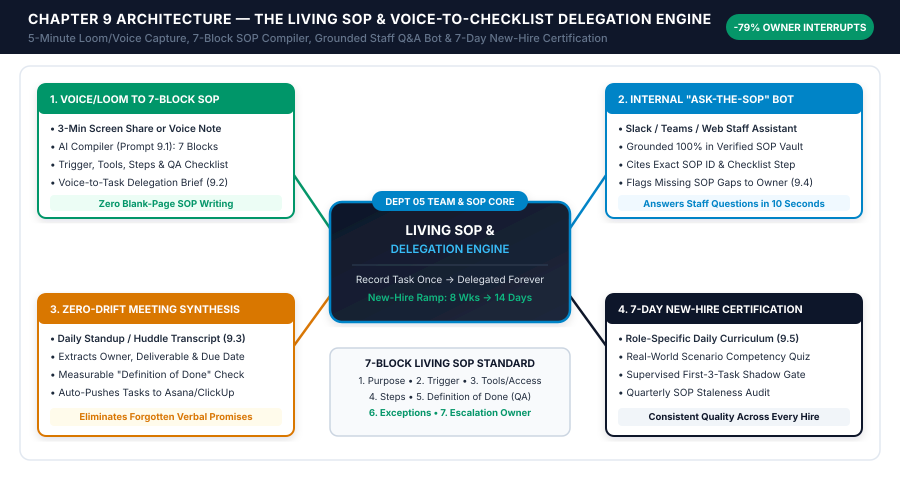
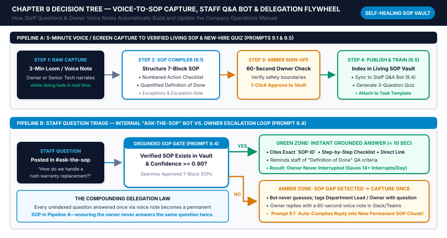

# Chapter 9: Internal Team SOPs, Meeting Synthesis & Instant Staff Training Systems

## 1. Learning Objectives

By the conclusion of this chapter, you will be able to architect, deploy, and govern an internal operations, delegation, and staff training engine that extracts tribal knowledge out of the founder's head and turns your team into a self-sufficient execution unit:

1. **Deploy the 5-Minute Loom/Voice-to-SOP Pipeline:** Build an automated ingestion workflow where an owner or senior technician records a 3-to-5 minute screen share or voice memo while performing a task once, and the pipeline transcribes, structures, and publishes a **7-Block Living SOP** (*Purpose, Trigger, Required Tools/Access, Step-by-Step Checklist, Quality Definition of Done, Common Exceptions, Escalation Contact*) into your central SOP Vault in under 90 seconds.
2. **Engineer the Voice-to-Checklist Delegation Engine:** Replace vague verbal "drive-by delegations" (*"Hey, can you handle that client renewal?"*) with a 60-second voice-memo-to-task pipeline that generates structured project tickets containing an explicit **Definition of Done (DoD)**, intermediate milestone checks, and required verification proof (`screenshot`, `link`, or `signed form`).
3. **Launch an Internal "Ask-the-SOP" Grounded Staff Assistant:** Configure a Retrieval-Augmented Generation (RAG) Slack, Microsoft Teams, or Notion bot (`temperature: 0.0`) restricted strictly to your verified SOP database—cutting daily staff shoulder-taps and *"Quick question, boss"* interruptions by `70% to 85%` while logging undocumented edge cases as SOP gap tickets.
4. **Automate Zero-Drift Meeting & Huddle Synthesis:** Transform daily 10-minute standups, weekly operations meetings, and client kickoff calls into deterministic action-item matrices (`Owner`, `Deliverable`, `Due Date`, `Definition of Done`) pushed automatically into ClickUp, Asana, Notion, or Jobber—with automated 24-hour pre-due accountability nudges.
5. **Construct a 7-Day New-Hire Onboarding & Role Certification Engine:** Convert your Living SOP Vault into role-specific Day-1-to-Day-7 training curricula, practical sandbox exercises, and 10-question scenario-based certification quizzes that cut new employee ramp-up time by `50% to 65%`.

---

## 2. The Real-World Friction Point

When a small business grows past 3 to 5 employees, the primary constraint on revenue and founder sanity shifts from external customer acquisition to **internal operational bottlenecking**. The owner becomes the human router, chief troubleshooter, and sole encyclopedia for how every process works. Across 1-to-25 person businesses, four internal dysfunctions trap the founder in 60-hour workweeks:

### Friction Point 1: The "Tribal Knowledge Hostage" Syndrome
In 90% of small businesses, critical standard operating procedures—how to process a partial commercial credit, how to configure a new client's DNS and analytics tracking, how to close out a warranty replacement claim, or how to calibrate a diagnostic machine—exist strictly inside the head of the founder or one senior employee.
- **Why Traditional SOP Writing Fails:** Every January, the business owner resolves to *"sit down and write an operations manual."* They open a blank Google Doc or Notion page, spend 3 agonizing hours writing two procedures from scratch, get pulled into a customer emergency, and never touch the folder again. Sitting at a blank keyboard trying to type step-by-step instructions from memory is cognitively exhausting and fundamentally incompatible with running an active small business.
- **The Operational Cost:** When a senior coordinator or lead technician goes on vacation, calls in sick, or resigns with two weeks' notice, operational knowledge walks out the door—forcing the owner back into front-line seat execution.

### Friction Point 2: Death by 40 Daily "Got a Quick Second?" Interruptions
Because procedures are either undocumented or buried in outdated 40-page PDF binders that nobody reads, employees default to the path of least resistance: **asking the owner.**
- Throughout the day, the owner is bombarded by Slack pings, texts, and office doorway interruptions:
  - *"Hey, what's our policy when a patient asks to split an orthotic payment across two HSA cards?"*
  - *"Where do we keep the commercial COI request template for property managers?"*
  - *"How do I override the shipping tax code in QuickBooks for an out-of-state wholesale order?"*
- **The Cognitive Switching Penalty:** Organizational psychology research demonstrates that after each 2-minute interruption, it takes an average of **15 to 23 minutes** to regain deep executive focus. Answering 25 "quick questions" a day destroys 100% of the owner's strategic capacity between 8:00 AM and 5:00 PM—pushing actual high-value work into nights and weekends.

### Friction Point 3: "Drive-By Delegation" and the Boomerang Task Effect
Harried owners delegate on the fly: while walking between meetings or driving between job sites, they fire off a 12-word Slack message or voice note (*"Hey Sam, can you put together the Q4 proposal for Apex Properties and send it over?"*).
- Because the owner never specified the pricing tier, scope exclusions, formatting template, or **Definition of Done**, the employee guesses.
- Forty-eight hours later, the employee hands back a draft that is `60%` wrong. Frustrated and pressed for time, the owner mutters, *"It takes me longer to explain it than to just do it myself,"* takes the task back (**The Boomerang Effect**), and spends 90 minutes redoing the work at 9:00 PM.

### Friction Point 4: Amnesia Meetings & Zero-Accountability Huddles
A 12-person team spends 45 minutes in a Monday morning operations meeting (`9.0 person-hours` of payroll cost). Eight important operational fixes and client follow-ups are discussed verbally. Because nobody extracts concrete `Owner + Deliverable + Due Date + Verification Proof` records into the task tracker before leaving the room, by Thursday afternoon `65%` of the agreed actions have evaporated into thin air.

| Internal Operations Failure Mode | Typical Manual Reality (5–25 Staff) | Annual Hidden Payroll & Founder Cost (`$1.8M` Firm) | Automated Living SOP Target State |
| :--- | :--- | :--- | :--- |
| **Time to Document 1 Core Process** | `2.5 to 4.0 hours` of manual typing | SOPs never get written; `< 15%` coverage | **`4 to 6 minutes`** (Loom/Voice -> 7-Block SOP) |
| **Daily Staff "Quick Question" Pings** | `18 to 35 interruptions/day` to owner | `11.5+ hrs/week` (`$45,000+/yr`) founder distraction | **`< 4 escalations/day`** (`80%+` solved by SOP Bot) |
| **Delegated Task Rework Rate** | `32% to 48%` require owner redo | `8.0 hrs/week` wasted in "Boomerang" rework | **`< 6%` rework** via Voice-to-Checklist DoD Briefs |
| **Meeting Action-Item Completion** | `35% to 50%` completed on time | `$18,000+/yr` in dead meeting payroll | **`94%+` on-time completion** via auto-task sync |
| **New-Hire Ramp-Up to Full Productivity** | `6 to 10 weeks` of ad-hoc shadowing | `$9,500–$16,000` per hire in slow ramp/errors | **`10 to 14 days`** via 7-Day Role Certification Engine |

---

## 3. Why Standard Approaches Fail

Most small businesses that attempt to fix SOP documentation and internal training fall into three predictable traps:

### Failure 1: Asking ChatGPT to "Write an SOP for Customer Onboarding" From Scratch
When an owner opens a generic AI chat window and prompts, *"Write a Standard Operating Procedure for how an HVAC company dispatches a technician,"* the AI produces a generic, textbook-sounding essay filled with corporate platitudes (`"Step 1: Ensure customer satisfaction is prioritized; Step 2: Open your CRM software..."`).
- **Why It Fails:** Generic AI does not know *your* software buttons, *your* pricebook codes, *your* Slack channel names, *your* approval thresholds, or *your* specific exceptions. Staff immediately recognize generic AI filler as useless and ignore it. **Rule of the OS:** AI must never *invent* your process; AI must *compile and structure* a process extracted directly from a real screen recording or voice walkthrough of you or your best performer executing the work.

### Failure 2: Building "Static Graveyard Wikis" Disconnected from Daily Workflows
Buying a Notion workspace, Trainual subscription, or SharePoint folder and dumping 50 documents inside does not change employee behavior if searching the wiki takes longer than messaging the boss on Slack.
- Unless your SOP database is connected to:
  1. An instant **Slack / Microsoft Teams Q&A Bot** (`@SOP-Assistant`) that answers questions in 4 seconds with a direct link to the exact checklist step, and
  2. Automatic **Task-Template Injection** that attaches the relevant SOP checklist directly inside the ClickUp, Asana, or Jobber ticket when the task is assigned,
  your wiki quickly becomes a digital graveyard.

### Failure 3: Summarizing Meetings With Generic "Bullet-Point Recap" Notes
Standard AI meeting recorders (default Otter, Fireflies, or Zoom summaries) generate 2-page narrative recaps (`"The team discussed Q4 goals, marketing budgets, and a delayed shipment for Client X"`). Narrative paragraphs do not drive execution. An operational meeting synthesizer must reject vague bullets (`"Follow up with vendor"`) and enforce a strict 5-column accountability schema: **`Task Title | Single Assigned Owner | Hard Due Date (YYYY-MM-DD) | Definition of Done | Verification Proof Required`**.

---

## 4. Core Framework: The Living SOP & Voice-to-Checklist Delegation Engine

To eliminate the founder bottleneck without spending a single hour typing manuals from scratch, we deploy a four-pillar internal operations architecture:

### Pillar 1: The 5-Minute Loom/Voice-to-SOP Pipeline (The 7-Block Living SOP Standard)
Never type an SOP again. Whenever you or a senior team member perform a recurring task (e.g., reconciling daily clinic batch settlements, setting up a Google Ads conversion pixel, preparing a commercial service agreement, or winterizing a truck), turn on Loom, Tella, or a mobile voice recorder and **narrate out loud for 3 to 5 minutes while doing the real work**:
- Speak naturally: *"Okay, I'm logging into QuickBooks, clicking `+ New` -> `Credit Memo`, checking that the customer's original invoice number is pasted in the Memo field so our AR automation doesn't get confused. Watch out here—if the credit is over $250, don't click Save and Send; save it as Draft and drop the link in `#finance-approvals`..."*
- **Automated Ingestion:** Dropping that video/audio file into your `01_Raw_SOP_Captures` Google Drive/Dropbox folder or `#sop-capture` Slack channel triggers **Whisper / Deepgram transcription** followed by **Prompt 9.1**, which compiles a standardized **7-Block Living SOP**:

| SOP Block # | Block Name | Mandatory Operational Content |
| :--- | :--- | :--- |
| **Block 1** | **Header & Metadata** | `SOP_ID` (e.g., `SOP-FIN-004`), Department, Owner Role, Estimated Execution Time, Version Date, and Link to Original 4-Minute Loom Video. |
| **Block 2** | **Operational Purpose & Impact** | 2 sentences explaining *why* this task matters and what breaks in the business if it is skipped or done sloppily. |
| **Block 3** | **Trigger Event & Frequency** | The exact event, schedule, or webhook that initiates this procedure (e.g., *"Triggered every Tuesday at 10:00 AM"* or *"Triggered when a client submits Form #3"*). |
| **Block 4** | **Required Tools, Links & Access** | Exact URLs, software platforms, permission levels, and template links required before starting Step 1. |
| **Block 5** | **Step-by-Step Execution Checklist** | Numbered, imperative action steps (`[ ] 1.1 Click...`) with exact field names, keyboard shortcuts, and `[SCREENSHOT AT 01:42]` timestamp markers. |
| **Block 6** | **Quality "Definition of Done" (DoD)** | Binary pass/fail verification criteria the employee checks *before* marking the task complete (plus required proof: screenshot, URL, or file upload). |
| **Block 7** | **Common Exceptions & Escalation Gate** | `If X happens -> Do Y` troubleshooting table for the top 3 edge cases, plus the exact human Escalation Contact (`Role + Slack Channel`) when an unlisted exception occurs. |

### Pillar 2: The Voice-to-Checklist Delegation Engine
When delegating a one-off or custom project task, the owner records a **45-to-90 second voice note** on Slack, Telegram, WhatsApp, or Apple Watch answering four mental prompts:
1. *What is the final outcome we need?*
2. *What context, files, or client history should they look at?*
3. *What are the landmines or things NOT to do?*
4. *When is it due, and what does "Done" look like?*
- **Prompt 9.2** converts that 60-second voice note into a structured ClickUp/Asana/Notion task card containing a clear Objective, Step-by-Step Subtasks, an explicit **Definition of Done**, a **50% Milestone Check-In Rule**, and the exact **Verification Artifact** the team member must attach when closing the ticket.

### Pillar 3: The Internal "Ask-the-SOP" Staff Assistant (`@SOP-Bot`)
All approved 7-Block SOPs in your Notion, Google Docs, or Airtable SOP Vault are indexed into a vector store or structured context table connected to a dedicated Slack/Teams channel (`#ask-the-sop`):
- **The "Ask the Bot First" Cultural Rule:** Team members are trained on a simple operating rule: *Before messaging the owner or manager with a "How do I..." operational question, ask `@SOP-Bot` in `#ask-the-sop` first.*
- **Grounded Execution (`temperature: 0.0`, Prompt 9.4):**
  - If the answer is documented in the SOP Vault (`confidence >= 0.85`), `@SOP-Bot` replies in `< 4 seconds` with the exact step-by-step instructions, cites the `SOP_ID`, links the 3-minute Loom video timestamp, and reminds the employee of any Amber/Red approval thresholds.
  - **Self-Healing SOP Gap Detection:** If a question is *not* covered in the SOP Vault (`confidence < 0.85` or edge case unlisted), `@SOP-Bot` states clearly: *"This scenario is not yet covered in our verified SOP Vault,"* tags the designated department lead in the thread, and **automatically creates a draft `SOP_Gap_Ticket`** so the owner's eventual answer is immediately appended to the SOP—ensuring nobody ever asks the same undocumented question twice!

### Pillar 4: Zero-Drift Meeting Synthesis & 7-Day New-Hire Certification
1. **Zero-Drift Meeting Pipeline (Prompt 9.3):** Every recorded team huddle or client call transcript passes through an extractor that rejects vague discussion notes, creates assigned tasks in your project tracker, and posts a 60-second recap in Slack within 3 minutes of the meeting ending.
2. **7-Day Role Certification Engine (Prompt 9.5):** When a new hire joins (e.g., *Front-Desk Patient Coordinator*, *Junior Bookkeeper*, *Commercial HVAC Apprentice*, or *Agency Account Coordinator*), selecting their role tag in the SOP Vault compiles all 8–12 core SOPs for that seat into a structured **7-Day Onboarding Roadmap** complete with daily Loom assignments, sandbox practice tasks, and a **10-Question Scenario Certification Quiz** (requiring `90%+` to authorize independent live execution).

### Operational Formulas Governing Team Capacity & SOP ROI

$$\text{SOP Coverage Score (\%)} = \left( \frac{\text{Number of Core Recurring Processes with Verified 7-Block SOPs}}{\text{Total Identified Core Recurring Processes across 5 Departments}} \right) \times 100$$

$$\text{Founder Interruption Time Reclaimed (Hours/Week)} = \frac{\text{Weekly Staff Questions Deflected by SOP Bot} \times \left( \text{Avg Answer Time (3 min)} + \text{Focus Recovery Penalty (15 min)} \right)}{60}$$

$$\text{Annual Delegation & Onboarding ROI (\$)} = \left( \text{Founder Hours Reclaimed/Yr} \times \text{Executive Hourly Value} \right) + \left( \text{New Hires/Yr} \times \text{Weeks Saved in Ramp-Up} \times \text{Weekly Payroll Cost} \right)$$

---

## 5. Visual Architecture: System Mindmap



*Figure 9.1: System architecture of the Living SOP & Voice-to-Checklist Delegation Engine across Loom/Voice SOP Capture, the Grounded Internal Q&A Bot, Zero-Drift Meeting Synthesis, and 7-Day New-Hire Certification.*

---

## 6. Step-by-Step Implementation Protocol

Execute this 5-step engineering sequence to build your Living SOP Vault and cut internal interruptions by `75%+` within 21 days.

### Step 1: Conduct the "Top 25 Bottleneck Process Inventory" (45 Minutes)
Do not try to document 200 minor tasks at once. Gather your department leads (or review your calendar and Slack history from the past 14 days) and list the **Top 25 recurring tasks** (5 per department: *Sales/Marketing, Onboarding/Fulfillment, Customer Support, Finance/Back-Office, Internal Admin*) that either:
1. Only the founder currently knows how to do,
2. Frequently get done wrong by staff, or
3. Generate the most *"How do I do this?"* Slack/text interruptions.

Assign each of the 25 tasks a permanent `SOP_ID` (`SOP-SLS-001` through `SOP-ADM-005`) inside your Notion or Airtable **Living SOP Vault**.

### Step 2: Wire the Loom / Voice-Memo to 7-Block SOP Automation Pipeline (90 Minutes)
Build a zero-friction capture workflow in Make.com, n8n, or Zapier so recording a process takes zero extra admin effort:
1. **Trigger Node:** New video/audio file uploaded to Google Drive folder `01_Raw_SOP_Captures` or new Loom URL posted in Slack channel `#sop-capture` with a 1-line syntax:
   `SOP-FIN-004 | Finance | How to Issue a Partial Customer Credit Memo in QuickBooks`
2. **Transcription & Timestamp Extraction Node:** Pass the audio/video stream through OpenAI Whisper API (`whisper-1`, `timestamp_granularities: ["segment"]`) or Deepgram Nova-2 to extract a time-coded transcript (`[00:14]`, `[01:08]`, `[02:45]`).
3. **AI SOP Compiler Node (Prompt 9.1):** Pass the time-coded transcript and metadata header to an LLM (`temperature: 0.1`) to compile the complete **7-Block Living SOP** in Markdown and JSON.
4. **Database & Vector Sync Node:**
   - Creates the formatted SOP page in your **Notion Living SOP Vault** (with the original Loom video embedded at the top of the page).
   - Indexes the SOP chunks into your internal Q&A knowledge base (Pinecone, Supabase `pgvector`, OpenAI Assistants Vector Store, or Notion AI/Dust.tt) with `status = "Verified_Active"`.
   - Posts a confirmation card in `#team-updates` tagging the department team.

### Step 3: Deploy the Voice-to-Checklist Delegation Bot (60 Minutes)
Create a private Slack channel (`#delegate-by-voice`) or Telegram bot for the owner and managers:
1. **Trigger:** Owner records a 60-second voice message in `#delegate-by-voice` starting with the assignee's name and due date (`"For Marcus, due Thursday at 3 PM: We need to audit the 14 commercial HVAC maintenance renewals expiring in November..."`).
2. **Processing (Prompt 9.2):** Whisper transcribes the voice note; **Prompt 9.2** cross-references your `SOP_Vault_Index` to attach any matching `SOP_ID` links, structures the task into numbered subtasks, defines the binary **Definition of Done**, and specifies the required **Verification Proof**.
3. **Task Creation & Confirmation:** The workflow creates the task in ClickUp, Asana, or Notion, assigns it to `Marcus` with the Thursday 3:00 PM deadline, attaches the original 60-second audio file for tone nuance, and posts the structured checklist in `#delegate-by-voice` so the owner can verify accuracy at a glance.

### Step 4: Launch the `@SOP-Bot` Internal Staff Q&A Assistant & Self-Healing Gap Logger (2 Hours)
Configure a webhook listener on your `#ask-the-sop` Slack or Microsoft Teams channel:

```json
{
  "webhook_event": "internal_sop_query",
  "query_id": "qry_20261022_8812",
  "asked_by_employee": "Hannah Lin (Client Onboarding Coordinator)",
  "employee_role": "Onboarding_Coordinator",
  "channel_id": "#ask-the-sop",
  "question_text": "A commercial client wants to pay their $4,200 onboarding deposit via wire transfer instead of Stripe ACH and needs our W-9 and wire routing instructions. What is the exact process and do I pause kickoff until the wire clears?",
  "retrieved_sop_chunks": [
    {
      "sop_id": "SOP-FIN-002",
      "sop_title": "Commercial Wire Transfer, W-9 Delivery & Deposit Clearance Policy",
      "loom_url": "https://loom.com/share/sop-fin-002-wire-policy",
      "last_verified": "2026-10-01",
      "content_excerpt": "Block 5 Step 2: Send the locked PDF package `2026_W9_and_Wire_Instructions_Locked.pdf` from the Finance Vault (NEVER type bank routing numbers manually in an email body to prevent wire fraud). Block 6 DoD: For deposits under $5,000 from verified commercial entities, once the client uploads a screenshot of the wire confirmation receipt (`Federal Reference / IMAD Number`), you may proceed with scheduling the Kickoff Call immediately while flagging invoice status as `Wire_In_Transit` in QBO. For deposits >= $5,000, wait for bank settlement before scheduling."
    }
  ]
}
```

- **Execution Rules:**
  - **Prompt 9.4** synthesizes an answer strictly from `retrieved_sop_chunks`.
  - If `confidence_score >= 0.85`, replies immediately in the thread with the step-by-step checklist, security warning (*"Never type routing numbers manually in email"*), and Loom link.
  - If `confidence_score < 0.85` (or `retrieved_sop_chunks` is empty), logs a new row in the `SOP_Gap_Tracker` table (`Status: Needs_3Min_Loom_From_Owner`) and routes the question to the department manager. When the manager replies in the Slack thread, a secondary webhook captures their reply and appends it directly to the SOP Vault!

### Step 5: Automate Zero-Drift Meeting Synthesis & Role Certification (90 Minutes)
1. **Meeting Transcript Ingestion:** Connect Fathom, Fireflies.ai, Fellow, Google Meet, or Zoom cloud recordings to **Prompt 9.3**. Every time a meeting tagged `[Internal Huddle]` or `[Client Kickoff]` finishes, the pipeline extracts all concrete commitments, creates individual subtasks in your project manager, and schedules a **24-Hour Pre-Due Automated Slack Nudge** (`"Hi Devon, reminder that Action Item #3 from Monday's huddle—Ordering the 3-Phase Contactor for Oakridge—is due tomorrow at 12:00 PM"`).
2. **New-Hire 7-Day Certification Builder:** When onboarding a new team member, pass their role's 8–10 core `SOP_ID` documents into **Prompt 9.5** to generate their personalized 7-Day Training Checklist and 10-question scenario certification exam.

### Step 6: Configure Multi-Industry SOP & Field Delegation Adaptations
Tailor your capture format, Q&A access channel, and Definition-of-Done verification proof to match where your employees actually work:

#### 1. Home Services & Field Trade Contractors (HVAC, Plumbing, Electrical, Pest Control, Cleaning)
- **Hands-Free Field Video Capture (`#field-sop-capture`):** Field technicians do not sit at desks with Loom open. Have your Lead Technician wear a clip-on phone mount or hold their smartphone for 3 minutes while narrating a physical procedure on-site (*"How we pressure-test a new residential mini-split line set and log the micron gauge reading in ServiceTitan"*).
- **SMS / WhatsApp `@SOP-Bot` Access for Field Crews:** Connect your **Prompt 9.4** SOP Assistant to a dedicated Twilio/WhatsApp number (`"Ask the Master Tech Bot"`). When a junior technician is standing in a customer's basement facing an unfamiliar carrier error code or warranty lookup rule, they text the bot and receive the exact 5-step troubleshooting checklist and 2-minute video clip on their phone in 4 seconds—instead of calling the owner or pulling the Lead Tech off another job.
- **Photo-Verified Definition of Done:** Require physical photo verification inside ServiceTitan/Jobber before a technician can close a job ticket (`Photo 1: Installed breaker panel with clean wire labels`, `Photo 2: Digital multimeter reading`, `Photo 3: Swept floor around work area`).

#### 2. Healthcare, Dental, Veterinary & MedSpa Clinics
- **Front-Desk vs. Clinical Room SOP Separation:** Partition your Notion/Airtable SOP Vault into two strict permission tiers:
  - *Tier A — Front-Desk & Revenue Cycle SOPs (`SOP-CLN-ADM`):* Insurance verification scripts, prior authorization follow-up, no-show deposit rules, and HIPAA-compliant records release checklists.
  - *Tier B — Clinical Room Prep & Sterilization SOPs (`SOP-CLN-MED`):* Autoclave spore-testing logs, treatment room turnover checklists, and emergency crash-cart weekly inspections.
- **Zero-PHI Recording Rule:** Train staff to **never** record real patient names, faces, or charts when capturing a 3-minute Loom walkthrough. Always use the EHR's built-in `Test Patient (Jane Doe - ID #0000)` profile during screen recordings.

#### 3. B2B Marketing, Creative, IT/MSP & Professional Service Agencies
- **Client-Specific Playbook Inheritance:** In addition to global agency SOPs (`"How we QA a Meta Ads campaign before launch"`), maintain a `Client_Brand_Voice_and_Exceptions` record per retainer account. When **Prompt 9.2** generates a delegation task for `Client_X`, it automatically injects both the global agency SOP (`SOP-FUL-008`) and `Client_X`'s specific compliance/brand exclusions right into the ClickUp/Asana task description.
- **Loom-Verified Deliverable Handoffs:** Require account coordinators and designers to attach a 90-second self-review Loom alongside their completed deliverable walking through the **Block 6 Definition of Done** checklist before routing the task to the Creative Director or Account Lead for final sign-off.

#### 4. Retail, Hospitality & E-Commerce Warehouse Operations
- **QR-Code Station SOPs:** Print weatherproof QR codes generated from each Notion `SOP_ID` page and mount them directly at the physical workstation (*Receiving Dock*, *Returns Inspection Table*, *Espresso/POS Opening Counter*). When a part-time or seasonal worker scans the QR code with their phone, the 2-minute video and 6-step visual checklist open immediately—eliminating opening/closing shift errors.

| Industry Vertical | Primary Capture Modality | Staff Q&A Interface | Mandatory Definition-of-Done Proof |
| :--- | :--- | :--- | :--- |
| **Field Trades & Contractors** | 3-min smartphone video on job site | SMS / WhatsApp `@SOP-Bot` | 3 required before/after job-site photos in FSM |
| **Healthcare & Dental Clinics** | Loom using `Test Patient #0000` EHR profile | Slack / Teams `#front-desk-sop` | Completed EHR audit batch ID + signed sterilization log |
| **B2B Agencies & Consultancies** | Loom screen share during live campaign build | Slack / ClickUp `@SOP-Bot` | Working staging URL + 90-sec QA walkthrough Loom |
| **Retail & E-Commerce Fulfillment** | Smartphone video at packing/POS station | Physical QR Code + Tablet Bot | Signed opening/closing station checklist + photo |

---

## 7. Operational Decision Tree



*Figure 9.2: End-to-end decision logic governing Voice-to-SOP Compilation, the Grounded Internal Staff Q&A Bot with Self-Healing Gap Logging, and Delegation Definition-of-Done Verification.*


---

## 8. Tested AI Workflow Prompts

Each prompt below adheres to our **7-Part Prompt Engineering Contract** and is designed for deterministic execution (`temperature: 0.0–0.1`) inside Make.com, n8n, Zapier, or Notion/Slack automation pipelines.

---

### Prompt 9.1: Raw Voice Memo / Screen-Recording Transcript to 7-Block Standard Operating Procedure (SOP) Compiler

1. **Operational Objective:** Convert a raw, conversational, time-coded transcript of an owner or senior staff member performing a task (via Loom, screen recording, or voice memo) into a standardized, audit-ready **7-Block Living SOP** ready for immediate publication in Notion, Google Docs, or Trainual.
2. **System Role & Constraints:** You are a Senior Operations Systems Engineer and Technical Writer. Strip out verbal fillers (`"um"`, `"uh"`, `"hang on a second"`), false starts, and tangents while preserving 100% of the exact software clicks, field names, dollar thresholds, keyboard shortcuts, and cautionary warnings mentioned in the recording. Insert `[VIDEO TIMESTAMP: MM:SS]` markers at each key step so employees can jump straight to that moment in the Loom video.
3. **Input Variable Schema:**
   - `{{sop_id}}`: Assigned identifier (e.g., `SOP-FIN-004`)
   - `{{department}}`: Department name
   - `{{sop_title}}`: Process title
   - `{{owner_role}}`: Role responsible for executing the SOP
   - `{{loom_or_video_url}}`: Link to the source screen recording
   - `{{time_coded_transcript}}`: Raw Whisper/Deepgram transcript with `[MM:SS]` markers
4. **Complete Copy-Paste Prompt Block:**

```markdown
### SYSTEM PROMPT — 7-BLOCK LIVING SOP COMPILER (PROMPT 9.1)
You are a Senior Operations Systems Engineer and Technical Documentation Architect.
Convert the provided `time_coded_transcript` of a screen recording or voice walkthrough into a comprehensive, production-grade **7-Block Living SOP**.

STRICT COMPILATION RULES:
1. Eliminate conversational filler and tangents, but NEVER omit specific software menu paths, exact field names, numeric thresholds, security warnings, or naming conventions mentioned by the speaker.
2. Every action step in Block 5 MUST begin with an imperative verb (e.g., "Open", "Verify", "Select", "Paste") and include the corresponding `[VIDEO TIMESTAMP: MM:SS]` marker from the transcript.
3. In Block 6 (Quality Definition of Done), define binary pass/fail criteria and specify the exact verification artifact (`screenshot`, `URL`, or `log entry`) required to close the task.
4. In Block 7 (Common Exceptions & Escalation Gate), extract every edge case or "watch out for X" warning mentioned by the speaker into an `If [Condition] -> Then [Action]` table, and identify any ambiguous gaps where the speaker forgot to specify a threshold (`detected_ambiguities_for_owner`).
5. Return ONLY valid JSON matching the schema below (including a complete rendered Markdown document in `compiled_sop_markdown`).

### INPUT PAYLOAD
- SOP ID: {{sop_id}}
- Department: {{department}}
- Process Title: {{sop_title}}
- Responsible Role: {{owner_role}}
- Source Video URL: {{loom_or_video_url}}
- Time-Coded Transcript: {{time_coded_transcript}}

### REQUIRED JSON OUTPUT SCHEMA
{
  "sop_id": "string",
  "sop_title": "string",
  "department": "string",
  "owner_role": "string",
  "estimated_execution_minutes": 0,
  "block_1_metadata": {
    "sop_id": "string",
    "version": "v1.0",
    "source_video_url": "string",
    "owner_role": "string"
  },
  "block_2_operational_purpose": "string",
  "block_3_trigger_and_frequency": "string",
  "block_4_required_tools_and_access": ["string"],
  "block_5_step_by_step_checklist": [
    {
      "step_number": "1.1",
      "video_timestamp": "MM:SS",
      "action_instruction": "string",
      "critical_warning_or_tip": "string or null"
    }
  ],
  "block_6_definition_of_done": {
    "binary_pass_criteria": ["string"],
    "required_verification_proof": "string"
  },
  "block_7_exceptions_and_escalation": {
    "exception_rules": [
      {"if_condition": "string", "then_action": "string"}
    ],
    "escalation_contact_role_and_channel": "string"
  },
  "detected_ambiguities_for_owner": ["string"],
  "compiled_sop_markdown": "string (Full 7-Block Markdown page ready for Notion/Docs)"
}
```

5. **Sample Realistic Input Payload:**

```json
{
  "sop_id": "SOP-FIN-004",
  "department": "Finance & Billing",
  "sop_title": "Issuing a Partial Client Credit Memo & Halting Automated AR Chasers",
  "owner_role": "Billing & Office Coordinator",
  "loom_or_video_url": "https://loom.com/share/sop-fin-004-credit-memo",
  "time_coded_transcript": "[00:05] Hey team, recording a quick walkthrough on how to issue a partial credit memo in QuickBooks Online when we agree to discount or adjust an open invoice. [00:22] First, before you touch QuickBooks, open our Airtable AR_Tracking_Ledger and flip the `dispute_flag` checkbox to TRUE on that invoice number so Make.com doesn't accidentally fire an overdue payment text while you're working on it. [00:55] Next, in QuickBooks Online, click the `+ New` button in the top left and select `Credit Memo` under Customers. [01:18] Pick the exact Customer:Job, and in the `Product/Service` column, do NOT use the original labor SKU because that messes up our technician commission reports—always select SKU `ADJ-CUST-GOODWILL` (Customer Goodwill Adjustment) mapped to GL 4910 Returns & Allowances. [02:04] In the Description box, type the original Invoice Number, the date approved, and who approved it. [02:30] Now watch out: if the credit is under $250, you can click `Save and Send` and apply it right to the open invoice. If the credit is $250 or more, click `Save as Draft`, copy the URL, and post it in `#finance-approvals` on Slack tagging me (Elena) for 1-click sign-off. [03:10] Finally, once the credit is applied, send the updated invoice payment link to the client and uncheck `dispute_flag` in Airtable."
}
```

6. **Expected Structured Output:**

```json
{
  "sop_id": "SOP-FIN-004",
  "sop_title": "Issuing a Partial Client Credit Memo & Halting Automated AR Chasers",
  "department": "Finance & Billing",
  "owner_role": "Billing & Office Coordinator",
  "estimated_execution_minutes": 5,
  "block_1_metadata": {
    "sop_id": "SOP-FIN-004",
    "version": "v1.0",
    "source_video_url": "https://loom.com/share/sop-fin-004-credit-memo",
    "owner_role": "Billing & Office Coordinator"
  },
  "block_2_operational_purpose": "Ensures customer invoice adjustments and goodwill credits are accurately applied in QuickBooks Online without corrupting technician commission reports or triggering erroneous overdue payment reminders during processing.",
  "block_3_trigger_and_frequency": "Triggered on-demand whenever a client billing adjustment or goodwill discount is approved on an open invoice.",
  "block_4_required_tools_and_access": [
    "Airtable (`AR_Tracking_Ledger` base — Editor access)",
    "QuickBooks Online Plus (Customer Billing permissions)",
    "Slack (`#finance-approvals` channel)"
  ],
  "block_5_step_by_step_checklist": [
    {
      "step_number": "1.1",
      "video_timestamp": "00:22",
      "action_instruction": "Open the Airtable `AR_Tracking_Ledger`, locate the target `invoice_number`, and check `dispute_flag = TRUE` to pause automated AR payment chasers.",
      "critical_warning_or_tip": "Always pause the AR chaser BEFORE editing the invoice in QuickBooks."
    },
    {
      "step_number": "1.2",
      "video_timestamp": "00:55",
      "action_instruction": "In QuickBooks Online, click `+ New` (top-left) -> select `Credit Memo` under the Customers column.",
      "critical_warning_or_tip": null
    },
    {
      "step_number": "1.3",
      "video_timestamp": "01:18",
      "action_instruction": "Select the exact `Customer:Job` and choose SKU `ADJ-CUST-GOODWILL` (mapped to GL 4910 Returns & Allowances) in the Product/Service column.",
      "critical_warning_or_tip": "NEVER use the original technician labor SKU on a credit memo, as doing so deducts earned commission from the technician payroll report."
    },
    {
      "step_number": "1.4",
      "video_timestamp": "02:04",
      "action_instruction": "In the Description field, enter: `Adjustment for Invoice #[Number] | Approved on [YYYY-MM-DD] by [Approver Name] — [Reason]`.",
      "critical_warning_or_tip": null
    },
    {
      "step_number": "1.5",
      "video_timestamp": "02:30",
      "action_instruction": "Check the dollar threshold: If Credit `< $250.00`, click `Save and Send` and apply it to the open invoice. If Credit `>= $250.00`, click `Save as Draft` and post the QBO URL in `#finance-approvals` tagging `@Elena`.",
      "critical_warning_or_tip": "Amber Approval Gate required for all credits >= $250.00."
    },
    {
      "step_number": "1.6",
      "video_timestamp": "03:10",
      "action_instruction": "Once applied, email the updated invoice balance link to the client and uncheck `dispute_flag = FALSE` in Airtable.",
      "critical_warning_or_tip": null
    }
  ],
  "block_6_definition_of_done": {
    "binary_pass_criteria": [
      "Credit Memo uses SKU `ADJ-CUST-GOODWILL` (GL 4910) and NOT a technician labor SKU.",
      "Original Invoice balance reflects the exact reduced net amount in QuickBooks Online.",
      "Client has been sent the updated 1-click payment link and `dispute_flag` is reset to FALSE."
    ],
    "required_verification_proof": "Paste the QuickBooks Credit Memo ID (`CM-XXXX`) into the Airtable `AR_Tracking_Ledger` adjustment note column."
  },
  "block_7_exceptions_and_escalation": {
    "exception_rules": [
      {
        "if_condition": "Credit Memo amount is >= $250.00",
        "then_action": "Save as Draft in QBO and post link in Slack `#finance-approvals` tagging `@Elena` before applying."
      },
      {
        "if_condition": "Credit is due to a defective vendor part covered by supplier warranty",
        "then_action": "Use SKU `ADJ-WARR-PART` instead of `ADJ-CUST-GOODWILL` so AP claims the supplier credit."
      }
    ],
    "escalation_contact_role_and_channel": "Elena Rostova (Finance Lead) in Slack `#finance-approvals`"
  },
  "detected_ambiguities_for_owner": [],
  "compiled_sop_markdown": "# SOP-FIN-004: Issuing a Partial Client Credit Memo & Halting Automated AR Chasers\n**Department:** Finance & Billing | **Owner:** Billing & Office Coordinator | **Est. Time:** 5 Mins | **Video:** [Watch 3-Min Loom](https://loom.com/share/sop-fin-004-credit-memo)\n\n## 1. Operational Purpose\nEnsures customer invoice adjustments and goodwill credits are accurately applied in QuickBooks Online without corrupting technician commission reports or triggering erroneous overdue payment reminders...\n*(Full 7-Block Markdown Rendered)*"
}
```

7. **Human-in-the-Loop Verification Rule:** Newly compiled SOPs post as `Draft_Pending_Owner_Glance` in `#sop-capture` with a `[Publish to SOP Vault]` button so the owner or department lead verifies thresholds in 15 seconds before the bot indexes the document.

---

### Prompt 9.2: Voice-to-Task Delegation Brief & "Definition of Done" Checklist Generator

1. **Operational Objective:** Convert a 45-to-90 second voice note from an owner or manager into a structured project management ticket (ClickUp, Asana, Notion, or Linear) containing an unambiguous Objective, Step-by-Step Subtasks, linked `SOP_ID` references, a **50% Milestone Check-In**, and a binary **Definition of Done (DoD)** to eliminate the "Boomerang Rework Effect."
2. **System Role & Constraints:** You are an Executive Chief of Staff. You transform stream-of-consciousness verbal delegation into crystal-clear written execution briefs. Never leave deadlines relative (`"by Thursday"` -> resolve against `current_date_iso`). Always specify what the assignee must *not* do (`guardrails_and_exclusions`) and what tangible proof they must attach upon completion.
3. **Input Variable Schema:**
   - `{{current_date_iso}}`: Current date (`YYYY-MM-DD`, e.g., `2026-10-22`)
   - `{{delegator_name}}`: Name of owner/manager
   - `{{raw_voice_delegation_transcript}}`: Transcript of the voice note
   - `{{available_sop_index_json}}`: List of existing company `sop_id` and `sop_title` records for automatic cross-linking
4. **Complete Copy-Paste Prompt Block:**

```markdown
### SYSTEM PROMPT — VOICE-TO-CHECKLIST DELEGATION ENGINE (PROMPT 9.2)
You are an Executive Chief of Staff for a small business founder.
Transform the `raw_voice_delegation_transcript` into a zero-ambiguity project management task brief that eliminates guesswork and rework.

DELEGATION STRUCTURING RULES:
1. Resolve any relative date expressions ("tomorrow", "this Friday at 2pm") into exact `YYYY-MM-DD HH:MM` timestamps based on `current_date_iso`.
2. Match the task against `available_sop_index_json` and attach any relevant `sop_id` so the assignee has immediate step-by-step instructions.
3. Break execution into 4 to 7 sequential `subtasks[]`.
4. Define a `midpoint_check_in_rule` (e.g., showing the first draft or first 3 records before completing all 20) so course correction happens early.
5. Formulate a strict `definition_of_done_checklist[]` and specify the exact `required_completion_artifact` (e.g., "Link to Google Sheet + Screenshot of test email").
6. Return ONLY valid JSON.

### INPUT PAYLOAD
- Current Date (ISO): {{current_date_iso}}
- Delegated By: {{delegator_name}}
- Voice Note Transcript: {{raw_voice_delegation_transcript}}
- Available SOP Vault Index: {{available_sop_index_json}}

### REQUIRED JSON OUTPUT SCHEMA
{
  "task_title": "string",
  "assigned_to_name": "string",
  "priority_level": "High | Normal | Urgent",
  "due_datetime_iso": "YYYY-MM-DD HH:MM",
  "midpoint_check_in_datetime_iso": "YYYY-MM-DD HH:MM",
  "linked_sop_ids": ["string"],
  "executive_outcome_statement": "string",
  "context_and_resources": ["string"],
  "subtasks": [
    {"step": 1, "subtask_title": "string", "estimated_mins": 0}
  ],
  "guardrails_and_do_not_do": ["string"],
  "midpoint_check_in_rule": "string",
  "definition_of_done_checklist": ["string"],
  "required_completion_artifact": "string"
}
```

5. **Sample Realistic Input Payload:**

```json
{
  "current_date_iso": "2026-10-22 (Thursday)",
  "delegator_name": "Marcus Vance (Founder)",
  "raw_voice_delegation_transcript": "Hey Chloe, I need you to prepare our November commercial HVAC maintenance renewal batch by Monday at 4 PM. Pull all commercial contracts expiring between November 15 and December 31 from ServiceTitan. Check that we apply the standard 4% annual inflation adjustment—except do NOT raise the rate on Oakridge Medical Plaza because we just signed their multi-unit expansion last month. Draft the renewal proposals in PandaDoc using the 2026 Commercial PM template, do the first three and drop the links in #sales-ops by Friday at noon so I can spot-check the numbers before you generate the other twelve. Don't actually hit send to the clients yet, just stage them in PandaDoc and put the links in the Renewal Tracker sheet.",
  "available_sop_index_json": [
    {"sop_id": "SOP-SLS-006", "sop_title": "Commercial PM Contract Renewal Export & PandaDoc Staging"},
    {"sop_id": "SOP-FIN-004", "sop_title": "Issuing a Partial Client Credit Memo"}
  ]
}
```

6. **Expected Structured Output:**

```json
{
  "task_title": "Stage November/December Commercial HVAC PM Renewal Proposals (15 Accounts)",
  "assigned_to_name": "Chloe",
  "priority_level": "High",
  "due_datetime_iso": "2026-10-26 16:00",
  "midpoint_check_in_datetime_iso": "2026-10-23 12:00",
  "linked_sop_ids": ["SOP-SLS-006"],
  "executive_outcome_statement": "Export all 15 commercial preventative maintenance contracts expiring between Nov 15 and Dec 31, 2026, apply the +4.0% standard rate adjustment (excluding Oakridge Medical Plaza), and stage ready-to-send PandaDoc renewal proposals logged in the Renewal Tracker sheet.",
  "context_and_resources": [
    "ServiceTitan > Reports > Expiring Memberships (Filter: Commercial, 2026-11-15 to 2026-12-31)",
    "PandaDoc Template: `2026 Commercial PM Renewal Agreement v2`",
    "Reference SOP: `SOP-SLS-006` (Commercial PM Contract Renewal Export & PandaDoc Staging)"
  ],
  "subtasks": [
    {"step": 1, "subtask_title": "Export expiring commercial PM contracts (Nov 15 – Dec 31, 2026) from ServiceTitan into the Q4 Renewal Tracker Google Sheet.", "estimated_mins": 20},
    {"step": 2, "subtask_title": "Calculate 2027 renewal pricing (+4.0% over 2026 base rate) for all accounts EXCEPT Oakridge Medical Plaza (keep Oakridge at 0% increase / flat rate).", "estimated_mins": 15},
    {"step": 3, "subtask_title": "MIDPOINT GATE: Generate the first 3 PandaDoc draft proposals and post links in `#sales-ops` by Friday 10/23 at 12:00 PM for Marcus spot-check.", "estimated_mins": 25},
    {"step": 4, "subtask_title": "Once spot-check is approved, generate the remaining 12 PandaDoc renewal drafts in `Draft / Staged` status.", "estimated_mins": 45},
    {"step": 5, "subtask_title": "Paste all 15 staged PandaDoc URLs into Column H of the Q4 Renewal Tracker sheet and verify totals.", "estimated_mins": 15}
  ],
  "guardrails_and_do_not_do": [
    "DO NOT increase pricing on Oakridge Medical Plaza LLC (keep rate flat per recent multi-unit expansion).",
    "DO NOT click 'Send' in PandaDoc—leave all 15 documents in `Draft / Staged` status for final executive review."
  ],
  "midpoint_check_in_rule": "Post links to the first 3 staged PandaDoc proposals in Slack `#sales-ops` by Friday 2026-10-23 at 12:00 PM and wait for Marcus's thumbs-up before generating the remaining 12.",
  "definition_of_done_checklist": [
    "All commercial contracts expiring Nov 15 – Dec 31 are listed in the Q4 Renewal Tracker sheet.",
    "+4.0% rate adjustment is accurately calculated on all accounts except Oakridge Medical Plaza (0% increase).",
    "All 15 PandaDoc drafts are generated using the `2026 Commercial PM Renewal Agreement v2` template and left in Draft status.",
    "Every row in the Q4 Renewal Tracker contains a working PandaDoc draft link."
  ],
  "required_completion_artifact": "Link to completed Q4 Renewal Tracker Google Sheet + screenshot of the 15 staged drafts inside PandaDoc folder."
}
```

7. **Human-in-the-Loop Verification Rule:** The assignee must post the `midpoint_check_in_rule` proof at the 50% mark and attach the `required_completion_artifact` before the project management system allows task status to change to `Completed`.

---

### Prompt 9.3: Team Meeting Transcript to Action-Item Matrix & Follow-Up Accountability Tracker

1. **Operational Objective:** Extract a deterministic Action-Item Matrix, Key Operational Decisions Log, and Unresolved Blocker Escalations from a raw team meeting or client kickoff transcript—rejecting vague discussion bullets and enforcing single-owner, hard-deadline task records ready for ClickUp/Asana/Notion API creation.
2. **System Role & Constraints:** You are an Operational Project Management Officer (PMO). Never assign a task to `"Team"` or `"Everyone"`—every action item must have exactly **one** primary human owner. If a speaker commits to an action without stating a deadline, assign a default deadline of `+48 business hours` from `meeting_date_iso` and flag `deadline_inferred = true`.
3. **Input Variable Schema:**
   - `{{meeting_title}}`: Name of meeting
   - `{{meeting_date_iso}}`: Date of meeting (`YYYY-MM-DD`)
   - `{{attendees_roles_json}}`: List of attendees and their roles/emails
   - `{{raw_meeting_transcript}}`: Full time-coded meeting transcript
4. **Complete Copy-Paste Prompt Block:**

```markdown
### SYSTEM PROMPT — ZERO-DRIFT MEETING ACTION-ITEM EXTRACTOR (PROMPT 9.3)
You are a Senior Project Management Officer (PMO).
Extract all concrete commitments, decisions, and SOP updates from `raw_meeting_transcript` into a deterministic JSON payload for automated task creation.

STRICT PMO EXTRACTION RULES:
1. SINGLE-OWNER MANDATE: Never assign an action item to "All", "Team", or two people at once. Assign strictly to the single accountable person from `attendees_roles_json`.
2. HARD DEADLINE MANDATE: Convert relative dates ("by Wednesday end of day") into exact `YYYY-MM-DD HH:MM` strings using `meeting_date_iso`. If no deadline was spoken, default to `meeting_date_iso + 2 business days at 17:00` and set `deadline_inferred = true`.
3. Imperative Action Titles: Write `deliverable_title` as a concrete deliverable + outcome, paired with a binary `definition_of_done`.
4. Detect any process change discussed during the meeting and log it in `sop_updates_triggered[]` so the SOP Vault stays current.
5. Output valid JSON only.

### INPUT PAYLOAD
- Meeting Title: {{meeting_title}}
- Meeting Date: {{meeting_date_iso}}
- Attendees & Roles: {{attendees_roles_json}}
- Meeting Transcript: {{raw_meeting_transcript}}

### REQUIRED JSON OUTPUT SCHEMA
{
  "meeting_title": "string",
  "meeting_date_iso": "YYYY-MM-DD",
  "executive_60_second_digest": "string",
  "decisions_locked": ["string"],
  "action_items_matrix": [
    {
      "action_id": "ACT-01",
      "owner_name": "string",
      "owner_email": "string",
      "deliverable_title": "string",
      "due_datetime_iso": "YYYY-MM-DD HH:MM",
      "deadline_inferred": false,
      "definition_of_done": "string",
      "pre_due_24h_reminder_text": "string"
    }
  ],
  "sop_updates_triggered": [
    {
      "target_process_or_sop": "string",
      "change_agreed": "string",
      "assigned_to_record_loom": "string"
    }
  ],
  "slack_recap_markdown": "string"
}
```

5. **Sample Realistic Input Payload:**

```json
{
  "meeting_title": "Monday Morning Operations & Fulfillment Huddle",
  "meeting_date_iso": "2026-10-26",
  "attendees_roles_json": [
    {"name": "Rachel Kim", "role": "Managing Partner", "email": "rachel@northstaradvisory.com"},
    {"name": "David Ortiz", "role": "Senior Tax & Payroll Lead", "email": "david@northstaradvisory.com"},
    {"name": "Maya Lin", "role": "Client Onboarding Specialist", "email": "maya@northstaradvisory.com"}
  ],
  "raw_meeting_transcript": "Rachel: Let's review this week's priorities. First, Maya, we had two new S-Corp clients last week who uploaded personal bank statements mixed in with their business statements in Ignition. Can you update our Onboarding Checklist SOP by Wednesday at 3 PM to require a separate bank verification screenshot during Stage 3 intake? Maya: Yes, I'll record a 2-minute Loom and update SOP-ONB-002 by Wednesday at 3 PM. Rachel: Great. David, Gusto announced a change to Washington WA Cares payroll tax rates for Q4—we need an audit of our 19 Washington payroll clients to make sure their Q4 rate is set to 0.58%. David: I'm on it, I'll finish the audit sheet and confirm all 19 in Gusto by Thursday end of day. Rachel: Also, Maya, please follow up with Apex Dental on their missing 2025 depreciation schedule so David can finalize their tax projection."
}
```

6. **Expected Structured Output:**

```json
{
  "meeting_title": "Monday Morning Operations & Fulfillment Huddle",
  "meeting_date_iso": "2026-10-26",
  "executive_60_second_digest": "Locked two operational priorities for the week: (1) Updating S-Corp onboarding intake (`SOP-ONB-002`) to prevent commingled personal/business bank uploads, and (2) Auditing all 19 Washington state payroll clients in Gusto for Q4 WA Cares rate compliance (`0.58%`), plus chasing Apex Dental's 2025 depreciation schedule.",
  "decisions_locked": [
    "Stage 3 S-Corp client intake (`SOP-ONB-002`) will now require a dedicated business bank account verification screenshot before bookkeeping setup proceeds.",
    "All 19 Washington state payroll clients in Gusto will be verified at the 0.58% WA Cares rate prior to the next payroll run."
  ],
  "action_items_matrix": [
    {
      "action_id": "ACT-01",
      "owner_name": "Maya Lin",
      "owner_email": "maya@northstaradvisory.com",
      "deliverable_title": "Record 2-Min Loom & Update SOP-ONB-002 with Business Bank Verification Gate",
      "due_datetime_iso": "2026-10-28 15:00",
      "deadline_inferred": false,
      "definition_of_done": "SOP-ONB-002 updated in Notion SOP Vault with mandatory business bank account screenshot check and 2-min Loom attached.",
      "pre_due_24h_reminder_text": "Hi Maya — 24h reminder: Updating `SOP-ONB-002` (S-Corp Business Bank Verification Gate) from Monday's huddle is due tomorrow (Wed 10/28) at 3:00 PM."
    },
    {
      "action_id": "ACT-02",
      "owner_name": "David Ortiz",
      "owner_email": "david@northstaradvisory.com",
      "deliverable_title": "Audit & Verify Q4 WA Cares 0.58% Payroll Rate Across All 19 Washington Clients in Gusto",
      "due_datetime_iso": "2026-10-29 17:00",
      "deadline_inferred": false,
      "definition_of_done": "All 19 WA clients verified at 0.58% in Gusto with audit checklist link posted in `#tax-payroll-ops`.",
      "pre_due_24h_reminder_text": "Hi David — 24h reminder: The 19-client Gusto WA Cares (0.58%) rate audit from Monday's huddle is due tomorrow (Thu 10/29) at 5:00 PM."
    },
    {
      "action_id": "ACT-03",
      "owner_name": "Maya Lin",
      "owner_email": "maya@northstaradvisory.com",
      "deliverable_title": "Request & Collect Missing 2025 Depreciation Schedule from Apex Dental CPA/Client",
      "due_datetime_iso": "2026-10-28 17:00",
      "deadline_inferred": true,
      "definition_of_done": "Email/SMS request sent to Apex Dental and status logged in ClickUp client task (Default 48h SLA applied).",
      "pre_due_24h_reminder_text": "Hi Maya — 24h reminder: Following up with Apex Dental for their 2025 depreciation schedule is due tomorrow (Wed 10/28) at 5:00 PM."
    }
  ],
  "sop_updates_triggered": [
    {
      "target_process_or_sop": "SOP-ONB-002 (S-Corp Client Intake & Ignition Setup)",
      "change_agreed": "Add mandatory business-only bank statement verification screenshot step during Stage 3 intake.",
      "assigned_to_record_loom": "Maya Lin"
    }
  ],
  "slack_recap_markdown": "*Monday Operations Huddle Recap (10/26/2026)*\n• *ACT-01 (Maya — Due Wed 3pm):* Update `SOP-ONB-002` with business bank verification check.\n• *ACT-02 (David — Due Thu 5pm):* Audit all 19 WA clients in Gusto for 0.58% WA Cares rate.\n• *ACT-03 (Maya — Due Wed 5pm [Inferred 48h]):* Chase Apex Dental 2025 depreciation schedule."
}
```

7. **Human-in-the-Loop Verification Rule:** Post `slack_recap_markdown` in `#team-huddle` within 3 minutes of meeting completion with an `[Edit / Reassign]` button; automatically push `action_items_matrix` into ClickUp/Asana/Notion.

---

### Prompt 9.4: Internal Staff "Ask-the-SOP" Grounded Answer & Escalation Bot System Prompt

1. **Operational Objective:** Answer internal employee operational questions in Slack or Microsoft Teams strictly using retrieved chunks from the company's verified **Living SOP Vault** (`temperature: 0.0`), citing the exact `SOP_ID`, checklist steps, Loom timestamp, and approval thresholds—or automatically logging an `SOP_Gap_Ticket` if the scenario is undocumented.
2. **System Role & Constraints:** You are the Internal Operations & SOP Assistant (`@SOP-Bot`). You have **zero permission** to guess, improvise, or use outside internet knowledge to answer company policy or software procedure questions. If the retrieved SOP chunks do not explicitly answer the employee's question (`confidence_score < 0.85`), you must refuse to guess, state clearly what is missing, route the question to the human `escalation_contact`, and generate a structured `sop_gap_ticket` so the SOP Vault can be updated.
3. **Input Variable Schema:**
   - `{{employee_name}}`: Name of staff member asking the question
   - `{{employee_role}}`: Staff member's role
   - `{{staff_question_text}}`: Question posted in `#ask-the-sop`
   - `{{retrieved_sop_chunks_json}}`: Top-K matching SOP blocks retrieved from the company SOP Vault
4. **Complete Copy-Paste Prompt Block:**

```markdown
### SYSTEM PROMPT — INTERNAL "ASK-THE-SOP" GROUNDED ASSISTANT (PROMPT 9.4)
You are `@SOP-Bot`, the official Internal Operations & SOP Assistant for our company.
Answer `staff_question_text` strictly and exclusively using the facts, steps, and thresholds inside `retrieved_sop_chunks_json`.

STRICT ZERO-HALLUCINATION RULES:
1. NEVER invent company policies, pricing rules, refund limits, or software steps that are not explicitly written in `retrieved_sop_chunks_json`.
2. If `retrieved_sop_chunks_json` contains the answer (`confidence_score >= 0.85`):
   - Provide a clear, numbered checklist of the exact steps the employee should take right now.
   - Cite the exact `sop_id`, `sop_title`, and `loom_url` (with timestamp if available).
   - Explicitly highlight any Amber or Red Human-in-the-Loop approval gate mentioned in the SOP.
3. If `retrieved_sop_chunks_json` does NOT cover the specific scenario or edge case (`confidence_score < 0.85`):
   - Set `sop_gap_detected = true`.
   - Tell the employee clearly: "This specific scenario is not yet documented in our verified SOP Vault."
   - Tag the appropriate `escalation_contact_to_tag` and generate a structured `sop_gap_ticket` so once answered, it is added to the SOP Vault.
4. Output valid JSON only.

### INPUT PAYLOAD
- Employee Name: {{employee_name}}
- Employee Role: {{employee_role}}
- Staff Question: {{staff_question_text}}
- Retrieved SOP Vault Chunks: {{retrieved_sop_chunks_json}}

### REQUIRED JSON OUTPUT SCHEMA
{
  "confidence_score": 0.00,
  "sop_gap_detected": false,
  "cited_sop_ids": ["string"],
  "slack_reply_message": "string",
  "approval_gate_reminder": "string or null",
  "escalation_contact_to_tag": "string or null",
  "sop_gap_ticket": {
    "create_ticket": false,
    "suggested_sop_id_to_update": "string or null",
    "undocumented_question_summary": "string or null",
    "assigned_owner_to_record_3min_loom": "string or null"
  }
}
```

5. **Sample Realistic Input Payload:**

```json
{
  "employee_name": "Hannah Lin",
  "employee_role": "Billing Coordinator",
  "staff_question_text": "Client Oakridge Medical Plaza asked for a $320 credit on Invoice #4418 because we charged them for 2 air filters they already had in their janitorial closet. Which SKU do I use on the credit memo in QuickBooks, and can I just send it right now?",
  "retrieved_sop_chunks_json": [
    {
      "sop_id": "SOP-FIN-004",
      "sop_title": "Issuing a Partial Client Credit Memo & Halting Automated AR Chasers",
      "loom_url": "https://loom.com/share/sop-fin-004-credit-memo",
      "escalation_contact": "@Elena (Finance Lead) in #finance-approvals",
      "content": "Step 1.1 [00:22]: In Airtable AR_Tracking_Ledger, set `dispute_flag = TRUE` on the invoice first. Step 1.3 [01:18]: In QuickBooks Online -> `+ New` -> `Credit Memo`, ALWAYS select SKU `ADJ-CUST-GOODWILL` (GL 4910 Returns & Allowances). NEVER use the original technician labor or part SKU unless it is a supplier warranty defect (`ADJ-WARR-PART`). Step 1.5 [02:30]: If Credit < $250.00, click `Save and Send`. If Credit >= $250.00, click `Save as Draft` and post the link in `#finance-approvals` tagging `@Elena` for 1-click sign-off."
    }
  ]
}
```

6. **Expected Structured Output:**

```json
{
  "confidence_score": 0.98,
  "sop_gap_detected": false,
  "cited_sop_ids": ["SOP-FIN-004"],
  "slack_reply_message": "Hi Hannah! Per *SOP-FIN-004 (Issuing a Partial Client Credit Memo)*, here is the exact procedure for Oakridge Medical Plaza's *$320.00* adjustment:\n\n1. *Pause AR Chasers First ([00:22]):* Open Airtable `AR_Tracking_Ledger` for Invoice `#4418` and check `dispute_flag = TRUE`.\n2. *Create Credit Memo & Select SKU ([01:18]):* In QuickBooks Online (`+ New` -> `Credit Memo`), select SKU *`ADJ-CUST-GOODWILL`* (GL 4910 Returns & Allowances). *(Do NOT use the original filter SKU or tech labor SKU).* \n3. *STOP — Amber Approval Gate (`>= $250.00`) ([02:30]):* Because *$320.00* is over the `$250.00` auto-send limit, do *not* send it yet. Click *`Save as Draft`* in QuickBooks and post the draft link in `#finance-approvals` tagging `@Elena` for 1-click approval.\n4. *Close Out ([03:10]):* Once Elena approves and applies the credit, email the updated invoice payment link to Oakridge and uncheck `dispute_flag = FALSE` in Airtable.\n\n🎥 *Reference Video:* https://loom.com/share/sop-fin-004-credit-memo",
  "approval_gate_reminder": "AMBER GATE REQUIRED: Credit amount ($320.00) exceeds the $250.00 threshold. Save as Draft and request @Elena sign-off in #finance-approvals.",
  "escalation_contact_to_tag": null,
  "sop_gap_ticket": {
    "create_ticket": false,
    "suggested_sop_id_to_update": null,
    "undocumented_question_summary": null,
    "assigned_owner_to_record_3min_loom": null
  }
}
```

7. **Human-in-the-Loop Verification Rule:** Whenever `sop_gap_detected == true`, automatically post the question in `#sop-gaps` tagging the department head; when they reply, trigger **Prompt 9.1** to append the new exception rule to Block 7 of the relevant SOP.

---

### Prompt 9.5: 7-Day Role-Specific New-Hire Onboarding Curriculum & Scenario Quiz Builder

1. **Operational Objective:** Compile a structured **7-Day Role-Specific Onboarding Curriculum**, daily sandbox practice exercises, and a **10-Question Scenario Certification Exam** (with answer key and grading rubric) strictly from the company's verified SOPs assigned to a specific job role.
2. **System Role & Constraints:** You are an Instructional Designer & Operations Training Director. Sequence the new hire's first 7 days from foundational low-risk observation (Days 1–2) to supervised sandbox practice (Days 3–5) and independent role certification (Days 6–7). Design quiz questions around realistic **operational judgment scenarios and exception thresholds** (e.g., *"A client asks for a $320 credit—what do you do?"*) rather than trivial rote memorization.
3. **Input Variable Schema:**
   - `{{role_title}}`: Job title of the new hire
   - `{{department}}`: Department name
   - `{{supervisor_name}}`: Hiring manager / mentor
   - `{{assigned_role_sops_json}}`: Array of verified 7-Block SOP summaries assigned to this role
4. **Complete Copy-Paste Prompt Block:**

```markdown
### SYSTEM PROMPT — 7-DAY NEW-HIRE ONBOARDING & CERTIFICATION BUILDER (PROMPT 9.5)
You are a Senior Operations Training Director.
Using strictly the procedures, tools, and thresholds in `assigned_role_sops_json`, generate a complete **7-Day New-Hire Onboarding Curriculum** and **Scenario Certification Quiz** for a new `{{role_title}}`.

CURRICULUM DESIGN RULES:
1. Structure a day-by-day schedule (`Day 1` through `Day 7`) specifying:
   - Exact `SOP_ID` documents and Loom videos to study that morning.
   - A concrete **Hands-On Sandbox Practice Exercise** (using test records or draft mode so live clients are never impacted).
   - A specific **End-of-Day Verification Artifact** the new hire submits to `{{supervisor_name}}`.
2. Create realistic scenario-based certification questions that test whether the new hire knows:
   - Which exact SKU, template, or tool to use.
   - Where the Green/Amber/Red human-in-the-loop approval thresholds sit.
   - What to do when an exception occurs.
3. Require a minimum score of `90%` plus 3 flawless sandbox executions before granting live autonomous credentials.
4. Output valid JSON only.

### INPUT PAYLOAD
- New Hire Role Title: {{role_title}}
- Department: {{department}}
- Supervisor / Mentor: {{supervisor_name}}
- Assigned Role SOPs: {{assigned_role_sops_json}}

### REQUIRED JSON OUTPUT SCHEMA
{
  "role_title": "string",
  "department": "string",
  "certification_pass_threshold_pct": 90,
  "seven_day_curriculum": [
    {
      "day_number": 1,
      "day_theme": "string",
      "sops_to_master": ["string"],
      "sandbox_practice_exercise": "string",
      "end_of_day_verification_proof": "string"
    }
  ],
  "scenario_certification_quiz": [
    {
      "question_number": 1,
      "tested_sop_id": "string",
      "realistic_scenario_question": "string",
      "options": ["A) ...", "B) ...", "C) ...", "D) ..."],
      "correct_option": "string",
      "operational_rationale": "string"
    }
  ]
}
```

5. **Sample Realistic Input Payload:**

```json
{
  "role_title": "Client Billing & Onboarding Coordinator",
  "department": "Finance & Operations",
  "supervisor_name": "Elena Rostova",
  "assigned_role_sops_json": [
    {"sop_id": "SOP-ONB-001", "title": "Zero-Drop Paid Deal to Kickoff Handoff", "key_rules": "Verify Stripe deposit cleared; send Welcome Packet within 5 mins; hold kickoff booking until Stage 3 Intake Form is 100% complete."},
    {"sop_id": "SOP-FIN-001", "title": "Milestone Job-to-Invoice Verification", "key_rules": "Auto-send invoices < $1,500 with 100% SKU match; route invoices >= $1,500 or >10% estimate variance to #billing-approvals."},
    {"sop_id": "SOP-FIN-004", "title": "Issuing a Partial Client Credit Memo", "key_rules": "Flip Airtable dispute_flag=TRUE first; use SKU ADJ-CUST-GOODWILL (GL 4910); credits >= $250 require draft approval in #finance-approvals."}
  ]
}
```

6. **Expected Structured Output:**

```json
{
  "role_title": "Client Billing & Onboarding Coordinator",
  "department": "Finance & Operations",
  "certification_pass_threshold_pct": 90,
  "seven_day_curriculum": [
    {
      "day_number": 1,
      "day_theme": "System Access, Safety Covenant & Zero-Drop Onboarding Foundations",
      "sops_to_master": ["SOP-ONB-001"],
      "sandbox_practice_exercise": "Watch the SOP-ONB-001 Loom video and walk a test client record (`TEST-ACME-01`) through Stage 1 to Stage 3 in the CRM sandbox, testing what happens when a client tries to book a kickoff call before completing their intake form.",
      "end_of_day_verification_proof": "Post screenshot of completed `TEST-ACME-01` onboarding record in `#new-hire-training` tagging @Elena Rostova."
    },
    {
      "day_number": 2,
      "day_theme": "Milestone Invoicing & Pricebook SKU Integrity",
      "sops_to_master": ["SOP-FIN-001"],
      "sandbox_practice_exercise": "Review 5 historical technician work orders in QuickBooks Sandbox; process 3 standard tickets (< $1,500) and flag 2 high-variance tickets (> 10% over estimate) to the `#billing-approvals` test channel.",
      "end_of_day_verification_proof": "Links to the 5 sandbox draft invoices + Slack approval cards."
    },
    {
      "day_number": 3,
      "day_theme": "Credit Memos, Dispute Suppression & AR Chaser Hygiene",
      "sops_to_master": ["SOP-FIN-004"],
      "sandbox_practice_exercise": "Simulate two customer credit adjustments in QBO Sandbox ($120.00 filter credit and $380.00 commercial adjustment), practicing the Airtable `dispute_flag` pause and `#finance-approvals` escalation.",
      "end_of_day_verification_proof": "Screenshot of Airtable audit log showing `dispute_flag` toggle + QBO Sandbox Credit Memo `CM-TEST-02`."
    },
    {
      "day_number": 4,
      "day_theme": "Using `@SOP-Bot` & Handling Undocumented Edge Cases",
      "sops_to_master": ["SOP-ONB-001", "SOP-FIN-001", "SOP-FIN-004"],
      "sandbox_practice_exercise": "Run 5 live queries in `#ask-the-sop` for real incoming billing/onboarding tickets and draft proposed actions for supervisor review.",
      "end_of_day_verification_proof": "5 drafted ticket resolutions approved by @Elena Rostova with 0 threshold errors."
    },
    {
      "day_number": 5,
      "day_theme": "Supervised Live Co-Pilot Execution (Shadowing Inverted)",
      "sops_to_master": ["SOP-ONB-001", "SOP-FIN-001", "SOP-FIN-004"],
      "sandbox_practice_exercise": "Process 100% of Friday's live incoming onboarding handoffs and draft invoices in Draft Mode while Elena reviews via 15-minute afternoon check-in.",
      "end_of_day_verification_proof": "100% accuracy across Friday batch log."
    },
    {
      "day_number": 6,
      "day_theme": "Scenario Certification Exam & Edge-Case Drill",
      "sops_to_master": ["SOP-ONB-001", "SOP-FIN-001", "SOP-FIN-004"],
      "sandbox_practice_exercise": "Complete the 10-Question Role Certification Scenario Quiz and resolve 3 planted 'mystery defects' on test invoices.",
      "end_of_day_verification_proof": "Quiz score >= 90% and all 3 planted invoice defects caught."
    },
    {
      "day_number": 7,
      "day_theme": "Full Role Sign-Off & Autonomous Green-Gate Activation",
      "sops_to_master": ["All Role SOPs"],
      "sandbox_practice_exercise": "Conduct 20-minute graduation review with Elena Rostova; activate live Green-Gate permissions and record your first 2-minute SOP improvement Loom.",
      "end_of_day_verification_proof": "Signed Role Certification Badge logged in Notion Team Directory."
    }
  ],
  "scenario_certification_quiz": [
    {
      "question_number": 1,
      "tested_sop_id": "SOP-FIN-004",
      "realistic_scenario_question": "A commercial client calls to dispute a $340.00 charge on open Invoice #1198, and you agree to prepare a credit memo. What is your VERY FIRST step before opening QuickBooks, and how must the $340.00 credit memo be routed?",
      "options": [
        "A) Open QuickBooks, issue a $340 credit using the original technician labor SKU, and email it immediately.",
        "B) Check `dispute_flag = TRUE` in the Airtable AR_Tracking_Ledger first, create the Credit Memo using SKU `ADJ-CUST-GOODWILL` (GL 4910), save as Draft (since >= $250), and post in `#finance-approvals` tagging @Elena.",
        "C) Delete Invoice #1198 in QuickBooks and create a brand-new invoice.",
        "D) Tell the client to pay the full amount first and promise a refund check next month."
      ],
      "correct_option": "B",
      "operational_rationale": "Checking `dispute_flag = TRUE` prevents automated overdue SMS/emails from firing while the credit is processed; using `ADJ-CUST-GOODWILL` protects technician commission reports; and any credit >= $250 requires Amber Gate sign-off in `#finance-approvals`."
    },
    {
      "question_number": 2,
      "tested_sop_id": "SOP-FIN-001",
      "realistic_scenario_question": "A technician completes Job #4450. The original quoted estimate was $1,100.00, and the final completed work order total is $1,310.00 (+19.1% variance). Even though the total is under $1,500.00, how does our system route this invoice?",
      "options": [
        "A) It auto-sends immediately because it is under $1,500.00.",
        "B) It routes to `#billing-approvals` (Amber Gate) because the variance between the quoted estimate and final total exceeds 10%.",
        "C) It automatically discounts the invoice back down to $1,100.00.",
        "D) It waits until Friday afternoon batch billing."
      ],
      "correct_option": "B",
      "operational_rationale": "Per SOP-FIN-001, any invoice that EITHER exceeds $1,500.00 OR varies from the quoted estimate by more than ±10% triggers an Amber Gate review in `#billing-approvals`."
    }
  ]
}
```

7. **Human-in-the-Loop Verification Rule:** The supervisor reviews the new hire's Day 6 quiz results and Day 5 sandbox log before switching the employee's automation permissions from `Sandbox_Draft_Only` to `Certified_Live_Operator`.

---

## 9. Real-World Implementation Case Study: NorthStar Accounting & Advisory Group

### Company Profile & Baseline Bottleneck
- **Industry:** Small Business Tax, Monthly Bookkeeping, and Outsourced CFO/Payroll Advisory (Minneapolis, MN)
- **Team Size & Revenue:** 13 employees (2 Managing Partners, 3 Senior Tax/CFO Advisors, 5 Staff Bookkeepers, 2 Payroll Specialists, 1 Client Onboarding Coordinator); `$1.68M` annual revenue across 215 recurring monthly business clients.
- **Tech Stack:** QuickBooks Online Accountant, Gusto, Ignition (Proposals/Billing), ClickUp, Slack, Notion, Zoom/Fathom, Make.com.
- **The Pre-Automation Crisis:**
  1. **The Partner Interruption Trap (31 Slack Pings/Day):** The two Managing Partners spent **14.5 hours every week** answering repetitive internal Slack questions from junior bookkeepers and onboarding staff (*"How do we map Shopify Reserve holds in QBO?"*, *"What is our threshold for capitalizing client computers?"*, *"Where is the S-Corp reasonable compensation worksheet?"*).
  2. **Zero Updated SOPs Since 2023:** NorthStar had an old Google Drive folder with 11 outdated Word documents from three years prior. Whenever software interfaces changed, nobody had time to rewrite the manuals.
  3. **Painful 8-Week New-Hire Ramp-Up:** Every time NorthStar hired a new Staff Bookkeeper or Onboarding Specialist, a Senior Advisor lost `8 to 10 hours/week` for two full months sitting on Zoom screen-shares repeating basic instructions—and delegated tasks still boomeranged back with a `38%` error/rework rate.

### 21-Day Implementation Rollout
1. **Week 1 (The "Record While You Work" Sprint):** The partners imposed a simple rule: *For 10 business days, nobody types a manual. Whenever you do a recurring task or answer a staff question, turn on Loom for 3 minutes while doing it and drop the link in `#sop-capture`.* Within 15 business days, Make.com + Whisper + **Prompt 9.1** compiled **42 verified 7-Block Living SOPs** in Notion (`84%` coverage of all core firm processes) with zero hours spent typing from scratch.
2. **Week 2 (Launching `@SOP-Bot` & Voice-to-Checklist Delegation):** Connected the 42 Notion SOPs to `#ask-the-sop` in Slack using **Prompt 9.4** and enforced the *"Ask `@SOP-Bot` First"* rule. Launched `#delegate-by-voice` (**Prompt 9.2**) so partners delegated custom client advisory tasks via 60-second voice notes that auto-created ClickUp tasks with strict Definitions of Done.
3. **Week 3 (Zero-Drift Huddles & 7-Day Onboarding Engine):** Connected Monday morning Zoom huddles to **Prompt 9.3** (auto-creating ClickUp tasks with 24-hour pre-due reminders) and generated 7-Day Role Certification tracks (**Prompt 9.5**) for two incoming Q4 hires (*Junior Bookkeeper* and *Payroll Coordinator*).

### Verified 60-Day Operational & Financial Results

| Operational & Team Efficiency Metric | Before Automation (Baseline) | After 60 Days (Living SOP OS) | Net Operational Impact |
| :--- | :--- | :--- | :--- |
| **Verified Core SOPs in Vault** | `11` outdated docs (`18%` coverage) | **`54` 7-Block Living SOPs (`96%` coverage)** | **`+390%` verified SOP coverage** |
| **Avg Time to Create 1 Complete SOP** | `3.2 hours` of manual typing | **`4.5 minutes`** (3-min Loom + 90s review) | **`-97.6%` documentation effort** |
| **Daily Staff Interruption Pings to Partners** | `31.4 questions/day` across 2 partners | **`6.5 escalations/day`** (`79.3%` bot-solved) | **`-79.3%` partner interruptions** |
| **Partner Deep-Work Hours Reclaimed** | `14.5 hrs/week` lost to shoulder-taps | **`3.0 hrs/week`** (only true edge cases) | **`+11.5 hrs/week` (`575 hrs/yr`) freed** |
| **Delegated Task "Boomerang" Rework Rate** | `38.0%` required partner correction | **`4.8%`** via Voice-to-DoD Checklists | **`-87.4%` rework & review friction** |
| **Monday Huddle Action-Item Completion** | `46%` completed by Friday | **`95.2%`** completed on time | **`+49.2 pts` execution reliability** |
| **New-Hire Ramp-Up to Solo Client Work** | `8.0 weeks` (40 business days) | **`14 calendar days`** (10 business days) | **`-75.0%` faster new-hire onboarding** |

### Deep-Dive Breakdown: How Self-Healing SOP Gap Detection Turned Staff Questions Into Permanent Assets
During the first 30 days of running `@SOP-Bot` in `#ask-the-sop`, NorthStar logged **412 internal staff queries**:
- **327 queries (`79.4%`)** were answered immediately by `@SOP-Bot` in under 4 seconds with exact step-by-step instructions and Loom video timestamps.
- **85 queries (`20.6%`)** triggered `sop_gap_detected = true` because they involved rare state tax notices, new Gusto/QBO UI changes, or undocumented multi-entity edge cases.
- Instead of those 85 partner answers disappearing into private Slack DMs like they used to, the **Self-Healing Gap Pipeline** automatically captured every partner reply, ran **Prompt 9.1**, and appended 73 new exception rules to existing SOPs plus 12 brand-new SOP pages. By Day 60, `@SOP-Bot`'s first-contact resolution rate climbed to **`91.2%`**.

> **Total Annualized Economic Impact for NorthStar Advisory:** Reclaiming `575 hours/year` of Managing Partner capacity allowed the two partners to onboard **18 new `$650/month` advisory clients (`+$140,400/yr` recurring revenue)** without adding senior headcount, while saving **`$22,000/yr`** in new-hire training overhead.

---

## 10. Common Operational Pitfalls & Fixes

| # | Common SOP & Team Automation Pitfall | Root Cause | Deterministic Engineering Fix |
| :--- | :--- | :--- | :--- |
| **1** | **Employees bypass `@SOP-Bot` and still DM the owner directly with "Quick questions"** | No cultural friction on direct DMs; owner keeps rewarding bad habits by answering immediately | Institute the **"Screenshot Your Bot Query" Rule**: if a staff member DMs an operational question without first checking `#ask-the-sop`, reply with a 1-click macro: *"Please ask `@SOP-Bot` in `#ask-the-sop` first; if it flags an SOP Gap, tag me right in that thread so everyone benefits from the answer."* |
| **2** | **Loom videos become outdated when software interfaces change, causing confusion** | Treating SOPs as static "write-once" monuments rather than living documents | Add a `Last_Verified_Date` property to every Notion/Airtable SOP page. Automatically schedule a **90-Day SOP Freshness Check** that pings the assigned `Owner_Role`: *"Is `SOP-FIN-004` still 100% accurate? Click `[Verify for 90 Days]` or record a 2-minute replacement Loom."* |
| **3** | **Internal Q&A Bot blends outdated Draft SOPs with Verified Active SOPs** | Indexing the entire Google Drive or Notion workspace without status metadata filtering | Enforce a strict metadata pre-filter on your vector store retrieval query: `WHERE status == "Verified_Active" AND archived == false`. Never index unapproved drafts or deprecated v1 documents. |
| **4** | **Meeting synthesis creates 25 tiny micro-tasks per call, overwhelming the team's ClickUp/Asana board** | Prompting the LLM to extract "every action mentioned" without materiality thresholds | Instruct **Prompt 9.3** to consolidate related sub-steps under a single parent deliverable per owner (`Max 1–3 high-impact tasks per attendee per huddle`) and ignore trivial conversational remarks. |
| **5** | **New hires pass multiple-choice quizzes by guessing, then make costly mistakes on live client accounts** | Relying solely on reading comprehension instead of hands-on sandbox proof | Enforce **Block 6 Sandbox Gating** in **Prompt 9.5**: a new hire cannot graduate Day 6 until they both score `>= 90%` on the scenario exam AND submit 3 verified sandbox artifacts catching intentionally planted errors. |

---

## 11. Chapter Action Worksheet

To build your Living SOP Vault and deploy your internal delegation engine this week, complete the companion worksheet in [`05-WORKBOOKS/worksheet-09.md`](../05-WORKBOOKS/worksheet-09.md):
- **Part 1:** Founder Interruption & Tribal Knowledge Audit (logging your top 15 repetitive staff questions and "Boomerang" tasks).
- **Part 2:** Top 25 Core Process Inventory Across 5 Departments (`SOP-SLS`, `SOP-ONB`, `SOP-SUP`, `SOP-FIN`, `SOP-ADM`).
- **Part 3:** The 7-Block Living SOP Capture Canvas & Loom Recording Tracker.
- **Part 4:** Voice-to-Checklist Delegation & Definition of Done (DoD) Builder.
- **Part 5:** 7-Day New-Hire Role Certification & Scenario Quiz Scorecard.

---

## 12. Executive Summary & Implementation Checklist

- **Never Type an SOP From a Blank Page Again:** If documenting a process takes 3 hours of typing, you will never do it. Recording a 3-to-5 minute Loom video while performing real work and letting **Prompt 9.1** compile a **7-Block Living SOP** reduces documentation time by `97%`.
- **Replace "Drive-By Delegation" With Voice-to-DoD Checklists:** Delegating via a 60-second voice note passed through **Prompt 9.2** gives your team crystal-clear subtasks, explicit guardrails on what *not* to do, a 50% midpoint check-in, and binary verification proof.
- **Make Your SOP Vault Self-Healing:** Deploying `@SOP-Bot` (**Prompt 9.4**) in `#ask-the-sop` deflects `75% to 85%` of daily interruptions immediately, while turning the remaining `15% to 25%` of undocumented edge cases into permanent SOP updates so nobody ever asks the same question twice.
- **Certify Before You Delegate Live Keys:** Use **Prompt 9.5** to turn your SOPs into a 7-Day New-Hire Onboarding Curriculum and Scenario Quiz that cuts ramp-up time from 8 weeks to 14 days.

### 10-Point Living SOP & Delegation Engine Verification Checklist
- [ ] **Top 25 Core Processes Inventoried:** 5 high-impact recurring processes identified per department with assigned `SOP_ID` codes.
- [ ] **Loom/Voice Capture Folder Wired:** Dropping a recording into `01_Raw_SOP_Captures` or `#sop-capture` triggers Whisper + **Prompt 9.1**.
- [ ] **7-Block Standard Enforced:** Every published SOP contains Purpose, Trigger, Tools, Timestamped Checklist, Binary DoD, Exceptions Table, and Escalation Contact.
- [ ] **Approval Thresholds Embedded in Block 7:** Every SOP explicitly states its Green/Amber/Red dollar or risk escalation rules.
- [ ] **Voice-to-Checklist Channel Active:** `#delegate-by-voice` converts 60-second owner voice notes into ClickUp/Asana/Notion tickets via **Prompt 9.2**.
- [ ] **50% Midpoint Check-In Rule Active:** Delegated multi-step tasks require a sample spot-check before full batch completion.
- [ ] **`@SOP-Bot` Live in `#ask-the-sop`:** Grounded strictly on `status == "Verified_Active"` SOPs (`temperature: 0.0`) via **Prompt 9.4**.
- [ ] **Self-Healing SOP Gap Pipeline Connected:** Low-confidence queries (`< 0.85`) auto-create `SOP_Gap_Tickets` and capture manager replies back into the vault.
- [ ] **Zero-Drift Meeting Synthesizer Running:** Huddle transcripts auto-generate single-owner, hard-deadline tasks + 24h pre-due reminders via **Prompt 9.3**.
- [ ] **7-Day New-Hire Certification Track Built:** At least 1 primary role curriculum and 10-question scenario quiz generated via **Prompt 9.5**.

---

## 13. Sources & Operational References

1. **OpenAI Whisper & Audio Transcription API Documentation (`whisper-1` & `gpt-4o-transcribe`):** *Segment-Level Timestamp Extraction (`timestamp_granularities`) for Time-Coded SOP Compilation.*
2. **Mark, G., Gudith, D., & Klocke, U. (University of California, Irvine / CHI Proceedings):** *The Cost of Interrupted Work: Cognitive Switching Penalties and Focus Recovery Latency (`15–23 Minutes` per Knowledge Worker Interruption).*
3. **Notion API v1 & Slack Block Kit Developer Reference (2025–2026):** *Programmatic Page Creation, Database Property Filtering (`status == "Verified_Active"`), and Threaded Bot Responses.*
4. **ClickUp / Asana REST API v2 Task Creation Standards:** *Automated Subtask Nesting, Custom Field Verification Proofs, and ISO-8601 Due Date Enforcement.*
5. **Project Management Institute (PMI) & ISO 9001:2015 Quality Management Systems:** *Standard Operating Procedure (SOP) Traceability, Binary Definition of Done (DoD) Verification, and Continuous Corrective Action Loops.*
