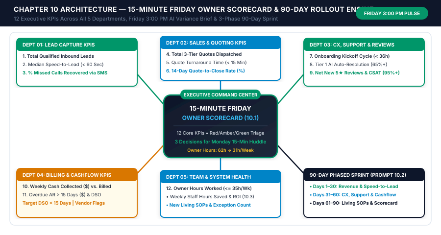
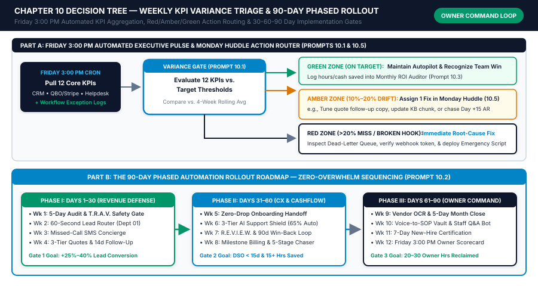

# Chapter 10: The 15-Minute Friday Owner Scorecard & 90-Day Automation Rollout Roadmap

## 1. Learning Objectives

By the conclusion of this final chapter, you will be able to unify all five departments of your business under a single weekly executive command rhythm and execute a disciplined 90-day phased rollout without overwhelming your team or breaking active operations:

1. **Architect the 15-Minute Friday Owner Scorecard:** Replace scattered, multi-tab dashboard logins with a single 5-department executive telemetry view tracking the **18 Vital Signs of Small Business Health** across Sales & Speed-to-Lead, Onboarding & Fulfillment, Support & Reputation, Finance & Cashflow, and Team & Automation Health.
2. **Deploy the Automated Friday 3:00 PM Executive Brief Pipeline:** Build a scheduled data-aggregation workflow that pulls live weekly metrics from your CRM, accounting ledger, review platform, and automation error logs every Friday at 3:00 PM—synthesizing week-over-week variances, pinpointing the **Top 3 Operational Bottlenecks**, and drafting your **Monday Morning 15-Minute All-Hands Priorities**.
3. **Execute the 90-Day Phased Automation Rollout Roadmap:** Sequence your implementation across three 30-day sprints (*Phase I Days 1–30: Revenue Defense & Speed-to-Lead; Phase II Days 31–60: Cashflow Velocity & Customer Experience; Phase III Days 61–90: Team Autonomy, Reputation & Executive Command*) with explicit **Sprint Exit Criteria** that forbid advancing to the next phase until the current phase runs at `< 2.0%` exception rate.
4. **Institute Monthly ROI Auditing & Quarterly Governance Reviews:** Measure hard dollar savings, labor hours reclaimed, and software stack ROI every 30 days while conducting a 45-minute quarterly audit of prompt drift, API key hygiene, and Amber/Red approval gate calibration.
5. **Transition from "Chief Everything Officer" to System Architect:** Reclaim 15 to 25+ hours of weekly founder bandwidth so you can step out of daily firefighting and manage your business by exception in 15 focused minutes every Friday afternoon.

---

## 2. The Real-World Friction Point

You now hold the complete blueprints, deterministic decision trees, and 50 tested AI workflow prompts required to automate every major friction point in a 1-to-25 person small business. Yet even with world-class blueprints in hand, small business owners face two final failure modes that determine whether they achieve lasting operational freedom or stall out after two weeks:

### Friction Point 1: "Flying Blind" Between Scattered Dashboards and Gut Feelings
Ask the average small business owner on Friday at 4:00 PM how their business performed that week. Almost universally, their answer is based on **emotional recency bias**:
- If they closed a big deal on Thursday afternoon, they feel great—even though `$42,000` in invoices quietly crossed 15 days past due, median lead response time slipped to 4 hours, and 6 onboarding clients are stuck waiting on intake forms.
- Conversely, if a single angry customer yelled on Tuesday, the owner feels like the business is falling apart—even though the team just delivered its highest-margin week of the quarter.
- **Why Dashboard Sprawl Fails:** To see the real numbers manually, an owner has to log into 7 different tabs: HubSpot/ServiceTitan for leads, PandaDoc for open quotes, Asana/ClickUp for fulfillment, HelpScout/Zendesk for support tickets, Google Business Profile for reviews, QuickBooks/Stripe for cash and AR aging, and Make/Zapier for automation logs. Because pulling those numbers manually takes 2.5 hours every Friday afternoon, the owner stops doing it after Week 2.

### Friction Point 2: The "Weekend Big-Bang Overwhelm" That Breaks Active Operations
When ambitious founders discover what modern no-code AI automation can do, their biggest enemy is impatience. They lock themselves in their office over a Saturday and Sunday and try to wire up **all 10 chapters simultaneously**:
- They launch an AI lead responder, a quote chaser, an onboarding bot, a support rag assistant, an invoice generator, and an SOP bot in the same 48-hour window.
- Come Monday morning at 9:00 AM, their staff has not been trained on the new Slack approval channels, three webhook filters have minor field-mapping bugs, and the owner is flooded with 40 unfamiliar notifications while trying to serve live customers. Overwhelmed, they turn the whole system off and conclude, *"Automation doesn't work for a business like mine."*

### Friction Point 3: Silent "Workflow & Prompt Drift" Over 6 to 12 Months
Businesses are living organisms: you add new service packages, adjust prices, hire new staff, change software vendors, and face seasonal demand shifts. An automation built in January that is never monitored for error rates, confidence score degradation, or orphaned SaaS subscriptions gradually drifts out of alignment by Q3.

| Executive Command Failure Mode | Typical Unstructured Owner Reality | Operational & Financial Consequence | Automated Executive OS Target State |
| :--- | :--- | :--- | :--- |
| **Weekly KPI Visibility** | Scattered across 6–9 software logins | Owner manages by gut feeling & firefighting | **1 Automated Friday 3:00 PM Scorecard** |
| **Time Spent Compiling Reports** | `2.0 to 3.5 hours/week` (or skipped entirely) | Bottlenecks go unnoticed for 30–60 days | **`0 minutes` compiling; `15 minutes` reviewing** |
| **Rollout Sequencing Strategy** | Ad-hoc "Big Bang" weekend tinkering | Staff confusion, webhook bugs, abandoned tools | **Phased 90-Day Sprint Roadmap (1 workflow/wk)** |
| **Automation Error Detection** | Discovered only when a customer complains | Missed leads or stalled invoices during API outages | **Real-time exception alerts + `< 2.0%` error ceiling** |
| **SaaS & AI Tool Stack Cost** | Bloated `$800–$2,400/mo` overlapping apps |Unused seats and redundant subscriptions | **Lean `$85–$250/mo` audited monthly for 10x+ ROI** |

---

## 3. Why Standard Approaches Fail

When small businesses try to implement executive reporting and automation roadmaps using enterprise BI tools or generic project plans, they fail for three reasons:

### Failure 1: Building Complex 40-Chart BI Dashboards (Looker, Tableau, PowerBI) That Nobody Checks
Enterprise consultants love building sprawling dashboards with 40 pie charts, cohort heatmaps, and multi-axis trend lines. Small business owners do not have time to interpret a cockpit built for a Fortune 500 CFO.
- **The Pull vs. Push Principle:** A dashboard you have to *remember to log into* ("Pull") dies within 30 days. An executive scorecard that **pushes** a clean, 1-page Red/Amber/Green digest directly to your Slack and inbox every Friday at 3:00 PM—with the exact 3 bottlenecks highlighted in plain English—gets read 52 weeks a year.

### Failure 2: Tracking "Vanity Metrics" Instead of Actionable Operational Levers
Tracking social media impressions, website bounce rates, or total cumulative emails sent tells you nothing about why cashflow tightened this week. Every metric on the **15-Minute Friday Owner Scorecard** must be tied directly to a specific chapter workflow and a deterministic **Green / Amber / Red Variance Threshold** so that when a metric turns Red, you know the exact knob to turn on Monday morning.

### Failure 3: Advancing to New Automations Before Stabilizing Previous Workflows
In software engineering, deploying new code on top of an unstable build compounds defects exponentially. In our **90-Day Phased Rollout Roadmap**, each 30-day sprint ends with a mandatory **Sprint Stabilization Gate**: you do not move from Phase I (Lead & Quote Automation) to Phase II (Onboarding, Support & Invoicing) until Phase I has run for 7 consecutive days with `< 2.0%` technical errors and `100%` staff adoption of the Amber approval channel.

---

## 4. Core Framework: The Weekly Executive Pulse & 90-Day Phased Automation Sprint

Our executive governance framework consists of three interlocking components: **The 15-Minute Friday Owner Scorecard**, **The Automated Friday 3:00 PM Brief Pipeline**, and **The 90-Day Phased Rollout Roadmap**.

### Component 1: The 15-Minute Friday Owner Scorecard (5 Departments, 18 Vital Signs)
Every Friday at 3:00 PM, your automation platform queries five departmental data sources and evaluates each metric against your **Green (Healthy)**, **Amber (Watch)**, and **Red (Action Required)** thresholds:

| Department & Chapter Link | Core Weekly KPIs Tracked | Green Target (Healthy) | Amber Threshold (Watch) | Red Trigger (Immediate Monday Fix) |
| :--- | :--- | :--- | :--- | :--- |
| **1. Sales & Speed-to-Lead** *(Chapters 3 & 4)* | • New Qualified Leads<br>• Median Speed-to-Lead (Seconds)<br>• Consults/Site Visits Booked<br>• 14-Day Quote-to-Close Rate % | • On/above weekly goal<br>• **`< 60 seconds`**<br>• `>= 45%` lead-to-book<br>• **`>= 38%` close rate** | • `-10% to -20%` vs 4-wk avg<br>• `60s to 180s`<br>• `30% to 44%`<br>• `28% to 37%` | • `> 20%` drop vs 4-wk avg<br>• **`> 180 seconds`** (Check webhook!)<br>• `< 30%` booking conversion<br>• **`< 28%`** (Audit Day-3/7 chasers) |
| **2. Onboarding & Fulfillment** *(Chapter 5)* | • New Paid Deals Onboarded<br>• Intake Completion < 48h %<br>• Avg Time-to-First-Value (Days)<br>• On-Time Deliverable/Job % | • `100%` zero-drop handoff<br>• **`>= 85%` in 48 hrs**<br>• Within SLA target<br>• **`>= 95%` on-time** | • `1` stalled handoff<br>• `70% to 84%`<br>• `+1 to +2 days` over SLA<br>• `88% to 94%` | • `>= 2` handoffs stuck `> 24h`<br>• **`< 70%`** (Check Stage 3 nudges)<br>• `> 2 days` over SLA<br>• **`< 88%`** capacity bottleneck |
| **3. Support, Reviews & Retention** *(Chapters 6 & 7)* | • Tier-1 AI Deflection Rate %<br>• First-Response SLA Compliance<br>• New 5-Star Google Reviews<br>• Win-Back / Recall Bookings | • **`60% to 78%`** deflected<br>• `>= 98%` within 5 mins<br>• **`>= 3 to 5` new 5★/wk**<br>• `>= 8%` campaign conversion | • `45% to 59%`<br>• `90% to 97%`<br>• `1 to 2` new 5★/wk<br>• `4% to 7.9%` | • **`< 45%`** (Update RAG KB gaps)<br>• `< 90%` SLA compliance<br>• **`0` new reviews** or `1★` alert<br>• `< 4%` reactivation rate |
| **4. Finance & Cashflow Velocity** *(Chapter 8)* | • Weekly Cash Collected ($)<br>• Job-to-Invoice Lag (Hours)<br>• Overdue A/R `> 15 Days` ($)<br>• Days Sales Outstanding (DSO) | • `>= 95%` of weekly billings<br>• **`< 2.0 hours`**<br>• **`< 5%` of total A/R**<br>• **`<= 16 days` DSO** | • `80% to 94%` of billings<br>• `2.0 to 12.0 hours`<br>• `5% to 12%` of total A/R<br>• `17 to 28 days` DSO | • `< 80%` collection ratio<br>• **`> 12 hours`** unbilled WIP lag<br>• **`> 12%`** (Fire Stage 4 chasers)<br>• **`> 28 days` DSO** |
| **5. Team & Automation Health** *(Chapters 1, 2 & 9)* | • Workflow Error/Exception %<br>• Staff Hours Saved This Week<br>• `@SOP-Bot` Deflection Rate %<br>• Verified SOP Vault Coverage % | • **`< 1.5%` error rate**<br>• `>= 25 hrs/wk` saved<br>• **`>= 75%` bot-answered**<br>• `>= 85%` of Top 25 SOPs | • `1.5% to 3.5%` errors<br>• `15 to 24 hrs/wk` saved<br>• `60% to 74%` bot-answered<br>• `60% to 84%` coverage | • **`> 3.5%` errors** (Fix API/Schema)<br>• `< 15 hrs/wk` saved<br>• **`< 60%`** (Clear SOP Gap queue)<br>• `< 60%` SOP coverage |

### Component 2: The Automated Friday 3:00 PM Executive Brief Pipeline
Here is how your Friday afternoon transforms once this pipeline is active:
1. **2:55 PM Friday — Scheduled Data Aggregation:** Make.com or n8n runs a scheduled scenario that queries your 5 departmental tables (or reads your central `Weekly_KPI_Snapshot` Airtable/Notion database populated continuously throughout the week by webhook counters).
2. **2:58 PM Friday — Deterministic Variance Calculation:** A code/math step computes Week-over-Week (`WoW %`) and 4-Week Rolling Average (`4Wk_Avg %`) deltas for all 18 metrics and tags each metric `GREEN`, `AMBER`, or `RED`.
3. **3:00 PM Friday — AI Executive Synthesis (Prompt 10.1):** The LLM analyzes the structured KPI table alongside the week's logged exceptions (`SOP_Gap_Tickets`, `Lost_Quote_Objections`, `Stage_4_Overdue_Accounts`, `Failed_Webhooks`) and posts the **1-Page Friday Owner Brief** in `#executive-command` on Slack and via email.
4. **3:00 PM to 3:15 PM Friday — The 15-Minute Owner Review:**
   - *Minutes 1–5:* Scan the Red/Amber flags and read the AI's **Top 3 Root-Cause Bottlenecks**.
   - *Minutes 6–10:* Click 1-click approval buttons on any staged actions (e.g., `[Approve 3 Stage-4 Overdue Notices]`, `[Assign 2 SOP Gap Looms]`).
   - *Minutes 11–15:* Approve the auto-generated **Monday 9:00 AM Team Huddle Brief (Prompt 10.5)** and close your laptop for the weekend knowing 100% of your business's vital signs are under control.

### Component 3: The 90-Day Phased Automation Rollout Roadmap
Instead of attempting a chaotic weekend overhaul, deploy your Operating System across **12 weekly milestones grouped into three 30-day phases**. Each week requires only **2.5 to 4.0 hours** of setup time:

```
====================================================================================================
PHASE I: DAYS 1–30 — REVENUE DEFENSE, SAFETY GATES & SPEED-TO-LEAD (CHAPTERS 1, 2, 3, 4)
Goal: Stop bleeding inbound leads & open quotes; establish T.R.A.V. safety gates.
----------------------------------------------------------------------------------------------------
• Week 1 (Ch 1): Conduct 5-Department Bottleneck Audit; eliminate lowest-ROI tasks via P.A.C.E. Grid.
• Week 2 (Ch 2): Set up Make/n8n workspace, Slack `#approvals` channels, and T.R.A.V. Error Handler.
• Week 3 (Ch 3): Launch 60-Second Multi-Channel Lead Capture, Missed-Call Text-Back & B.A.N.T.-Lite.
• Week 4 (Ch 4): Launch Voice-to-Quote Generator & 14-Day Polite-Persistence Proposal Follow-Up.
  [GATE 1 EXIT CRITERIA]: Speed-to-lead < 60s; 0 unapproved high-ticket quotes sent; Error rate < 2%.
====================================================================================================
PHASE II: DAYS 31–60 — CASHFLOW VELOCITY & CUSTOMER EXPERIENCE (CHAPTERS 5, 6, 8)
Goal: Accelerate invoice collections, automate onboarding handoffs, and deflect 65%+ support tickets.
----------------------------------------------------------------------------------------------------
• Week 5 (Ch 8 Pt A): Deploy Milestone-Triggered Instant Invoicing & 5-Stage Payment Chaser Ladder.
• Week 6 (Ch 8 Pt B): Launch OCR Receipt/Vendor Bill Triage (`bills@`), 5% Price-Creep & Pre-Close.
• Week 7 (Ch 5): Wire Zero-Drop Payment-to-Onboarding Handoff & Stage 3 Intake Chaser Cadence.
• Week 8 (Ch 6): Build Grounded 30-Doc Support RAG Knowledge Base & Sentiment Escalation Router.
  [GATE 2 EXIT CRITERIA]: DSO reduced >= 25%; Support deflection >= 55%; Zero missed onboarding handoffs.
====================================================================================================
PHASE III: DAYS 61–90 — GROWTH LOOPS, LIVING SOPs & EXECUTIVE COMMAND (CHAPTERS 7, 9, 10)
Goal: Automate 5-star reviews/win-backs, extract owner tribal knowledge, and lock in the Friday Pulse.
----------------------------------------------------------------------------------------------------
• Week 9 (Ch 7): Launch Sentiment-Gated 5-Star Review Engine & 60/90/180-Day Dormant Win-Backs.
• Week 10 (Ch 9 Pt A): Record Top 25 3-Min Looms -> Compile 7-Block Living SOP Vault in Notion.
• Week 11 (Ch 9 Pt B): Launch `@SOP-Bot` in `#ask-the-sop`, Voice Delegation & Huddle Synthesis.
• Week 12 (Ch 10): Activate 15-Minute Friday Owner Scorecard, Monday Team Brief & Quarterly Audit.
  [GATE 3 EXIT CRITERIA]: 15+ founder hours/wk reclaimed; 85%+ SOP coverage; Friday Brief live at 3 PM.
====================================================================================================
```

### Executive ROI & Enterprise Valuation Formulas

To quantify both the immediate cashflow return and the long-term enterprise equity value created by your 90-Day Rollout, apply these three executive equations:

$$\text{Total Net Annual Automation Impact (\$)} = \text{Recovered Lead/Quote Revenue} + \text{Win-Back Revenue} + \text{Working Capital Interest Saved} + \text{Prevented Vendor/Material Leakage} + \left( \text{Total Team Hours Saved/Yr} \times \text{Blended Hourly Cost} \right) - \text{Annual Automation Stack Cost}$$

$$\text{Automation Stack ROI Multiple} = \frac{\text{Total Net Annual Automation Impact (\$)}}{\text{Annual Automation Software & API Spend (\$)}}$$

$$\text{Enterprise Valuation Expansion (\$)} = \text{Annual EBITDA Increase from Automation (\$)} \times \text{Industry Valuation Multiple (typically } 3.5\times \text{ to } 6.0\times \text{ for systemized SMBs)}$$

> **The Valuation Multiplier Effect:** A small business that depends on the founder working 60 hours a week to manually route leads, write quotes, chase invoices, and answer staff questions is nearly impossible to sell—and trades at a steep discount (`2.0x to 2.5x` Seller's Discretionary Earnings). A business with a verified **Living SOP Vault**, automated **Speed-to-Lead**, **14-Day DSO**, and a **15-Minute Friday Owner Scorecard** commands a premium **4.0x to 6.0x+ EBITDA multiple** because an acquirer or General Manager can run the machine from Day 1.

---

## 5. Visual Architecture: System Mindmap



*Figure 10.1: Complete architecture of the 15-Minute Friday Owner Scorecard across all 5 Departments, the Automated Friday 3:00 PM Brief Pipeline, and the 90-Day Phased Rollout Roadmap.*

---

## 6. Step-by-Step Implementation Protocol

Follow this 5-step engineering sequence to wire your Friday Executive Scorecard and govern your 90-day transformation.

### Step 1: Create the Central `Weekly_KPI_Snapshot` Ledger Table (45 Minutes)
Rather than making complex multi-pagination API calls every Friday afternoon, create a lightweight `Weekly_KPI_Snapshot` table in Airtable, Notion, or Google Sheets with one row per ISO week (`2026-W43`, `2026-W44`, etc.):
- Configure each departmental workflow from Chapters 3 through 9 to increment its respective counter in real time as events occur (`leads_captured_count + 1`, `invoices_collected_usd + amount`, `support_tickets_deflected + 1`, `sop_bot_resolved + 1`, `workflow_exceptions + 1`).
- Every Friday at 2:50 PM, a single scheduled Make.com / n8n collector module appends point-in-time balance snapshots from QuickBooks/Xero (`total_ar_balance`, `overdue_ar_gt_15d`, `operating_cash_balance`) to complete the 18-metric row.

### Step 2: Wire the Friday 3:00 PM Executive Synthesizer Pipeline (60 Minutes)
Connect your `Weekly_KPI_Snapshot` table to **Prompt 10.1** every Friday at 3:00 PM local time:

```json
{
  "report_week_iso": "2026-W43 (Oct 19 – Oct 23, 2026)",
  "company_name": "Summit Peak Physical Therapy & Sports Rehab",
  "departments_kpi_snapshot": {
    "sales_and_leads": {
      "new_leads": {"current": 64, "four_wk_avg": 58, "status": "GREEN"},
      "median_speed_to_lead_sec": {"current": 28, "target_max": 60, "status": "GREEN"},
      "evals_booked": {"current": 41, "booking_rate_pct": 64.1, "status": "GREEN"},
      "plan_of_care_acceptance_pct": {"current": 78.5, "target_min": 80.0, "status": "AMBER"}
    },
    "onboarding_and_fulfillment": {
      "new_patients_onboarded": {"current": 39, "stalled_handoffs": 0, "status": "GREEN"},
      "digital_intake_completed_pre_visit_pct": {"current": 92.3, "target_min": 85.0, "status": "GREEN"},
      "appointment_utilization_pct": {"current": 91.4, "target_min": 88.0, "status": "GREEN"}
    },
    "support_and_reputation": {
      "ai_faq_deflection_pct": {"current": 71.2, "target_min": 60.0, "status": "GREEN"},
      "new_5star_google_reviews": {"current": 6, "target_min": 4, "status": "GREEN"},
      "private_detractor_intercepts": {"current": 1, "resolved_within_24h": 1, "status": "GREEN"},
      "reactivated_past_patients_booked": {"current": 9, "rev_generated_usd": 11250.00, "status": "GREEN"}
    },
    "finance_and_cashflow": {
      "weekly_cash_collected_usd": {"current": 46800.00, "four_wk_avg": 43200.00, "status": "GREEN"},
      "overdue_ar_gt_15_days_usd": {"current": 6420.00, "pct_of_total_ar": 13.8, "status": "RED"},
      "dso_days": {"current": 15.2, "target_max": 16.0, "status": "GREEN"},
      "operating_cash_balance_usd": {"current": 184500.00, "status": "GREEN"}
    },
    "team_and_automation_health": {
      "workflow_exception_rate_pct": {"current": 0.8, "target_max": 1.5, "status": "GREEN"},
      "sop_bot_deflection_pct": {"current": 82.4, "sop_gaps_logged": 2, "status": "GREEN"},
      "estimated_team_hours_saved_wk": {"current": 34.5, "status": "GREEN"}
    }
  },
  "exception_logs_summary": [
    "RED FLAG (Finance): Overdue A/R > 15 days rose to $6,420.00 (13.8% of total A/R) due to 14 BlueCross ERA patient co-insurance balances from Oct 5–8 where Card-on-File expired.",
    "AMBER FLAG (Sales): Plan-of-Care acceptance dipped slightly to 78.5% (target 80%) at Clinic #2 (Westside) on Wednesday/Thursday.",
    "SOP GAPS (Team): 2 new questions in #ask-the-sop regarding Workers' Comp adjuster billing authorization codes."
  ]
}
```

- **Execution Flow:**
  1. **Prompt 10.1** digests the payload, highlights all `GREEN` wins, isolates the `RED` (`Overdue A/R > 15 days`) and `AMBER` (`Plan-of-Care acceptance at Clinic #2`) flags, and prescribes 3 concrete, 15-minute corrective actions.
  2. **Prompt 10.5** converts those 3 corrective actions plus departmental wins into a ready-to-read **Monday 9:00 AM 15-Minute All-Hands Team Agenda**.

### Step 3: Customize Your 90-Day Phased Rollout Schedule (Prompt 10.2)
Pass your Chapter 1 Bottleneck Audit scores, team size, and current software stack into **Prompt 10.2** to generate a customized 12-week rollout calendar that sequences your highest-ROI department first while respecting a hard cap of `<= 3.5 hours/week` of implementation effort.

### Step 4: Automate the 1st-of-the-Month Automation ROI & Tool-Stack Audit (Prompt 10.3)
On the 1st business day of every month, run **Prompt 10.3** against your monthly execution counters and software subscription expenses (`GL-6110`). This audit calculates your exact **Net Dollars Generated & Saved vs. Software Spend**, flags any zombie SaaS tool with zero usage, and verifies that your automation stack maintains at least a **`10x` to `25x+` return on investment**.

### Step 5: Execute the 45-Minute Quarterly Governance & Drift Review (Prompt 10.4)
Once every 90 days (on the last Friday of Q1, Q2, Q3, and Q4), run **Prompt 10.4** to audit:
1. **Amber/Red Gate Threshold Calibration:** If a workflow has run 200 times in Amber mode with `99.5%` human approval without edits, promote standard tiers to Green Auto-Send. Conversely, if an auto-send workflow triggered any customer friction, tighten its Amber gate threshold.
2. **Prompt & Pricebook Freshness:** Verify that any new products, updated pricing tiers, or seasonal policies added during the quarter are synced across your Chapter 3, 4, 6, 8, and 9 lookup tables.
3. **Security & API Key Hygiene:** Revoke access for any departed staff or contractors, verify webhook HMAC signatures, and confirm zero PII/PHI exposure in external logs.

### Step 6: Customize Your Friday Scorecard KPIs by Industry Vertical
While 14 of the 18 Friday Scorecard metrics are universal across every small business, customize the 4 industry-specific operational health indicators to match your vertical:

#### 1. Home Services & Commercial Trade Contractors (HVAC, Plumbing, Electrical, Roofing)
- **Custom Scorecard Metrics:**
  - *Average Revenue Per Dispatched Truck (`Target >= $1,850/day`):* Measures whether your Chapter 3 B.A.N.T.-Lite router is prioritizing high-ticket replacement and commercial retrofit calls over low-margin diagnostic trips.
  - *Same-Day Estimate Presentation Rate (`Target >= 92%`):* Tracks the percentage of field visits where the technician or estimator triggered **Prompt 4.1** within 2 hours of leaving the property.
  - *Callback / Rework Warranty Rate (`Target < 2.0%` of completed jobs):* Alerts you if rapid field growth is compromising installation quality or requiring a new Chapter 9 Living SOP.
  - *Unbilled Field Material Receipt Lag (`Target < $150/week` unmatched):* Tracks compliance with the Chapter 8 SMS receipt capture bot.

#### 2. Healthcare, Dental, Veterinary & MedSpa Clinics
- **Custom Scorecard Metrics:**
  - *Provider Chair / Room Utilization % (`Target >= 88%`):* Measures how effectively Chapter 3 Missed-Call Text-Back and Chapter 5 48-Hour Confirmations keep provider schedules full.
  - *No-Show & Late-Cancellation Rate (`Target < 3.5%`):* Monitors the impact of digital intake deposits and automated SMS waitlist backfilling.
  - *Plan-of-Care / Treatment Plan Acceptance % (`Target >= 80%`):* Tracks patient conversion from initial evaluation to completed multi-visit treatment package (Chapter 4).
  - *Post-ERA Patient Balance DSO (`Target <= 15 days`):* Measures how quickly co-pays and high-deductible balances clear via Card-on-File and Stage 1–3 HIPAA-safe SMS links (Chapter 8).

#### 3. B2B Marketing, Creative, IT/MSP & Professional Consultancies
- **Custom Scorecard Metrics:**
  - *Effective Billable Utilization % (`Target 72%–80%` across delivery staff):* Tracks how much staff time goes to billable client work vs. internal meetings and administrative chasing.
  - *Time-to-First-Value (TTFV) Onboarding Days (`Target <= 5 business days`):* Measures elapsed time between Stripe/Ignition contract signature and first live client deliverable/kickoff (Chapter 5).
  - *Unbilled Scope-Creep Capture Rate (`Target >= 95%`):* Tracks out-of-scope client requests converted into approved paid change orders or itemized invoice lines (Chapter 8).
  - *Net Monthly Recurring Revenue (MRR) Retention (`Target >= 97%/month`):* Monitors churn risk and proactive 90-day account check-ins (Chapter 7).

#### 4. Retail, Wholesale & E-Commerce Brands
- **Custom Scorecard Metrics:**
  - *WISMO ("Where Is My Order?") Autonomous Deflection % (`Target >= 78%`):* Tracks order-status and return/exchange tickets solved automatically without human support touch (Chapter 6).
  - *3-Way AP Bill Match Exception Rate (`Target < 4%` uncollected supplier credits):* Tracks vendor short-shipments and `> 5%` unit price hikes caught by **Prompt 8.4**.
  - *60/90-Day Repeat Purchase Win-Back Rate (`Target >= 11%` cohort conversion):* Measures automated replenishment and VIP reactivation revenue (Chapter 7).

| Industry Vertical | North-Star Efficiency KPI | Red Flag Threshold | Automated Chapter Lever to Pull on Monday |
| :--- | :--- | :--- | :--- |
| **Field Trades & Contractors** | Revenue Per Truck / Day | `< $1,400 / truck / day` | Tighten Ch 3 urgency/tier routing + fire Ch 7 seasonal tune-up win-back |
| **Healthcare & MedSpa Clinics** | Provider Schedule Utilization % | `< 82%` (`>5%` no-shows) | Activate Ch 5 72h/24h SMS waitlist backfill + Ch 4 HSA care-plan follow-up |
| **B2B Agencies & Consultancies** | Client Onboarding TTFV | `> 7 business days` | Enforce Ch 5 Stage 3 intake chaser + Ch 9 Voice-to-Checklist delegation |
| **E-Commerce & Wholesale** | Tier-1 Support Deflection % | `< 60%` deflected | Sync missing SKU/shipping policy docs into Ch 6 RAG KB via Prompt 6.5 |

---

## 7. Operational Decision Tree



*Figure 10.2: Deterministic decision logic governing the Friday 3:00 PM Scorecard Variance Triage, Monday Priority Generation, and 90-Day Sprint Gate Progression.*


---

## 8. Tested AI Workflow Prompts

Each prompt below follows our **7-Part Prompt Engineering Contract** and is designed for `temperature: 0.0–0.1` execution inside Make.com, n8n, Zapier, or custom executive reporting pipelines.

---

### Prompt 10.1: Friday 3:00 PM Executive KPI Synthesizer & Variance Bottleneck Detective

1. **Operational Objective:** Analyze the weekly 5-department KPI snapshot (`Weekly_KPI_Snapshot`) and exception logs every Friday at 3:00 PM to generate a 1-page Executive Owner Brief that celebrates verified Green wins, diagnoses the root cause of up to 3 Amber/Red variances, and prescribes exact 15-minute corrective actions mapped to specific chapter workflows.
2. **System Role & Constraints:** You are a Fractional COO and Financial Operations Analyst. Never alter or round input KPI numbers. Prioritize variances strictly by cashflow and customer-retention severity (`RED` flags first, then `AMBER` flags). Map every corrective recommendation to the exact chapter workflow and owner role responsible so the founder can approve fixes in under 15 minutes.
3. **Input Variable Schema:**
   - `{{report_week_iso}}`: ISO week string (e.g., `"2026-W43"`)
   - `{{company_name}}`: Business name
   - `{{departments_kpi_snapshot_json}}`: Structured JSON of all 5 departments with current values, 4-week averages, targets, and `GREEN`/`AMBER`/`RED` flags
   - `{{exception_logs_summary_json}}`: Specific logged anomalies from the week
4. **Complete Copy-Paste Prompt Block:**

```markdown
### SYSTEM PROMPT — FRIDAY 3:00 PM EXECUTIVE KPI SYNTHESIZER (PROMPT 10.1)
You are the Fractional Chief Operating Officer (COO) for `{{company_name}}`.
Synthesize the provided 5-department `departments_kpi_snapshot_json` and `exception_logs_summary_json` into the official **15-Minute Friday Owner Scorecard Brief**.

STRICT EXECUTIVE ANALYSIS RULES:
1. NEVER invent, alter, or omit numeric KPIs from `departments_kpi_snapshot_json`.
2. Compute an `overall_operating_health_score` (0–100) weighted across the 5 departments (20 pts each).
3. Identify the Top 3 Departmental Wins (`GREEN` metrics outperforming the 4-week average) to reinforce positive team momentum.
4. Isolate all `RED` and `AMBER` metrics into `prioritized_bottlenecks[]`, ordered from highest immediate cash/revenue impact to lowest. For each bottleneck, diagnose the exact operational root cause from `exception_logs_summary_json` and prescribe a concrete 15-minute fix referencing the specific OS workflow.
5. Output valid JSON only, including a clean Slack/Email formatted digest in `slack_executive_brief_markdown`.

### INPUT PAYLOAD
- Report Week: {{report_week_iso}}
- Company Name: {{company_name}}
- 5-Department KPI Snapshot: {{departments_kpi_snapshot_json}}
- Weekly Exception Logs: {{exception_logs_summary_json}}

### REQUIRED JSON OUTPUT SCHEMA
{
  "report_week_iso": "string",
  "overall_operating_health_score": 0,
  "executive_status_headline": "string",
  "top_departmental_wins": ["string"],
  "prioritized_bottlenecks": [
    {
      "rank": 1,
      "severity": "RED | AMBER",
      "department": "string",
      "metric_name_and_value": "string",
      "diagnosed_root_cause": "string",
      "prescribed_15min_fix": "string",
      "assigned_owner_role": "string"
    }
  ],
  "one_click_owner_approvals_staged": ["string"],
  "slack_executive_brief_markdown": "string"
}
```

5. **Sample Realistic Input Payload:**

```json
{
  "report_week_iso": "2026-W43 (Oct 19 – Oct 23, 2026)",
  "company_name": "Summit Peak Physical Therapy & Sports Rehab",
  "departments_kpi_snapshot_json": {
    "sales_and_leads": {
      "new_leads": {"current": 64, "four_wk_avg": 58, "status": "GREEN"},
      "median_speed_to_lead_sec": {"current": 28, "target_max": 60, "status": "GREEN"},
      "evals_booked": {"current": 41, "booking_rate_pct": 64.1, "status": "GREEN"},
      "plan_of_care_acceptance_pct": {"current": 78.5, "target_min": 80.0, "status": "AMBER"}
    },
    "onboarding_and_fulfillment": {
      "new_patients_onboarded": {"current": 39, "stalled_handoffs": 0, "status": "GREEN"},
      "digital_intake_completed_pre_visit_pct": {"current": 92.3, "target_min": 85.0, "status": "GREEN"},
      "appointment_utilization_pct": {"current": 91.4, "target_min": 88.0, "status": "GREEN"}
    },
    "support_and_reputation": {
      "ai_faq_deflection_pct": {"current": 71.2, "target_min": 60.0, "status": "GREEN"},
      "new_5star_google_reviews": {"current": 6, "target_min": 4, "status": "GREEN"},
      "reactivated_past_patients_booked": {"current": 9, "rev_generated_usd": 11250.00, "status": "GREEN"}
    },
    "finance_and_cashflow": {
      "weekly_cash_collected_usd": {"current": 46800.00, "four_wk_avg": 43200.00, "status": "GREEN"},
      "overdue_ar_gt_15_days_usd": {"current": 6420.00, "pct_of_total_ar": 13.8, "status": "RED"},
      "dso_days": {"current": 15.2, "target_max": 16.0, "status": "GREEN"}
    },
    "team_and_automation_health": {
      "workflow_exception_rate_pct": {"current": 0.8, "target_max": 1.5, "status": "GREEN"},
      "sop_bot_deflection_pct": {"current": 82.4, "sop_gaps_logged": 2, "status": "GREEN"},
      "estimated_team_hours_saved_wk": {"current": 34.5, "status": "GREEN"}
    }
  },
  "exception_logs_summary_json": [
    "RED FLAG (Finance): Overdue A/R > 15 days rose to $6,420.00 (13.8% of total A/R vs <5% target) due to 14 BlueCross ERA patient co-insurance balances where Card-on-File expired or declined.",
    "AMBER FLAG (Sales): Plan-of-Care acceptance dipped to 78.5% (target 80%) at Clinic #2 (Westside); 4 patients cited uncertainty over out-of-pocket HSA coverage before accepting 12-visit packages.",
    "SOP GAPS (Team): 2 new questions in #ask-the-sop regarding Workers' Comp adjuster billing authorization codes."
  ]
}
```

6. **Expected Structured Output:**

```json
{
  "report_week_iso": "2026-W43 (Oct 19 – Oct 23, 2026)",
  "overall_operating_health_score": 92,
  "executive_status_headline": "Strong revenue and utilization week ($46,800 collected, +8.3% vs 4-wk avg; 91.4% clinic utilization); 1 Red Flag in Overdue Patient A/R ($6,420 from declined Cards-on-File) and 1 minor Amber dip in Westside Plan-of-Care acceptance (78.5%).",
  "top_departmental_wins": [
    "Sales & Speed-to-Lead: 64 new patient leads answered in a median 28 seconds, converting 41 into booked initial evaluations (64.1% booking rate).",
    "Reputation & Win-Backs: 6 new 5-star Google reviews posted and 9 dormant past patients reactivated ($11,250.00 in new plan-of-care value).",
    "Team Efficiency: 34.5 staff hours saved this week with a 0.8% workflow exception rate and 82.4% @SOP-Bot question deflection."
  ],
  "prioritized_bottlenecks": [
    {
      "rank": 1,
      "severity": "RED",
      "department": "Finance & Cashflow (Chapter 8)",
      "metric_name_and_value": "Overdue A/R > 15 Days: $6,420.00 (13.8% of Total A/R vs <5.0% target)",
      "diagnosed_root_cause": "14 BlueCross ERA post-insurance patient co-insurance balances had expired or declined Cards-on-File and did not automatically trigger Stage 3 SMS card-update links.",
      "prescribed_15min_fix": "Approve the staged batch of 14 Stage-3 Friendly SMS/Email HSA & Card-Update links (Prompt 8.2) with the 50/50 split-payment option enabled.",
      "assigned_owner_role": "Billing Coordinator (Hannah)"
    },
    {
      "rank": 2,
      "severity": "AMBER",
      "department": "Sales & Proposals (Chapter 4)",
      "metric_name_and_value": "Plan-of-Care Acceptance Rate: 78.5% (Target >= 80.0%)",
      "diagnosed_root_cause": "4 evaluation patients at Westside Clinic hesitated on 12-visit care plans due to unclear HSA/FSA eligibility and out-of-pocket breakdown.",
      "prescribed_15min_fix": "Trigger the Day-3 Educational & HSA Eligibility Follow-Up (Prompt 4.3) for those 4 open care plans and attach the 1-page HSA Benefit Breakdown sheet during initial evaluations.",
      "assigned_owner_role": "Westside Clinic Director (Dr. Miller)"
    },
    {
      "rank": 3,
      "severity": "AMBER",
      "department": "Internal SOPs (Chapter 9)",
      "metric_name_and_value": "2 Undocumented SOP Gap Tickets Logged in #ask-the-sop",
      "diagnosed_root_cause": "Front-desk staff asked how to verify Workers' Comp adjuster billing authorization codes—currently undocumented in the SOP Vault.",
      "prescribed_15min_fix": "Assign Billing Coordinator to record a 3-minute Loom walking through Workers' Comp authorization verification (`SOP-CLN-009`) via Prompt 9.1.",
      "assigned_owner_role": "Billing Coordinator (Hannah)"
    }
  ],
  "one_click_owner_approvals_staged": [
    "[Approve & Send 14 Declined-Card Stage-3 SMS Links ($6,420.00 A/R)]",
    "[Approve 4 Westside HSA Plan-of-Care Follow-Ups]",
    "[Assign 3-Min Loom for SOP-CLN-009 (Workers' Comp Auth)]"
  ],
  "slack_executive_brief_markdown": "*📊 FRIDAY 3:00 PM OWNER SCORECARD — 2026-W43 (Health Score: 92/100)*\n*Wins:* $46,800 cash collected (+8.3% vs avg) | 28s speed-to-lead | 91.4% clinic utilization | 6 new 5★ reviews | $11,250 win-backs.\n*🔴 RED ACTION:* Overdue A/R >15d at $6,420 (13.8%) from 14 declined ERA cards -> Click `[Approve Stage-3 Card Update SMS Batch]`.\n*🟡 AMBER WATCH:* Westside Plan-of-Care acceptance at 78.5% (4 patients undecided on HSA coverage) -> Trigger Prompt 4.3 HSA follow-up."
}
```

7. **Human-in-the-Loop Verification Rule:** The owner reviews the brief at 3:00 PM Friday and clicks the staged approval buttons in `#executive-command` before approving Monday's all-hands priorities.

---

### Prompt 10.2: 90-Day Phased Automation Rollout Master Schedule & Milestone Customizer

1. **Operational Objective:** Generate a tailored, week-by-week **90-Day Phased Rollout Master Schedule** (Weeks 1 through 12) calibrated to the business's specific industry, team size, current tech stack, Chapter 1 bottleneck scores, and weekly implementation time budget (`2 to 5 hours/week`).
2. **System Role & Constraints:** You are a Principal Automation Solutions Architect. Never schedule more than **one major workflow deployment per week** (`<= weekly_hours_budget`). Enforce strict **Phase Exit Gates** at Day 30, Day 60, and Day 90 so the team never advances to a new phase while an earlier workflow has an error rate `> 2.0%`.
3. **Input Variable Schema:**
   - `{{business_name_and_industry}}`: Business name and vertical
   - `{{team_size_and_roles}}`: Headcount and key roles
   - `{{current_software_stack}}`: CRM, ERP, scheduling, and messaging tools in use
   - `{{top_3_bottlenecks_from_ch1}}`: Highest-friction areas identified in Worksheet 1
   - `{{weekly_hours_budget}}`: Max hours per week available for setup (e.g., `3.5 hours`)
4. **Complete Copy-Paste Prompt Block:**

```markdown
### SYSTEM PROMPT — 90-DAY PHASED ROLLOUT ROADMAP CUSTOMIZER (PROMPT 10.2)
You are a Principal Small Business Automation Architect.
Generate a customized 12-week (90-Day) Phased Implementation Schedule tailored to the business profile and bottlenecks provided.

ARCHITECTURAL SEQUENCING RULES:
1. Respect `weekly_hours_budget` strictly: never assign more setup work in a single week than the owner/champion can complete inside their hourly budget.
2. Prioritize the business's #1 financial bleed from `top_3_bottlenecks_from_ch1` inside Phase I (Days 1–30) so the rollout becomes cashflow self-funding within the first 21 days.
3. For each of the 12 weeks, specify: `week_number`, `chapter_and_prompt_deployed`, `concrete_deliverable`, `assigned_champion_role`, `estimated_setup_hours`, and `weekly_verification_test`.
4. Define binary `sprint_exit_gate_criteria` at Week 4 (Day 30), Week 8 (Day 60), and Week 12 (Day 90).
5. Output valid JSON only.

### INPUT PAYLOAD
- Business & Industry: {{business_name_and_industry}}
- Team Size & Roles: {{team_size_and_roles}}
- Current Software Stack: {{current_software_stack}}
- Top 3 Chapter 1 Bottlenecks: {{top_3_bottlenecks_from_ch1}}
- Weekly Setup Time Budget: {{weekly_hours_budget}}

### REQUIRED JSON OUTPUT SCHEMA
{
  "business_name": "string",
  "weekly_hours_budget": 0.0,
  "estimated_day_30_cashflow_unlock_usd": 0.00,
  "phases": [
    {
      "phase_name": "Phase I: Days 1–30 (Weeks 1–4)",
      "phase_objective": "string",
      "weekly_milestones": [
        {
          "week": 1,
          "chapter_reference": "string",
          "prompts_deployed": ["string"],
          "concrete_deliverable": "string",
          "assigned_champion": "string",
          "setup_hours": 0.0,
          "verification_test": "string"
        }
      ],
      "sprint_exit_gate_criteria": ["string"]
    }
  ]
}
```

5. **Sample Realistic Input Payload:**

```json
{
  "business_name_and_industry": "Summit Peak Physical Therapy & Sports Rehab (2 Outpatient PT Clinics)",
  "team_size_and_roles": "17 Staff (1 Founder/DPT, 2 Clinic Directors, 9 Physical Therapists, 3 Front-Desk Coordinators, 1 Billing Specialist, 1 Marketing/Ops Coordinator)",
  "current_software_stack": "Jane App (EHR/Scheduling), QuickBooks Online, Stripe, Google Workspace, Slack, Twilio, Make.com",
  "top_3_bottlenecks_from_ch1": "1) 4.2-hour delay answering web/missed-call patient inquiries (losing ~$9,500/mo in evaluations); 2) Front desk spending 18 hrs/wk chasing incomplete digital intake & insurance forms; 3) 34-day patient co-insurance A/R cycle.",
  "weekly_hours_budget": 3.5
}
```

6. **Expected Structured Output:**

```json
{
  "business_name": "Summit Peak Physical Therapy & Sports Rehab",
  "weekly_hours_budget": 3.5,
  "estimated_day_30_cashflow_unlock_usd": 11400.00,
  "phases": [
    {
      "phase_name": "Phase I: Days 1–30 (Weeks 1–4) — Patient Lead Defense & Safety Architecture",
      "phase_objective": "Eliminate the 4.2-hour inquiry lag, capture 100% of missed calls in under 60 seconds, and automate Plan-of-Care follow-ups.",
      "weekly_milestones": [
        {
          "week": 1,
          "chapter_reference": "Chapters 1 & 2",
          "prompts_deployed": ["Prompt 1.1", "Prompt 2.1", "Prompt 2.2"],
          "concrete_deliverable": "Complete 5-Department Audit; configure Make.com workspace, HIPAA-safe Slack `#clinic-approvals` channel, and T.R.A.V. Error Handler.",
          "assigned_champion": "Marketing/Ops Coordinator + Founder",
          "setup_hours": 3.0,
          "verification_test": "Send 3 malformed test webhooks and confirm 100% are caught by the T.R.A.V. schema validator."
        },
        {
          "week": 2,
          "chapter_reference": "Chapter 3 (Part A)",
          "prompts_deployed": ["Prompt 3.1", "Prompt 3.3"],
          "concrete_deliverable": "Deploy 60-Second Web Inquiry & Twilio Missed-Call Text-Back Pipeline for both clinic locations.",
          "assigned_champion": "Marketing/Ops Coordinator",
          "setup_hours": 3.5,
          "verification_test": "Submit test web lead and missed call at 7:30 PM; verify SMS + Jane App booking link arrives in < 45 seconds."
        },
        {
          "week": 3,
          "chapter_reference": "Chapter 3 (Part B)",
          "prompts_deployed": ["Prompt 3.2", "Prompt 3.4", "Prompt 3.5"],
          "concrete_deliverable": "Activate Insurance/Condition Triage Router and 60-Second Pre-Evaluation Briefing Card for PTs.",
          "assigned_champion": "Front-Desk Lead",
          "setup_hours": 3.0,
          "verification_test": "Verify 10 consecutive booked evaluations generate accurate PT pre-call briefs with 0 PHI leaks."
        },
        {
          "week": 4,
          "chapter_reference": "Chapter 4",
          "prompts_deployed": ["Prompt 4.1", "Prompt 4.3"],
          "concrete_deliverable": "Launch 14-Day Plan-of-Care Acceptance & HSA/FSA Educational Follow-Up Sequence for undecided evaluation patients.",
          "assigned_champion": "Clinic Directors",
          "setup_hours": 3.0,
          "verification_test": "Confirm automatic sequence halt the instant a patient books their 2nd follow-up visit in Jane App."
        }
      ],
      "sprint_exit_gate_criteria": [
        "Median Speed-to-Lead verified at < 60 seconds across 7 consecutive days.",
        "Technical webhook error rate < 1.5%.",
        "Front-desk team 100% trained on `#clinic-approvals` Amber Gate buttons."
      ]
    },
    {
      "phase_name": "Phase II: Days 31–60 (Weeks 5–8) — Zero-Drop Intake, Patient A/R & Support Triage",
      "phase_objective": "Reclaim 18 hrs/wk of front-desk intake chasing, cut patient DSO from 34 days to < 15 days, and deflect 65%+ of routine FAQ calls.",
      "weekly_milestones": [
        {
          "week": 5,
          "chapter_reference": "Chapter 5",
          "prompts_deployed": ["Prompt 5.1", "Prompt 5.2", "Prompt 5.3"],
          "concrete_deliverable": "Deploy Zero-Drop New Patient Welcome Packet & Automated 72h/24h Digital Intake & Insurance Card Chaser.",
          "assigned_champion": "Front-Desk Lead",
          "setup_hours": 3.5,
          "verification_test": "90%+ of new patients arrive with 100% completed intake forms and verified insurance before appointment start."
        },
        {
          "week": 6,
          "chapter_reference": "Chapter 8 (Part A)",
          "prompts_deployed": ["Prompt 8.1", "Prompt 8.2"],
          "concrete_deliverable": "Activate Post-ERA Patient Statement Invoicing & 5-Stage HIPAA-Safe Payment Chaser with 50/50 Split-Pay Link.",
          "assigned_champion": "Billing Specialist",
          "setup_hours": 3.5,
          "verification_test": "Verify live balance check and instant suppression when a patient pays online via Stripe/Jane."
        },
        {
          "week": 7,
          "chapter_reference": "Chapter 8 (Part B)",
          "prompts_deployed": ["Prompt 8.3", "Prompt 8.4", "Prompt 8.5"],
          "concrete_deliverable": "Launch `bills@summitpeakpt.com` OCR Vendor Triage, Medical Supply Price-Creep Detector & Day-1 Monthly Pre-Close.",
          "assigned_champion": "Billing Specialist",
          "setup_hours": 3.0,
          "verification_test": "Process 10 clinic supply invoices through Prompt 8.3/8.4 with >= 98% GL code accuracy."
        },
        {
          "week": 8,
          "chapter_reference": "Chapter 6",
          "prompts_deployed": ["Prompt 6.1", "Prompt 6.2", "Prompt 6.3"],
          "concrete_deliverable": "Deploy Grounded 30-Doc Clinic FAQ Assistant (Parking, Hours, HSA, Cancellation Policy) with Clinical Red-Gate Escalation.",
          "assigned_champion": "Marketing/Ops Coordinator",
          "setup_hours": 3.5,
          "verification_test": "Test 5 clinical symptom questions and confirm 100% immediate escalation to PT staff with zero medical advice given."
        }
      ],
      "sprint_exit_gate_criteria": [
        "Pre-visit digital intake completion >= 88%.",
        "Patient DSO reduced below 18 days with 0 unaddressed billing disputes.",
        "Zero clinical advice hallucinations across 100% of support transcripts."
      ]
    },
    {
      "phase_name": "Phase III: Days 61–90 (Weeks 9–12) — 5-Star Reviews, Patient Reactivation, Living SOPs & Friday Scorecard",
      "phase_objective": "Generate 20+ new 5-star Google reviews/month, reactivate discharged athletes, document Top 25 clinic SOPs, and lock in the 15-Minute Friday Scorecard.",
      "weekly_milestones": [
        {
          "week": 9,
          "chapter_reference": "Chapter 7",
          "prompts_deployed": ["Prompt 7.1", "Prompt 7.2", "Prompt 7.4"],
          "concrete_deliverable": "Launch Graduation Sentiment Gate -> 5-Star Google Review Engine & 90/180-Day Seasonal Mobility Tune-Up Win-Back.",
          "assigned_champion": "Marketing/Ops Coordinator",
          "setup_hours": 3.0,
          "verification_test": "Confirm <= 3/5 sentiment scores route privately to Clinic Director within 60 seconds and never see public Google review link."
        },
        {
          "week": 10,
          "chapter_reference": "Chapter 9 (Part A)",
          "prompts_deployed": ["Prompt 9.1", "Prompt 9.2"],
          "concrete_deliverable": "Record 25 3-minute Looms across Front Desk, Billing & Clinical Prep -> Compile 7-Block Living SOP Vault + Voice Delegation.",
          "assigned_champion": "Clinic Directors + Front-Desk Lead",
          "setup_hours": 3.5,
          "verification_test": "25 verified 7-Block SOPs published in Notion with embedded Looms and binary Definitions of Done."
        },
        {
          "week": 11,
          "chapter_reference": "Chapter 9 (Part B)",
          "prompts_deployed": ["Prompt 9.3", "Prompt 9.4", "Prompt 9.5"],
          "concrete_deliverable": "Launch `@SOP-Bot` in `#ask-the-sop`, Monday Huddle Action Synthesizer & 7-Day Front-Desk Onboarding Certification.",
          "assigned_champion": "Founder + Clinic Directors",
          "setup_hours": 3.0,
          "verification_test": "@SOP-Bot achieves >= 75% deflection rate on internal staff questions during Week 11."
        },
        {
          "week": 12,
          "chapter_reference": "Chapter 10",
          "prompts_deployed": ["Prompt 10.1", "Prompt 10.3", "Prompt 10.4", "Prompt 10.5"],
          "concrete_deliverable": "Activate Automated Friday 3:00 PM Owner Scorecard, Monday All-Hands Agenda Generator & Monthly ROI Auditor.",
          "assigned_champion": "Founder",
          "setup_hours": 2.5,
          "verification_test": "Founder completes full weekly multi-clinic executive review in <= 15 minutes at 3:00 PM Friday."
        }
      ],
      "sprint_exit_gate_criteria": [
        "All 5 departmental pipelines live with < 1.0% weekly exception rate.",
        "Founder operational hours reduced by >= 20 hours/week.",
        "Friday 3:00 PM Executive Brief verified against QuickBooks and Jane App ledgers."
      ]
    }
  ]
}
```

7. **Human-in-the-Loop Verification Rule:** At Weeks 4, 8, and 12, the founder and department champions formally sign off on the `sprint_exit_gate_criteria` checklist before unlocking the next 30-day phase.

---

### Prompt 10.3: Monthly Automation ROI, Labor Savings & Tool-Stack Cost Auditor

1. **Operational Objective:** Audit the business's monthly automation execution logs, recovered revenue counters, labor hours saved, and software/API invoices (`GL-6110`) on the 1st of every month to calculate exact **Net Monthly Financial ROI ($)**, **Stack ROI Multiple (`Xx`)**, and identify redundant or underutilized SaaS subscriptions to cancel or consolidate.
2. **System Role & Constraints:** You are a CFO & IT Procurement Auditor. Calculate conservative, audit-defensible financial returns based strictly on logged execution volumes and verified conversion deltas. Flag any software tool where `cost_per_active_execution > $2.50` or seat utilization is `< 50%` for immediate cancellation or tier downgrade.
3. **Input Variable Schema:**
   - `{{audit_month}}`: Month audited (e.g., `"October 2026"`)
   - `{{monthly_execution_metrics_json}}`: Counts of automated leads booked, quotes recovered, win-backs closed, vendor credits caught, and tasks automated
   - `{{blended_staff_hourly_wage_usd}}`: Fully burdened hourly staff cost
   - `{{software_and_api_invoices_json}}`: Itemized list of automation, AI API, and SaaS tools billed during the month
4. **Complete Copy-Paste Prompt Block:**

```markdown
### SYSTEM PROMPT — MONTHLY AUTOMATION ROI & TOOL-STACK AUDITOR (PROMPT 10.3)
You are a Senior CFO and Technology ROI Auditor.
Evaluate `monthly_execution_metrics_json` against `software_and_api_invoices_json` for `{{audit_month}}`.

CFO AUDIT RULES:
1. Calculate `total_labor_hours_saved` and multiply by `{{blended_staff_hourly_wage_usd}}` to determine `monthly_labor_value_reclaimed_usd`.
2. Sum verified incremental gross margin from fast-response leads, recovered day-3/7 quotes, reactivated dormant clients, and vendor price-creep credits to determine `monthly_hard_cash_impact_usd`.
3. Sum all automation platform, LLM API, SMS/telephony, and connected SaaS costs into `total_monthly_stack_spend_usd`.
4. Compute `net_monthly_benefit_usd`, `annualized_run_rate_benefit_usd`, and `roi_multiple_x`.
5. Audit `software_and_api_invoices_json` for zombie subscriptions, duplicate functionality, or unused seats, listing concrete cost-reduction actions in `stack_optimization_recommendations[]`.
6. Output valid JSON only.

### INPUT PAYLOAD
- Audit Month: {{audit_month}}
- Monthly Execution & Revenue Metrics: {{monthly_execution_metrics_json}}
- Blended Staff Hourly Cost ($): {{blended_staff_hourly_wage_usd}}
- Monthly Software & API Spend: {{software_and_api_invoices_json}}

### REQUIRED JSON OUTPUT SCHEMA
{
  "audit_month": "string",
  "total_labor_hours_saved": 0.0,
  "monthly_labor_value_reclaimed_usd": 0.00,
  "monthly_hard_cash_impact_usd": 0.00,
  "total_gross_monthly_value_usd": 0.00,
  "total_monthly_stack_spend_usd": 0.00,
  "net_monthly_benefit_usd": 0.00,
  "annualized_run_rate_benefit_usd": 0.00,
  "roi_multiple_x": 0.0,
  "stack_optimization_recommendations": [
    {
      "tool_name": "string",
      "current_monthly_cost_usd": 0.00,
      "issue_detected": "string",
      "recommended_action": "string",
      "monthly_savings_usd": 0.00
    }
  ]
}
```

5. **Sample Realistic Input Payload:**

```json
{
  "audit_month": "October 2026",
  "blended_staff_hourly_wage_usd": 34.00,
  "monthly_execution_metrics_json": {
    "after_hours_and_missed_call_evals_booked": 14,
    "avg_net_margin_per_patient_plan_usd": 620.00,
    "undecided_care_plans_recovered_ch4": 6,
    "dormant_patients_reactivated_ch7": 11,
    "vendor_price_creep_credits_captured_ch8_usd": 490.00,
    "total_staff_hours_saved_across_5_depts": 142.0
  },
  "software_and_api_invoices_json": [
    {"tool": "Make.com Teams Plan (40k ops)", "cost_usd": 59.00, "active_usage": "31,400 ops used"},
    {"tool": "OpenAI API (GPT-4o / Whisper)", "cost_usd": 38.40, "active_usage": "4,820 workflow calls"},
    {"tool": "Twilio A2P 10DLC SMS & Voice", "cost_usd": 44.10, "active_usage": "3,100 SMS segments"},
    {"tool": "Legacy Standalone Review SaaS (Podium Lite)", "cost_usd": 289.00, "active_usage": "0 campaigns sent (replaced by Ch 7 workflow)"},
    {"tool": "Notion Plus (17 seats)", "cost_usd": 170.00, "active_usage": "17 active staff users"}
  ]
}
```

6. **Expected Structured Output:**

```json
{
  "audit_month": "October 2026",
  "total_labor_hours_saved": 142.0,
  "monthly_labor_value_reclaimed_usd": 4828.00,
  "monthly_hard_cash_impact_usd": 19710.00,
  "total_gross_monthly_value_usd": 24538.00,
  "total_monthly_stack_spend_usd": 600.50,
  "net_monthly_benefit_usd": 23937.50,
  "annualized_run_rate_benefit_usd": 287250.00,
  "roi_multiple_x": 40.86,
  "stack_optimization_recommendations": [
    {
      "tool_name": "Legacy Standalone Review SaaS (Podium Lite)",
      "current_monthly_cost_usd": 289.00,
      "issue_detected": "Zero campaigns sent in October; 100% of review requests and SMS messaging are now handled natively by Chapter 7 Make.com + Twilio workflow ($44.10/mo).",
      "recommended_action": "Cancel legacy Podium Lite subscription immediately and export historical archive CSV.",
      "monthly_savings_usd": 289.00
    }
  ]
}
```

7. **Human-in-the-Loop Verification Rule:** Review the monthly ROI audit during the 1st Friday Executive Scorecard session and execute any recommended zombie SaaS cancellations.

---

### Prompt 10.4: Quarterly Workflow Health Check, Prompt Drift & Security Governance Reviewer

1. **Operational Objective:** Conduct a comprehensive 90-day governance audit of all active automation workflows to detect prompt drift, recalibrate Amber/Red human approval thresholds based on empirical accuracy logs, verify pricebook/SOP synchronization, and enforce API/access security hygiene.
2. **System Role & Constraints:** You are a Principal AI Governance & Systems Reliability Engineer. Recommend promoting an Amber-gated workflow to Green Auto-Send **only** if it has executed `>= 100` times in the quarter with `>= 99.0%` unedited human approval and `0` customer complaints. Conversely, recommend tightening any workflow whose edit/override rate exceeds `5.0%`.
3. **Input Variable Schema:**
   - `{{quarter_label}}`: Quarter under review (e.g., `"Q4 2026"`)
   - `{{workflow_telemetry_json}}`: Execution counts, error rates, human edit rates, and average confidence scores per chapter pipeline
   - `{{business_changes_this_quarter_json}}`: New services, price changes, staff departures, or regulatory updates
4. **Complete Copy-Paste Prompt Block:**

```markdown
### SYSTEM PROMPT — QUARTERLY GOVERNANCE & DRIFT AUDITOR (PROMPT 10.4)
You are a Principal AI Governance & Systems Reliability Engineer.
Audit `workflow_telemetry_json` and `business_changes_this_quarter_json` for `{{quarter_label}}`.

GOVERNANCE & RECALIBRATION RULES:
1. THRESHOLD PROMOTION RULE: Only recommend promoting an Amber-gate segment to Green Auto-Send if `executions >= 100`, `human_unedited_approval_pct >= 99.0%`, and `customer_complaints == 0`.
2. THRESHOLD TIGHTENING / PROMPT TUNING RULE: Flag any workflow where `human_edit_rate_pct > 5.0%` or `avg_confidence_score < 0.88` for prompt/context recalibration.
3. SCHEMA & PRICEBOOK SYNC: Cross-reference `business_changes_this_quarter_json` to list every lookup table, RAG document, or SOP that requires updating.
4. SECURITY & ACCESS HYGIENE: Generate a mandatory API key rotation and departed-staff revocation checklist for any personnel changes listed.
5. Output valid JSON only.

### INPUT PAYLOAD
- Quarter Reviewed: {{quarter_label}}
- Workflow Telemetry Summary: {{workflow_telemetry_json}}
- Business & Personnel Changes This Quarter: {{business_changes_this_quarter_json}}

### REQUIRED JSON OUTPUT SCHEMA
{
  "quarter_label": "string",
  "system_reliability_grade": "A+ | A | B | C",
  "gate_recalibration_recommendations": [
    {
      "workflow_name": "string",
      "current_gate_setting": "string",
      "recommended_change": "PROMOTE_TO_GREEN | TIGHTEN_TO_AMBER | TUNE_PROMPT",
      "empirical_justification": "string"
    }
  ],
  "knowledge_base_and_pricebook_sync_tasks": ["string"],
  "security_and_access_revocation_checklist": ["string"]
}
```

5. **Sample Realistic Input Payload:**

```json
{
  "quarter_label": "Q4 2026",
  "workflow_telemetry_json": [
    {"workflow": "Ch 8 Milestone Invoicing ($1,500–$2,500 Tier)", "gate": "Amber Slack Approval", "executions": 148, "human_unedited_approval_pct": 99.3, "customer_complaints": 0},
    {"workflow": "Ch 6 Support RAG Bot (Insurance Billing Queries)", "gate": "Green if conf >= 0.85", "executions": 310, "human_edit_rate_pct": 9.4, "avg_confidence_score": 0.83, "note": "29 queries escalated due to new 2027 Medicare therapy cap questions"}
  ],
  "business_changes_this_quarter_json": {
    "new_services_launched": ["Dry Needling & Shockwave Recovery Package ($450 / 3-session bundle)"],
    "pricing_updates": ["Initial PT Evaluation rate increasing from $165 to $180 effective Jan 1, 2027"],
    "staff_departures": ["Part-time Front Desk Assistant (Lucas M.) departed Oct 15"]
  }
}
```

6. **Expected Structured Output:**

```json
{
  "quarter_label": "Q4 2026",
  "system_reliability_grade": "A",
  "gate_recalibration_recommendations": [
    {
      "workflow_name": "Ch 8 Milestone Invoicing ($1,500–$2,500 Tier)",
      "current_gate_setting": "Amber Slack Approval for all invoices >= $1,500",
      "recommended_change": "PROMOTE_TO_GREEN",
      "empirical_justification": "148 consecutive executions in the $1,500–$2,500 band achieved 99.3% unedited approval with 0 customer disputes. Raise Green Auto-Send cap from $1,500 to $2,500 (when SKU match == 100%)."
    },
    {
      "workflow_name": "Ch 6 Support RAG Bot (Insurance Billing Queries)",
      "current_gate_setting": "Green Auto-Reply at confidence >= 0.85",
      "recommended_change": "TUNE_PROMPT",
      "empirical_justification": "9.4% escalation/edit rate driven by missing 2027 Medicare therapy threshold documentation. Add `KB-FIN-2027-Medicare-Caps.md` to the Chapter 6 RAG knowledge base."
    }
  ],
  "knowledge_base_and_pricebook_sync_tasks": [
    "Add SKU `PKG-SW-NEEDLE-3` (Dry Needling & Shockwave 3-Session Bundle — $450.00) to the Chapter 4/8 deterministic pricebook table and Chapter 3/6 service FAQ docs.",
    "Schedule pricebook update for SKU `CLN-PT-EVAL60` from $165.00 to $180.00 effective 2027-01-01 00:00."
  ],
  "security_and_access_revocation_checklist": [
    "Verify departed employee Lucas M. (departed 10/15) is deactivated in Jane App, Slack, Google Workspace, and Notion.",
    "Rotate shared Make.com / Twilio webhook bearer tokens and verify zero active personal OAuth connections tied to Lucas M."
  ]
}
```

7. **Human-in-the-Loop Verification Rule:** The founder completes this 45-minute governance checklist on the final Friday of each calendar quarter before locking next quarter's targets.

---

### Prompt 10.5: Monday Morning 15-Minute All-Hands Team Priorities Brief Generator

1. **Operational Objective:** Transform Friday's **Prompt 10.1 Executive Scorecard Output** into an energizing, zero-fluff **Monday 9:00 AM 15-Minute All-Hands Team Agenda** that celebrates specific departmental wins by name, assigns the week's Top 3 operational fixes with clear owners and Friday definitions of done, and sets the weekly scoreboard target.
2. **System Role & Constraints:** You are an Executive Leadership Coach & Operations Director. Keep the entire agenda structured so it can be read and discussed in **strictly 15 minutes** (`3 mins Wins`, `8 mins Top 3 Departmental Fixes`, `4 mins Weekly Scoreboard Target & Q&A`). Never use blame-oriented language when addressing Red/Amber metrics—frame every variance as a *system process refinement*.
3. **Input Variable Schema:**
   - `{{week_starting_date}}`: Monday date (`YYYY-MM-DD`)
   - `{{friday_scorecard_output_json}}`: Structured JSON output from Prompt 10.1
   - `{{this_week_key_targets_json}}`: Revenue, booking, and quality goals for the new week
4. **Complete Copy-Paste Prompt Block:**

```markdown
### SYSTEM PROMPT — MONDAY 15-MINUTE ALL-HANDS BRIEF GENERATOR (PROMPT 10.5)
You are the Operations Director preparing our **Monday 9:00 AM 15-Minute All-Hands Team Huddle Brief**.
Convert `friday_scorecard_output_json` and `this_week_key_targets_json` into a crisp, high-morale, high-accountability 15-minute meeting script and Slack announcement.

MEETING STRUCTURE RULES (15 MINUTES TOTAL):
1. Minutes 0–3 (Scoreboard Wins & Shoutouts): Highlight the Top 3 verified departmental wins from last week with exact numbers.
2. Minutes 3–11 (Top 3 System Refinements for This Week): Translate Friday's Red/Amber bottlenecks into constructive, blame-free process fixes, naming the single `Owner`, `Action`, and `Friday 3:00 PM Definition of Done`.
3. Minutes 11–15 (This Week's North-Star Targets): State the 4 core scoreboard targets for the week starting `{{week_starting_date}}`.
4. Output valid JSON only.

### INPUT PAYLOAD
- Week Starting: {{week_starting_date}}
- Friday Scorecard Synthesis: {{friday_scorecard_output_json}}
- This Week's Core Targets: {{this_week_key_targets_json}}

### REQUIRED JSON OUTPUT SCHEMA
{
  "week_starting_date": "string",
  "meeting_duration_minutes": 15,
  "part_1_wins_and_shoutouts_3min": ["string"],
  "part_2_top_3_weekly_priorities_8min": [
    {
      "priority_number": 1,
      "department": "string",
      "owner_role_and_name": "string",
      "process_fix_action": "string",
      "friday_3pm_definition_of_done": "string"
    }
  ],
  "part_3_weekly_scoreboard_targets_4min": ["string"],
  "slack_monday_kickoff_post": "string"
}
```

5. **Sample Realistic Input Payload:**

```json
{
  "week_starting_date": "2026-10-26",
  "friday_scorecard_output_json": {
    "top_departmental_wins": [
      "$46,800 collected (+8.3% vs 4-wk avg); 91.4% clinic utilization",
      "28-second median speed-to-lead; 41 new evaluations booked (64.1%)",
      "6 new 5-star Google reviews and $11,250 in reactivated past-patient plans"
    ],
    "prioritized_bottlenecks": [
      {"rank": 1, "department": "Finance", "owner": "Hannah (Billing)", "fix": "Clear $6,420 in declined-card ERA co-insurance balances via Stage-3 SMS card-update + 50/50 split-pay links"},
      {"rank": 2, "department": "Sales/Clinical", "owner": "Dr. Miller (Westside)", "fix": "Include 1-page HSA/FSA coverage breakdown sheet in all Westside initial evaluations to lift care-plan acceptance above 82%"},
      {"rank": 3, "department": "Team SOPs", "owner": "Hannah (Billing)", "fix": "Record 3-min Loom for SOP-CLN-009 (Workers' Comp Authorization Lookup) to close the 2 #ask-the-sop gap tickets"}
    ]
  },
  "this_week_key_targets_json": {
    "evals_booked_goal": 42,
    "plan_of_care_acceptance_goal_pct": 82.0,
    "cash_collection_goal_usd": 47500.00,
    "five_star_reviews_goal": 5
  }
}
```

6. **Expected Structured Output:**

```json
{
  "week_starting_date": "2026-10-26",
  "meeting_duration_minutes": 15,
  "part_1_wins_and_shoutouts_3min": [
    "Clinic Utilization & Cashflow: $46,800 collected last week (+8.3% above our 4-week average) with 91.4% schedule utilization across both clinics!",
    "Front-Desk Speed-to-Lead: 28-second median inquiry response time, converting 64.1% of new inquiries into 41 booked initial evaluations.",
    "Patient Reputation & Reactivation: 6 brand-new 5-star Google reviews and 9 former athletes reactivated ($11,250 in care plans)."
  ],
  "part_2_top_3_weekly_priorities_8min": [
    {
      "priority_number": 1,
      "department": "Finance & Billing",
      "owner_role_and_name": "Hannah (Billing Specialist)",
      "process_fix_action": "Dispatch Stage-3 SMS card-update & 50/50 split-pay links to the 14 BlueCross ERA accounts with expired Cards-on-File ($6,420 total).",
      "friday_3pm_definition_of_done": "At least 10 of 14 balances settled or on active split-pay plans; Overdue A/R >15d reduced below 5.0% ($2,300)."
    },
    {
      "priority_number": 2,
      "department": "Clinical Evaluations (Westside)",
      "owner_role_and_name": "Dr. Miller (Westside Clinic Director)",
      "process_fix_action": "Attach the 1-page HSA/FSA Benefit Summary sheet to all initial evaluation folders and trigger Prompt 4.3 follow-ups for last week's 4 undecided patients.",
      "friday_3pm_definition_of_done": "Westside Plan-of-Care acceptance rate >= 82.0% by Friday 3:00 PM."
    },
    {
      "priority_number": 3,
      "department": "Living SOP Vault",
      "owner_role_and_name": "Hannah (Billing Specialist)",
      "process_fix_action": "Record a 3-minute Loom walking through Workers' Comp adjuster authorization lookups (`SOP-CLN-009`) and publish to `#ask-the-sop`.",
      "friday_3pm_definition_of_done": "`SOP-CLN-009` live in Notion SOP Vault and indexed in `@SOP-Bot` by Wednesday 4:00 PM."
    }
  ],
  "part_3_weekly_scoreboard_targets_4min": [
    "New Initial Evaluations Booked: >= 42",
    "Plan-of-Care Acceptance Rate: >= 82.0%",
    "Weekly Cash Collected: >= $47,500",
    "New 5-Star Google Reviews: >= 5"
  ],
  "slack_monday_kickoff_post": "*🚀 MONDAY 15-MIN TEAM KICKOFF — Week of Oct 26, 2026*\n*🏆 Last Week's Wins:* $46,800 collected (+8.3%) | 28s lead response (41 evals booked!) | 91.4% clinic utilization | 6 new 5★ Google reviews.\n*🎯 Top 3 Process Priorities This Week:*\n1. *Hannah (Billing):* Clear 14 expired-card ERA balances ($6,420) via Stage-3 SMS links -> Goal: Overdue >15d under 5% by Fri.\n2. *Dr. Miller (Westside):* Include 1-page HSA/FSA summary in all initial evals -> Goal: Care-Plan Acceptance >= 82%.\n3. *Hannah (SOP Vault):* Record 3-min Loom for `SOP-CLN-009` (Workers' Comp Auth) by Wed 4 PM.\n*📊 This Week's Scoreboard Targets:* 42 Evals Booked | 82% Plan Acceptance | $47,500 Collected | 5 New 5★ Reviews."
}
```

7. **Human-in-the-Loop Verification Rule:** Automatically post `slack_monday_kickoff_post` in `#team-announcements` at 8:45 AM Monday morning, 15 minutes before the weekly huddle starts.

---

## 9. Real-World Implementation Case Study: Summit Peak Physical Therapy & Sports Rehab

### Company Profile & Baseline Bottleneck
- **Industry:** Multi-Location Outpatient Physical Therapy & Sports Rehabilitation (Denver & Lakewood, CO)
- **Team Size & Revenue:** 17 employees across 2 clinics (1 Founder/Doctor of Physical Therapy, 2 Clinic Directors, 9 Staff Physical Therapists, 3 Front-Desk Patient Coordinators, 1 Billing Specialist, 1 Marketing/Ops Coordinator); `$2.25M` baseline annual gross revenue.
- **Tech Stack:** Jane App (EHR/Scheduling), QuickBooks Online, Stripe, Twilio (A2P 10DLC SMS/Voice), Slack, Notion, Make.com.
- **The Pre-Automation Crisis:**
  1. **The 62-Hour Founder Trap:** Founder Dr. Lucas Meyer was working **62 hours every week**—treating patients 22 hours/week while spending 40 hours/week putting out operational fires across two clinics, chasing front-desk staff on missed calls, reviewing insurance billing exceptions, and manually compiling spreadsheets on Sunday nights to figure out why cashflow felt tight.
  2. **Leaky Patient Funnel & Intake Chaos:** Because front-desk coordinators were busy checking in live patients at the counter, `34%` of inbound calls went to voicemail and web inquiries waited an average of **4.2 hours** for a callback. Furthermore, `39%` of new patients showed up for their first evaluation without having completed their digital health history or insurance upload, delaying evaluations by 15 minutes.
  3. **14.2% Net Operating Margin:** Between `$38,000` in 30+ day overdue patient co-insurance balances, `18%` plan-of-care drop-off after visit #3, and high front-desk overtime, net operating profit margin was stuck at `14.2%` (`$319,500/yr`).

### Disciplined 90-Day Phased Rollout Execution
Instead of trying to automate everything in one weekend, Dr. Meyer and his Marketing/Ops Coordinator followed the **Prompt 10.2 90-Day Phased Rollout Schedule**, investing strictly `3.5 hours per week`:
- **Days 1–30 (Phase I — Revenue Defense):** Deployed Chapter 2 T.R.A.V. guardrails, Chapter 3 60-Second Missed-Call Text-Back & Web Lead Concierge, and Chapter 4 Plan-of-Care HSA Follow-Up Sequence. *Day 30 Sprint Gate passed with a 28-second median speed-to-lead and `0.6%` error rate.*
- **Days 31–60 (Phase II — Cashflow & Patient Experience):** Deployed Chapter 5 Zero-Drop Intake Chasers, Chapter 8 Post-ERA Patient Statement Chasers (`50/50` split-pay option) + Vendor Price-Creep Auditor, and Chapter 6 Grounded Clinic FAQ Bot (with strict clinical Red-Gate escalation). *Day 60 Sprint Gate passed with pre-visit intake completion hitting `92.3%` and patient DSO dropping from 34 days to 15.2 days.*
- **Days 61–90 (Phase III — Growth Loops, Living SOPs & Executive Command):** Deployed Chapter 7 Graduation 5-Star Review Engine + 90/180-Day Athlete Tune-Up Win-Backs, recorded 38 3-minute Looms to launch `@SOP-Bot` in `#ask-the-sop` (Chapter 9), and wired the **15-Minute Friday Owner Scorecard** (Chapter 10).

### Verified 90-Day Operational & Financial Transformation

| Executive & Departmental KPI | Baseline (Day 0 Manual State) | Day 90 Verified State (Full OS Live) | 90-Day Net Transformation |
| :--- | :--- | :--- | :--- |
| **Founder Weekly Working Hours** | `62.0 hours/week` (incl. Sunday admin) | **`31.0 hours/week`** (Zero weekend work) | **`-31.0 hrs/wk` (`1,550 hrs/yr`) freed** |
| **Friday KPI Review & Prep Time** | `3.5 hours` every Sunday night | **`14 minutes`** Friday at 3:00 PM | **`-93.3%` executive reporting time** |
| **Median Speed-to-Lead (Web & Calls)** | `4.2 hours` (`252 minutes`) | **`28 seconds`** (24/7 SMS + Booking) | **`-99.8%` response latency** |
| **Initial Evaluation Booking Rate** | `41.0%` of inbound inquiries | **`64.1%`** of inbound inquiries | **`+23.1 pts` conversion lift** |
| **Pre-Visit Digital Intake Completion** | `61.0%` completed before arrival | **`92.3%`** completed >= 24h prior | **`+31.3 pts` front-desk readiness** |
| **Tier-1 Support / FAQ Deflection Rate** | `0%` (100% handled by front desk) | **`71.2%`** resolved autonomously | **`19.5 hrs/wk` front-desk time saved** |
| **Monthly 5-Star Google Reviews** | `3.5 reviews/month` across 2 clinics | **`24.0 reviews/month`** (`4.9★` avg) | **`+585%` review velocity** |
| **Patient Co-Insurance A/R DSO** | `34.0 days` (`$38,400` > 30d overdue) | **`15.2 days`** (`<$2,100` > 30d overdue) | **`-18.8 days` faster cash collection** |
| **Internal Staff Pings to Founder/Directors** | `29 questions/day` | **`5.2 escalations/day`** (`82.4%` `@SOP-Bot`) | **`-82.1%` leadership interruptions** |
| **Annualized Gross Revenue Run-Rate** | `$2,250,000 / year` | **`$2,590,000 / year`** (Same 17 staff) | **`+$340,000/yr` revenue expansion** |
| **Net Operating Profit Margin (%)** | `14.2%` (`$319,500/yr` net profit) | **`24.8%`** (`$558,000/yr` on base; `$642k` run-rate) | **`+$238,500+/yr` net profit lift** |

> **Total Enterprise Equity Impact for Summit Peak PT:** By lifting annual net operating income (EBITDA) by **`+$238,500/year`** while proving the two clinics run autonomously on a 15-minute Friday owner cadence, Summit Peak's appraised practice valuation (at a conservative `4.5x` multi-clinic EBITDA multiple) increased by **`+$1,073,250`** in 90 days—all powered by a **`$311.50/month`** optimized automation stack (`76.5x` ROI).

---

## 10. Common Operational Pitfalls & Fixes

| # | Common Rollout & Scorecard Pitfall | Root Cause | Deterministic Engineering Fix |
| :--- | :--- | :--- | :--- |
| **1** | **"Big-Bang Weekend Syndrome": Trying to launch Chapters 3 through 9 simultaneously in one weekend** | Founder excitement overrides change-management discipline | Enforce the **1-Workflow-Per-Week Rule (Prompt 10.2)**: never deploy a new automation until the prior week's workflow has processed at least 20 live events with `< 2.0%` exception rate and full staff comfort. |
| **2** | **Friday Scorecard numbers don't match QuickBooks or CRM totals by 5%–10%** | Counting webhook triggers instead of settled ledger states (e.g., counting invoice *drafts* instead of *paid* balances) | Use event-driven counters for speed/volume metrics (`speed_to_lead`, `deflection_pct`), but always pull **Financial & A/R Balances** via a direct point-in-time ERP query (`GET /invoices?status=Open`) at 2:50 PM Friday. |
| **3** | **Team members feel "micromanaged" or threatened by AI & Scorecard metrics** | Framing automation as "replacing staff" rather than "eliminating boring admin drudgery" | Introduce the OS using our **Team Compact**: *"We are automating robotic copy-pasting, after-hours voicemail tag, and awkward invoice chasing so you never have to do boring data entry again—freeing you for high-value human work and higher bonus potential."* |
| **4** | **Ignoring `AMBER` flags for 4 consecutive weeks until they explode into `RED` cashflow emergencies** | Treating the Friday Scorecard as passive reading material rather than a trigger for Monday action | Connect **Prompt 10.1** directly to **Prompt 10.5**: every `RED` or `AMBER` metric on Friday afternoon *must* generate a named owner and a Friday 3:00 PM Definition of Done on Monday morning's 15-minute huddle agenda. |
| **5** | **Orphaned automations breaking silently when an employee leaves or changes their password** | Building Make.com / Zapier / n8n connections using an individual employee's personal Google/Slack/CRM login | Always authenticate production webhooks and OAuth connections using a dedicated **System Service Account** (`ops-automation@yourdomain.com`) with 2FA stored in a shared 1Password/Bitwarden vault. |

---

## 11. Chapter Action Worksheet

To launch your **15-Minute Friday Owner Scorecard** and customize your **90-Day Phased Rollout Roadmap** today, complete [`05-WORKBOOKS/worksheet-10.md`](../05-WORKBOOKS/worksheet-10.md):
- **Part 1:** The 18-Metric Departmental Target & Red/Amber/Green Threshold Calibration Table.
- **Part 2:** Friday 3:00 PM Executive Ritual & 15-Minute Agenda Checklist.
- **Part 3:** 90-Day Phased Rollout Master Tracker (`Weeks 1–4 Phase I`, `Weeks 5–8 Phase II`, `Weeks 9–12 Phase III` + Sprint Exit Gates).
- **Part 4:** Monthly Automation Stack ROI & Zombie-SaaS Audit Calculator.
- **Part 5:** Quarterly Governance, Prompt Drift & Security Hygiene Sign-Off Sheet.

---

## 12. Executive Summary & Implementation Checklist

- **What Gets Pushed Every Friday at 3:00 PM Gets Managed:** Never rely on logging into 7 separate dashboards. Push a single 18-metric Red/Amber/Green Scorecard (**Prompt 10.1**) to `#executive-command` every Friday at 3:00 PM and convert its top 3 variances directly into Monday morning's 15-minute team huddle (**Prompt 10.5**).
- **Sequence Beats Speed—Respect the 30/60/90-Day Sprint Gates:** Deploy **Phase I (Revenue Defense)** in Days 1–30 so your speed-to-lead and quote recovery cashflow pays for your entire year of software in the first month. Then layer **Phase II (Cashflow & CX)** in Days 31–60 and **Phase III (Growth Loops, Living SOPs & Scorecard)** in Days 61–90.
- **Audit Your ROI Monthly and Your Gates Quarterly:** Run **Prompt 10.3** on the 1st of every month to verify a `10x–40x+` return on software spend, and run **Prompt 10.4** once a quarter to promote proven `99%+` Amber workflows to Green Auto-Send.
- **You Are No Longer the Human Router—You Are the System Architect:** When your leads are answered in under 60 seconds, your quotes follow up automatically for 14 days, your onboarding handoffs never drop a ball, your support bot deflects `70%` of routine questions, your invoices go out in 45 seconds, your team asks `@SOP-Bot` before interrupting you, and your entire business reports its vital signs in a 15-minute Friday brief—you own a true asset, not a 60-hour-a-week job.

### 10-Point Executive Scorecard & 90-Day Rollout Verification Checklist
- [ ] **Service Account Provisioned:** All production automations authenticated under `ops-automation@yourdomain.com` (never personal staff logins).
- [ ] **`Weekly_KPI_Snapshot` Table Live:** Central 18-metric ledger created in Airtable, Notion, or Google Sheets with Green/Amber/Red thresholds.
- [ ] **Real-Time Departmental Counters Wired:** Chapters 3–9 workflows increment weekly execution and savings counters automatically.
- [ ] **2:50 PM Friday ERP Snapshot Scheduled:** Live QuickBooks/Xero/Stripe cash, total A/R, and `>15d` overdue A/R balances pulled automatically.
- [ ] **3:00 PM Friday Executive Brief Active:** **Prompt 10.1** posts the 1-page Red/Amber/Green synthesis and staged 1-click approvals in `#executive-command`.
- [ ] **Monday 8:45 AM Team Kickoff Automated:** **Prompt 10.5** converts Friday's top 3 fixes into Monday's 15-minute all-hands agenda.
- [ ] **90-Day Rollout Schedule Customized:** **Prompt 10.2** 12-week plan locked with named champions and `<= 3.5 hrs/wk` setup cap.
- [ ] **Day 30 / 60 / 90 Sprint Exit Gates Enforced:** Next phase unlocks only after 7 consecutive days of `< 2.0%` error rate in the current phase.
- [ ] **1st-of-Month ROI & Stack Audit Scheduled:** **Prompt 10.3** verifies net dollar ROI and flags redundant SaaS tools for cancellation.
- [ ] **Quarterly Governance Calendar Locked:** 45-minute **Prompt 10.4** review scheduled for the final Friday of Q1, Q2, Q3, and Q4.

---

## 13. Sources & Operational References

1. **Kaplan, R. S., & Norton, D. P. (*Harvard Business Review*):** *The Balanced Scorecard: Translating Strategy into Departmental Operational Telemetry and Leading Indicators.*
2. **Gino Wickman (*Traction / Entrepreneurial Operating System — EOS*):** *Weekly Scorecard Cadence, 13-Week (90-Day) Rocks, and Issue-Solving Track Accountability in Small-to-Midsize Enterprises.*
3. **NIST AI Risk Management Framework (AI RMF 1.0 — Map, Measure, Manage, Govern):** *Continuous Post-Deployment Telemetry, Threshold Recalibration, and Drift Monitoring for Production AI Systems.*
4. **Make.com & n8n Enterprise Operations API Documentation (2025–2026):** *Programmatic Scenario Execution Telemetry, Error Rate Aggregation, and Service Account OAuth Governance.*
5. **Pepperdine Private Capital Markets Report & BizBuySell Insight Data:** *Valuation Multiple Expansion (`2.2x SDE` vs. `4.5x–6.0x EBITDA`) for Systemized, Owner-Independent Small Businesses.*
